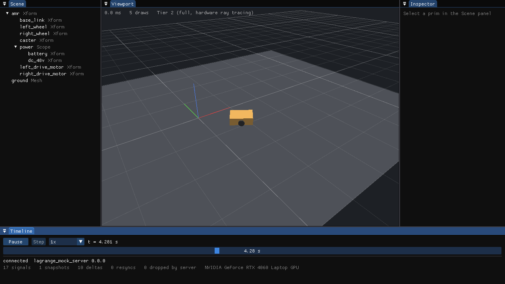

<p align="center">
  
</p>

# Lagrange

Lagrange is an open-source (Apache-2.0) robot simulator for ROS 2 Lyrical Luth on Ubuntu 26.04.
Its aim is multi-physics that can be switched on and off: rigid-body motion, electrical, thermal,
aerodynamics, weather, EMI and sensors are separate domains on a unit-checked signal bus, and any
of them can be disabled or replaced by ideal, constant or replayed data.

**Status: early development.** The current phase is v0.1: a native Vulkan viewer, the viewer
protocol, and a mock/replay server. There is no physics yet: the viewer below is showing a
synthetic recording.

<p align="center">
  
</p>

## Where to read

| Topic | File |
|---|---|
| Vision, scope and release metrics | [docs/plan/00-overview.md](docs/plan/00-overview.md) |
| Roadmap and v0.1/v0.2 issues | [docs/plan/roadmap.md](docs/plan/roadmap.md) |
| Architecture | [docs/design/architecture.md](docs/design/architecture.md) |
| Formats, USD schemas, profiles | [docs/design/formats.md](docs/design/formats.md) |
| Viewer and protocol | [docs/design/viewer.md](docs/design/viewer.md), [docs/design/protocol.md](docs/design/protocol.md) |
| Design proposals | [rfcs/](rfcs/) |
| Decisions and open questions | [docs/plan/open-questions.md](docs/plan/open-questions.md) |

## Build

Requirements: Ubuntu 26.04 with ROS 2 Lyrical installed.

```bash
source /opt/ros/lyrical/setup.bash
mkdir -p ~/lagrange_ws/src && cd ~/lagrange_ws
git clone -b dev https://github.com/Open-Physical-Systems/Lagrange.git src/lagrange

# One dependency (the Python MCAP library) is not packaged for Ubuntu. Register the project's
# extra rosdep keys once, then let rosdep install it with pip.
echo "yaml file://$PWD/src/lagrange/packaging/rosdep/lagrange.yaml" | \
  sudo tee /etc/ros/rosdep/sources.list.d/10-lagrange.list
rosdep update
PIP_BREAK_SYSTEM_PACKAGES=1 PIP_CONSTRAINT=$PWD/src/lagrange/packaging/pip-constraints.txt \
  rosdep install --from-paths src --ignore-src -y

colcon build --cmake-args -DCMAKE_BUILD_TYPE=RelWithDebInfo
colcon test && colcon test-result --verbose
```

If you prefer not to install pip packages into the system Python, create a virtual environment
with `--system-site-packages`, install `mcap` there, and pass
`-DPython3_EXECUTABLE=<venv>/bin/python` to `colcon build`.

Packages so far:

| Package | Directory | Content |
|---|---|---|
| `lagrange_cmake` | `cmake/` | Shared build options |
| `lagrange_core` | `core/` | Simulation time types |
| `lagrange_proto` | `proto/` | Viewer protocol messages, framing, socket transport, shared memory |
| `lagrange_mock_server` | `mock_server/` | Replay server that speaks the protocol from a recording |
| `lagrange_gpu` | `gpu/` | Vulkan device layer, capability tiers, Slang shader build |
| `imgui_vendor` | `vendor/imgui_vendor/` | Dear ImGui (docking branch), pinned upstream release |
| `lagrange_viewer` | `viewer/` | The desktop viewer |

## Run the viewer

Start the mock server with the built-in sample, then the viewer:

```bash
source install/setup.bash
ros2 run lagrange_mock_server lagrange_mock_server --sample &
ros2 run lagrange_viewer lagrange_viewer
```

Both use the same default Unix socket, so no address is needed on one machine. Drag with the
left mouse button to orbit, the right or middle button to pan, and the wheel to zoom. Panels can
be dragged and docked; the layout is saved in `~/.config/lagrange/viewer/layout.ini`.

`--sample` serves a built-in synthetic recording (an AMR on a figure-eight path; computed, not
simulated). `--write-sample file.mcap` writes it to disk and `--recording file.mcap` serves a
file.

Other useful commands:

```bash
ros2 run lagrange_gpu lagrange_gpu_info                      # GPUs and their capability tier
ros2 run lagrange_viewer lagrange_viewer --gpu Intel         # pick a GPU by name or index
ros2 run lagrange_viewer lagrange_viewer --headless --screenshot out.png   # no window
ros2 run lagrange_mock_server lagrange_mock_server --check unix:$XDG_RUNTIME_DIR/lagrange/default.sock
```

## Contributing

Development happens on the `dev` branch; `main` holds releases only. See
[CONTRIBUTING.md](CONTRIBUTING.md).

## License

Apache-2.0. See [LICENSE](LICENSE).

Lagrange is a project of Open Physical Systems.
