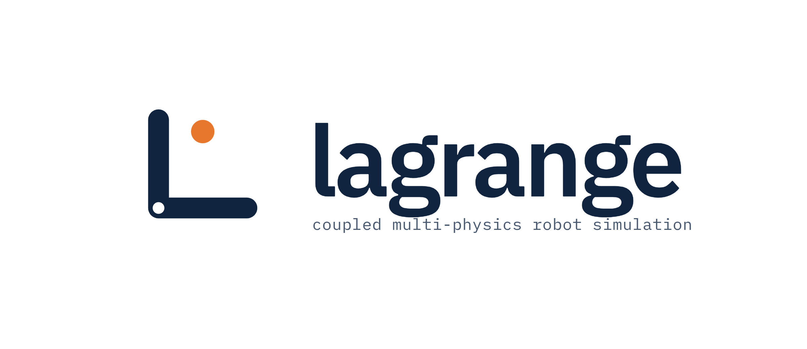
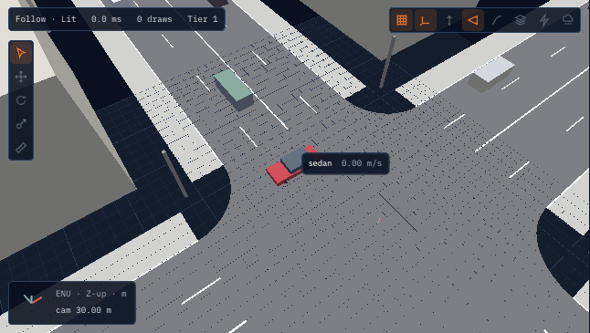
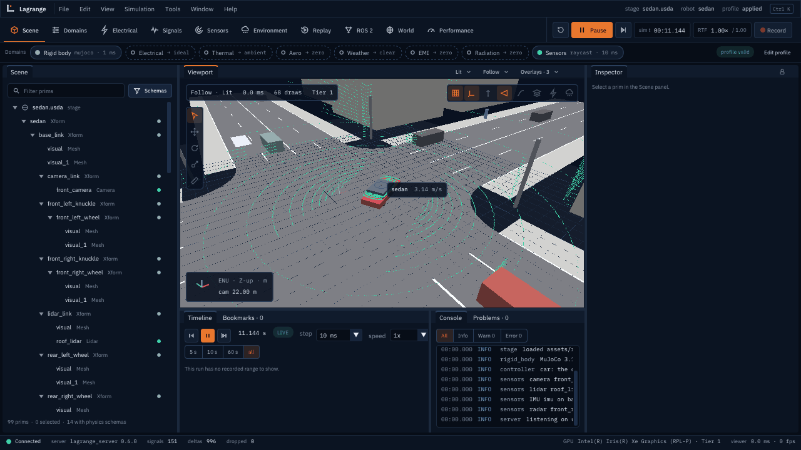
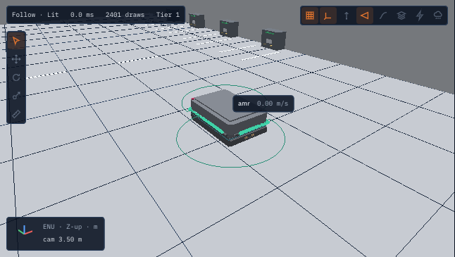
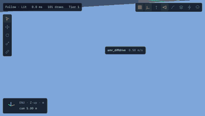
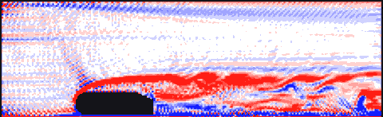
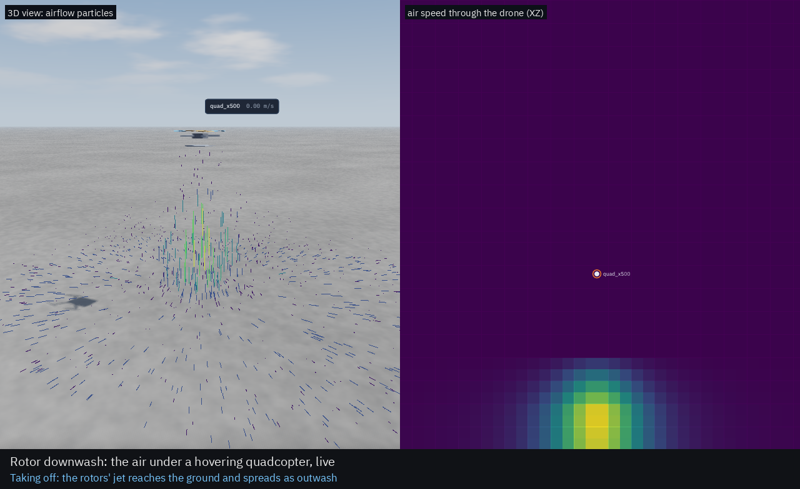
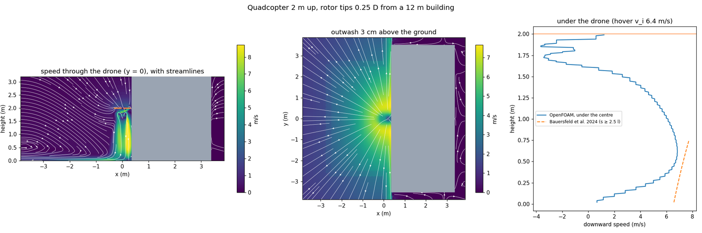
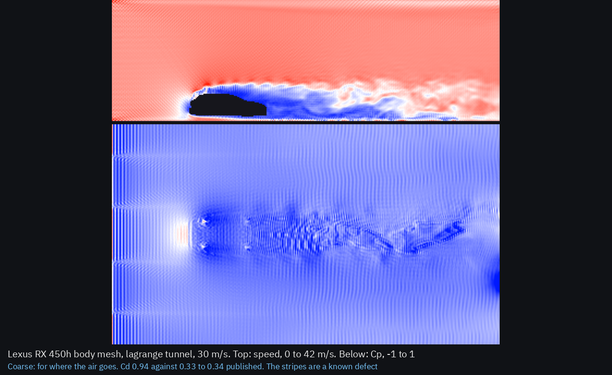

<p align="center">
  
</p>

# Lagrange

Lagrange is an open-source (Apache-2.0) robot simulator for ROS 2 Lyrical Luth on Ubuntu 26.04.
Its aim is multi-physics that can be switched on and off: rigid-body motion, electrical, thermal,
aerodynamics, weather, EMI, comms, vehicle dynamics, traffic and sensors are separate domains on a
unit-checked signal bus, and any of them can be disabled or replaced by ideal, constant or
replayed data. A native Vulkan viewer shows the run; it talks to the simulator only through a
protocol, never by linking it.

**Status: v1.0.0, stable** ([release notes](docs/release/v1.0.0.md)). The USD schemas, the
plugin C ABI, the viewer protocol, profiles and recordings are frozen for 1.x and change only by
addition ([RFC 0007](rfcs/0007-v1-freeze.md)); 1.x is supported on `release/1.x` until ROS 2
Lyrical's end of life in May 2031 ([GOVERNANCE.md](GOVERNANCE.md)). What each model is checked
against: the [validation report](docs/validation/report.md).

<p align="center">
  
  <br><b><a href="https://github.com/Open-Physical-Systems/Lagrange/releases/download/v1.0.0/lagrange-sedan-city.mp4">▶ Watch 20 s of the whole viewer (MP4, 6 MB)</a></b>
  <br><sub>The sample sedan on Magic Formula tyres, among IDM traffic in an OpenDRIVE city block
  (<code>lagrange_server --robot assets/robots/sedan/sedan.usda --world assets/worlds/city_block/city_block.usda</code>).</sub>
</p>

<p align="center">
  
</p>

## Real robots in real places

<table>
  <tr>
    <td align="center" width="50%">
      
      <br><sub><b>Lexus RX 450h on Koen-dori, Nishi-Shinjuku, Tokyo</b>, at 10 m/s along the
      street's OpenStreetMap centreline. Body mesh and dimensions from Autoware's sample vehicle
      (Apache-2.0); buildings and roads © OpenStreetMap contributors (ODbL).</sub>
    </td>
    <td align="center" width="50%">
      
      <br><sub><b>Holybro X500 V2 over Zurich</b>, from PX4's default home, flown by
      <code>/cmd_vel</code>. Frame, motor and propeller meshes, mass and inertia from PX4's model
      (BSD-3-Clause); terrain produced using Copernicus WorldDEM-30 (notice above); buildings and
      roads © OpenStreetMap contributors (ODbL).</sub>
    </td>
  </tr>
</table>

<p align="center">
  
  <br><sub><b>The AMR_FMS swerve AMR</b> in its 60 m × 40 m warehouse: four steered wheels on the
  built-in swerve controller (<code>/cmd_vel</code> with sideways speed).</sub>
</p>

```bash
ros2 run lagrange_assets fetch_assets        # the large meshes: pinned upstream commits, SHA-256 checked
tools/ci/build_sample_world.sh --place tokyo # or zurich: worlds from open data (network)
ros2 run lagrange_server lagrange_server --robot assets/robots/lexus_rx450h/lexus_rx450h.urdf \
    --overlay assets/robots/lexus_rx450h/lexus_rx450h.overlay.yaml \
    --world ~/.cache/lagrange/worlds/tokyo_shinjuku_10km/tokyo_shinjuku_10km.usda \
    --geo-origin 35.689568,139.691717,68.5 --spawn -124.86,294.15,0.3,-1.3746
ros2 run lagrange_server lagrange_server --robot assets/robots/holybro_x500_v2/holybro_x500_v2.urdf \
    --overlay assets/robots/holybro_x500_v2/holybro_x500_v2.overlay.yaml \
    --world ~/.cache/lagrange/worlds/zurich_40km/zurich_40km.usda \
    --geo-origin 47.397742,8.545594,535.82 --air-density 1.225
ros2 run lagrange_server lagrange_server --robot assets/robots/amr_fms/amr_fms.urdf \
    --world assets/worlds/amr_fms_warehouse/warehouse.sdf --spawn 26,8,0,3.1416
```

### People



`lagrange people`, or `--humans N` with any robot and world, or `lagrange spawn
assets/humans/walker.usda`: people with a walk cycle who follow waypoints or wander and steer round
robots, walls and each other. Lidars see their legs scissor. They are moved, not simulated:
contact is one-way and nothing balances ([tutorial](docs/guide/tutorial-humans.md)).

### Wind tunnel



`lagrange tunnel ROBOT` blows air past a robot's collision shapes with a lattice Boltzmann solver,
on the GPU when there is one. It writes forces per link, ParaView and NanoVDB fields, a world of
streamlines to open in the viewer, and, with `--frames`, pictures of the wake moving. `--study`
says whether the grid still changes the answer, and `flow.nvdb` can blow on a robot in a run
([videos](docs/videos/README.md)).

For force numbers use `lagrange foam`, below; use the tunnel to see where the air goes: an Ahmed body reads Cd 1.26 on 8M cells
against a measured 0.29 to 0.30. `lagrange foam ROBOT` puts the same shapes through OpenFOAM, a
separate GPL-3 program that it runs from an install or a container, and reads 0.27 to 0.29 at a 25°
slant, though not yet the measured change of drag with slant
([equations and what was measured](docs/design/domains/cfd.md)). The sample cars collide as one box each.

### Rotor downwash



A drone's rotors push air down; Lagrange computes that air live and lets other robots feel it.
The jet under each multirotor follows measurements under six drones (Bauersfeld et al. 2024),
the outwash along the ground a NASA model rotor (Tanner et al. 2015). A quadcopter flown under
another loses thrust, close to what Kiran et al. (2025) measured, and the outwash lifts dust
that the cameras see. `lagrange quad -- --overlays airflow` shows it as moving particles
([equations and validation](docs/design/domains/rotor_aero.md),
[video](docs/videos/drone_downwash.mp4)). Buildings take part: a wake spreads over a roof and
hugs a wall, and a wall beside a drone sends more air down through its near rotors, so it would
roll towards the wall unless its controller spins them faster (calibrated on OpenFOAM runs that
`lagrange foam-hover` makes)
([beside a building](docs/videos/drone_building.mp4), [low](docs/videos/drone_low_altitude.mp4)).
With `downwash_model: lbm` the air round the drone is computed live instead, in a lattice
Boltzmann box on the GPU that follows it ([live air](docs/videos/drone_live_air.mp4)).

<p align="center">
  
  <br><sub><code>lagrange foam-hover</code>: the sample quadcopter beside a building in OpenFOAM. The wake hugs the wall.</sub>
</p>

<p align="center">
  
  <br><sub>The Lexus RX 450h's body mesh in the tunnel, 30 m/s
  (<a href="docs/videos/wind_tunnel_lexus.mp4">video</a>). Cd 0.94 here and 0.24 in OpenFOAM, against 0.33 to 0.34 published.</sub>
</p>

## What it simulates

| Robot class | Since | Sample | Highlights |
|---|---|---|---|
| Mobile robots (AMR) | v0.2 | `amr_diffdrive` in the small warehouse | MuJoCo or Jolt physics, IMU, 2D/3D lidar on CPU or GPU, Nav2, ros2_control |
| Robot arms | v0.3 | `arm6` work cell | MoveIt 2, motor drives, battery and bus at 100 µs, motor heating and derating |
| Drones | v0.4 | `quad_x500` on the open field | Rotor aerodynamics (coefficients or blade element), wind, PX4 and ArduPilot SITL in lockstep |
| Any robot outdoors | v0.5 | `amr_fog.yaml`, the power line | Weather (fog, rain, dust, NanoVDB fields), EMI from power lines and drives, Wi-Fi and CAN links |
| Cars, autonomous cars | v0.6 | `sedan` in the city block | Tyres, suspension, powertrain, OpenDRIVE roads, traffic and pedestrians, OpenSCENARIO, radar, camera sensor model, Autoware interface |
| Any robot, anywhere | v0.7 | the tiled town, the 40 km Zurich world | Worlds streamed in tiles, a floating origin that follows the robot, robots far apart in regions of their own, worlds built from elevation models and OpenStreetMap, terrain as height fields |

<p align="center">
  
  <br><sub>The 40 km Zurich world, built by <code>tools/ci/build_sample_world.sh</code>. Terrain produced using
  Copernicus WorldDEM-30 © DLR e.V. 2010-2014 and © Airbus Defence and Space GmbH 2014-2018
  provided under COPERNICUS by the European Union and ESA; all rights reserved. Buildings and
  roads © OpenStreetMap contributors (ODbL).</sub>
</p>

Everything runs headless too: from Python (`import lagrange`), from the `lagrange` command, or
recorded to MCAP and replayed.

## Where to read

| Topic | File |
|---|---|
| **User guide: tutorial, concepts, profiles, writing a module, CLI** | [docs/guide/](docs/guide/README.md) |
| Vision, scope and release metrics | [docs/plan/00-overview.md](docs/plan/00-overview.md) |
| Roadmap and progress | [docs/plan/roadmap.md](docs/plan/roadmap.md), [docs/plan/progress.md](docs/plan/progress.md) |
| Release notes | [docs/release/](docs/release/) |
| Architecture | [docs/design/architecture.md](docs/design/architecture.md) |
| Formats, USD schemas, profiles | [docs/design/formats.md](docs/design/formats.md) |
| Viewer and protocol | [docs/design/viewer.md](docs/design/viewer.md), [docs/design/protocol.md](docs/design/protocol.md) |
| CFD: methods, equations, OpenFOAM and what was measured | [docs/design/domains/cfd.md](docs/design/domains/cfd.md) |
| Design proposals | [rfcs/](rfcs/) |
| Decisions and open questions | [docs/plan/open-questions.md](docs/plan/open-questions.md) |

### Every document

<!-- docs-index begin: written by tools/ci/docs_index.py -->

<details><summary>User guide (18)</summary>

- [User guide](docs/guide/README.md)
- [Autoware with a simulated car](docs/guide/autoware.md)
- [The `lagrange` command](docs/guide/cli.md)
- [Concepts](docs/guide/concepts.md)
- [Installing Lagrange](docs/guide/install.md)
- [Profiles](docs/guide/profiles.md)
- [The run file](docs/guide/run-file.md)
- [Tutorial: an AMR in a warehouse](docs/guide/tutorial-amr.md)
- [Tutorial: the sample arm with MoveIt 2](docs/guide/tutorial-arm.md)
- [Tutorial: a car in a city block](docs/guide/tutorial-cars.md)
- [Tutorial: test your own drone, step by step](docs/guide/tutorial-custom-drone.md)
- [Tutorial: a quadcopter, from hover to a PX4 mission](docs/guide/tutorial-drone.md)
- [Tutorial: weather, interference and radio links](docs/guide/tutorial-environment.md)
- [Tutorial: huge worlds](docs/guide/tutorial-huge-worlds.md)
- [Tutorial: people around your robot](docs/guide/tutorial-humans.md)
- [Tutorial: a robot's power system from a schematic](docs/guide/tutorial-power.md)
- [Writing a module](docs/guide/writing-a-module.md)
- [Writing a plugin](docs/guide/writing-a-plugin.md)

</details>

<details><summary>Physics reference (5)</summary>

- [Battery](docs/physics/battery.md)
- [Downwash](docs/physics/downwash.md)
- [Physics reference](docs/physics/index.md)
- [Motors](docs/physics/motors.md)
- [Rotors](docs/physics/rotors.md)

</details>

<details><summary>Domains and physics (15)</summary>

- [Domain design documents](docs/design/domains/README.md)
- [Domain: aerodynamics, wind and rotor aero](docs/design/domains/aerodynamics.md)
- [CFD: methods, equations and what was measured](docs/design/domains/cfd.md)
- [Domain: comms](docs/design/domains/comms.md)
- [Domain: electrical](docs/design/domains/electrical.md)
- [Domain: electromagnetic interference (EMI)](docs/design/domains/emi.md)
- [Domain: hydrodynamics (marine)](docs/design/domains/hydrodynamics.md)
- [Domain: radiation](docs/design/domains/radiation.md)
- [Domain: rigid body and articulations](docs/design/domains/rigid_body.md)
- [Domain: rotor downwash and outwash](docs/design/domains/rotor_aero.md)
- [Domain: sensors](docs/design/domains/sensors.md)
- [Domain: thermal](docs/design/domains/thermal.md)
- [Domain: traffic](docs/design/domains/traffic.md)
- [Domain: vehicle dynamics](docs/design/domains/vehicle_dynamics.md)
- [Domain: weather](docs/design/domains/weather.md)

</details>

<details><summary>Viewer UI design (26)</summary>

- [Lagrange UI · 00 · Design system](docs/design/ui/00-design-system/README.md)
- [00 · Design system: SPEC](docs/design/ui/00-design-system/SPEC.md)
- [Lagrange UI · 01 · Launcher](docs/design/ui/01-launcher/README.md)
- [01 · Launcher: SPEC](docs/design/ui/01-launcher/SPEC.md)
- [Lagrange UI · 02 · Scene workspace](docs/design/ui/02-scene/README.md)
- [02 · Scene workspace: SPEC (default workspace)](docs/design/ui/02-scene/SPEC.md)
- [Lagrange UI · 03 · Domains & profile](docs/design/ui/03-domains/README.md)
- [03 · Domains & profile: SPEC](docs/design/ui/03-domains/SPEC.md)
- [Lagrange UI · 04 · Electrical workspace](docs/design/ui/04-electrical/README.md)
- [04 · Electrical workspace: SPEC](docs/design/ui/04-electrical/SPEC.md)
- [Lagrange UI · 05 · Signals & scopes](docs/design/ui/05-signals/README.md)
- [05 · Signals & scopes: SPEC](docs/design/ui/05-signals/SPEC.md)
- [Lagrange UI · 06 · Sensors workspace](docs/design/ui/06-sensors/README.md)
- [06 · Sensors workspace: SPEC](docs/design/ui/06-sensors/SPEC.md)
- [Lagrange UI · 07 · Environment & fields](docs/design/ui/07-environment/README.md)
- [07 · Environment & fields: SPEC](docs/design/ui/07-environment/SPEC.md)
- [Lagrange UI · 08 · Replay & validation](docs/design/ui/08-replay/README.md)
- [08 · Replay & validation: SPEC](docs/design/ui/08-replay/SPEC.md)
- [Lagrange UI · 09 · ROS 2 workspace](docs/design/ui/09-ros2/README.md)
- [09 · ROS 2 workspace: SPEC](docs/design/ui/09-ros2/SPEC.md)
- [Lagrange UI · 10 · World (huge worlds)](docs/design/ui/10-world/README.md)
- [10 · World (huge worlds): SPEC](docs/design/ui/10-world/SPEC.md)
- [Lagrange UI · 11 · Performance](docs/design/ui/11-performance/README.md)
- [11 · Performance: SPEC](docs/design/ui/11-performance/SPEC.md)
- [Lagrange viewer UI design](docs/design/ui/README.md)
- [Lagrange viewer: shared UI conventions](docs/design/ui/shared/ui-conventions.md)

</details>

<details><summary>Design (9)</summary>

- [Architecture](docs/design/architecture.md)
- [Performance benchmarks](docs/design/benchmarks.md)
- [Dependencies](docs/design/dependencies.md)
- [Formats](docs/design/formats.md)
- [Huge worlds](docs/design/huge-worlds.md)
- [UI↔server protocol](docs/design/protocol.md)
- [Robot classes](docs/design/robot-classes.md)
- [Security review (v1.0)](docs/design/security.md)
- [Viewer](docs/design/viewer.md)

</details>

<details><summary>Plan and evaluation (16)</summary>

- [Project overview](docs/plan/00-overview.md)
- [Rotor downwash and live airflow: progress](docs/plan/downwash-progress.md)
- [What to develop next: an evaluation, 2026-11-01](docs/plan/evaluation-2026-11.md)
- [Open questions and challenges to the plan](docs/plan/open-questions.md)
- [Overnight work, 2026-11-03 (until 07:00 JST)](docs/plan/overnight-2026-11-03.md)
- [Progress](docs/plan/progress.md)
- [Repository, CI, release and security plan](docs/plan/repo-tooling.md)
- [Risk register](docs/plan/risks.md)
- [Roadmap](docs/plan/roadmap.md)
- [Spike 0.2-B1: OpenUSD v26.08 on Ubuntu 26.04](docs/plan/spikes/0.2-B1-openusd.md)
- [Spike 0.2-C1: MuJoCo source and validation](docs/plan/spikes/0.2-C1-mujoco.md)
- [Spike 0.2-C6: a second rigid-body backend on Jolt Physics](docs/plan/spikes/0.2-C6-jolt.md)
- [Spike 0.2-F7: `rosidl::Buffer` (desk study)](docs/plan/spikes/0.2-F7-rosidl-buffer.md)
- [Spike 0.2-H8: packaging trial](docs/plan/spikes/0.2-H8-packaging.md)
- [Usability and sensor physics queue](docs/plan/usability-physics-queue.md)
- [Verification record](docs/plan/verification.md)

</details>

<details><summary>Release notes (8)</summary>

- [v0.2.0 compared with Gazebo Jetty: the sample AMR](docs/release/v0.2.0-comparison.md)
- [Lagrange v0.2.0: simulation core and AMR (release notes, draft)](docs/release/v0.2.0.md)
- [Lagrange v0.3.0: arms, electrical and thermal (release notes)](docs/release/v0.3.0.md)
- [Lagrange v0.4.0: drones (release notes)](docs/release/v0.4.0.md)
- [Lagrange v0.5.0: weather, interference and radio links (release notes)](docs/release/v0.5.0.md)
- [Lagrange v0.6.0: cars and autonomous cars (release notes)](docs/release/v0.6.0.md)
- [Lagrange v0.7.0: huge worlds (release notes)](docs/release/v0.7.0.md)
- [Lagrange v1.0.0: stable (release notes)](docs/release/v1.0.0.md)

</details>

<details><summary>Validation (1)</summary>

- [Validation report (v1.0, brought up to date 2026-11-03)](docs/validation/report.md)

</details>

<details><summary>Videos (1)</summary>

- [Feature videos](docs/videos/README.md)

</details>

<details><summary>Design proposals (RFCs) (10)</summary>

- [RFC 0001: Module interface, signals and scheduling contract](rfcs/0001-module-interface.md)
- [RFC 0002: USD custom schemas](rfcs/0002-usd-schemas.md)
- [RFC 0003: UI↔server protocol](rfcs/0003-ui-server-protocol.md)
- [RFC 0004: Capability tiers](rfcs/0004-capability-tiers.md)
- [RFC 0005: Simulation profile format](rfcs/0005-sim-profile-format.md)
- [RFC 0006: Native viewer stack](rfcs/0006-native-viewer-stack.md)
- [RFC 0007: The v1.0 freeze](rfcs/0007-v1-freeze.md)
- [RFC 0008: Plugins in the server: loading, scene access, custom sensors and physics backends](rfcs/0008-plugins-in-the-server.md)
- [RFC 0009: Walking humans](rfcs/0009-walking-humans.md)
- [RFC 0010: Components between buses, and a schematic's parts](rfcs/0010-electrical-nodes.md)

</details>

<!-- docs-index end -->

## Install

Step by step, with ROS 2 Lyrical itself, checks and fixes: [Installing Lagrange](docs/guide/install.md).

The packages are built as `ros-lyrical-*` debs; until they are published on the ROS buildfarm,
build them yourself from a clone of this repository and install them on any Ubuntu 26.04 machine
with ROS 2 Lyrical (about an hour, with podman; `packaging/README.md`):

```bash
packaging/debs/build_debs.sh ~/lagrange_debs          # every package, in a clean container
sudo apt install ~/lagrange_debs/*.deb
PIP_BREAK_SYSTEM_PACKAGES=1 pip3 install -c packaging/pip-constraints.txt mcap coacd
packaging/test_install.sh ~/lagrange_debs              # optional: the clean-machine test
```

Or build from source:

## Build

Requirements: Ubuntu 26.04 with ROS 2 Lyrical installed.

```bash
source /opt/ros/lyrical/setup.bash
mkdir -p ~/lagrange_ws/src && cd ~/lagrange_ws
git clone -b dev https://github.com/Open-Physical-Systems/Lagrange.git src/lagrange

# One dependency (the Python MCAP library) is not packaged for Ubuntu. Register the project's
# extra rosdep keys once, then let rosdep install it with pip.
echo "yaml file://$PWD/src/lagrange/packaging/rosdep/lagrange.yaml" | \
  sudo tee /etc/ros/rosdep/sources.list.d/10-lagrange.list
rosdep update
PIP_BREAK_SYSTEM_PACKAGES=1 PIP_CONSTRAINT=$PWD/src/lagrange/packaging/pip-constraints.txt \
  rosdep install --from-paths src --ignore-src -y

colcon build --cmake-args -DCMAKE_BUILD_TYPE=RelWithDebInfo
colcon test && colcon test-result --verbose
```

If you prefer not to install pip packages into the system Python, create a virtual environment
with `--system-site-packages`, install `mcap` there, and pass
`-DPython3_EXECUTABLE=<venv>/bin/python` to `colcon build`.

Optional: `lagrange_autoware` builds only with the Autoware messages
([docs/guide/autoware.md](docs/guide/autoware.md)); the PX4 and ArduPilot missions need their
SITL builds ([drone tutorial](docs/guide/tutorial-drone.md)).

Packages:

| Package | Directory | Content |
|---|---|---|
| `lagrange_cmake` | `cmake/` | Shared build options |
| `lagrange_core` | `core/` | Units, signal bus, multirate scheduler, time, random numbers, world state, coordinates, plugin C ABI |
| `lagrange_schemas` | `schemas/` | The OpenUSD applied schemas (electrical, thermal, aero, weather, EMI, comms, sensors, vehicle, road, world) |
| `lagrange_profiles` | `profiles/` | Profile schema and examples |
| `lagrange_proto` | `proto/` | Viewer protocol messages, framing, socket transport, shared memory |
| `lagrange_gpu` | `gpu/` | Vulkan device layer, capability tiers, Slang kernels, the GPU ray caster |
| `lagrange_stage` | `io/stage/` | USD stage → world tables and scene, and back |
| `lagrange_importers` | `io/importers/` | SDFormat and MJCF readers (URDF in `lagrange_stage`) |
| `lagrange_meshes` | `io/meshes/` | glTF, OBJ, STL and Collada import |
| `lagrange_recording` | `io/recording/` | MCAP reading and the replay substitute |
| `lagrange_fields` | `io/fields/` | NanoVDB fields, OpenFOAM wind import |
| `lagrange_opendrive` | `io/opendrive/` | OpenDRIVE reader and road import to USD |
| `lagrange_geospatial` | `io/geospatial/` | Worlds from elevation models, OpenStreetMap and 3D Tiles (`lagrange_build_world`) |
| `lagrange_openscenario` | `io/openscenario/` | OpenSCENARIO 1.x subset runner |
| `lagrange_rigid_body_mujoco`, `_jolt`, `_substitutes` | `modules/rigid_body/` | The rigid-body domain on MuJoCo or Jolt, and its substitutes |
| `lagrange_electrical` | `modules/electrical/` | Batteries, buses, motor drives, FMU host |
| `lagrange_thermal` | `modules/thermal/` | Lumped thermal networks |
| `lagrange_aerodynamics`, `lagrange_rotor_aero` | `modules/` | Link drag, wind and turbulence; rotors |
| `lagrange_weather`, `lagrange_emi`, `lagrange_comms` | `modules/` | Weather, EMI fields, radio and CAN links |
| `lagrange_vehicle_dynamics`, `lagrange_traffic` | `modules/` | Road vehicles; traffic agents and pedestrians |
| `lagrange_sensors` | `modules/sensors/` | IMU, lidar, camera, radar, GNSS, magnetometer, barometer |
| `lagrange_models` | `models/` | Component FMUs |
| `lagrange_ros2`, `lagrange_ros2_control` | `bridges/` | The ROS 2 bridge; the ros2_control hardware plugin |
| `lagrange_mavlink`, `lagrange_autoware` | `bridges/` | PX4 and ArduPilot SITL; the Autoware vehicle interface |
| `lagrange_server` | `server/` | The simulator (`lagrange_server`) and the `lagrange` command |
| `lagrange_viewer` | `viewer/` | The desktop viewer |
| `lagrange_mock_server` | `mock_server/` | Replay server for recordings; a test tool |
| `lagrange_python` | `python/` | Python bindings: run a simulation headless, step it, read signals |
| `lagrange_assets`, `lagrange_demos` | `assets/`, `demos/` | Sample robots and worlds; the Nav2 and MoveIt demos |
| `lagrange_collision_bake`, `lagrange_migrate` | `tools/` | Convex decomposition; schema and profile migrations |
| `lagrange_tutorial`, `lagrange_benchmarks` | `tests/` | The user guide's code; performance benchmarks |
| `*_vendor` | `vendor/` | Pinned OpenUSD, Jolt, FMI Library, Dear ImGui and ImPlot |

## Examples

The tutorials are in [`docs/guide/`](docs/guide), among them [a power system from a schematic](docs/guide/tutorial-power.md).

[`examples/`](examples) has one ROS 2 package per use: your own robot, an arm, a power system from a schematic, a lidar, fog, a quadcopter, a car in the town, spawning robots, ros2_control, a C plugin, learning, a trotting quadruped, a camera and a wind tunnel. Each runs Lagrange through a launch file:

```bash
ros2 launch lagrange_example_diff_drive drive.launch.py
```

## Run the simulator

```bash
source install/setup.bash          # or /opt/ros/lyrical/setup.bash with the debs installed
lagrange                           # the server and the viewer: the sample AMR in the warehouse
lagrange sedan                     # a sample by name: amr, sedan, quad, lexus, x500, swerve, people
lagrange robot.urdf                # your own robot on an empty ground, still until you command it
lagrange robot.usda world.sdf      # and a world (URDF, SDFormat, MJCF or USD)
lagrange run.yaml                  # or say it all in one file: docs/guide/run-file.md
lagrange --server-only sedan       # headless, like gzserver; `lagrange viewer` is the viewer alone
lagrange empty                     # no robot: the ground only, then from another terminal
lagrange spawn robot.urdf --at 2,0 #   add robots while it runs (lagrange delete /robot)
```

Closing the viewer stops the server. Options before `--` go to the server (`--spawn`,
`--physics jolt`, `--no-ros`, ...; `lagrange_server --help`), after it to the viewer
(`lagrange sedan -- --follow 20`). The robot drives a figure-eight until it gets `/cmd_vel`.
Robots can be spawned into a running simulation, as in Gazebo: with `lagrange spawn`, the
viewer's File → Add robot (Ctrl+O), or the standard ROS 2 `/spawn_entity` and `/delete_entity`
services ([docs/guide/cli.md](docs/guide/cli.md#spawning-robots)).
The same samples with the server alone:

```bash
# the sedan in the city block, with traffic (drive it with /ackermann_cmd or /cmd_vel)
ros2 run lagrange_server lagrange_server --robot assets/robots/sedan/sedan.usda \
    --world assets/worlds/city_block/city_block.usda
# the quadcopter, hovering 2 m up (fly it with /cmd_vel)
ros2 run lagrange_server lagrange_server --robot assets/robots/quad_x500/quad_x500.usda \
    --world assets/worlds/open_field/open_field.usda --air-density 1.225 \
    --geo-origin 47.397742,8.545594,488
# the arm work cell with MoveIt 2
ros2 launch lagrange_demos arm6_workcell.launch.py viewer:=true
```

One tutorial per robot class walks through everything (ROS 2, profiles, recording, substitutes,
the stacks that drive it):
[AMR and Nav2](docs/guide/tutorial-amr.md) ·
[arm and MoveIt 2](docs/guide/tutorial-arm.md) ·
[drone and PX4/ArduPilot](docs/guide/tutorial-drone.md) ·
[weather, EMI and comms](docs/guide/tutorial-environment.md) ·
[cars, scenarios and Autoware](docs/guide/tutorial-cars.md) ·
[huge worlds](docs/guide/tutorial-huge-worlds.md) ·
[people around your robot](docs/guide/tutorial-humans.md).
The scripts in `tools/ci/` (`tutorial_amr.sh`, `tutorial_drone.sh`, `tutorial_environment.sh`,
`tutorial_cars.sh`, `tutorial_huge_worlds.sh`, and `arm_scenario.sh` for the arm) run them headless and check every step.

To record a clip like the one above: `lagrange_viewer --headless --follow 30,55
--record-frames DIR --record-fps 10 --frames 100` writes PNG frames of a running simulation;
the video is 500 frames at 25 fps, `ffmpeg -framerate 25 -i DIR/frame_%05d.png -c:v libx264
-pix_fmt yuv420p -crf 23 clip.mp4`.

## Extend it with plugins

Sensors, domains and physics engines can be added without changing Lagrange: a plugin is a
shared library against one C header (`lagrange_plugin.h`, stable for 1.x), loaded with
`lagrange --plugin NAME`. It sees the world and casts rays at the scene, implements custom
sensors declared in URDF, SDFormat or USD, and reaches ROS 2 through `--ros-topics`; a physics
engine plugin is checked by a conformance suite. Start from `tools/templates/lagrange_plugin_template`
and [Writing a plugin](docs/guide/writing-a-plugin.md); `lagrange_tof` (a time-of-flight
sensor) and `lagrange_jolt` (the Jolt engine) are the worked examples.

## The viewer and the mock server

The viewer also works without the simulator: the mock server replays recordings and a built-in
synthetic sample. Start the mock server with the sample, then the viewer:

```bash
source install/setup.bash
ros2 run lagrange_mock_server lagrange_mock_server --sample &
ros2 run lagrange_viewer lagrange_viewer
```

Both use the same default Unix socket, so no address is needed on one machine. Drag with the
left mouse button to orbit, the right or middle button to pan, and the wheel to zoom. Panels can
be dragged and docked; the layout is saved in `~/.config/lagrange/viewer/layout.ini`.

The Scope panel plots signals at their full rate (the sample has four at 10 kHz). Use
**+ Signal** to add one; signals with the same unit share a plot. **Freeze** stops the plot
from following time so that you can pan and zoom it. To open signals from the command line:

```bash
ros2 run lagrange_viewer lagrange_viewer \
  --scope motor/left_drive_motor/current_q,bus/dc_48v/voltage,joint/left_wheel_joint/velocity
```

`--sample` serves a built-in synthetic recording (an AMR on a figure-eight path; computed, not
simulated). `--write-sample file.mcap` writes it to disk and `--recording file.mcap` serves a
file.

### Open your own robot

With the viewer and a server running, open a URDF or xacro file in any of these ways:
drag the file onto the window, use **File > Open robot or recording...** (Ctrl+O), or start
the viewer with `--open`:

```bash
ros2 run lagrange_viewer lagrange_viewer --open ~/my_robot/urdf/my_robot.urdf
```

The robot is shown with every joint at zero. Meshes in STL, OBJ and DAE are read, and
`package://` paths are looked up in installed ROS packages and in the folders above the file.
Anything the importer could not use (textures, a mesh it could not find) is listed in the
Timeline panel; a missing mesh is drawn as a magenta box. A `.mcap` recording opens the same
way. To serve a robot directly: `lagrange_mock_server --urdf robot.urdf`.

Other useful commands:

```bash
ros2 run lagrange_server lagrange info                        # version, paths, GPUs and tiers
ros2 run lagrange_gpu lagrange_gpu_info                      # GPUs and their capability tier
ros2 run lagrange_viewer lagrange_viewer --gpu Intel         # pick a GPU by name or index
ros2 run lagrange_viewer lagrange_viewer --headless --screenshot out.png   # no window
ros2 run lagrange_mock_server lagrange_mock_server --check unix:$XDG_RUNTIME_DIR/lagrange/default.sock
```

## Contributing

Development happens on the `dev` branch; `main` holds releases only. See
[CONTRIBUTING.md](CONTRIBUTING.md).

## License

Apache-2.0. See [LICENSE](LICENSE).

Lagrange is a project of Open Physical Systems.
