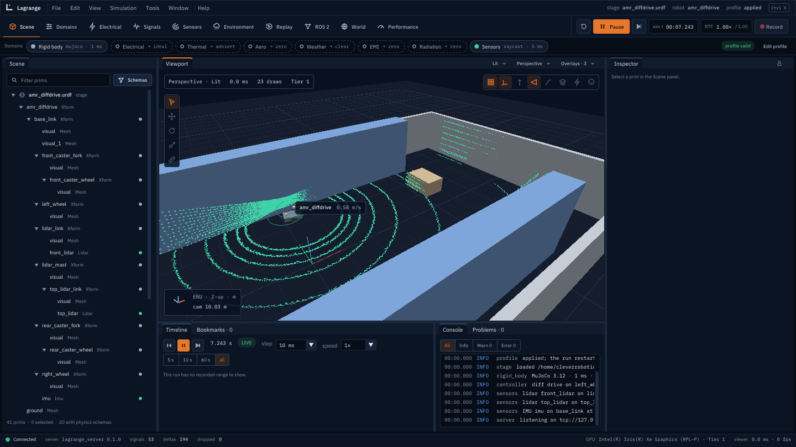

<p align="center">
  
</p>

# Lagrange

Lagrange is an open-source (Apache-2.0) robot simulator for ROS 2 Lyrical Luth on Ubuntu 26.04.
Its aim is multi-physics that can be switched on and off: rigid-body motion, electrical, thermal,
aerodynamics, weather, EMI and sensors are separate domains on a unit-checked signal bus, and any
of them can be disabled or replaced by ideal, constant or replayed data.

**Status: early development (v0.2 in progress).** The simulator runs a differential-drive AMR
with MuJoCo physics, an IMU and 2D/3D lidars (on the CPU, or on the GPU with a compute kernel),
switchable domains with substitutes, profiles, MCAP recording and a ROS 2 bridge that Nav2
drives. Electrical, thermal and the other domains have their formats and substitutes, but no
models yet.

<p align="center">
  
</p>

## Where to read

| Topic | File |
|---|---|
| **User guide: tutorial, concepts, profiles, writing a module, CLI** | [docs/guide/](docs/guide/README.md) |
| Vision, scope and release metrics | [docs/plan/00-overview.md](docs/plan/00-overview.md) |
| Roadmap and v0.1/v0.2 issues | [docs/plan/roadmap.md](docs/plan/roadmap.md) |
| Architecture | [docs/design/architecture.md](docs/design/architecture.md) |
| Formats, USD schemas, profiles | [docs/design/formats.md](docs/design/formats.md) |
| Viewer and protocol | [docs/design/viewer.md](docs/design/viewer.md), [docs/design/protocol.md](docs/design/protocol.md) |
| Design proposals | [rfcs/](rfcs/) |
| Decisions and open questions | [docs/plan/open-questions.md](docs/plan/open-questions.md) |

## Build

Requirements: Ubuntu 26.04 with ROS 2 Lyrical installed.

```bash
source /opt/ros/lyrical/setup.bash
mkdir -p ~/lagrange_ws/src && cd ~/lagrange_ws
git clone -b dev https://github.com/Open-Physical-Systems/Lagrange.git src/lagrange

# One dependency (the Python MCAP library) is not packaged for Ubuntu. Register the project's
# extra rosdep keys once, then let rosdep install it with pip.
echo "yaml file://$PWD/src/lagrange/packaging/rosdep/lagrange.yaml" | \
  sudo tee /etc/ros/rosdep/sources.list.d/10-lagrange.list
rosdep update
PIP_BREAK_SYSTEM_PACKAGES=1 PIP_CONSTRAINT=$PWD/src/lagrange/packaging/pip-constraints.txt \
  rosdep install --from-paths src --ignore-src -y

colcon build --cmake-args -DCMAKE_BUILD_TYPE=RelWithDebInfo
colcon test && colcon test-result --verbose
```

If you prefer not to install pip packages into the system Python, create a virtual environment
with `--system-site-packages`, install `mcap` there, and pass
`-DPython3_EXECUTABLE=<venv>/bin/python` to `colcon build`.

Packages:

| Package | Directory | Content |
|---|---|---|
| `lagrange_cmake` | `cmake/` | Shared build options |
| `lagrange_core` | `core/` | Units, signal bus, multirate scheduler, time, random numbers, world state, coordinates |
| `lagrange_gpu` | `gpu/` | Vulkan device layer, capability tiers, Slang kernels, the GPU ray caster |
| `lagrange_rigid_body_mujoco` | `modules/rigid_body/mujoco_backend/` | The rigid-body domain on MuJoCo |
| `lagrange_rigid_body_substitutes` | `modules/rigid_body/substitutes/` | Fixed robot and other rigid-body substitutes |
| `lagrange_sensors` | `modules/sensors/` | IMU and lidar, their noise models and ground-truth substitutes |
| `lagrange_meshes` | `io/meshes/` | glTF, OBJ, STL and Collada import |
| `lagrange_ros2` | `bridges/ros2/` | The ROS 2 bridge: topics, `/clock`, `simulation_interfaces` services |
| `lagrange_server` | `server/` | The simulator (`lagrange_server`) and the `lagrange` command |
| `lagrange_profiles` | `profiles/` | Profile schema and examples |
| `lagrange_proto` | `proto/` | Viewer protocol messages, framing, socket transport, shared memory |
| `lagrange_viewer` | `viewer/` | The desktop viewer |
| `imgui_vendor` | `vendor/imgui_vendor/` | Dear ImGui (docking branch), pinned upstream release |
| `lagrange_mock_server` | `mock_server/` | Replay server for recordings; a test tool |
| `lagrange_assets` | `assets/` | The sample robots and worlds |
| `lagrange_demos` | `demos/` | The Nav2 warehouse demo |
| `lagrange_python` | `python/` | Python bindings: run a simulation headless, step it, read signals |
| `lagrange_tutorial` | `tests/tutorial/` | The user guide's code and its tests |
| `lagrange_benchmarks` | `tests/benchmarks/` | Performance benchmarks |

## Run the simulator

```bash
source install/setup.bash
ros2 run lagrange_server lagrange_server &      # the sample AMR in the sample warehouse
ros2 run lagrange_viewer lagrange_viewer --connect unix:$XDG_RUNTIME_DIR/lagrange/default.sock
```

The robot drives a figure-eight until it gets `/cmd_vel`. For a walk through everything (ROS 2,
profiles, recording, substitutes, your own module, Nav2), follow the
[tutorial](docs/guide/tutorial-amr.md).

## The viewer and the mock server

The viewer also works without the simulator: the mock server replays recordings and a built-in
synthetic sample. Start the mock server with the sample, then the viewer:

```bash
source install/setup.bash
ros2 run lagrange_mock_server lagrange_mock_server --sample &
ros2 run lagrange_viewer lagrange_viewer
```

Both use the same default Unix socket, so no address is needed on one machine. Drag with the
left mouse button to orbit, the right or middle button to pan, and the wheel to zoom. Panels can
be dragged and docked; the layout is saved in `~/.config/lagrange/viewer/layout.ini`.

The Scope panel plots signals at their full rate (the sample has four at 10 kHz). Use
**+ Signal** to add one; signals with the same unit share a plot. **Freeze** stops the plot
from following time so that you can pan and zoom it. To open signals from the command line:

```bash
ros2 run lagrange_viewer lagrange_viewer \
  --scope motor/left_drive_motor/current_q,bus/dc_48v/voltage,joint/left_wheel_joint/velocity
```

`--sample` serves a built-in synthetic recording (an AMR on a figure-eight path; computed, not
simulated). `--write-sample file.mcap` writes it to disk and `--recording file.mcap` serves a
file.

### Open your own robot

With the viewer and a server running, open a URDF or xacro file in any of these ways:
drag the file onto the window, use **File > Open robot or recording...** (Ctrl+O), or start
the viewer with `--open`:

```bash
ros2 run lagrange_viewer lagrange_viewer --open ~/my_robot/urdf/my_robot.urdf
```

The robot is shown with every joint at zero. Meshes in STL, OBJ and DAE are read, and
`package://` paths are looked up in installed ROS packages and in the folders above the file.
Anything the importer could not use (textures, a mesh it could not find) is listed in the
Timeline panel; a missing mesh is drawn as a magenta box. A `.mcap` recording opens the same
way. To serve a robot directly: `lagrange_mock_server --urdf robot.urdf`.

Other useful commands:

```bash
ros2 run lagrange_server lagrange info                        # version, paths, GPUs and tiers
ros2 run lagrange_gpu lagrange_gpu_info                      # GPUs and their capability tier
ros2 run lagrange_viewer lagrange_viewer --gpu Intel         # pick a GPU by name or index
ros2 run lagrange_viewer lagrange_viewer --headless --screenshot out.png   # no window
ros2 run lagrange_mock_server lagrange_mock_server --check unix:$XDG_RUNTIME_DIR/lagrange/default.sock
```

## Contributing

Development happens on the `dev` branch; `main` holds releases only. See
[CONTRIBUTING.md](CONTRIBUTING.md).

## License

Apache-2.0. See [LICENSE](LICENSE).

Lagrange is a project of Open Physical Systems.
