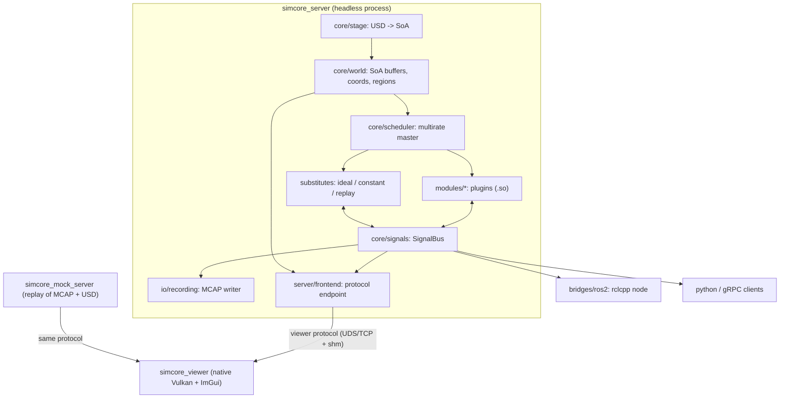
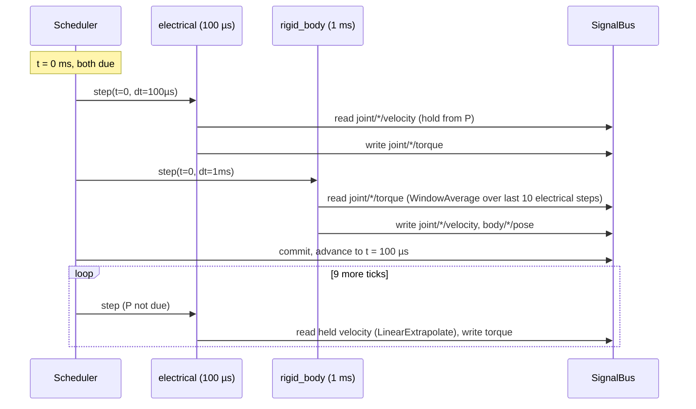
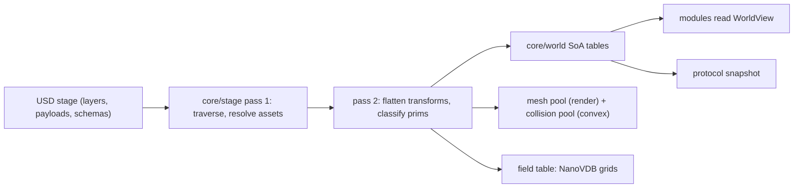
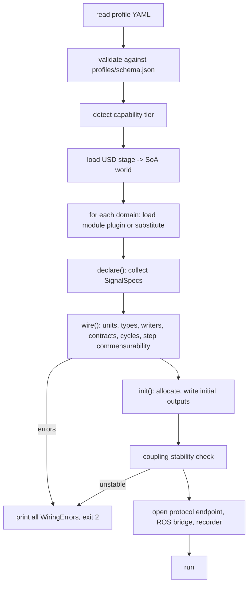

# Architecture

Status: draft for review. Normative details are decided through `rfcs/0001` (module interface),
`rfcs/0003` (protocol), `rfcs/0004` (tiers) and `rfcs/0005` (profiles). This document expands the
reference examples in CLAUDE.md §11.4–§11.7; where it changes one, the change is listed in
`docs/plan/open-questions.md` under "Flaws found in the reference examples".

Confidence marks: [High], [Medium], [Low] with the basis in brackets.

## 1. Process and package view



Colcon packages (each top-level directory is one or more `ament_cmake` packages):

| Package | Directory | Depends on (project-internal) | First release |
|---|---|---|---|
| `simcore_proto` | `proto/` | — | v0.1 |
| `simcore_core` | `core/` | — | v0.1 (units, signals, time only), v0.2 (all) |
| `simcore_gpu_hal` | `gpu/hal/`, `gpu/capability/` | `simcore_core` | v0.1 |
| `simcore_gpu_kernels` | `gpu/kernels/` | `simcore_gpu_hal` | v0.1 (viewer shaders), v0.2 (sensors) |
| `simcore_viewer` | `viewer/` | `simcore_proto`, `simcore_gpu_hal`, `simcore_gpu_kernels` | v0.1 |
| `simcore_mock_server` | `mock_server/` | `simcore_proto` | v0.1 |
| `simcore_profiles` | `profiles/` | — | v0.1 |
| `simcore_schemas` | `schemas/` | `openusd_vendor` | v0.2 |
| `simcore_stage` | `core/stage/` | `simcore_core`, `simcore_schemas` | v0.2 |
| `simcore_mod_<domain>` | `modules/<domain>/` | `simcore_core` only | per roadmap |
| `simcore_io_*` | `io/*` | `simcore_core` | per roadmap |
| `simcore_ros2`, `simcore_ros2_control` | `bridges/*` | `simcore_core` | v0.2 |
| `simcore_server` | `server/` | `simcore_core`, `simcore_proto`, `simcore_stage` | v0.2 |
| `simcore_py` | `python/` | `simcore_core` | v0.2 |

`simcore_core` has no GPU, physics or USD dependency (invariant 5 keeps USD in `simcore_stage`).
`simcore_viewer` never links a `simcore_mod_*` package or `simcore_server` (invariant 14). CI
enforces both with a dependency-graph check on `package.xml` files.

## 2. Time

Simulation time is an integer count of nanoseconds. Floating-point time is not used anywhere in
the scheduler, because `0.0001 * 10 != 0.001` in binary floating point and multirate scheduling
needs exact comparisons.

```cpp
// core/time/SimTime.hpp
namespace simcore {

struct Duration {
    std::int64_t ns{0};
    constexpr double seconds() const { return static_cast<double>(ns) * 1e-9; }
    friend constexpr auto operator<=>(Duration, Duration) = default;
};

struct SimTime {
    std::int64_t ns{0};                    // since simulation start; 2^63 ns is about 292 years
    constexpr SimTime operator+(Duration d) const { return {ns + d.ns}; }
    friend constexpr auto operator<=>(SimTime, SimTime) = default;
};

constexpr Duration operator""_ns(unsigned long long v) { return {static_cast<std::int64_t>(v)}; }
constexpr Duration operator""_us(unsigned long long v) { return {static_cast<std::int64_t>(v) * 1'000}; }
constexpr Duration operator""_ms(unsigned long long v) { return {static_cast<std::int64_t>(v) * 1'000'000}; }

}  // namespace simcore
```

A profile's `dt: 0.0001` is parsed as a decimal string and must be an exact multiple of 1 ns. A
value that is not is a startup error.

## 3. Units and signal types

Every signal carries a `Unit`. Units are compared at wiring time. There is no conversion: a
mismatch in dimension, scale or quantity kind stops startup (invariant 2).

Two quantities can share SI dimensions and still be different things: torque and energy are both
kg·m²·s⁻². A dimension-only check would let a module wire energy into a torque port. `Unit`
therefore also carries a `QuantityKind`.

```cpp
// core/signals/Unit.hpp
namespace simcore {

// Exponents of the seven SI base units plus angle. Angle is tracked so that rad/s and 1/s differ.
struct Dimension {
    std::int8_t length{0};       // m
    std::int8_t mass{0};         // kg
    std::int8_t time{0};         // s
    std::int8_t current{0};      // A
    std::int8_t temperature{0};  // K
    std::int8_t amount{0};       // mol
    std::int8_t luminous{0};     // cd
    std::int8_t angle{0};        // rad
    friend constexpr bool operator==(const Dimension&, const Dimension&) = default;
};

enum class QuantityKind : std::uint16_t {
    Unspecified = 0,
    Torque, Energy, Force, Power, Voltage, Current, Charge, Resistance, Temperature,
    HeatFlow, AngularVelocity, AngularPosition, LinearVelocity, Position, Pressure,
    Density, ElectricField, MagneticFluxDensity, DoseRate, AbsorbedDose, Irradiance,
    Extinction, Probability, Ratio, Count,
};

struct Unit {
    Dimension dim{};
    double scale{1.0};            // factor to the coherent SI unit; 1.0 for SI
    QuantityKind kind{QuantityKind::Unspecified};

    // Wiring rule: all three must match. There is no implicit conversion.
    friend constexpr bool operator==(const Unit&, const Unit&) = default;
};

namespace units {  // SI, scale 1.0
inline constexpr Unit one       {{},                         1.0, QuantityKind::Ratio};
inline constexpr Unit m         {{.length = 1},              1.0, QuantityKind::Position};
inline constexpr Unit m_per_s   {{.length = 1, .time = -1},  1.0, QuantityKind::LinearVelocity};
inline constexpr Unit rad       {{.angle = 1},               1.0, QuantityKind::AngularPosition};
inline constexpr Unit rad_per_s {{.time = -1, .angle = 1},   1.0, QuantityKind::AngularVelocity};
inline constexpr Unit N         {{.length = 1, .mass = 1, .time = -2}, 1.0, QuantityKind::Force};
inline constexpr Unit N_m       {{.length = 2, .mass = 1, .time = -2}, 1.0, QuantityKind::Torque};
inline constexpr Unit J         {{.length = 2, .mass = 1, .time = -2}, 1.0, QuantityKind::Energy};
inline constexpr Unit W         {{.length = 2, .mass = 1, .time = -3}, 1.0, QuantityKind::Power};
inline constexpr Unit V         {{.length = 2, .mass = 1, .time = -3, .current = -1}, 1.0, QuantityKind::Voltage};
inline constexpr Unit A         {{.current = 1},             1.0, QuantityKind::Current};
inline constexpr Unit C         {{.time = 1, .current = 1},  1.0, QuantityKind::Charge};
inline constexpr Unit ohm       {{.length = 2, .mass = 1, .time = -3, .current = -2}, 1.0, QuantityKind::Resistance};
inline constexpr Unit K         {{.temperature = 1},         1.0, QuantityKind::Temperature};
inline constexpr Unit Pa        {{.length = -1, .mass = 1, .time = -2}, 1.0, QuantityKind::Pressure};
inline constexpr Unit kg_per_m3 {{.length = -3, .mass = 1},  1.0, QuantityKind::Density};
inline constexpr Unit V_per_m   {{.length = 1, .mass = 1, .time = -3, .current = -1}, 1.0, QuantityKind::ElectricField};
inline constexpr Unit T         {{.mass = 1, .time = -2, .current = -1}, 1.0, QuantityKind::MagneticFluxDensity};
inline constexpr Unit Gy        {{.length = 2, .time = -2},  1.0, QuantityKind::AbsorbedDose};
inline constexpr Unit Gy_per_s  {{.length = 2, .time = -3},  1.0, QuantityKind::DoseRate};
inline constexpr Unit W_per_m2  {{.mass = 1, .time = -3},    1.0, QuantityKind::Irradiance};
inline constexpr Unit per_m     {{.length = -1},             1.0, QuantityKind::Extinction};
}  // namespace units

std::string to_string(const Unit&);   // "N·m (Torque)" — used in wiring error messages

}  // namespace simcore
```

Temperatures on the bus are always kelvin. Celsius exists only in UI formatting.

```cpp
// core/signals/SignalType.hpp
namespace simcore {

enum class SignalType : std::uint8_t {
    Scalar,       // 1 x f64
    Vec3,         // 3 x f64, expressed in the frame named by SignalSpec::frame
    Quat,         // 4 x f64, (w, x, y, z), unit norm
    Pose,         // 7 x f64: position (m, local frame of the active region) + Quat
    Wrench,       // 6 x f64: force (N) then torque (N·m)
    ScalarArray,  // N x f64, N fixed at wiring (e.g. cell voltages)
    Bool,         // 1 x u8
    Int,          // 1 x i64 (counters, fault codes)
    Bytes,        // variable-length packet (CAN frame, radio packet); see BufferHandle
    Field3D,      // handle to a NanoVDB grid (CPU and/or GPU copy)
    Image,        // handle to an image buffer (CPU and/or GPU)
    PointCloud,   // handle to a point buffer (CPU and/or GPU)
};

std::size_t componentCount(SignalType, std::size_t arrayLength);  // f64 components, 0 for handles

}  // namespace simcore
```

## 4. Signal bus

Rules:

1. A signal has exactly one writer and any number of readers. Two writers is a wiring error.
2. A signal is addressed by name only while wiring. During `step()` modules use `SignalId`
   handles that were resolved once. No string lookups happen in the hot path.
3. Numeric signals live in one contiguous `double` buffer per world batch. Handle-typed signals
   (`Field3D`, `Image`, `PointCloud`, `Bytes`) live in a side table of reference-counted buffers.
4. Every signal value has the time at which its writer last wrote it. Readers see the committed
   value from the last finished step of the writer, not a value written during the current tick,
   unless the scheduler ordered the writer first (section 6).
5. The bus supports `batchCount >= 1` parallel environments from the first version. All
   single-robot use is `batchCount == 1`.

Signal naming: `<class>/<instance>/<quantity>[/<qualifier>]`, lower snake case, `/` separated.
Instance names come from USD prim names relative to the robot root, with `/` replaced by `.`.
Examples: `joint/left_wheel/torque`, `bus/dc_48v/voltage`, `body/base_link/pose`,
`sensor/front_lidar/points`, `env/wind/velocity_field`. Multi-robot worlds prefix the robot:
`robot/amr_01/joint/left_wheel/torque`.

```cpp
// core/signals/SignalBus.hpp
namespace simcore {

enum class Hold : std::uint8_t {
    ZeroOrder,          // reader sees the last committed value (default)
    LinearExtrapolate,  // reader sees value extrapolated from the last two commits to its own time
    WindowAverage,      // slow reader sees the mean of all commits since its previous step
};

struct SignalSpec {
    std::string name;            // owned; see open-questions F1 for why not string_view
    SignalType type{SignalType::Scalar};
    Unit unit{};
    std::uint32_t arrayLength{1};      // for ScalarArray
    std::string frame;                 // for Vec3/Pose/Wrench: "world_local", "body:<name>", ""
    Hold hold{Hold::ZeroOrder};        // meaningful on inputs only
    bool optional{false};              // input may stay unconnected; reads return defaultValue
    double defaultValue{0.0};
    bool feedback{false};              // input edge is allowed to carry a one-step delay (cycles)
};

struct SignalId { std::uint32_t index{UINT32_MAX}; constexpr bool valid() const { return index != UINT32_MAX; } };

struct BufferHandle { std::uint64_t id{0}; };   // resolved through BufferTable

class SignalBus {
public:
    // --- hot path, called from IModule::step ---------------------------------------------
    double read(SignalId id, std::uint32_t env = 0) const;
    std::span<const double> readN(SignalId id, std::uint32_t env = 0) const;   // Vec3, Pose, arrays
    void write(SignalId id, double value, std::uint32_t env = 0);
    void writeN(SignalId id, std::span<const double> values, std::uint32_t env = 0);

    BufferHandle readBuffer(SignalId id, std::uint32_t env = 0) const;
    void writeBuffer(SignalId id, BufferHandle h, std::uint32_t env = 0);

    // Whole-batch access for vectorized or GPU modules: [env][component], row-major.
    std::span<const double> readBatch(SignalId id) const;
    std::span<double> writeBatch(SignalId id);

    SimTime stamp(SignalId id) const;            // time of the last commit
    std::uint32_t batchCount() const;

    // --- cold path, used by tools, recording and the protocol frontend ---------------------
    SignalId find(std::string_view name) const;  // invalid id if absent
    const SignalSpec& spec(SignalId id) const;
    std::span<const SignalSpec> all() const;

private:
    friend class Scheduler;                      // commit(), history management
};

}  // namespace simcore
```

`read`/`write` are inline array accesses with a bounds check in debug builds. A module that is
given an id it did not declare aborts in debug and sanitizer builds.

## 5. Modules, configuration and world view

`IModule` keeps the shape in CLAUDE.md §11.4 and adds four things that the example lacks. Each
addition is argued in RFC 0001.

- A `declare()` phase. The signal list depends on the world (one torque signal per joint), so it
  cannot be known before the world is loaded.
- `Status` return values. Exceptions must not cross the plugin C ABI.
- `saveState` / `restoreState`, needed for deterministic replay, rollback and checkpoint tests.
- `StepContext`, so that later additions (substep index, deadline) do not change the signature.

```cpp
// core/module/IModule.hpp
namespace simcore {

enum class StatusCode : std::uint8_t { Ok, InvalidConfig, UnitMismatch, MissingInput, Diverged, Unsupported, Internal };
struct Status {
    StatusCode code{StatusCode::Ok};
    std::string message;
    constexpr bool ok() const { return code == StatusCode::Ok; }
};

struct ModuleInfo {
    std::string_view domain;      // "electrical" — matches the key in the profile's `domains`
    std::string_view name;        // "averaged_network" or, for a substitute, "ideal_torque_source"
    std::uint32_t versionMajor, versionMinor;
    bool isSubstitute;
    bool deterministic;           // false for GPU paths that cannot guarantee bit-exact output
    CapabilityTier minimumTier;   // Tier0, Tier1 or Tier2
};

struct StepContext {
    SimTime t;                    // time at the start of this step
    Duration dt;                  // this module's step
    std::uint64_t stepIndex;      // 0, 1, 2 ... for this module
    std::uint64_t seed;           // per (run, module) seed for counter-based RNG
};

class SignalDeclarer {            // handed to declare(); the module lists what it needs
public:
    SignalId input(SignalSpec spec);
    SignalId output(SignalSpec spec);
};

class IModule {
public:
    virtual ~IModule() = default;
    virtual ModuleInfo info() const = 0;
    virtual Duration preferredStep() const = 0;      // 100 µs electrical, 1 ms physics...

    // 1. Inspect the world and config; declare every input and output. No allocation of big state.
    virtual Status declare(const WorldView&, const ModuleConfig&, SignalDeclarer&) = 0;
    // 2. All units checked and ids valid. Allocate state, write initial output values.
    virtual Status init(const WorldView&, const ModuleConfig&, SignalBus&) = 0;
    // 3. Hot path. No allocation, no USD access, no blocking I/O.
    virtual Status step(const StepContext&, SignalBus&) = 0;
    virtual void shutdown() = 0;

    // Valid after declare(). Kept from the reference example for introspection and tooling.
    virtual std::span<const SignalSpec> inputs() const = 0;
    virtual std::span<const SignalSpec> outputs() const = 0;

    // Complete dynamic state as bytes. Required when info().deterministic is true.
    virtual Status saveState(StateWriter&) const { return {StatusCode::Unsupported, {}}; }
    virtual Status restoreState(StateReader&) { return {StatusCode::Unsupported, {}}; }
};

}  // namespace simcore
```

```cpp
// core/module/ModuleConfig.hpp
namespace simcore {

// The profile entry for one domain, already validated against profiles/schema.json.
class ModuleConfig {
public:
    bool enabled() const;
    std::string_view backend() const;          // "physx", "mujoco", "jolt", "" if not applicable
    std::string_view fidelity() const;         // "averaged", "drag_plus_field", ...
    std::optional<Duration> dt() const;        // overrides IModule::preferredStep when present
    std::string_view substituteKind() const;   // "ideal", "constant", "replay", "" when enabled
    std::string_view substitutePreset() const; // "zero", "clear", "ground_truth", ...
    std::string_view replaySource() const;     // MCAP path for replay substitutes

    // Typed access to domain-specific keys ("coupling", "ambient_temperature", ...).
    template <class T> std::optional<T> get(std::string_view key) const;
    bool has(std::string_view key) const;
    CapabilityTier tier() const;               // resolved tier for this run
    bool deterministic() const;                // profile's `deterministic: true`
};

}  // namespace simcore
```

`WorldView` is the read-only runtime world. It contains no USD types (invariant 5).

```cpp
// core/world/WorldView.hpp
namespace simcore {

struct BodyId  { std::uint32_t index; };
struct JointId { std::uint32_t index; };
struct PrimId  { std::uint32_t index; };

enum class JointType : std::uint8_t { Fixed, Revolute, Prismatic, Spherical, Free, Continuous };

struct BodiesView {                       // SoA; every span has length bodyCount
    std::span<const std::string> names;
    std::span<const double> mass;                 // kg
    std::span<const std::array<double, 3>> comLocal;      // m
    std::span<const std::array<double, 6>> inertiaLocal;  // kg·m², (xx, yy, zz, xy, xz, yz)
    std::span<const PrimId> prim;
    std::span<const std::uint32_t> robot;         // index into robots()
};

struct JointsView {
    std::span<const std::string> names;
    std::span<const JointType> type;
    std::span<const BodyId> parent, child;
    std::span<const std::array<double, 3>> axis;
    std::span<const double> lowerLimit, upperLimit;   // rad or m
    std::span<const double> effortLimit;              // N·m or N
    std::span<const double> velocityLimit;            // rad/s or m/s
    std::span<const PrimId> prim;
};

// One applied API schema instance on one prim, already decoded into flat arrays.
struct SchemaInstanceView {
    std::string_view schema;        // "ElectricalMotorAPI_1"
    PrimId prim;
    // Attribute lookup by name. Values were read from USD once at load.
    std::optional<double> real(std::string_view attr) const;
    std::optional<std::int64_t> integer(std::string_view attr) const;
    std::optional<std::string_view> token(std::string_view attr) const;
    std::optional<std::string_view> assetPath(std::string_view attr) const;   // resolved
    std::span<const PrimId> rel(std::string_view relName) const;
    std::span<const double> realArray(std::string_view attr) const;
};

class WorldView {
public:
    const BodiesView& bodies() const;
    const JointsView& joints() const;
    std::span<const SchemaInstanceView> instancesOf(std::string_view schemaName) const;
    std::string_view primPath(PrimId) const;
    std::string_view signalInstanceName(PrimId) const;   // "left_wheel", see naming rule

    // Coordinates (docs/design/huge-worlds.md). World positions are double (invariant 6).
    struct Origin { double ecefX, ecefY, ecefZ; double enuFromEcef[9]; };
    const Origin& localOrigin() const;                    // origin of the active local frame
    std::array<double, 3> gravityLocal() const;           // m/s², default (0, 0, -9.80665)

    std::uint32_t batchCount() const;
    std::uint64_t topologyHash() const;                   // changes when bodies/joints/schemas change
};

}  // namespace simcore
```

## 6. Scheduler

The scheduler is a multirate co-simulation master (invariant 4).

Definitions:

- Each active module `i` has a step `dt_i` (integer ns).
- The **base tick** is `gcd(dt_i)`. The **hyperperiod** is `lcm(dt_i)`.
- At tick time `t`, module `i` is due when `t mod dt_i == 0`.
- A profile is rejected if the hyperperiod exceeds 10 s or the base tick is below 1 µs, because
  that almost always means a typo such as `dt: 0.00101`.

Ordering inside one tick:

1. Build a directed graph: an edge `A → B` for every signal that A writes and B reads.
2. Remove every edge whose input is marked `feedback: true`. Such an input reads the value from
   the writer's previous step (one-step delay). This is how algebraic loops are broken, and it
   is explicit in the module's declaration, not chosen silently by the scheduler.
3. If cycles remain, startup fails and the error lists the cycle and the signals on it.
4. Topologically sort. Ties are broken by `(dt ascending, domain name, module name)`, so the
   order is the same on every run.
5. Modules in the same topological level that are due in the same tick may run in parallel. The
   single-writer rule makes this safe. In deterministic mode the result is identical to serial
   execution because no module reads a signal written in its own level.

Rate transitions follow the reader's `Hold` policy (section 4). Fast-to-slow uses `WindowAverage`
where the quantity is a flow that must conserve energy or charge (torque on the mechanical side,
current into a thermal loss model). Slow-to-fast uses `ZeroOrder` or `LinearExtrapolate`.

```cpp
// core/scheduler/Scheduler.hpp
namespace simcore {

struct ScheduledModule {
    IModule* module;
    Duration dt;
    std::uint32_t level;          // topological level
    std::uint32_t order;          // total order inside the tick
};

struct WiringError {
    enum class Kind { UnitMismatch, TypeMismatch, MissingWriter, DuplicateWriter, Cycle,
                      ContractUnsatisfied, IncommensurateSteps, TierUnsupported } kind;
    std::string signal;           // "joint/left_wheel/torque"
    std::string detail;           // "writer electrical/averaged_network: N·m (Torque); reader rigid_body/physx: N (Force)"
};

struct SchedulerOptions {
    bool deterministic{false};    // serial order, no GPU modules unless they declare deterministic
    std::uint32_t workerThreads{0};          // 0 = hardware concurrency
    double realTimeFactorTarget{1.0};        // 0 = as fast as possible
    std::uint64_t runSeed{0};
};

class Scheduler {
public:
    explicit Scheduler(SchedulerOptions);

    // Wiring. All of these run before the first step and may fail.
    void add(std::unique_ptr<IModule> module, const ModuleConfig& config);
    std::expected<void, std::vector<WiringError>> wire(const WorldView& world);

    // Introspection (used by the viewer's domain panel and by `simcore graph`).
    std::span<const ScheduledModule> plan() const;
    Duration baseTick() const;
    Duration hyperperiod() const;
    std::string dumpGraphDot() const;

    // Execution.
    Status stepTick();                        // advance by one base tick
    Status stepUntil(SimTime t);
    SimTime now() const;
    double measuredRealTimeFactor() const;

    // State.
    Status saveState(StateWriter&) const;     // all modules + bus + time
    Status restoreState(StateReader&);
    std::uint64_t stateHash() const;          // XXH3 of saved state; used by determinism tests

    SignalBus& bus();
};

}  // namespace simcore
```

`std::expected` is C++23. Because the project is limited to C++20 (CLAUDE.md §5), the code uses
`tl::expected` or an in-tree `simcore::Expected<T, E>` with the same shape. This is a header
sketch; the choice is tracked as an issue in the v0.2 core epic.

Step sequence for one tick with electrical at 100 µs and physics at 1 ms:



## 7. Substitutes and domain contracts

A substitute is an ordinary `IModule` with `info().isSubstitute == true`. What makes disabling a
domain safe is the **domain contract**: the set of outputs other domains may rely on.

```cpp
// core/module/DomainContract.hpp
namespace simcore {

// "For every prim with ElectricalMotorAPI_1 that drives a joint, a signal
//  joint/<joint>/torque of type Scalar and unit N·m exists."
struct ContractRule {
    std::string_view schema;          // prims this rule ranges over; "" = once per world
    std::string_view signalPattern;   // "joint/{joint}/torque"
    SignalType type;
    Unit unit;
};

struct DomainContract {
    std::string_view domain;
    std::span<const ContractRule> provides;
};

enum class SubstituteKind : std::uint8_t { Ideal, Constant, Replay };

struct SubstituteDescriptor {
    std::string_view domain;          // "electrical"
    SubstituteKind kind;
    std::string_view preset;          // "ideal_torque", "zero", "clear", "ground_truth", "ambient"
    std::unique_ptr<IModule> (*create)();
};

class SubstituteRegistry {
public:
    static SubstituteRegistry& instance();
    void add(const SubstituteDescriptor&);
    void addContract(const DomainContract&);

    const DomainContract* contract(std::string_view domain) const;
    // nullptr if the domain has no substitute of that kind/preset.
    std::unique_ptr<IModule> create(std::string_view domain, SubstituteKind kind,
                                    std::string_view preset) const;
    std::span<const SubstituteDescriptor> list(std::string_view domain) const;
};

// In a module's .cpp. Registration happens when the plugin is loaded.
#define SIMCORE_REGISTER_SUBSTITUTE(domain, kind, preset, Type) /* ... */

}  // namespace simcore
```

Wiring rules that follow from this:

- Every domain package registers its contract and at least one substitute. A domain package
  without a substitute fails a unit test in `tests/contracts/`.
- At `wire()`, the scheduler checks that the active module or substitute of each domain produces
  every signal its contract promises for this world. A real backend that does not (for example
  an aerodynamics model without rotor thrust) fails with `ContractUnsatisfied`.
- The replay substitute is generic: `io/recording/ReplaySubstitute` reads an MCAP file, finds the
  channels whose names match the contract's signals, checks their recorded units against the
  contract, and writes them at their recorded times with the reader's hold policy.
- A disabled domain with no `substitute` in the profile is a profile validation error (JSON
  Schema, RFC 0005), before any module is loaded.

Mapping of the names in CLAUDE.md §11.1 to kinds (the profile accepts the short names):

| Profile value | Kind | Preset | Domain |
|---|---|---|---|
| `ideal` | Ideal | `ideal_torque` | electrical |
| `zero` | Constant | `zero` | aerodynamics, emi, radiation |
| `clear` | Constant | `clear` | weather |
| `ambient` | Constant | `ambient` | thermal |
| `ground_truth` | Ideal | `ground_truth` | sensors |
| `fixed` | Constant | `fixed` | rigid_body |
| `load_profile` | Ideal | `load_profile` | rigid_body |
| `replay` | Replay | — | any |

## 8. Coupling stability

This is the main numerical risk (CLAUDE.md context; risk R3). The stiff pair is
current ↔ torque ↔ back-EMF: the electrical module computes torque from current, the mechanical
module computes speed from torque, and back-EMF feeds speed into the current dynamics.

Why explicit exchange can fail: with sample-and-hold of speed over a macro step `H`, the loop
behaves like an explicit integrator on the mechanical pole. For a DC motor with torque constant
`Kt`, back-EMF constant `Ke`, resistance `R` and reflected inertia `J`, the mechanical time
constant is `τm = J·R / (Kt·Ke)`. Explicit hold is stable only for roughly `H < 2·τm`
[Medium, standard result for forward-Euler on a first-order pole; exact bound depends on the
exchange scheme]. With the example motor in CLAUDE.md §11.3 (`R = 0.12 Ω`, `Kt = 0.085 N·m/A`,
`Ke` numerically equal in SI) and a small wheel inertia `J = 2e-4 kg·m²`, `τm ≈ 3.3 ms`. A 1 ms
physics step is then stable but with poor damping accuracy. A light rotor (`J = 1e-5`) gives
`τm ≈ 0.17 ms`, and a 1 ms exchange is unstable.

Approach, in order of application:

1. **Fast side subcycles; flows are averaged.** Electrical runs at 100 µs. The torque that
   physics receives is the window average over its step, so the impulse is conserved.
2. **Speed prediction on the fast side.** The rigid-body module publishes, for every actuated
   joint, the effective inertia seen at the joint: `joint/<j>/effective_inertia` (kg·m²,
   diagonal of the joint-space inertia matrix, updated each physics step). Between physics steps
   the electrical module integrates a local one-degree-of-freedom rotor model
   `J_eff·ω̇ = τ_motor − τ_load_est` and uses the predicted `ω` for back-EMF. At the next physics
   step the prediction is replaced by the true velocity. This is an interface-Jacobian method
   with a diagonal approximation [Medium, common in co-simulation literature; to be validated in
   `tests/coupling/`].
3. **Startup check.** For each motor the scheduler computes `H / τm` from schema attributes and
   `effective_inertia` at the initial pose. Above 0.5 without prediction, or above 5 with
   prediction, startup fails with a message that names the motor and proposes a smaller physics
   `dt` or `fidelity`. The thresholds are provisional and set from the validation tests.
4. **Option of last resort: co-located integration.** A joint can be marked
   `elec:rotorIntegration = "electrical"`. Then the rotor inertia belongs to the electrical
   module, and physics sees a torque source behind a compliant coupling. This costs fidelity in
   contact-rich cases and is off by default.

Validation (ships with v0.3): a monolithic reference integrates the coupled DC-motor ODE with a
stiff solver. Tests in `tests/coupling/` compare speed and current step responses for inertia
ratios from 1e-6 to 1e-2 kg·m² and require less than 2 % RMS error and no growth in total energy
over 10 s. The same suite runs for thermal ↔ electrical (resistance rises with temperature),
which is slow and expected to be benign.

## 9. Capability tiers

Tiers are detected once at startup by `gpu/capability/` and can be forced lower with the profile
key `tier` or the environment variable `SIMCORE_TIER`. RFC 0004 has the detection rules.

| Tier | Detection | Typical hardware |
|---|---|---|
| 0 | No Vulkan device, or only a CPU device (lavapipe), or forced | CI runners, servers |
| 1 | Vulkan 1.3 device with compute; no `VK_KHR_ray_tracing_pipeline` / `VK_KHR_ray_query` | integrated GPUs, older discrete GPUs |
| 2 | Tier 1 plus ray query and acceleration structures, at least 6 GB VRAM; CUDA optional | NVIDIA RTX; AMD best-effort |

Per-feature behaviour (every new feature adds a row; invariant 9):

| Feature | Tier 0 | Tier 1 | Tier 2 |
|---|---|---|---|
| Rigid-body physics | MuJoCo or Jolt or PhysX on CPU; deterministic reference | same as Tier 0 | PhysX GPU or batched backend (CUDA) for many environments; CPU for one |
| Lidar | Embree ray casting on CPU | compute-shader BVH traversal (Slang → SPIR-V) | hardware ray query |
| Camera | raster through the HAL on a software Vulkan device (lavapipe); low resolution expected | GPU raster | GPU raster + ray-traced shadows/reflections (optional) |
| Radar | Embree rays + analytic RCS | compute BVH | ray query |
| Weather scattering | per-ray CPU attenuation | compute kernel | compute kernel on RT rays |
| Fields (EMI, wind, dose) | NanoVDB sampling on CPU | NanoVDB on GPU | NanoVDB on GPU |
| Dose shielding | Embree rays | compute BVH | ray query |
| Electrical, thermal | CPU | CPU | CPU; batched GPU only for many environments (later RFC) |
| GPU lattice Boltzmann | unsupported (error names the feature) | small volumes (≤ 64³) | supported |
| Viewer viewport | runs on lavapipe for tests only | supported, simplified shading | supported |
| Batched environments | CPU threads | CPU threads | GPU batch |

Tier 0 camera output goes through the same HAL as the other tiers. Bit-exact camera images on
lavapipe across Mesa versions are not promised; see open question Q5 on the scope of invariant 7.

## 10. Server/client split and threading

Server process threads:

| Thread | Work | May block |
|---|---|---|
| Sim thread | `Scheduler::stepTick` loop, real-time pacing | no |
| Worker pool | modules in the same level; Embree/TBB tasks | no |
| GPU submit thread | HAL command submission, readback fences | on fences only |
| Protocol I/O thread | accept, encode snapshots/deltas/signal blocks, socket writes | yes |
| Recording thread | MCAP chunk compression and file writes | yes |
| ROS executor thread(s) | `rclcpp` callbacks, publishers | yes |

Hand-off rules:

- The sim thread never does I/O. After each tick it publishes a **tick record** (changed signal
  ranges and world deltas) into single-producer single-consumer ring buffers, one per consumer
  (protocol, recording, ROS).
- If a consumer falls behind, its ring fills. Policy per consumer: recording applies
  back-pressure (the sim slows, and a warning is logged); protocol and ROS drop the oldest
  records and count the drops. A dropped viewer delta triggers a fresh snapshot.
- Commands from clients (pause, step, set parameter, apply profile) enter through a
  multi-producer queue that the sim thread drains between ticks. They never run inside a tick.

The viewer's threading is in `docs/design/viewer.md`.

## 11. Memory layout: USD → SoA



Tables in `core/world/` (one struct of arrays per kind, index-addressed):

| Table | Columns (types) |
|---|---|
| `Prims` | `path` (string id), `parent` (u32), `typeToken` (u16), `firstSchema`/`schemaCount` (u32), `robot` (u32) |
| `Transforms` | `localPos` (3×f64), `localRot` (4×f64), `scale` (3×f32), `parentBody` (u32) |
| `Bodies` | as `BodiesView` plus dynamic state `pos` (3×f64, local frame), `rot` (4×f64), `linVel`, `angVel` (3×f64) |
| `Joints` | as `JointsView` plus `q`, `qd` (f64) |
| `Colliders` | `body` (u32), `shapeType` (u8), `convexMesh` (u32), `material` (u32), `localPose` |
| `RenderMeshes` | `prim` (u32), `meshId` (u32), `materialId` (u32), `lodCount` (u8) |
| `Materials` | UsdPreviewSurface parameters + `SensorMaterialAPI` columns |
| `SchemaInstances` | `schemaId` (u16), `prim` (u32), offsets into typed value pools |
| `Fields` | `prim` (u32), `gridCpu`, `gridGpu` (handles), `bboxWorld` (6×f64), `unit` |
| `Regions` | see `docs/design/huge-worlds.md` |

Rules:

- All positions that leave a local frame are `double` (invariant 6). Dynamic state is stored
  relative to the active region's origin in `double`; conversion to `float` happens only when
  uploading to the GPU, after subtracting the camera- or sensor-relative origin.
- Schema attribute values are copied into typed pools (`f64`, `i64`, token id, asset id,
  relationship targets) at load. `SchemaInstanceView::real()` is a hash lookup done in
  `declare()`/`init()`, never in `step()`.
- Runtime edits from the viewer (inspector changes) go through a command that updates the SoA
  tables and, if the user asks to save, writes back to a USD session layer in `core/stage/`.
  Modules are told through a `topologyHash` change or a parameter-changed callback (RFC 0001,
  unresolved question 3).

## 12. Determinism

Scope: with `deterministic: true` in the profile, two runs of the same profile, stage, seed and
binary on the same machine produce bit-identical signal histories and state hashes. It is not a
promise across CPU architectures or compiler versions.

Measures:

1. Integer time and a fixed total order of module steps (section 6).
2. Serial module execution, or level-parallel execution with thread-count-independent results.
   Inside a module, parallel loops must use static partitioning and fixed-order reductions.
3. Compiler flags for all `simcore_*` targets in deterministic builds: no `-ffast-math`,
   `-ffp-contract=off`, no `-march=native` in release artefacts.
4. Counter-based RNG (Philox 4×32-10) keyed by `(runSeed, moduleId, entityId, stepIndex)`. No
   module owns sequential RNG state, so results do not depend on evaluation order.
5. No iteration over hash containers with pointer keys in any `step()`.
6. Physics backend in reference mode: MuJoCo CPU by default. Jolt is the alternative; it
   documents a deterministic build mode [Medium, from Jolt documentation knowledge, not re-checked
   in verification]. PhysX CPU can be deterministic under fixed conditions but is not the
   reference backend.
7. GPU modules report `deterministic = false` unless they prove otherwise, and the scheduler
   refuses them in deterministic mode; the Tier 0 equivalents run instead.
8. `Scheduler::stateHash()` is recorded into the MCAP file every 1000 ticks on the channel
   `/simcore/state_hash`.

CI (merge queue): run `profiles/examples/determinism_amr.yaml` twice for 10 simulated seconds and
compare the hash channel and the final state bytes.

## 13. Plugin C ABI

Third-party modules implement a C interface (invariant 10). The host wraps a loaded plugin in an
internal `IModule` adapter. First-party modules may use the C++ interface directly but are built
as plugins too, so that enabling or disabling them is a load-time choice.

```c
/* core/plugin_abi/simcore_plugin.h
 * SPDX-License-Identifier: Apache-2.0
 * Stable C ABI for simulation modules. C99. No exceptions, no C++ types cross this boundary. */
#ifndef SIMCORE_PLUGIN_H
#define SIMCORE_PLUGIN_H

#include <stddef.h>
#include <stdint.h>

#ifdef __cplusplus
extern "C" {
#endif

/* Versioning rule:
 *   MAJOR changes when an existing struct layout or function meaning changes. A host loads only
 *   plugins with the same MAJOR.
 *   MINOR changes when fields are appended to structs or functions appended to tables. Every
 *   struct starts with struct_size so that either side can detect a shorter (older) struct. */
#define SIMCORE_PLUGIN_ABI_MAJOR 1u
#define SIMCORE_PLUGIN_ABI_MINOR 0u

#define SIMCORE_EXPORT __attribute__((visibility("default")))

typedef enum simcore_status {
    SIMCORE_OK = 0, SIMCORE_INVALID_CONFIG = 1, SIMCORE_UNIT_MISMATCH = 2,
    SIMCORE_MISSING_INPUT = 3, SIMCORE_DIVERGED = 4, SIMCORE_UNSUPPORTED = 5, SIMCORE_INTERNAL = 6
} simcore_status;

typedef enum simcore_signal_type {
    SIMCORE_SCALAR = 0, SIMCORE_VEC3 = 1, SIMCORE_QUAT = 2, SIMCORE_POSE = 3, SIMCORE_WRENCH = 4,
    SIMCORE_SCALAR_ARRAY = 5, SIMCORE_BOOL = 6, SIMCORE_INT = 7, SIMCORE_BYTES = 8,
    SIMCORE_FIELD3D = 9, SIMCORE_IMAGE = 10, SIMCORE_POINT_CLOUD = 11
} simcore_signal_type;

typedef struct simcore_unit {
    int8_t length, mass, time, current, temperature, amount, luminous, angle;
    double scale;             /* 1.0 for SI */
    uint16_t kind;            /* simcore::QuantityKind value */
} simcore_unit;

typedef struct simcore_signal_spec {
    uint32_t struct_size;
    const char* name;         /* UTF-8, NUL-terminated; copied by the host during declare */
    simcore_signal_type type;
    simcore_unit unit;
    uint32_t array_length;
    const char* frame;
    uint8_t hold;             /* 0 zero-order, 1 linear extrapolate, 2 window average */
    uint8_t optional;
    uint8_t feedback;
    double default_value;
} simcore_signal_spec;

typedef struct simcore_step_context {
    uint32_t struct_size;
    int64_t t_ns;
    int64_t dt_ns;
    uint64_t step_index;
    uint64_t seed;
} simcore_step_context;

/* Opaque host objects. */
typedef struct simcore_world simcore_world;
typedef struct simcore_config simcore_config;
typedef struct simcore_bus simcore_bus;
typedef struct simcore_declarer simcore_declarer;

/* Functions the host gives to the plugin. */
typedef struct simcore_host_api {
    uint32_t struct_size;
    uint32_t abi_major, abi_minor;

    uint32_t (*declare_input)(simcore_declarer*, const simcore_signal_spec*);    /* returns signal id */
    uint32_t (*declare_output)(simcore_declarer*, const simcore_signal_spec*);

    double (*bus_read)(const simcore_bus*, uint32_t id, uint32_t env);
    void (*bus_write)(simcore_bus*, uint32_t id, uint32_t env, double value);
    const double* (*bus_read_n)(const simcore_bus*, uint32_t id, uint32_t env, uint32_t* count);
    void (*bus_write_n)(simcore_bus*, uint32_t id, uint32_t env, const double* values, uint32_t count);

    uint32_t (*world_joint_count)(const simcore_world*);
    const char* (*world_joint_name)(const simcore_world*, uint32_t joint);
    uint32_t (*world_schema_instance_count)(const simcore_world*, const char* schema);
    int (*world_schema_real)(const simcore_world*, const char* schema, uint32_t instance,
                             const char* attr, double* out);          /* 1 if present */
    const char* (*world_schema_instance_name)(const simcore_world*, const char* schema, uint32_t instance);

    int (*config_get_real)(const simcore_config*, const char* key, double* out);
    int (*config_get_string)(const simcore_config*, const char* key, const char** out);

    void (*log)(int level, const char* message);                      /* 0 debug .. 3 error */
} simcore_host_api;

/* Functions the plugin gives to the host. `self` is the plugin's own instance pointer. */
typedef struct simcore_module_api {
    uint32_t struct_size;
    const char* domain;             /* "electrical" */
    const char* name;               /* "acme_bldc_drive" */
    uint32_t version_major, version_minor;
    uint8_t is_substitute;
    uint8_t deterministic;
    uint8_t minimum_tier;           /* 0, 1, 2 */
    int64_t preferred_step_ns;

    void* (*create)(const simcore_host_api*);
    void (*destroy)(void* self);
    simcore_status (*declare)(void* self, const simcore_world*, const simcore_config*, simcore_declarer*);
    simcore_status (*init)(void* self, const simcore_world*, const simcore_config*, simcore_bus*);
    simcore_status (*step)(void* self, const simcore_step_context*, simcore_bus*);
    void (*shutdown)(void* self);
    /* Optional (may be NULL). Size query: call with buffer == NULL. */
    simcore_status (*save_state)(const void* self, uint8_t* buffer, size_t capacity, size_t* written);
    simcore_status (*restore_state)(void* self, const uint8_t* buffer, size_t size);
    const char* (*last_error)(const void* self);
} simcore_module_api;

/* The single symbol a plugin exports. Returns NULL if host_abi_major is not supported.
 * `index` enumerates the modules in this shared object: 0, 1, ... until NULL. */
SIMCORE_EXPORT const simcore_module_api* simcore_plugin_get_module(uint32_t host_abi_major,
                                                                   uint32_t host_abi_minor,
                                                                   uint32_t index);

#ifdef __cplusplus
}
#endif
#endif /* SIMCORE_PLUGIN_H */
```

ABI policy:

- The ABI is declared unstable (`MAJOR 0`) until v1.0. The sketch shows the v1 shape.
- `tests/abi/` builds a C-only plugin with `-std=c99 -pedantic` and a plugin compiled against the
  previous minor header, and loads both.
- `abidiff` (libabigail) runs in CI against the last release for `core/plugin_abi/` headers.
  TODO(verify): libabigail availability in Resolute.
- Plugins are discovered through the ament resource index (resource type `simcore_plugins`), which
  is how ROS packages register plugins without scanning directories.

## 14. Startup sequence



All wiring errors are collected and reported together, so a user fixes a profile in one pass.
Exit codes: 0 normal, 1 runtime failure, 2 configuration or wiring error, 3 unsupported tier.
