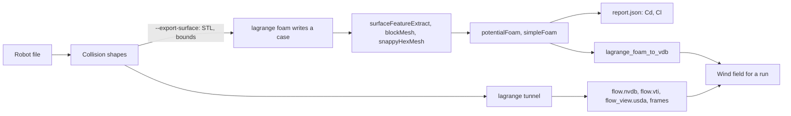
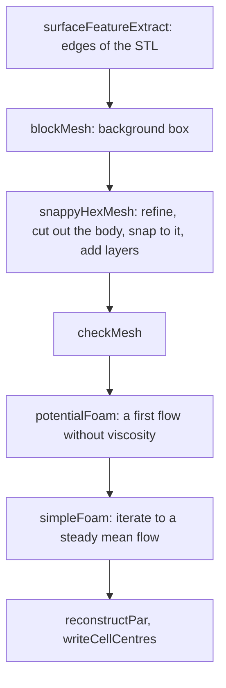
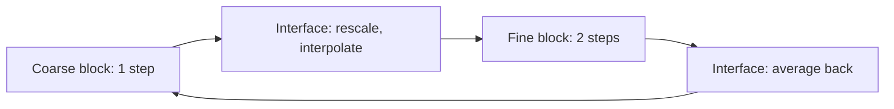

# CFD: methods, equations and what was measured

Computational fluid dynamics in Lagrange, as of 2026-11-02, on branch `feat/cfd-openfoam`. It has two
tools, and this document says what each one does, which equations it solves, how far its numbers can
be trusted, and what comes next. Short notes on the tunnel also live in
[aerodynamics.md](aerodynamics.md) §10.

## 1. Two tools

| | `lagrange tunnel` | `lagrange foam` |
|---|---|---|
| Method | Lattice Boltzmann, D3Q19, Smagorinsky LES | Finite volume, SIMPLE, k-omega SST RANS (OpenFOAM) |
| Code | Our own, CPU reference and GPU (Slang) | OpenFOAM v2512, a separate GPL-3 program |
| Time | Transient: the wake moves | Steady: a mean flow |
| Mesh | Uniform cubes, staircase surface | Refined near the body, fitted to it, with layers |
| Needs | Nothing more | An installed OpenFOAM, or podman or docker and a 1.6 GB image |
| Use it for | Seeing where the air goes, animations, a wind field | Force numbers, as far as section 6 supports them |



The boundary with OpenFOAM is files only. Lagrange writes its input and reads its output and never
links or ships it, which keeps Apache-2.0 intact and follows invariant 12 of `CLAUDE.md`. The method
is free to learn from; its source is not free to copy into this repository. The dictionaries in
`tools/cli/lagrange_foam` are written from the documented keywords, and OpenFOAM's own tutorial
files were read for syntax only.

## 2. The incompressible flow both approximate

Mass and momentum for an incompressible Newtonian fluid, with kinematic pressure $p$ (Pa per
kg/m³), velocity $\mathbf{u}$ and viscosity $\nu$:

$$\nabla\cdot\mathbf{u}=0$$

$$\frac{\partial\mathbf{u}}{\partial t}+(\mathbf{u}\cdot\nabla)\mathbf{u}=-\nabla p+\nabla\cdot\big[(\nu+\nu_t)(\nabla\mathbf{u}+\nabla\mathbf{u}^T)\big]$$

$\nu_t$ is what the turbulence model adds for motion the grid does not resolve. What reports use, for
wind speed $U$ and frontal area $A$:

$$C_d=\frac{F_x}{\tfrac12\rho U^2 A},\qquad C_l=\frac{F_z}{\tfrac12\rho U^2 A},\qquad C_p=\frac{p-p_\infty}{\tfrac12\rho U^2},\qquad Re=\frac{UL}{\nu}$$

## 3. `lagrange tunnel`: lattice Boltzmann

Populations $f_i$ move along 19 lattice velocities $\mathbf{c}_i$ and relax towards equilibrium
(BGK; Krüger et al., *The Lattice Boltzmann Method*, 2017):

$$f_i(\mathbf{x}+\mathbf{c}_i\Delta t,t+\Delta t)=f_i(\mathbf{x},t)-\frac{1}{\tau}\big[f_i-f_i^{eq}\big]$$

$$f_i^{eq}=w_i\rho\Big[1+3\,\mathbf{c}_i\cdot\mathbf{u}+\tfrac92(\mathbf{c}_i\cdot\mathbf{u})^2-\tfrac32|\mathbf{u}|^2\Big],\qquad \nu=\frac{\tau-\tfrac12}{3},\qquad p=\frac{\rho}{3}$$

in lattice units, with $w_0=1/3$, $w_{1..6}=1/18$, $w_{7..18}=1/36$. Eddy viscosity comes from the
non-equilibrium stress $Q_{\alpha\beta}=\sum_i c_{i\alpha}c_{i\beta}(f_i-f_i^{eq})$ (Hou et al. 1996):

$$\tau_{\mathrm{eff}}=\frac12\Big(\tau+\sqrt{\tau^2+18\sqrt2\,C_s^2\,\sqrt{Q_{\alpha\beta}Q_{\alpha\beta}}/\rho}\Big),\qquad C_s=0.17$$

At walls, half-way bounce-back, with a moving road by Ladd (1994). Force is momentum exchange on each
link, less the resting state's (gauge):

$$f_{\bar i}(\mathbf{x},t+\Delta t)=f_i^{*}(\mathbf{x},t)+6w_{\bar i}\,\mathbf{c}_{\bar i}\cdot\mathbf{u}_w,\qquad \mathbf{F}=\sum_{\text{links}}2\,\mathbf{c}_i\,(f_i^{*}-w_i)$$

The inlet imposes $f_i^{eq}(\rho{=}1,U)$ and the outlet copies its last column. Sides wrap around.

### Frames

`--frames N` writes speed in a slice along the body over $C_p$ in a slice from above, smoothly
interpolated over fluid cells only, with scales in `frames/legend.json`. `--frame-spin` draws the air's
spin instead. Forces do not depend on it (`FramesDoNotChangeTheForce`).

## 4. `lagrange foam`: finite volume with OpenFOAM

The steps of the generated `Allrun`:



**SIMPLE** finds the pressure that makes the velocity divergence free. In each iteration, with $A$ the
diagonal and $\mathbf{H}$ the off-diagonal part of the discretised momentum equation (Jasak 1996):

$$A\,\mathbf{u}=\mathbf{H}(\mathbf{u})-\nabla p,\qquad \nabla\cdot\Big(\frac{1}{A}\nabla p\Big)=\nabla\cdot\Big(\frac{\mathbf{H}(\mathbf{u})}{A}\Big),\qquad \mathbf{u}=\frac{\mathbf{H}(\mathbf{u})-\nabla p}{A}$$

**k-omega SST** (Menter 1994) transports turbulent kinetic energy $k$ and specific dissipation
$\omega$, and limits the eddy viscosity with the blending function $F_2$ and strain rate $S$:

$$\nu_t=\frac{a_1k}{\max(a_1\omega,\;SF_2)},\qquad a_1=0.31$$

**Wall functions** replace resolving the boundary layer: for a first cell at $y^+=yu_\tau/\nu$ above
about 30, the log law gives the wall friction (`nutkWallFunction`, `omegaWallFunction`,
`kqRWallFunction`):

$$\frac{u}{u_\tau}=\frac1\kappa\ln(Ey^+),\qquad \kappa=0.41,\quad E=9.8$$

| Choice in the case | Value |
|---|---|
| Domain | 3 body lengths ahead, 8 behind, 2 each side, 3 above |
| Background cell | Longest size / 8 |
| Surface cell | Background / $2^{\text{refine}}$; wake box two levels coarser |
| Layers | `--layers`, 3 by default, expansion 1.2 |
| Inlet | Fixed velocity; intensity 1 %, $k=\tfrac32(IU)^2$; length scale 5 % of the body |
| Outlet | Fixed pressure, 0 |
| Sides and top | Slip |
| Road | With `--ground`, a wall moving at the wind's speed; else a slip floor far below |
| Schemes | `linearUpwindV` for velocity, upwind for $k$ and $\omega$, `consistent` SIMPLE (SIMPLEC) |
| Report | Mean of the last fifth of the iterations, and half its range as "moves" |

Run it and look at it:

```bash
lagrange foam ROBOT --speed 40 --ground --clearance 0.05 --out case   # the container if none installed
paraview case/case.foam
ros2 run lagrange_fields lagrange_foam_to_vdb case/2000/C case/2000/U flow.nvdb --voxel 0.05
```

Limits today: forces for the whole robot only, not per link; a capsule is exported as a cylinder;
`--yaw` turns the shapes but the road's direction stays along the wind.

## 5. The test: the Ahmed body

The Ahmed body (Ahmed, Ramm & Faltin, SAE 840300, 1984) is the standard car-like reference: length
1.044 m, width 0.389 m, height 0.288 m, nose radius 0.1 m, 50 mm over the floor. Our model, from
`assets/robots/ahmed_body/make_ahmed_body.py`, is one convex shape with no stilts, and 40 m/s gives
$Re=2.8\times10^6$ on the length (ERCOFTAC case AC1-05 at this speed).

Sources quote its measured drag differently: 0.2875 at 25° (SimScale's validation page, citing Ahmed
1984, at 60 m/s) and 0.298 at 25° with a moving ground (Strachan et al. 2007, quoted in arXiv
2001.11074). No figure for 35° has been checked yet: `TODO(verify)` against the source. Drag is
known to fall past about 30°, the "drag crisis".

## 6. Results

All one run each, on this machine (20 threads, RTX 4060 laptop GPU), 2026-11-02.

**OpenFOAM**, 2000 iterations on 12 processes; ± is how much it still moves:

| Slant | Cells | Cd | Cl | Wall time |
|---|---|---|---|---|
| 25° | 219,379 | 0.474 ± 0.015 | 0.337 ± 0.116 | 6.5 min |
| 25° | 753,328 | 0.445 ± 0.009 | 0.385 ± 0.083 | 28 min |
| 35° | 221,169 | 0.511 ± 0.050 | 0.293 ± 0.193 | 6.6 min |
| 35° | 754,615 | 0.529 ± 0.031 | 0.469 ± 0.132 | 36 min |

**Our tunnel**, GPU; the gap is 2.2 cells on 2M and grows with the grid:

| Slant | Cells | Cd | Cl |
|---|---|---|---|
| 25° | 2M | 1.12 | 0.93 |
| 25° | 4M | 1.36 | 0.31 |
| 25° | 8M | 1.31 | 0.38 |
| 25° | 16M | 1.17 | 1.02 |
| 35° | 8M | 1.33 | 0.37 |

What this says:

- **OpenFOAM is far closer on far fewer cells**, 0.445 on 753k against 1.17 on 16M. It is still about
  50 % above the measurement, so it is not validated either.
- **The drag crisis is not reproduced by either.** 35° reads above 25° in OpenFOAM, and level with it
  in the tunnel. Steady RANS with wall functions on these meshes may be the limit, and our model has
  no stilts; which of these matters has not been measured.
- **The mesh is the main gap**, as far as these runs can tell: uniform cubes spend their cells on empty
  air and turn every surface into a staircase. Solver, turbulence model and wall treatment also differ,
  so this comparison cannot split the credit between them.

## 7. What was tried on the tunnel and not adopted

Each was run by hand and left out because it moved references away from their measurements:

| Change | Result | Why not |
|---|---|---|
| Regularized collision (Latt & Chopard 2006) | Cube 1.44, plate 0.85 | Worse, and a test fails |
| Sponge at both ends | Checkerboard 44.8 to 24.0, cube 1.28 | The cube moves away from 1.05 |
| Sponge plus viscosity floor 0.005 | Checkerboard 6.7, cube 1.69 | Further still |
| Log-law moving wall | Plate friction 0.013, cube 0.69, Ahmed Cd −8.25 | Pushes air on staircases |
| Velocity inlet and pressure outlet, plain equilibrium | Cube −1.46, GPU and CPU disagree | Unstable or worse |
| Pressure outlet with Guo's extrapolation only | Cube −6.20 | Worse |
| Guo's extrapolation at both ends | Cube 0.88, plate 0.87 | Worse, and the plate's test fails |

Cube and plate figures are at their test grids. Their measured values are 1.05 and 1.17; without these changes they read 1.03 and 0.97.

## 8. Known defects

- **Stripes and offset.** The pressure panel shows stripes two cells wide starting at the inlet, and the
  free stream reads a negative $C_p$ where it should be about 0. Nothing anchors pressure well: the
  inlet fixes density and velocity together and the outlet fixes neither. This is the likeliest source of
  the checkerboard seen in speed and spin, but that link is not proven. The obvious fixes in section 7
  failed, so the right one is still open.
- **Wall friction too high.** A plate along the wind reads 0.037 at 1M cells and 0.014 at 4M, against
  about 0.0037 for a turbulent flat plate.
- **Lift is not settled** in either tool.

## 9. Next: local refinement for the tunnel

Finer cells only where the air needs them, by blocks at a 2:1 ratio. Keeping $\nu$ continuous across
levels fixes the relaxation time, and the equilibrium part of a population carries over unchanged while
the off-equilibrium part scales with the velocity gradient (Dupuis & Chopard 2003; Rohde et al. 2006):

$$\tau_f=2\tau_c-\tfrac12,\qquad f_i=f_i^{eq}+\alpha f_i^{neq}$$

`TODO(verify)`: $\alpha$ and exactly when in the step it is applied against Dupuis & Chopard, Phys. Rev.
E 67, 066707; secondary sources disagree on the timing.



Done means, in this order: a uniform flow stays uniform across an interface; the shear wave keeps its
decay rate; cube and plate stay within their tests on fewer cells than today; then the Ahmed body, with
OpenFOAM as the reference on the same shape. Interfaces are known to radiate spurious noise (arXiv
2004.11863), so section 8's stripes should be understood first. A finite-volume solver of our own would
need an RFC, since invariant 12 prefers integrating engines.

## 10. Sources

- OpenFOAM: [openfoam.com](https://www.openfoam.com/), [v2606 documentation](https://doc.openfoam.com/2606/), [licence](https://www.openfoam.com/documentation/licencing)
- Ahmed body: [ERCOFTAC AC1-05](https://www.kbwiki.ercoftac.org/w/index.php/Description_AC1-05), [SimScale validation](https://simscale.com/docs/content/validation/AhmedBody/AhmedBody.html), [arXiv 2001.11074](https://ar5iv.labs.arxiv.org/html/2001.11074)
- Refinement: [arXiv 1608.06915](https://arxiv.org/pdf/1608.06915), [arXiv 2004.11863](https://arxiv.org/pdf/2004.11863)
- Textbook and papers cited from memory of their standard forms, not re-read here: Krüger et al. 2017, Hou et al. 1996, Ladd 1994, Menter 1994, Jasak 1996. `TODO(verify)` the SST and SIMPLE forms against them.
