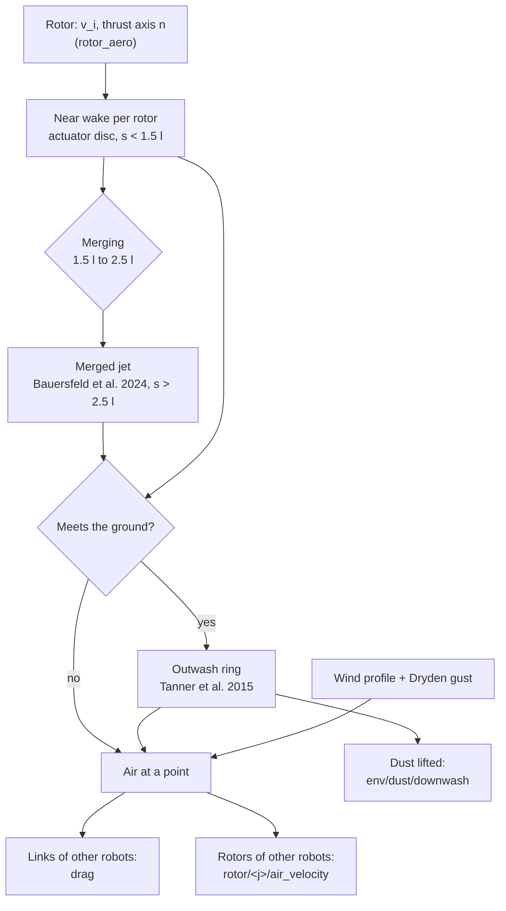
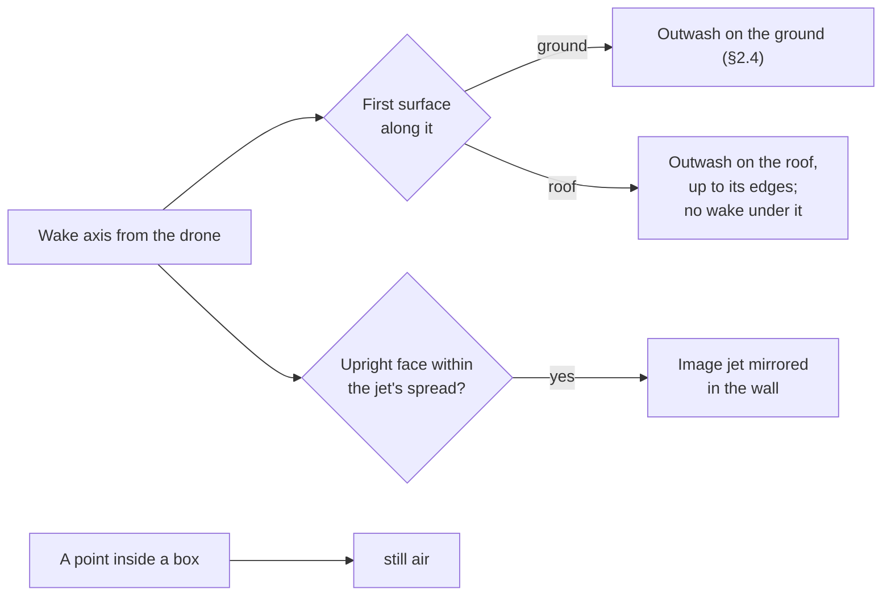
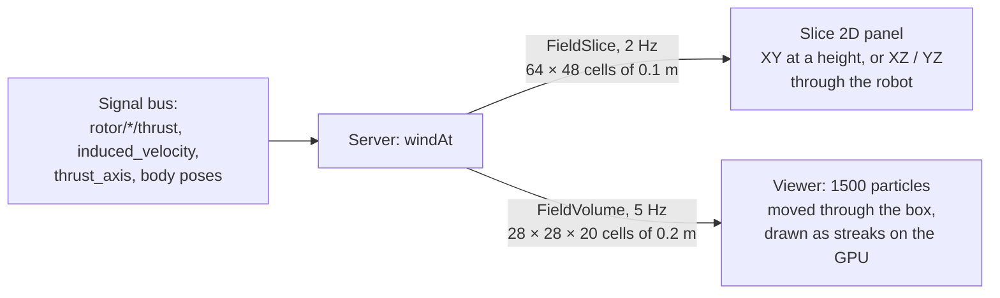
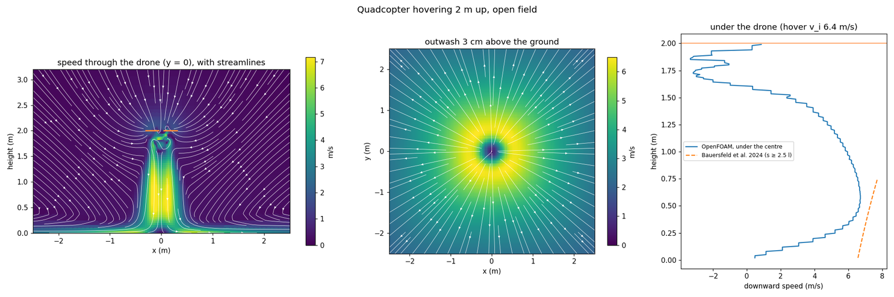
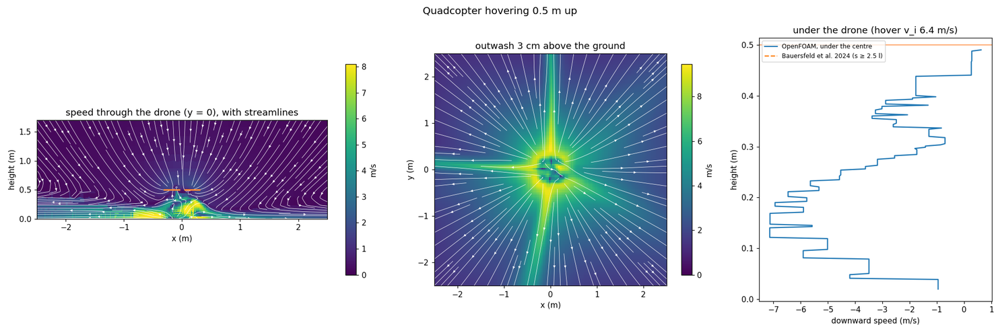
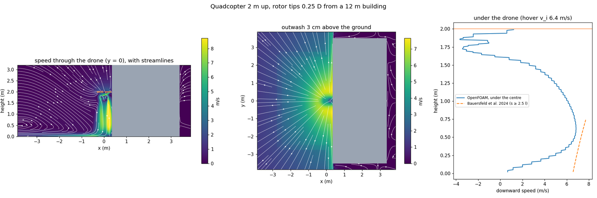

# Domain: rotor downwash and outwash

The air a rotor pushes, and what it does to everything else. The loads on a rotor itself
(thrust, torque, blade-element momentum, ground effect) are in
[aerodynamics.md](aerodynamics.md) §2. This document covers the wake that leaves the rotor:
the column of air under a drone, the jet it becomes further down, and the outwash along the
ground.

## 1. Scope

| What | Where it acts | Status |
|---|---|---|
| Near wake of each rotor (actuator disc) | other robots' links and rotors | done |
| Merged jet below a multirotor | the same | done |
| Outwash along the ground | the same; dust lifted for the weather | done |
| Wake skew in wind and forward flight | the column's direction | done |
| Live view of the air in the viewer | `aero/wind_speed` slices, particles | done (§5) |
| Inflow above the disc, swirl, unsteadiness | | not modelled |
| Interference between rotors of one drone | | not modelled |
| Buildings: roofs, walls beside a wake (boxes of the scenery) | the same | done (§2.6) |
| A wall beside a rotor: more inflow, less thrust, a roll towards it | the robot's own rotors | done (§2.7) |
| Ceilings, scenery other than boxes and the ground plane | | not modelled |

The model is `aerodynamics::Downwash` (`modules/aerodynamics/include/lagrange/aerodynamics/Downwash.hpp`),
run by the aerodynamics domain (`AeroDrag`). It runs whenever the stage has rotors and the site
air density is known; the profile's `aerodynamics.downwash: false` turns it off.

## 2. The model

Every quantity comes from what the rotor domain already computes: the induced velocity at the
disc $v_i$ (momentum theory, or blade-element momentum at the `bem` fidelity) and the thrust
direction $\hat n$. The rotors of one robot form a **group**. A body is never pushed by its own
group's wake, because the rotor data already describe an isolated rotor.

### 2.1 Near wake: the actuator disc

Below each rotor, at distance $s$ along the wake, the axial speed on the axis is the
vortex-cylinder solution of momentum theory (Leishman, *Principles of Helicopter Aerodynamics*,
2nd ed., 2006, §2.7):

$$
w(s) = v_i\left(1 + \frac{s}{\sqrt{s^2 + R^2}}\right)
$$

It is $v_i$ at the disc and $2v_i$ far below. Mass conservation gives the column's radius:

$$
r_w(s) = R\sqrt{\frac{v_i}{w(s)}} \;\longrightarrow\; \frac{R}{\sqrt 2}
$$

Across the column the speed is a top hat with a smoothed edge 0.1 R wide.

### 2.2 Far wake: the merged jet

A few motor distances below a multirotor the four columns have merged into one turbulent round
jet. Bauersfeld, Müller, Ziegler, Coletti and Scaramuzza (2024, arXiv:2403.13321) measured it
under six drones from 0.23 kg to 6.3 kg and fitted (their eqs. 3, 5, 6 and 9):

$$
U_C(s) = U_H\,\frac{\tilde B}{s/l - \tilde s_0}, \qquad
r_{1/2}(s) = S\,(s - \tilde s_0\, l), \qquad
\frac{U}{U_C} = \frac{1}{\left(1 + (\sqrt2 - 1)\,\xi^2\right)^2}, \quad \xi = \frac{r}{r_{1/2}}
$$

with $\tilde B = 10.11$, $\tilde s_0 = -5.817$ and $S = 0.07668$. Here $U_H = \sqrt{\overline{v_i^2}}$
is the hover induced velocity and $l$ the motor-to-motor diagonal. The jets merge between
$1.5\,l$ and $2.5\,l$ (their Fig. 5), and the model blends the near and far wakes linearly
across that range. A single rotor uses its diameter as $l$. This is TODO(verify), because the
constants were fitted to multirotors only.

### 2.3 Wake skew

In wind or forward flight the column leans with the air going past the vehicle, along
$-\hat n\,U_H + (\mathbf{v}_{air} - \mathbf{v}_{vehicle})$. That is Leishman's wake skew angle
$\tan\chi = \mu/\lambda_i$ for a hovering rotor in a crosswind.

### 2.4 Outwash along the ground

Where the wake meets the ground plane it turns into a radial wall jet. Tanner, Overmeyer,
Jenkins, Yao and Bartram (2015, AHS Forum 71, NTRS 20160006428) measured it under a model rotor.
The mean outwash peaks between 1.7 and 1.8 R from the axis, at about $1.9\,V_h$ for a rotor
1 R above the ground, 0.02 to 0.08 R above the ground, in a layer about 0.15 R deep. The model
scales that calibration point by the jet that actually arrives, using its speed $U_a$ and its
top-hat radius $r_a$:

$$
u_{peak} = \frac{1.9}{1.707}\,U_a, \qquad \rho_p = \frac{1.7}{0.765}\,r_a
$$

The factors 1.707 and 0.765 are the near wake's speed and radius one radius below the disc. In
the radial direction the speed rises as $(\rho/\rho_p)^{0.8}$, a fit to Tanner's 1.2 R and 1.6 R
profiles. Outboard of the peak it falls as $(\rho_p/\rho)^{1.1}$, the radial wall jet's decay
(TODO(verify) against Poreh, Tsuei and Cermak 1967). In height it follows a 1/7 power below
the peak and a Gaussian above it, halving at the layer depth. The layer thickens outboard at
0.073 per metre (the plane wall jet's growth rate; TODO(verify) for the radial one). Within the
jet's own radius of the ground, the axial speed falls linearly to zero, as at a stagnation
point.

### 2.5 Dust

The outwash's friction velocity is $u_* = 0.05\,u_{peak}$. The 0.05 is $\sqrt{c_f/2}$ with
$c_f \approx 0.005$ (TODO(verify)). Dust lifts once $u_*$ passes Bagnold's threshold
(*The Physics of Blown Sand and Desert Dunes*, 1941):

$$
u_{*t} = A\sqrt{\frac{\rho_p - \rho}{\rho}\, g\, d}, \qquad A = 0.1
$$

The concentration is $C_{max}\,(1 - (u_{*t}/u_*)^2)$, a behavioural model that is checked only
for plausible values. $d$ and $C_{max}$ are the site's loose ground: `--weather
ground_dust_diameter=M,ground_dust_concentration=KG_M3`, or the same keys in the profile's
`weather`. Neither has a default. The weather module adds the dust to the air's, so cameras and
lidars see it and lenses get dirty. For 0.1 mm sand $u_{*t} \approx 0.15$ m/s, so an outwash
peak of about 3 m/s starts lifting it.

### 2.6 Buildings

The scenery's fixed boxes (static `Box` colliders: buildings, walls, crates) are obstacles. The
model handles three situations:

1. **Roofs.** The wake is cast along its (skewed) axis. Where it first meets a surface, the
   ground or a box face, the jet stops as it does on the ground, and the outwash of §2.4 spreads
   over that face. It stops at the face's edges, because a wall jet separates at an edge. Below
   the face, behind it, the drone's wake is gone. Dust (§2.5) lifts only from the ground.
2. **Walls beside a wake.** An upright face within the jet's spread is a mirror. Every point on
   the drone's side gets the image jet's axial speed too, evaluated at the point's mirror image.
   This is the method of images (as Cheeseman and Bennett treat the ground). It keeps the air
   from going through the wall, so near the wall the downwash is stronger: the wake hugs it.
   The spread used is twice the far jet's half-width where the wake ends, or 1.5 motor
   distances plus two rotor radii if that is larger.
3. **Inside a box** the air is still.

### 2.7 A wall beside a rotor

A wall beside a rotor restricts the inflow into the part of the disc next to it. Hovering takes
more power (Herz and McCrink, VFS Forum 81, 2025). An isolated rotor near a side wall loses
thrust and rolls towards the wall. A multirotor's rotors are at different distances from the
wall, so the whole aircraft tilts towards it. Tanabe et al. (*J. Robot. Mechatron.* 30(3),
2018, CFD) recommend keeping at least 1.5 rotor diameters from a side wall.

Neither source gives numbers that can be used directly. The live model therefore takes them from
`lagrange foam-hover` runs of the sample quadcopter beside a 12 m building, at several gaps
(§7). The air going down through each disc beyond the open-air value is fitted as

$$
\frac{\Delta w_i}{v_i} = A\,e^{-(g/D)/\lambda}\,s_i, \qquad A = 0.0173,\ \lambda = 3.5,\ g < 10D
$$

The symbols are:

- $g$: the gap between the drone's nearest rotor tip and the wall.
- $D$: the rotor diameter.
- $s_i$: runs from +1 for the hub farthest towards the wall to −1 for the one farthest away.

The CFD saw the near rotors take about 2% more air and the far ones about 1.3% less. Each
rotor's `rotor/<j>/air_velocity` carries its share. A blade-element rotor at a fixed speed in
more downward air makes less thrust, so the drone rolls towards the wall, as the references
describe. Flown by the built-in controller beside `drone_building`, with the tips 1.2 D from the
wall, the near rotors get 0.088 m/s more air and the far ones 0.089 m/s less. The controller
holds the drone level by spinning the near ones faster. All four then make the same thrust, and
the drone drifts 0.5 mm towards the wall.

The fade length is the weak part. Fitted to the near-minus-far difference, it is 3.5 ± 2.7 D;
the near rotors alone show no fading out to 2 D within the mesh noise (±0.05 m/s, 0.8% of
$v_i$). Tanabe et al. find the effect gone beyond 1.5 D. The model may therefore reach too far.

## 3. Signals

| Signal | Unit | Writer | Reader |
|---|---|---|---|
| `rotor/<j>/thrust`, `rotor/<j>/induced_velocity` | N, m/s | rotor_aero | aerodynamics |
| `rotor/<j>/thrust_axis` | unit vector, world | rotor_aero | aerodynamics |
| `rotor/<j>/air_velocity` | m/s, world | aerodynamics | rotor_aero (`bem`, config `rotor_air`) |
| `body/<b>/wrench/aero` | N, N·m | aerodynamics | wrench sum |
| `env/dust/downwash` | kg/m³ | aerodynamics | weather (config `downwash_dust`) |

The modules talk only through these signals (invariant 1). The aerodynamics domain reads the
rotors' outputs from the previous step (feedback), so there is no loop within a step.

## 4. Validation

`modules/aerodynamics/test/test_downwash.cpp` checks:

- **Momentum theory.** The near wake gives $v_i$ at the disc, $2v_i$ far below, and a column
  radius of $R/\sqrt2$.
- **Bauersfeld et al.'s drone.** Their "Offboard 1" (0.572 kg, 12.95 cm propellers, 26.6 cm
  motor distance) gives $U_H = 6.66$ m/s, as in their Table I. The jet's centreline and
  half-width follow their eqs. 5 and 6 from $2.5\,l$ to $10\,l$.
- **Momentum flux (not fitted).** A free jet's momentum flux $\int \rho u^2\, dA$ must equal
  the thrust that made it. Bauersfeld et al. fitted their decay and spread constants separately,
  yet together they give the drone's weight within 5% at $3\,l$, $6\,l$ and $12\,l$.
- **Outwash.** A rotor 1 R above the ground peaks at $1.9\,V_h$ between 1.65 and 1.85 R, 0.02
  to 0.08 R above the ground. This is the calibration point. At 1.5 R the model gives
  $1.72\,V_h$; the flight tests Tanner et al. quote measured $1.7\,V_h$ (CH-47D), $1.9\,V_h$
  (HH-60H, V-22) and $2.1\,V_h$ (CH-53E).
- **Skew.** A crosswind equal to $v_i$ leans the wake by 45°.

`server/test/test_downwash_pair.cpp` stacks two copies of the sample quadcopter's rotors (10-inch
blade-element propellers, 0.25 m arms, 565 rad/s) and compares the lower one's thrust with
Kiran, Ayanian and Breuer (2025, RSS XXI, arXiv:2507.09463). They used stacked Crazyflies, with
$l$ the centre-to-motor distance:

| Gap below the upper drone | Kiran et al. (measured) | Lagrange |
|---|---|---|
| 4 l | 65% of hover thrust | 53% |
| 19 l | 95–98% | 87% |

The model loses more thrust than the measurements, by about 12 points at 4 l and about 10 at
19 l. Some of that difference is expected: the Crazyflies ran at constant voltage, so their
rotors sped up as the load fell, while the test holds rotor speed fixed. The rest is open. The
mean jet of Bauersfeld et al. may still be too strong that far out for a drone as small as a
Crazyflie, or the unsteady wake may mix faster than its mean suggests. The test accepts 45–75%
at 4 l and 85–100% at 19 l.

`test_downwash` also checks buildings (§2.6). A wake over a roof stops on it, spreads over it
and stops at its edges, and leaves still air inside and beneath. A wall beside a wake makes the
air next to it go down faster, and makes no difference far on the other side.
`test_downwash_pair` puts the quadcopter's rotors 0.25 D from a wall. The near rotors' air minus
the far rotors' matches the CFD fit, the near rotors make less thrust (the roll towards the
wall), and at 12 D nothing is left.

## 5. Seeing the air

The server serves the air as the field `aero/wind_speed`. It is computed with the same `windAt`
the aerodynamics domain uses, from the rotor signals on the bus. The viewer shows it in two
ways, both in the Environment workspace (design `07-environment`):

- **Slices.** In the Overlays panel, tick *air speed*. The Slice 2D panel then shows its
  magnitude on the field colour map (viridis). XY, XZ and YZ choose the plane. XY sits at the
  height slider's value; XZ and YZ cut through the robot, from the ground up. The probe reads
  the speed under the cursor.
- **Particles.** Tick *airflow · particles*. The viewer asks for a box of the air's velocity
  around the robot five times a second. It moves 1500 particles through the box, interpolating
  trilinearly, and draws each one as a short streak coloured by its speed. The legend at the
  viewport's bottom right gives the scale in m/s. New particles are placed where the air moves,
  so they gather in the downwash and the outwash. Particles move on the CPU and are drawn as
  overlay lines by the GPU renderer.

From the command line: `lagrange_viewer --overlays airflow --slice aero/wind_speed:xz`.

Protocol (added after 1.0, RFC 0007): `SubscribeField.orientation` and `.volume`,
`FieldSlice.orientation`, `SliceOrientation`, and `FieldVolume` (envelope field 47).

## 6. Limits

- The outwash calibration is one rotor height (1 R). Between 1 R and 2 R the model's peak rises
  slightly with height, as the free wake still accelerates there. Tanner et al. saw the
  high-speed layer fade instead.
- The coefficient fidelity's rotors do not react to the air they sit in (as before); only `bem`
  rotors read `rotor/<j>/air_velocity`.
- Near the ground, a multirotor's rotor jets meet along its arms and turn up under it (a
  fountain). The CFD shows it at 0.5 m (§7), lifting the frame. The live model has no
  interaction between the rotors of one drone, so neither the fountain nor the cross-shaped
  outwash it gives.
- Buildings are boxes only. The wake does not run down a wall it does not hit, separate off a
  roof's edge, or curl round a corner.
- The air at a robot's links comes from other robots only. A drone's own frame does not feel
  its own downwash (download), since the rotor data hold the isolated rotor.

## 7. Offline check: OpenFOAM

`lagrange foam-hover ROBOT.urdf [--height M] [--building X0,Y0,X1,Y1,H]` (`tools/cli/lagrange_foam_hover`)
writes and runs an OpenFOAM case of a hovering multirotor:

- The robot's collision boxes, over a ground wall.
- Each rotor is an actuator disc: a momentum source (`vectorSemiImplicitSource`) over a cylinder
  of cells two cells thick, carrying its share of the weight.
- Open boundaries on every other side (total pressure).
- snappyHexMesh, cells of 2 cm round the drone and 4 cm in its wake and near the ground.
- simpleFoam with k-omega SST, 1500 iterations.

It draws three views: the air through the drone (XZ), the air along the ground, and the speed
under the drone against Bauersfeld et al. It also reports the air through each disc and the
force on the frame. OpenFOAM is GPL-3 and runs as a separate program (invariant 12).

The sample quadcopter (2.0 kg, 0.254 m propellers, 4.91 N per rotor, $v_i$ 6.4 m/s), 412k cells
each:

| Case | Air down through the discs | Peak outwash 3 cm up | Force of the air on the frame |
|---|---|---|---|
| 2 m up, open field | 7.41–7.47 m/s | 6.5 m/s | 1.86 N down (9% of the weight) |
| 0.5 m up | 7.48–7.55 m/s | 9.5 m/s | 0.63 N **up** |
| 2 m, tips 0.25 D from a 12 m building | near 7.54, far 7.38 m/s | 7.7 m/s | 2.08 N down |
| 2 m, 0.5 D | near 7.56, far 7.40 m/s | 6.9 m/s | 2.14 N down |
| 2 m, 1 D | near 7.50, far 7.43 m/s | 6.6 m/s | 2.07 N down |
| 2 m, 2 D | near 7.55, far 7.46 m/s | 6.5 m/s | 1.97 N down |

- **In the open**, the jet under the drone peaks at 6.7 m/s about 0.5 m above the ground.
  Bauersfeld et al.'s fit gives 7.35 m/s there, about 10% more. Their measurements were also
  taken in the open, with no ground in the fit. Between the four rotor columns, just under the
  drone, the air rises: the known fountain of a multirotor.

- **Low, at 0.5 m**, the rotor jets reach the ground before they merge. Their wall jets meet
  along the arms in a cross and turn up under the drone at about 7 m/s. That lifts the frame
  (0.63 N) instead of pressing it down, and the outwash is half as strong again (9.5 m/s).

- **Beside a building**, the wake hugs the wall, faster there (up to 8.7 m/s) than in the open.
  It spreads along the foot of the wall rather than round the drone. The rotors near the wall
  take more air through them and the far ones less (§2.7). The frame feels no side force
  (0.02 N), so the pull towards the wall comes through the rotors.

The live model covers the open-field jet within its references, the roof and wall-hugging wake
(§2.6) and the near-wall rotors (§2.7). It does not have the fountain (§6).
