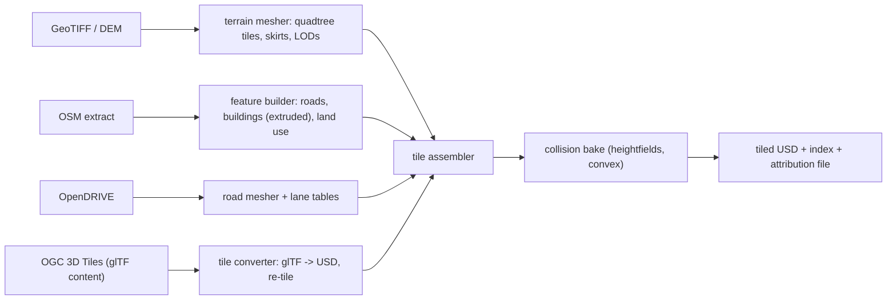

# Huge worlds

Status: draft for review. Full implementation is v0.7, but four things are built into v0.2 so
that v0.7 is an extension and not a rewrite: double-precision positions, a floating origin,
region identifiers on every body, and geodetic conversion in `core/world/coords/`.

## 1. Coordinate frames

| Frame | Type | Use |
|---|---|---|
| ECEF (WGS84) | `double` | Anchor of a georeferenced world; never used for dynamics |
| World ENU | `double` | East-north-up tangent plane at the profile's `world.geo_origin`. USD stage coordinates are this frame (`upAxis = "Z"`, metres). Valid for stages up to a few hundred kilometres across if curvature is handled (section 1.2) |
| Region-local | `double` storage, small magnitudes | World ENU minus the active region's origin. Physics, signals of type `Pose`, and the protocol's transforms use this frame |
| Render-local | `float` | Region-local minus the camera (or sensor) position, computed on the CPU in `double` and converted last. Only the GPU sees `float` positions |

Invariant 6 in practice: no struct in `core/`, `modules/`, `proto/` or MCAP stores a position in
world or region frames as `float`. A clang-tidy check plus a naming rule (`*World`, `*Local`
suffixes; `float` allowed only for `*Render`) enforces it.

### 1.1 Why a floating origin when positions are already double

`double` has about 1 nm resolution at 10 000 km, so storage is not the problem. The problem is
that physics engines and GPUs compute in `float` internally (PhysX, and GPU vertex transforms),
where resolution at 10 km from the origin is about 1 mm and contact solving degrades earlier.
MuJoCo uses `double` (`mjtNum`) by default. Rebasing keeps coordinates handed to any backend
below a few kilometres.

### 1.2 Rebase

```cpp
// core/world/coords/Frames.hpp
namespace lagrange::coords {

struct Geodetic { double latitudeRad, longitudeRad, heightM; };   // WGS84
struct Ecef     { double x, y, z; };                               // m
struct Enu      { double e, n, u; };                               // m, relative to a GeoOrigin

class GeoOrigin {
public:
    explicit GeoOrigin(Geodetic origin);
    Ecef toEcef(Enu) const;
    Enu  fromEcef(Ecef) const;
    Geodetic toGeodetic(Enu) const;
    Enu  fromGeodetic(Geodetic) const;
    std::array<double, 9> enuFromEcefRotation() const;
};

// WGS84 constants (NIMA TR8350.2): a = 6378137.0 m, 1/f = 298.257223563. Named in code with the source.

struct RegionOrigin {
    std::array<double, 3> worldEnu;     // origin of the region-local frame in world ENU
    std::uint64_t rebaseCount;          // increments on every rebase
};

}  // namespace lagrange::coords
```

- Trigger: when the focus entity (the ego robot, or the centroid of robots in the region) is
  more than `rebase_distance` (default 1000 m) from the region origin.
- Action, between ticks: subtract the offset from every region-local position in `core/world`,
  call each rigid-body backend's origin-shift function (PhysX has one; MuJoCo and Jolt state is
  shifted by rewriting body positions), bump `rebaseCount`, and publish the new origin.
- Signals of type `Pose` are region-local, so their values jump at a rebase. Every consumer that
  keeps history (recording, scopes, ROS TF) receives the origin with the data: MCAP stores the
  origin on a channel, `SceneDelta.rebased_frame` tells the viewer, and the ROS bridge publishes
  a `map → region` transform so that `map`-frame poses stay continuous.
- Rebase offsets are whole metres, so the subtraction is exact in `double` and does not disturb
  determinism.
- Earth curvature: a single ENU plane deviates from the ellipsoid by about 8 cm at 1 km and
  about 20 m at 16 km from its origin. Tiles are authored in world ENU with their true heights
  (the importer converts geodetic → ECEF → ENU), so geometry is correct; gravity direction is
  taken as the local ellipsoid normal at the region origin and updated at rebase. For flights
  spanning more than about 100 km the region frame should be re-anchored to a new tangent plane;
  that rotation is planned as an extension of rebase and is not in v0.7 scope.

## 2. Tile streaming

Worlds are USD stages whose terrain, buildings and props are **payloads**, so they can be loaded
and unloaded without reopening the stage.

```
worlds/coastal_survey_root.usda        # root: geo origin metadata, tile index, robots
└── tiles/
    ├── L0/tile_0_0.usdc               # 4096 m tiles, coarse LOD (always loadable quickly)
    ├── L1/tile_3_5.usdc               # 1024 m tiles
    └── L2/tile_14_22.usdc             # 256 m tiles, full detail + collision
```

Tile prim (in the root layer or an index layer):

```usda
def Xform "tile_L2_14_22" (
    prepend apiSchemas = ["WorldTileAPI_1"]
    prepend payload = @tiles/L2/tile_14_22.usdc@
)
{
    int world:tile:level = 2
    int2 world:tile:index = (14, 22)
    double3 world:tile:boundsMin = (3584, 5632, -20)     # m, world ENU
    double3 world:tile:boundsMax = (3840, 5888, 180)
    double world:tile:geometricError = 0.5               # m, for LOD selection
    bool world:tile:hasCollision = true
    double3 xformOp:translate = (3584, 5632, 0)
    uniform token[] xformOpOrder = ["xformOp:translate"]
}
```

`WorldTileAPI_1` is a new schema in `schemas/world/` (added to RFC 0002's list). Tile contents are
authored relative to the tile's own origin, so vertex data is small-magnitude `float` and the
tile's `double` translate places it.

Streaming manager (`core/world/streaming/`):

| Aspect | Design |
|---|---|
| Interest sources | Each robot, each sensor with range, each viewer camera (sent as a hint over the protocol) |
| Selection | For each interest source, tiles within `load_radius`; LOD by `geometricError / distance` against a threshold (screen-space error for cameras, range resolution for lidars) |
| Hysteresis | Unload only beyond `unload_radius` (> `load_radius`) and after 5 s, to avoid thrashing |
| Loading | Worker threads load the payload into a private USD stage mask, convert to SoA and GPU buffers (`core/stage/`), then hand a finished tile to the sim thread, which attaches it between ticks. USD is never touched by the sim thread (invariant 5) |
| Collision | Level-2 tiles carry convex or triangle-mesh static colliders and heightfields. A tile becomes "physics-ready" only when its colliders are in the backend. A robot is not allowed to enter a tile that is not physics-ready: the scheduler slows the real-time factor (or, in deterministic mode, blocks) until it is. This makes results independent of disk speed |
| Memory budgets | Profile keys for GPU and CPU megabytes; the least-recently-needed tiles are dropped first |
| Determinism | In deterministic mode the tile set is a pure function of robot positions (no camera hints, no time-based hysteresis; distance hysteresis only) |
| Protocol | The viewer receives tile prims as `SceneDelta.added` / `removed`; meshes through the shared-memory scene region |

## 3. Active regions and simplified distant agents

A **region** is a bubble of full simulation around one or more robots. Outside all regions the
world is static geometry plus simplified agents.

```cpp
// core/world/regions/Region.hpp
namespace lagrange::regions {

struct RegionId { std::uint32_t value; };

struct Region {
    RegionId id;
    coords::RegionOrigin origin;
    double radiusM;                       // profile: world.streaming.active_region_radius
    std::vector<std::uint32_t> robots;    // robots that define the region
    std::uint32_t owner;                  // process/node that simulates it; 0 in single-process mode
};

enum class AgentLod : std::uint8_t {
    Full,        // rigid bodies, all enabled domains
    Kinematic,   // pose follows a path; collision shape present; no electrical/thermal
    Statistical  // position and velocity only; no body; updated at the traffic rate
};

}  // namespace lagrange::regions
```

Rules:

- Every body and every signal instance has a `RegionId` column from v0.2 on (always region 0
  until v0.7). This is the "region boundaries designed in from day one" requirement.
- Two robots whose bubbles overlap share one region (regions merge and split with hysteresis).
  Robots far apart get separate regions with separate origins, and their backends are separate
  scenes.
- Agents controlled by the traffic module move between `Statistical`, `Kinematic` and `Full` as
  they approach a region. Promotion happens at a distance greater than any sensor range in the
  region, so sensors never see a pop-in.
- Signals from a robot outside every viewer's interest are still computed in full if the robot
  is a robot under test. Level-of-detail reduction applies to traffic and props, never silently
  to user robots.

Later distribution (post-1.0, not designed in detail here): a region is the unit that could move
to another process or machine. The pieces that make this possible later are already
constraints now: modules talk only through the signal bus (invariant 1), signals carry a region
id, cross-region interaction happens only through the traffic/agent hand-off and environment
fields, and the hand-off record (`AgentRecord`) is a serialisable value type.

## 4. Geospatial pipeline

Offline tools in `io/geospatial/`, run by the user or by `tools/build_world`. Output is the tiled
USD layout of section 2.



| Input | Library | Notes |
|---|---|---|
| GeoTIFF / DEM | GDAL 3.12.2, PROJ 9.7.1 (apt) | Reprojected to the world ENU frame. Vertical datum handled explicitly: orthometric heights are converted to ellipsoidal with a geoid grid if the user supplies one, otherwise the tool refuses unless `--assume-ellipsoidal` is given |
| OSM | a PBF reader (candidate: libosmium; license and packaging TODO(verify)) | Buildings extruded from `height` / `building:levels`; roads as ribbons draped on the terrain. Data is ODbL: outputs carry attribution, and derived tiles are not committed to the main repo |
| OpenDRIVE | own reader or a permissively licensed library (candidates to evaluate in v0.6; TODO(verify)) | Reference line, lanes, elevation, superelevation → mesh + lane tables for traffic and for ground-truth lane signals |
| OGC 3D Tiles | own reader for `tileset.json` + glTF through Assimp or a glTF library (TODO(verify)) | Photogrammetry tiles are visual only; they get no collision unless the user requests a simplified collision bake |
| WGS84 ↔ ENU | GeographicLib 2.7 (apt) for geodesy; our `coords::GeoOrigin` for the hot path | Conversion code is tested against GeographicLib |

Every generated world has an `ATTRIBUTION.md` listing sources and licenses, written by the tool.

## 5. Sensors and rendering at scale

- GPU scenes use camera-relative (or sensor-relative) transforms: the model matrix sent to the
  GPU is `float(tileOriginRegionLocal − eyeRegionLocal)` computed in `double`.
- Acceleration structures (Embree scenes, compute BVHs, Vulkan TLAS) are built per tile (BLAS)
  with a top level over loaded tiles, so loading a tile does not rebuild everything.
- Depth precision: reversed-Z with a floating-point depth buffer for the viewport and cameras, so
  near 0.05 m and far 50 km fit in one frustum.
- Long-range lidar and radar use the tile LOD that matches their range resolution.

## 6. What is tested when

| Release | Test |
|---|---|
| v0.2 | Unit tests for `GeoOrigin` against GeographicLib (round trip < 1e-6 m within 100 km). A world placed 500 km from the stage origin simulates the AMR identically (bit-identical in deterministic mode with MuJoCo) to the same world at the origin. A forced rebase mid-run does not change the trajectory |
| v0.4 | A drone flight crossing two rebases; MAVLink GNSS output is continuous |
| v0.7 | 40 km sample world streams within memory budgets; a robot never enters a tile that is not physics-ready; deterministic tile selection; viewer frame time stays within budget while tiles load |
