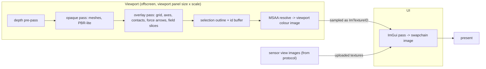

# Viewer

Status: draft for review; the stack is decided in `rfcs/0006-native-viewer-stack.md`.
`lagrange_viewer` is a native C++20 desktop program for Ubuntu 26.04. It draws with Vulkan through
`gpu/hal/`, builds its UI with Dear ImGui (docking branch), and talks to a simulation only
through the protocol (`docs/design/protocol.md`). It contains no web technology (invariant 13).

## 1. Stack (proposed, see RFC 0006)

| Concern | Choice | Source | Basis |
|---|---|---|---|
| Window, input, Vulkan surface | SDL3 | apt `libsdl3-dev` 3.4.2 | Wayland by default with X11 fallback; per-window display scale; IME; the ImGui SDL3 backend lists multi-viewport and IME support, while the GLFW backend header lists parent-viewport support as missing (verification §9) |
| UI | Dear ImGui, docking branch, pinned commit | `imgui_vendor` | The Ubuntu package is the master branch without docking (verification V1) |
| Plots | ImPlot v1.0 | `imgui_vendor` | MIT, not in apt |
| Schematic canvas | imgui-node-editor behind `viewer/panels/schematic/Canvas.hpp` | `imgui_vendor` | MIT; last release 2023, so it sits behind an interface that an in-house canvas can replace (Q11) |
| Gizmo | ImGuizmo 1.10 | `imgui_vendor` | MIT |
| Font rasteriser | FreeType through `imgui_freetype` | apt `libfreetype-dev` | Better hinting for CJK at small sizes |
| Fonts | Noto Sans + Noto Sans JP + a monospace font, bundled | `viewer/assets/fonts/` | SIL OFL (TODO(verify) the license files of the exact font builds bundled) |
| Vulkan helpers | volk (loader), Vulkan Memory Allocator | apt | Both are in Resolute |
| Shaders | Slang → SPIR-V at build time | apt `slang-compiler` or `slang_vendor` | Shared with sensor kernels |
| Protocol | Protobuf C++ | apt | — |
| UI tests | Dear ImGui Test Engine, fetched in CI only | not shipped | Custom license (verification V13, Q12) |

## 2. Module layout and dependencies

```
viewer/
├── app/        main, CLI, Window (SDL3), Swapchain, FrameLoop, Settings
├── render/     FrameGraph, SceneRenderer, passes, GpuScene (mesh/material upload), Camera
├── client/     ViewerClient, FrameReader, ShmMap, SceneStore, SignalStore
├── panels/     Panel interface, registry, one directory per panel
├── layout/     dock layouts, presets, .ini persistence
└── assets/     fonts, icons, default layouts
```

Dependency rule inside the viewer: `panels → client, render (read-only views)`;
`render → gpu/hal, client (SceneStore)`; `client → proto`. `client/` has no ImGui or Vulkan
includes, so it can be unit-tested and fuzzed without a display.

## 3. Window and surface layer

- `SDL_Init(SDL_INIT_VIDEO | SDL_INIT_GAMEPAD)`; window created with `SDL_WINDOW_VULKAN |
  SDL_WINDOW_RESIZABLE | SDL_WINDOW_HIGH_PIXEL_DENSITY`.
- The Vulkan instance is created by `gpu/hal/`. The viewer passes the extension list from
  `SDL_Vulkan_GetInstanceExtensions` and creates the surface with `SDL_Vulkan_CreateSurface`.
  `gpu/hal/` never includes SDL headers; it receives a `VkSurfaceKHR`.
- Video driver selection is left to SDL (Wayland first, then X11). `--x11` and `--wayland` set
  `SDL_HINT_VIDEO_DRIVER` for testing. CI runs the headless smoke test with the `offscreen` or
  `dummy` SDL video driver and an offscreen HAL target (TODO(verify) which SDL3 driver gives a
  Vulkan surface without a compositor; otherwise the test renders without a swapchain).
- Swapchain: FIFO present mode by default (vsync), `MAILBOX` when available and
  `--low-latency` is set. Recreated on `SDL_EVENT_WINDOW_PIXEL_SIZE_CHANGED` and on
  `VK_ERROR_OUT_OF_DATE_KHR`.
- When the window is minimised or occluded, the frame loop sleeps on `SDL_WaitEventTimeout`
  (100 ms) and does not render, but the client worker keeps receiving so scopes do not lose data.

### Wayland and X11 behaviour

| Topic | Wayland | X11 / XWayland |
|---|---|---|
| Window position | Cannot be set or read by the client. The layout file stores size and maximised state only | Position and size restored |
| Decorations | libdecor on GNOME (client-side); package dependency on `libdecor-0-0` | Server-side |
| Multi-viewport (torn-off panels) | Off by default. With `--multi-viewport`, torn-off windows appear where the compositor places them | Available as an option; still off by default so behaviour is the same on both |
| Fractional scaling | `SDL_GetWindowDisplayScale` gives the scale; the swapchain is in pixels | Scale from `Xft.dpi` through SDL |
| IME (Japanese input) | text-input protocol through SDL; `SDL_HINT_IME_SHOW_UI` left to the system | IBus/Fcitx through SDL |
| Clipboard, drag-and-drop of files | SDL events (`SDL_EVENT_DROP_FILE`) → "import URDF/USD/MCAP" | same |
| Session restore | Layout comes from our own `.ini`; `xdg-session-management` is not relied on | — |

The default is one fully docked window (CLAUDE.md §13.5). Every feature must be reachable in
that mode.

## 4. Vulkan frame graph



- The 3D scene is drawn into an offscreen colour image and shown in the viewport panel as an
  ImGui image. Its size follows the panel, so the scene is not rendered for pixels hidden by
  other panels.
- Passes are described by a small `FrameGraph` (pass name, attachments, read/write resources) so
  that later passes (shadow map, ray-traced ambient occlusion on Tier 2, thermal false colour)
  are additions, not rewrites.
- **Realistic shading** (`Shading::Realistic`, `RealisticPass`, `gpu/kernels/camera/realistic.slang`;
  the default on a GPU, Lit stays for inspection and for software devices). In order: the sun's depth
  (two cascades), the scene turned over the water's surface at half size (what the water reflects),
  the scene in HDR (Cook-Torrance GGX from each material's metallic and roughness, sky light by
  Lazarov's split-sum, grain where a surface is rough), sky, water, see-through things, then ambient
  occlusion, bloom, ACES tone map and FXAA, with overlays drawn on top. A water prim is one with
  `WaterAPI_1`: Gerstner waves whose height follows the site's wind, ripples, Fresnel reflection,
  depth-based colour, caustics, foam where it meets things. Limits: what the water looks like does
  not reach physics, which stays a flat surface, so things float level on the drawn waves and leave
  no wake; one water body is drawn as water, others as glass; the sun has a fixed place; no textures;
  about 15 ms a frame at 1080p on an Iris Xe. Camera sensors draw colour with the same `gpu::RealisticRenderer` on a
  GPU (invariant 13); a software device keeps `mesh.slang`, and depth and instance ids always do.
  Rain and snow (`falling`, `fallingKind` in the shader): the run's rain from EnvironmentState and
  its snow from the signals `env/snow_rate` and `env/snow_cover` (the environment message has no
  snow; no protocol change) fall through the world as drops on a lattice that moves with the wind
  and their fall speed (rain at Atlas's speed over Marshall–Palmer drops, as the aerodynamics
  domain has it; snow at 1 m/s), walked along each pixel's ray up to what it sees, 22 m at most
  (18 m for snow). Drops are streaks of a 1/30 s exposure, flakes swaying dots; how many are drawn
  grows with the rate (a drawing choice: real rain has thousands of drops per m³). With Summer
  picked, falling rain brings the rainy season's look and snow (or a third of the ground under it)
  the winter's (`effectiveSeason`); a season picked by hand stays. Camera sensors do not see the
  falling drops yet (their fog veil and lens drops are the sensors domain's).
- An id buffer (`R32_UINT`, prim id) is rendered for the pixel under the cursor only (scissored
  1×1 readback) for picking.
- MSAA 4× on Tier 1 and 2; off on lavapipe.
- Frame pacing: one frame in flight by default to keep input latency low; two with
  `--throughput`.

### Sharing `gpu/hal/` and Slang with sensor rendering

The same code draws a camera sensor image and the viewport (invariant 13):

| Shared piece | Location | Used by viewer | Used by sensors (v0.2+) |
|---|---|---|---|
| Device, queues, allocator, command contexts | `gpu/hal/` | yes | yes |
| `GpuScene`: mesh buffers, material table, instance transforms | `gpu/scene/` (new subdirectory under `gpu/`) | fed from `SceneStore` (protocol) | fed from `core/world` (SoA) |
| Slang modules `scene.slang`, `material.slang`, `lighting.slang`, `camera.slang` | `gpu/kernels/common/`, `gpu/kernels/camera/` | viewport passes | camera sensor passes |
| Raster pipeline for opaque geometry | `gpu/kernels/camera/raster.slang` | viewport opaque pass | RGB/depth/segmentation camera |
| Viewer-only shaders (grid, gizmo, outline) | `viewer/render/shaders/` | yes | no |

`GpuScene` has two feeders with one interface (`GpuSceneSource`): the viewer's `SceneStore` and
the server's world tables. That is the seam that keeps the viewer free of simulation modules
while still sharing the renderer. `gpu/scene/` is an addition to the layout in CLAUDE.md §6
(open question Q14).

The viewport's default shading is deliberately simple (one directional light, hemisphere
ambient, UsdPreviewSurface base colour/metallic/roughness). A sensor view shown in the viewer is
never re-rendered by the viewer: it displays the image the server produced.

## 5. Threading and the lock-free hand-off

| Thread | Owns | Blocks on |
|---|---|---|
| UI thread (main) | SDL events, all ImGui calls, all Vulkan submission, `SceneStore` read side, `ScopeBuffer` read side | vsync only |
| Client worker | socket, frame reader, Protobuf decoding, shm mapping, `SceneStore` write side, `ScopeBuffer` write side | socket `poll` |
| Loader pool (2 threads) | texture decode, mesh preprocessing (tangents, bounds), font atlas build | job queue |

Hand-off design:

- **Scene state** uses a triple buffer. The worker applies snapshots and deltas to a back copy of
  the transform array and an append-only change list, then publishes it by exchanging an atomic
  index. `FrameLoop::applyIncomingState()` takes the latest published buffer with one atomic
  exchange. If the UI is slower than the server, intermediate states are skipped, not queued.
- **Structural changes** (prims added/removed, meshes, materials) travel through a
  single-producer single-consumer queue of `SceneEdit` records that the UI thread drains with a
  time budget of 2 ms per frame. Mesh uploads continue over several frames; a prim whose mesh is
  not uploaded yet draws its bounding box.
- **Signals** go into one `ScopeBuffer` per subscribed signal: a single-producer single-consumer
  ring that the worker fills and the UI reads without locks (section 7).
- **Commands** from panels go into a multi-producer queue (only the UI thread produces in
  practice) that the worker drains and sends. Results come back through a small SPSC queue and
  are matched by `request_id`.
- No mutex is taken by the UI thread in the steady state. `tsan` builds run the viewer's
  integration test to check this.

```cpp
// viewer/app/FrameLoop.hpp
namespace lagrange::viewer {

struct FrameStats {
    double frameMs, uiBuildMs, viewportRenderMs, uiRenderMs, presentMs;
    std::uint64_t frameIndex;
    std::uint32_t sceneEditsApplied, signalSamplesRead;
};

class FrameLoop {
public:
    FrameLoop(Window&, gpu::Device&, ViewerClient&, PanelRegistry&, layout::LayoutManager&);
    void run();                               // until the window closes or requestQuit()
    void requestQuit();
    bool runFrames(std::uint32_t count);      // headless tests: render exactly N frames
    const FrameStats& lastStats() const;

private:
    void pollEvents();                        // SDL3 events -> ImGui IO, resize, DPI change, file drop
    void applyIncomingState();                // triple-buffer swap + budgeted SceneEdit drain (lock-free)
    void buildUi();                           // PanelRegistry::drawAll(); UI thread only
    void renderViewport(gpu::CommandContext&);    // 3D scene into the offscreen image
    void renderUi(gpu::CommandContext&);          // ImGui draw data; viewport shown as an ImGui image
    void present();
    void handleDisplayScaleChange(float newScale);    // rebuild font atlas, rescale style
};

}  // namespace lagrange::viewer
```

## 6. Panels

### 6.1 Interface and registry

```cpp
// viewer/panels/Panel.hpp
namespace lagrange::viewer {

// Everything a panel may touch. Panels never see the socket or Vulkan objects directly.
struct PanelContext {
    const SceneStore& scene;          // read side; valid for the current frame
    SignalStore& signals;             // subscribe/unsubscribe, ScopeBuffer access
    CommandSink& commands;            // enqueue protocol commands; non-blocking
    Selection& selection;             // shared selection (prim ids)
    const ServerStatusView& status;   // sim time, run state, RTF, capabilities
    const ProfileStateView& profile;
    render::ViewportHandle viewport;  // texture id + camera control for the 3D panel
    float uiScale;                    // current display scale
    double frameTimeSec;
};

class Panel {
public:
    virtual ~Panel() = default;
    virtual std::string_view id() const = 0;            // stable, used in layout files: "scope"
    virtual std::string_view title() const = 0;         // shown in the tab; may be localised
    virtual bool allowsMultipleInstances() const { return false; }

    // Called once per frame while the panel is open. UI thread. Must not block or allocate in
    // the steady state (CLAUDE.md §13.5).
    virtual void draw(PanelContext&) = 0;

    // Called when the panel becomes visible/hidden (e.g. its tab is not selected). A hidden
    // scope keeps its subscriptions; a hidden sensor view drops them.
    virtual void onVisibilityChanged(bool /*visible*/, PanelContext&) {}

    // Persistent per-instance settings, stored in the layout file next to ImGui's own data.
    virtual void saveSettings(SettingsWriter&) const {}
    virtual void loadSettings(const SettingsReader&) {}
};

struct PanelDescriptor {
    std::string_view id;
    std::string_view menuPath;                       // "View/Scopes/Waveform scope"
    std::unique_ptr<Panel> (*create)();
    bool openByDefault;
};

class PanelRegistry {
public:
    void add(const PanelDescriptor&);
    std::span<const PanelDescriptor> descriptors() const;

    Panel& open(std::string_view id);                // creates another instance if allowed
    void close(Panel&);
    void drawAll(PanelContext&);                     // Begin/End + draw() for each open instance
    void drawViewMenu();

    void saveAll(SettingsWriter&) const;
    void loadAll(const SettingsReader&);
};

#define LAGRANGE_REGISTER_PANEL(Type, id, menuPath, openByDefault) /* static registration */

}  // namespace lagrange::viewer
```

Third-party panels are out of scope for v0.1. The registry is the place where a plugin mechanism
would attach later.

### 6.2 v0.1 panel catalog

Each sketch shows the default content. All lists use `ImGuiListClipper`.

**3D viewport** (`viewport`)

```
┌ Viewport ───────────────────────────────────────────────────────────┐
│ [Orbit|Fly] [Select|Move|Rotate] [Grid] [Axes] [Contacts] [Forces]  │
│ [Field: none ▾] [Shading: lit ▾]                         60 fps 4 ms│
│                                                                     │
│                      (offscreen scene image)                        │
│                                                                     │
│ x 12.340 m  y -3.201 m  z 0.000 m   |  33.5902° N 130.4017° E       │
└─────────────────────────────────────────────────────────────────────┘
```
Orbit (Alt+LMB or MMB), pan, zoom to cursor, fly (RMB + WASD), frame selection (F). Click selects
through the id buffer. The gizmo sends `SetTransform` and is disabled when the server lacks
`can_edit_scene`. The geodetic readout appears only for georeferenced stages.

**Scene tree** (`scene_tree`)

```
┌ Scene ──────────────────────────────┐
│ 🔍 filter…                 [types ▾]│
│ ▾ amr                    Xform   👁 │
│   ▸ base_link            Xform   👁 │
│   ▸ left_wheel           Xform   👁 │
│   ▾ power                Scope      │
│       battery            Xform  ⚡🌡 │
│       dc_48v             Xform  ⚡  │
│   ▸ sensors              Scope      │
└─────────────────────────────────────┘
```
Badges show applied schema families (electrical, thermal, EMI, sensor). Selection is shared with
the viewport, inspector and schematic. A stage with 100 000 prims must scroll at 60 fps: the tree
keeps a flattened visible-row index that is rebuilt only when expansion or filter changes.

**Property inspector** (`inspector`)

```
┌ Inspector: /amr/left_drive_motor ───────────────────────┐
│ ▾ Transform                                             │
│     translate   0.000   0.250   0.080  m                │
│ ▾ ElectricalMotorAPI (v1)                               │
│     windingResistance   [ 0.120 ] Ω        ● authored   │
│     inductance          [ 3.1e-4 ] H       ● authored   │
│     polePairs           [ 4 ]                           │
│     resistanceTempCoeff [ 0.00393 ] 1/K    ○ fallback   │
│     powerPort           → /amr/power/dc_48v             │
│ ▾ ThermalAPI (v1)                                       │
│     heatCapacity        [ 450 ] J/K                     │
│ ▾ Live signals                                          │
│     joint/left_wheel/torque      1.92 N·m   [+ scope]   │
│     motor/left_drive_motor/current_q  22.6 A [+ scope]  │
└─────────────────────────────────────────────────────────┘
```
Attributes come from `GetAttributes`, with unit and documentation from the schema. Edits send
`SetAttribute`. "Live signals" lists catalog entries whose `prim` is the selection.

**Domain toggle panel** (`domains`)

```
┌ Domains ────────────────────────────────────────────────────────────┐
│ Profile: amr_warehouse_nav2.yaml*        [Validate] [Apply] [Save…] │
│ ☑ rigid_body    backend [mujoco ▾]   dt [1 ms   ]      ▮▮▮▯▯ 31 %   │
│ ☑ electrical    fidelity [averaged ▾] dt [100 µs]      ▮▮▯▯▯ 18 %   │
│ ☑ thermal                             dt [100 ms]      ▯▯▯▯▯  0 %   │
│ ☐ aerodynamics  substitute [zero ▾]                                 │
│ ☐ weather       substitute [clear ▾]                                │
│ ☐ emi           substitute [zero ▾]                                 │
│ ☐ radiation     substitute [zero ▾]                                 │
│ ☑ sensors       dt [5 ms]                              ▮▯▯▯▯  9 %   │
│ ⚠ /domains/electrical/dt: not a whole number of nanoseconds         │
│ ▸ YAML preview                                                      │
└─────────────────────────────────────────────────────────────────────┘
```
The panel edits a YAML document in memory. It validates locally against the JSON Schema that the
server sent in `ProfileState.json_schema`, then with `ValidateProfile` for the checks a schema
cannot express. A disabled domain always has a substitute selected, so the panel cannot produce
an invalid profile. "Save…" writes the YAML file; the acceptance test loads the saved file with
the schema validator.

**Timeline** (`timeline`)

```
┌ Timeline ───────────────────────────────────────────────────────────┐
│ [⏮] [▶/⏸] [⏭ step]  RTF target [1.00×]  measured 0.98×   t = 12.340 s│
│ ├──────────────●──────────────────────────────────────┤ 0 … 95.2 s  │
│   markers: ▲ log errors  ◆ profile changes                          │
└─────────────────────────────────────────────────────────────────────┘
```
The scrub bar is active when `can_seek` is true. Dragging sends `Seek` at most 30 times per
second.

**Waveform scope** (`scope`, multiple instances)

```
┌ Scope 1 ────────────────────────────────────────────────────────────┐
│ [+ signal] [⏸ freeze] window [200 ms ▾] [trigger: off ▾] [cursors]  │
│ 30 A ┤      ╭╮    ╭╮                    — motor/left/current_q  A   │
│      ┤╭╮  ╭╯╰╮ ╭─╯╰─╮                   — motor/right/current_q A   │
│  0 A ┼╯╰──╯   ╰╯     ╰────                                          │
│ 52 V ┤────────╮  ╭──────────             — bus/dc_48v/voltage   V   │
│ 48 V ┤        ╰──╯                                                  │
│       12.20        12.30        12.40 s          Δt 3.1 ms Δy 4.2 A │
└─────────────────────────────────────────────────────────────────────┘
```
Signals with different units get separate stacked Y axes; signals with the same unit share one.
Dropping a signal from the inspector or scene tree adds it. See section 7 for data handling.

**Electrical schematic** (`schematic`)

```
┌ Schematic ──────────────────────────────────────────────────────────┐
│ [auto layout] [show: current ▾] [scale: 30 A]                       │
│  ┌─────────┐   dc_48v 51.3 V   ┌──────────────┐                     │
│  │ battery ├──►──►──►──┬──►──►─┤ left_motor   │ 22.6 A              │
│  │ SoC 82% │           │       └──────────────┘                     │
│  └─────────┘           ├──►──►─┤ right_motor  │ 21.9 A              │
│                        └──►────┤ computer     │ 0.9 A               │
└─────────────────────────────────────────────────────────────────────┘
```
Nodes are prims with ports; edges are nets from `SceneSnapshot.nets`. Animated dashes move along
each edge at a speed proportional to the current signal, in the direction of its sign. Clicking a
node selects the prim everywhere. Node positions are stored in the layout file, keyed by prim
path; "auto layout" places sources left and loads right.

**Field overlay controls** (`fields`): lists `Field3D` signals, lets the user pick one, a slice
plane (axis and offset) or iso-level, a colour map and range. The viewport draws the slice. In
v0.1 the mock server supplies a sample field as a dense grid in a `Blob`.

**Console/log** (`console`): `LogRecord` stream with level and source filters, text search,
copy, and "pause on error". A ring of 100 000 lines.

**ROS 2 topic browser** (`ros_topics`): table of topics from `RosGraph` (name, type, publishers,
subscribers, rate). Numeric fields of topics that the server exposes as signals can be dropped
into a scope. When `has_ros_graph` is false the panel says so.

**Layout presets** (menu, not a panel): "Default", "Electrical debugging" (schematic + 2 scopes +
inspector), "Navigation" (viewport + ROS topics + console), "Replay review" (viewport + timeline
+ scopes).

### 6.3 Robot builder (RFC 0016, Draft)

`rfcs/0016-robot-builder.md` (Draft, not accepted) proposes a **Builder** workspace: build a
robot in the viewer (links with box, cylinder, sphere and later mesh shapes, joints, sensors from
a catalog of the built-in types and kinds), test it in a test server of the viewer's own, and
save it as URDF. Build mode simulates nothing and draws only the edited robot, Lit, so it works
without a server. Its code would live in `viewer/builder/` with no simulation module linked
(invariant 14); the MVP needs no protocol change. The screen's draft design is
`docs/design/ui/12-builder/`. Nothing of it is built until the owner accepts the RFC.

## 7. Scopes: ring buffers and decimation

Requirements: at least 16 signals at 10 kHz without dropped samples (CLAUDE.md §13.4), smooth
drawing of windows from 1 ms to 10 min.

```cpp
// viewer/client/ScopeBuffer.hpp
namespace lagrange::viewer {

// Single-producer (client worker) single-consumer (UI thread) ring of uniformly sampled values
// for one signal component. Lock-free: one atomic write cursor, one atomic generation.
class ScopeBuffer {
public:
    // capacity is rounded up to a power of two. Default: 2^20 samples (104 s at 10 kHz).
    ScopeBuffer(std::size_t capacitySamples, std::int64_t dtNs);

    // --- producer side (worker thread) ---------------------------------------------------
    // Appends a run. If firstIndex is not contiguous with the last sample, a gap is recorded.
    void push(std::uint64_t firstIndex, std::int64_t t0Ns, std::span<const double> samples);
    void reset(std::int64_t dtNs);                    // catalog generation changed or seek

    // --- consumer side (UI thread) -------------------------------------------------------
    struct Column { float min, max; };               // one per horizontal pixel
    // Fills `out` (size = pixel columns) with min/max over each column's time span.
    // Uses the min/max pyramid, so cost is O(columns · log(samplesPerColumn)), not O(samples).
    // Returns the number of columns that contain at least one sample.
    std::size_t decimate(std::int64_t tBeginNs, std::int64_t tEndNs, std::span<Column> out) const;

    // Raw access when zoomed in (fewer samples than pixels). Up to two spans (ring wrap).
    struct RawView { std::span<const double> first, second; std::int64_t t0Ns; std::int64_t dtNs; };
    RawView raw(std::int64_t tBeginNs, std::int64_t tEndNs) const;

    std::int64_t newestTimeNs() const;
    std::int64_t oldestTimeNs() const;
    std::uint64_t droppedSamples() const;             // from index gaps; shown in the status bar
    std::span<const std::int64_t> gapTimesNs() const; // drawn as markers
    double valueAt(std::int64_t tNs) const;           // for cursors

private:
    // samples_: ring of f64.  pyramid_[k]: ring of {min,max} over 4^(k+1) samples, k = 0..7.
    // Pyramid levels are completed by the producer as blocks fill; the consumer reads only
    // completed blocks plus the raw tail.
};

}  // namespace lagrange::viewer
```

Notes:

- Memory: 2²⁰ samples × 8 bytes = 8 MiB per component, plus about 1/3 more for the pyramid at
  `float` precision. Sixteen signals use about 170 MiB. The capacity is a setting.
- Drawing: when a pixel column covers more than two samples, the scope draws a vertical min/max
  bar per column (`ImPlot` shaded/bars item fed by `decimate`). Otherwise it draws a polyline
  from `raw`. This is the "min/max per pixel" decimation in CLAUDE.md §13.1.
- Server-side decimation: for windows longer than the ring or over a slow link, the scope
  subscribes with `MODE_MINMAX`. Locally it always uses `MODE_FULL` so that zooming in after
  the fact shows real samples.
- Trigger (rising/falling edge on one signal with level and hold-off) is evaluated on the worker
  thread when samples arrive, so no edge is missed between frames.
- Non-uniform signals (event-driven) use a second buffer type with explicit timestamps and a
  simpler stride decimation.

## 8. Protocol client

```cpp
// viewer/client/ViewerClient.hpp
namespace lagrange::viewer {

struct Endpoint {
    enum class Kind { UnixSocket, Tcp } kind;
    std::string address;              // socket path or host
    std::uint16_t port{0};
};

enum class ConnectionState { Disconnected, Connecting, Handshaking, Ready, Refused, Lost };

struct ClientOptions {
    bool useSharedMemory{true};       // only effective on Unix sockets
    std::chrono::milliseconds reconnectDelay{1000};
    std::size_t scopeCapacitySamples{1u << 20};
};

class ViewerClient {
public:
    explicit ViewerClient(ClientOptions);
    ~ViewerClient();                                   // joins the worker

    void connect(Endpoint);                            // returns immediately; worker connects
    void disconnect();
    ConnectionState state() const;                     // atomic
    std::string refusalReason() const;                 // set when state() == Refused

    // --- read side, UI thread only ---------------------------------------------------------
    // Swaps in the newest scene state and drains structural edits within the time budget.
    void pump(std::chrono::microseconds editBudget);
    const SceneStore& scene() const;
    SignalStore& signals();
    const ServerStatusView& status() const;
    const ProfileStateView& profile() const;
    bool pollLog(LogRecordView& out);                  // SPSC, call until false
    bool pollResult(CommandResultView& out);

    // --- command side, UI thread only; never blocks -------------------------------------
    std::uint64_t send(CommandVariant command);        // returns request_id
    CommandSink& sink();

    struct Stats { std::uint64_t bytesIn, framesIn, decodeErrors, snapshots, deltas, resyncs, shmPayloads; };
    Stats stats() const;

private:
    void workerMain();                                 // poll(), read frames, decode, publish
};

// Subscription bookkeeping. Subscriptions are by name, so they survive catalog generations.
class SignalStore {
public:
    struct Handle { std::uint32_t slot; };
    Handle subscribe(std::string_view signalName, std::uint32_t component = 0);
    void unsubscribe(Handle);
    const ScopeBuffer* buffer(Handle) const;           // nullptr until the signal exists
    std::span<const SignalInfoView> catalog() const;
    std::uint64_t catalogGeneration() const;
    double latest(std::string_view signalName, std::uint32_t component = 0) const;   // inspector
};

}  // namespace lagrange::viewer
```

Shared-memory handling lives in `client/ShmMap`: it receives the file descriptors from the
handshake, maps the regions read-only, and resolves a `ShmRef` to a span after checking the
slot generation before and after the copy (protocol §6). Texture and mesh payloads are copied
once, directly into a staging buffer that `gpu/hal/` uploads.

## 9. Layouts

- ImGui's docking state is saved to `~/.config/lagrange/viewer/layout.ini` (XDG config
  directory). Our panel settings are stored in the same file through an ImGui settings handler,
  so one file describes a layout.
- Presets are `.ini` files in `share/lagrange_viewer/layouts/`. "Reset layout" copies a preset
  over the user file. Users can save their own presets by name.
- Layout files store a `ui_scale`-independent description (ImGui stores dock sizes as ratios
  within the dock space), so a layout saved on a HiDPI laptop opens correctly on a 1× monitor.
- A layout that references an unknown panel id (older or newer viewer) ignores that entry.

## 10. HiDPI and fonts

- Scale source: `SDL_GetWindowDisplayScale`. On `SDL_EVENT_WINDOW_DISPLAY_SCALE_CHANGED` the
  viewer rebuilds the font atlas at the new pixel size and rescales the style from a pristine
  copy (`ImGuiStyle::ScaleAllSizes` applied to the unscaled style, never cumulatively).
- Base font size 15 px at scale 1.0; user setting 0.8×–1.5× on top of the display scale.
- Fonts: Latin UI font, Japanese font merged into the same ImFont, monospace font for the console
  and numeric fields, and an icon font.
- Japanese glyphs: with the ImGui 1.92+ dynamic font atlas, glyphs are rasterised on demand, so
  the whole Jōyō set does not have to be baked at startup [Medium, from ImGui 1.92 release
  notes knowledge; TODO(verify) on the pinned docking commit]. If the pinned version lacks it,
  the fallback is `GetGlyphRangesJapanese()` baked at startup, which costs atlas memory and
  start-up time and must be measured against the 5 s cold-start budget.
- Prim names, file paths and log text are UTF-8 end to end. A test stage with Japanese prim
  names (`/ロボット/左車輪`) is part of the viewer tests.
- UI strings are English in v0.1 but go through a `tr("…")` lookup from the start so that a
  Japanese translation is a data file, not a refactor.

## 11. Performance budgets and how they are measured

| Budget (CLAUDE.md §13.4) | Measurement | Where |
|---|---|---|
| ≤ 16.6 ms frame on an RTX-class GPU, sample AMR scene, 8 scopes | `FrameStats` p99 over 3600 frames in `--benchmark` mode | GPU runner, nightly |
| ≥ 16 signals at 10 kHz without drops | `ScopeBuffer::droppedSamples() == 0` and `ServerStatus.dropped_signal_blocks == 0` after 60 s | PR (lavapipe) and GPU runner |
| Cold start to first frame with a sample URDF < 5 s (warm disk) | timestamp from `main()` to first present with at least one mesh drawn | GPU runner |
| Runs on Tier 1 | Smoke test on an integrated-GPU runner or with `LAGRANGE_TIER=1` | nightly |

Internal targets that support them:

| Stage | Target |
|---|---|
| `applyIncomingState` | ≤ 0.5 ms typical, 2 ms cap |
| `buildUi` with 10 panels | ≤ 3 ms |
| Scope draw, 8 scopes × 4 signals, 1000 px wide | ≤ 1.5 ms total |
| Viewport render, 200 meshes, 1M triangles | ≤ 4 ms on RTX-class |
| Worker decode of one 25 kB `SignalBlock` | ≤ 0.1 ms |
| Steady-state heap allocations per frame on the UI thread | 0 (checked with an allocation counter in debug builds) |

On lavapipe the frame-time check is relaxed to a functional check (frames complete, golden image
matches). Performance is asserted only on real GPUs.

What keeps a frame cheap (as built):

- The 3D view is drawn again only when what it shows changed: the scene frame, the camera, the
  viewport size, the render options or an overlay (`Ui::renderScene`, `ViewKey`). Paused, it is
  drawn once; running, at the server's scene rate, not the display's. Airflow particles, which
  move every frame, always redraw.
- Realistic: the opaque meshes' depth first, then shading with no depth writes (each pixel is
  shaded once); meshes whose bounding ball is outside the view, or outside a shadow cascade's box,
  are not drawn there (bounds from `MeshSet`, so camera sensors cull too). Raster shadings cull to
  the view the same way, with bounds the client computes from the vertices it received.
- A stage's meshes are uploaded in one vertex and one index buffer (two transfers, not two per
  mesh); lidar overlays and thermal cell faces are rebuilt only when their data changed; ImGui's
  vertex buffers start at 4 MB so that a growing scope does not reallocate them every frame.

`LAGRANGE_VIEWER_PROFILE=1 lagrange_viewer ...` prints the median and 95th percentile of each
stage (UI build, command recording, GPU wait, present, whole frame) to stderr, at the end of a
headless run and every five seconds with a window, and how often the 3D view was drawn.

## 12. Tests

- **Unit** (no display): `ScopeBuffer` (wrap, pyramid against brute force, gaps), `SceneStore`
  (snapshot + delta sequences, resync), frame reader (fuzzed), profile YAML generation.
- **Headless integration** (PR, lavapipe): start the mock server with a sample recording, start
  the viewer with `--headless --frames 300 --layout default`, compare the viewport image against
  a golden image (per-pixel tolerance; goldens are produced on lavapipe only), check that the
  domain panel's saved YAML validates, check zero dropped samples.
- **UI automation**: ImGui Test Engine scripts for panel interactions (toggle a domain, add a
  signal to a scope, select in tree → inspector shows it). Compiled only when
  `LAGRANGE_VIEWER_UI_TESTS=ON`; the engine is fetched at configure time in CI and is never part
  of an installed package (Q12).
- **Sanitizers**: ASan+UBSan and TSan runs of the headless integration test.
- **Manual matrix per release**: GNOME Wayland, GNOME X11, KDE Wayland; 1× and fractional scale;
  NVIDIA proprietary driver and Mesa (Intel or AMD).

## 13. Relationship to RViz2 and other tools

RViz2 on Lyrical renders with OGRE 1.12 and OpenGL (verification V15), so no rendering code can
be shared. The viewer does not host RViz display plugins. Interoperation is through data:

- The ROS 2 bridge publishes standard messages (`tf2_msgs/TFMessage`, `sensor_msgs/JointState`,
  `sensor_msgs/Image`, `sensor_msgs/PointCloud2`, `sensor_msgs/LaserScan`, `nav_msgs/Odometry`,
  `visualization_msgs/MarkerArray`), so RViz2, Foxglove (`ros-lyrical-foxglove-bridge` exists) and
  PlotJuggler work unchanged next to our viewer.
- Our recordings are MCAP, which Foxglove and `ros2 bag` tooling open.
- What the viewer adds over those tools is what they do not have: domain toggles, the unit-aware
  signal catalog, 10 kHz scopes fed without ROS serialisation, the electrical schematic, field
  overlays, and scene editing against the simulation.

## Seasons and procedural surfaces

`surfacePatternOf` takes a surface from a word of a material's name (brick, asphalt, pavement,
plaster, concrete, lawn, leaves, road_paint, window_glass, bark, roof_felt). Brick, asphalt, pavement,
plaster, concrete, lawn, bark and roofing use photographs (`gpu/assets_textures`, CC0), tiled by
world position and tinted to the material's own colour, so meshes need no texture coordinates; a
viewer without the files, and the other kinds, use shader patterns. `Season` (`--season`, the Shading
menu) changes the sun, sky, haze, surfaces, puddles and falling rain or snow; all by eye and drawn
only. The effect of rain and snow on sensors and grip comes from the weather domain, which
`lagrange --season` sets. Water does not freeze. Camera sensors share all of this through
`gpu::RealisticRenderer` (`--camera-look`, `--camera-season`).
