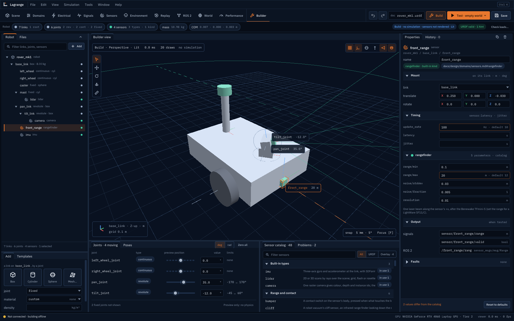
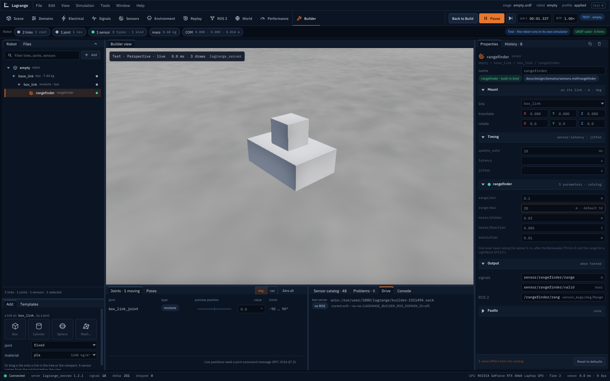
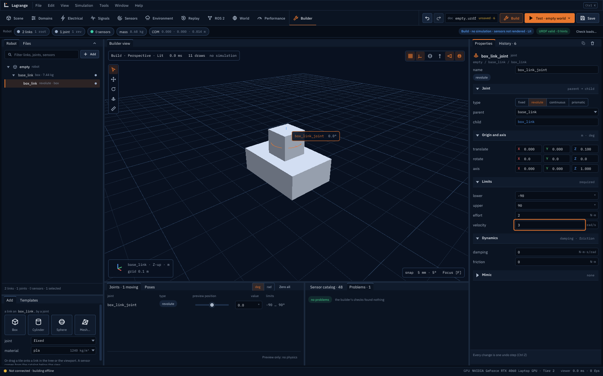
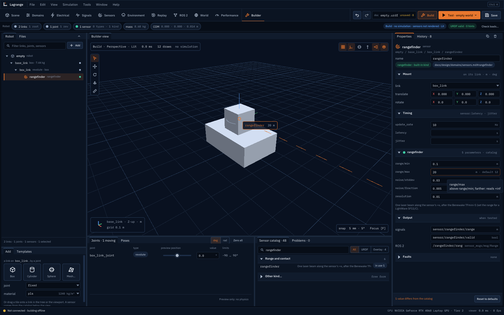
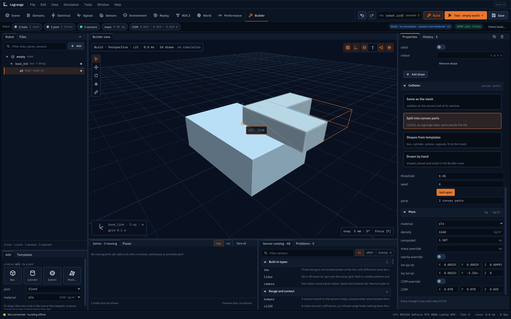

# The robot builder

The viewer's **Builder** workspace makes a robot without writing URDF by hand: links with simple
shapes or meshes, joints between them, sensors from the catalog of everything Lagrange
simulates. One click tests it in a simulator of its own, and Save writes an ordinary URDF that
`lagrange`, `lagrange_server` and any other URDF tool read. It needs no running simulation.
The design is RFC 0016 (`rfcs/0016-robot-builder.md`) and the screen's design
`docs/design/ui/12-builder/`.



## Opening it

```bash
lagrange viewer --workspace builder                     # a new robot
lagrange viewer --workspace builder --builder-open my_robot.urdf
```

In the viewer, the **Builder** tab is the last workspace tab, or press **Ctrl B**, also on the
launcher before connecting to anything. A `.xacro` file opens by expansion (`xacro` must be
installed); it is saved as a `.urdf` beside it, never over the `.xacro`.

## Build, Test, Save

The workspace bar's right side has the builder's own controls:

| Control | What it does |
|---|---|
| Undo, Redo | every change is one step (**Ctrl Z**, **Ctrl Shift Z** or **Ctrl Y**); the History tab beside Properties lists them and goes back to any |
| `doc` readout | the file name, and `unsaved · N`: the edits since the last save |
| **Build** | the mode you edit in. Nothing is simulated, no sensor is rendered, the view is drawn Lit: building costs almost nothing |
| **Test · empty world** | validates the robot, writes it to a temporary file and starts `lagrange_server` with it on this machine (joint control on; ROS 2 on your `ROS_DOMAIN_ID` + 1, or the domain `LAGRANGE_BUILDER_ROS_DOMAIN_ID` names, `off` for none); the viewer connects to it |
| **Save** | **Ctrl S**; its menu has Save as…, Open…, **Export USD…** (runs `lagrange_import`) and **Check loads…** (runs `lagrange check`: can each joint hold the robot against gravity) |

While testing, the view is the server's, live, with Play/Pause and Step; **Drive** lists the
ROS 2 topics the robot takes, each with a command line to copy, and **Console** shows the test
server's log. **Back to Build** (**Esc**) stops the test server and returns to the document as it
was. If the server refuses the robot, Problems shows why and Build stays active.



The Robot strip under the workspace bar counts links, joints by type, sensors, the total mass
and the centre of mass; its pill says whether the URDF is valid. Problems lists every finding
(error, warning, hint) with the item it is about; Test is refused while there is an error, Save
is not. An autosave goes to `$XDG_STATE_HOME/lagrange/builder/<robot>.autosave.urdf` every 30 s.

## Links and joints

A new robot is one link, `base_link`, a 0.3 × 0.2 × 0.1 m box. The **Add** panel (bottom left)
adds a link **on the selected link, by a joint**: the tiles **Box**, **Cylinder**, **Sphere** and
**Mesh…**, with the joint type and material under them as the defaults for the next tile. You can
also drag a tile onto a link in the tree or in the view, or use the tree's **Add** menu.

A link needs a mass: choose a material (its density), type a density, or set a mass override in
the link's Properties. The densities are those of the thermal presets; a link without one is a
Problem. Mass, centre of mass and the inertia tensor are computed from the shapes, and can be
overridden.

In the **Robot** tree, a child link's row shows its joint type and shape (`revolute · box`):
click the joint type to select the joint. Drag a row onto another link to re-parent it; the name field in
Properties renames it; **Delete** (or the bin in Properties' tab bar) removes the selection and
everything under it (one undo step).

A joint's Properties: the type (fixed, revolute, continuous, prismatic), parent and child, the
origin and axis, the limits, the dynamics (damping, friction) and mimic. Revolute and prismatic
joints need all four limits (lower, upper, effort, velocity): the builder invents no defaults, an
empty limit is a Problem. Angles are typed in degrees and written in radians.



The **Joints** panel has a slider per moving joint: dragging it poses the robot in the view by
forward kinematics only (nothing is simulated, it is not an undo step). **Poses** keeps named sets
of slider positions in the document.

## Sensors from the catalog

The **Sensor catalog** lists the built-in sensor types (camera, lidar, IMU) and the built-in
kinds (rangefinder, bumper, cliff sensor and the others of [Sensors](sensors.md)), in
groups, with any kinds from installed plugins'
catalog files after them. Filter by name; hover a row and press **Add** to put it on the selected
link, or drag it onto a link. The URDF and Overlay switches show what URDF holds and what needs
the overlay file (GNSS, magnetometer, barometer and radar, not built yet). **Other kind…** adds a
sensor of a kind the catalog does not know, with free keys and values.

The sensor's Properties: its mount (link, translate, rotate), timing (`update_rate`, `latency`,
`jitter`), and one section of the catalog's parameters with their units and defaults. A value
different from its default has an accent border and its default beside it; **Reset to
defaults** puts them all back. Output lists the signals and the ROS 2 topic the sensor will have.



## Meshes and how a link collides

**Mesh…** in Add takes an STL, OBJ, DAE or glTF file (the file dialog with a window, or a path
typed in its field; tick *file in millimetres* for a scale of 0.001), read as the simulator reads
it. A closed mesh's mass comes from its volume; a mesh that is not closed is a Problem and its
mass comes from its convex hull.

Each link's **Collision** section in Properties chooses how it collides, one of four:

1. **Same as the mesh**: the visual mesh collides. The simulator collides a mesh as the convex
   hull of its vertices (at most 256 points), so the builder draws that hull; a concave mesh is
   marked *its inside will be filled*.
2. **Split into convex parts**: CoACD, as `lagrange bake` does, with its threshold and seed. The
   parts are written beside the robot's file in `<robot>_collision/` (save the robot first). It
   needs `pip install coacd`.
3. **Shapes from templates**: a box, cylinder, sphere or capsule, and **Fit to mesh**: the
   tightest box or cylinder about the mesh's principal axes, or the enclosing sphere, to edit
   from there.
4. **Drawn by hand**: shapes placed over the translucent mesh in the view and sized with the
   gizmos and size handles, several per link.

The choice is written as a `lagrange_collision` attribute on the link (the loaders ignore it), so
the file reopens with the same choice.



## The Builder view, gizmos and keys

The view draws only the robot being edited. The tools on its left:

| Key | Tool |
|---|---|
| **Q** | Select |
| **W** | Move: the selected link's joint origin, or the selected sensor's mount |
| **E** | Rotate |
| **A** | Joint axis: drag the ring to snap the axis to x, y or z of the parent; Shift for any direction |
| **M** | Measure |
| **F** | Focus on the selection |
| **Esc** | drop a drag in progress; while testing, Back to Build |

Moves snap to 5 mm and 5° (hold **Ctrl** to toggle the snap). The toggles at the top right show
the grid, frames and joint axes, collision shapes, the centre of mass and inertia boxes, sensor
frustums and rays, and names.

## Templates

The **Templates** tab beside Add opens a starting robot as a new document: a differential-drive
base, a three-joint arm and a pan-tilt head (`assets/robots/templates/`). Save asks for a file;
the template stays as it is.

## Not supported yet

- **Test** into a world: only the empty world. *A sample world…*, *A world file…* and *Into the
  connected run* (RFC 0016 §7.2) are greyed.
- Joint sliders driving the test robot: the Joints panel shows the live positions only once a
  joint-command message exists (RFC 0016 §7.3).
- Motors, battery and bus, and the overlay-only sensors (GNSS, magnetometer, barometer, radar):
  RFC 0016 phase 3.
- Opening USD or SDFormat robots (phase 4); the builder opens URDF and xacro.
- Free-form modelling: the builder places primitives and meshes, it is not a CAD tool.

## Headless

For scripts and tests the viewer runs the Builder without a window:

```bash
lagrange_viewer --headless --size 1600x1000 --workspace builder \
    --builder-open robot.urdf --input "3:click:40,862" \
    --builder-save out.urdf --screenshot out.png
```

`--builder-save` writes the document at the end; the JSON report on stdout has a `builder`
object (links, joints, sensors, the mode, the history, Problems). `viewer/test/test_builder_acceptance.py`
builds a robot this way from start to Test and back and compares the file with a golden one.
