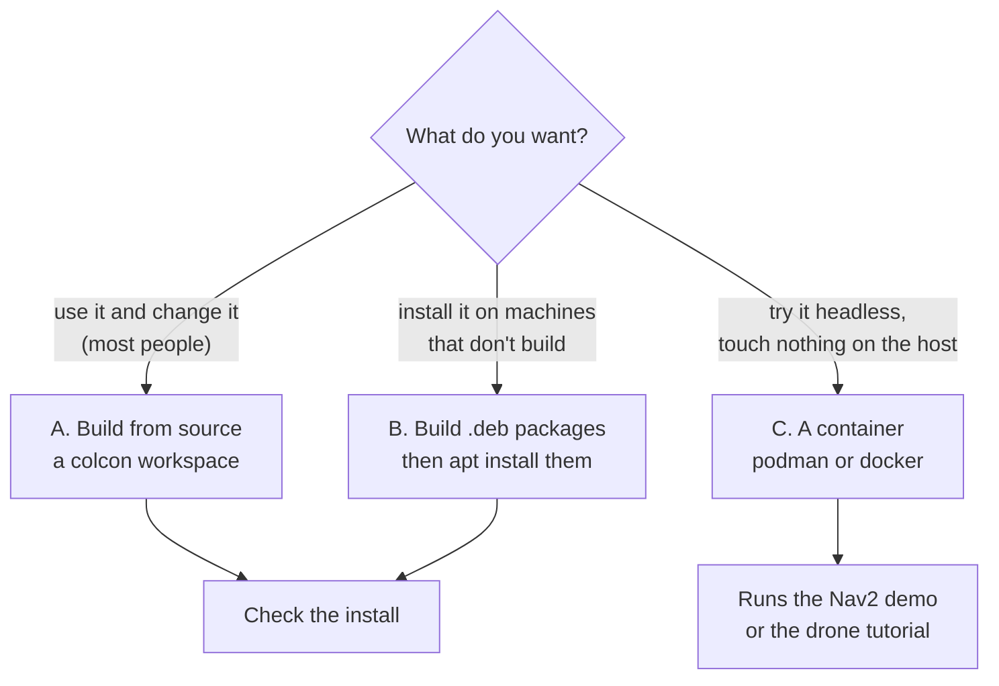

# Installing Lagrange

Lagrange runs on **Ubuntu 26.04 with ROS 2 Lyrical**, on amd64 (arm64 builds, without GPU
tests). It has no binary packages on the ROS buildfarm yet, so you build it yourself. There are
three ways to do that. Pick one:



| | A. From source | B. `.deb` packages | C. Container |
|---|---|---|---|
| Viewer window | yes | yes | no (no display) |
| Time, first time | about an hour (OpenUSD is most of it) | about an hour, then minutes per machine | about an hour |
| Disk | about 8 GB (`build/` and `install/`) | the debs, plus podman's cache | the image |
| Edit the code | yes | no | rebuild the image |

## What you need

- **Ubuntu 26.04 LTS** (Resolute Raccoon). Other versions and other systems aren't supported.
- **Memory:** 16 GB or more. The build compiles OpenUSD, and many compilers at once can use
  up 30 GB; the commands below limit that.
- **A GPU is optional.** With an NVIDIA RTX card you get the full tier (hardware ray-traced
  lidar, the live air box). With any other Vulkan GPU you get Tier 1. With none at all,
  everything still runs on the CPU (Tier 0), and the viewer draws with Mesa's software Vulkan.
  See [capability tiers](concepts.md).
- **A GPU driver with Vulkan**, if you have a GPU. For NVIDIA, install the proprietary driver
  (Software & Updates → Additional Drivers, or `sudo ubuntu-drivers install`) and reboot.

## 1. Install ROS 2 Lyrical

These are the steps from the
[official ROS 2 guide](https://docs.ros.org/en/lyrical/Installation/Ubuntu-Install-Debs.html).
If they differ from the guide by the time you read this, follow the guide.

```bash
# A UTF-8 locale
sudo apt update && sudo apt install -y locales
sudo locale-gen en_US en_US.UTF-8
sudo update-locale LC_ALL=en_US.UTF-8 LANG=en_US.UTF-8
export LANG=en_US.UTF-8

# The Universe repository and ROS's apt source
sudo apt install -y software-properties-common curl
sudo add-apt-repository universe
export ROS_APT_SOURCE_VERSION=$(curl -s https://api.github.com/repos/ros-infrastructure/ros-apt-source/releases/latest | grep -F "tag_name" | awk -F'"' '{print $4}')
curl -L -o /tmp/ros2-apt-source.deb "https://github.com/ros-infrastructure/ros-apt-source/releases/download/${ROS_APT_SOURCE_VERSION}/ros2-apt-source_${ROS_APT_SOURCE_VERSION}.$(. /etc/os-release && echo ${UBUNTU_CODENAME:-${VERSION_CODENAME}})_all.deb"
sudo dpkg -i /tmp/ros2-apt-source.deb

# ROS itself, and the build tools (colcon, rosdep)
sudo apt update && sudo apt upgrade -y
sudo apt install -y ros-lyrical-desktop ros-dev-tools
```

Check it:

```bash
source /opt/ros/lyrical/setup.bash
ros2 doctor --report | head -20
```

Add `source /opt/ros/lyrical/setup.bash` to your `~/.bashrc` if you don't want to type it in
every terminal.

## A. Build from source

### 2. Get the code and its dependencies

```bash
source /opt/ros/lyrical/setup.bash
mkdir -p ~/lagrange_ws/src && cd ~/lagrange_ws
git clone -b dev https://github.com/Open-Physical-Systems/Lagrange.git src/lagrange
```

rosdep installs everything the packages list. Lagrange needs a few keys that aren't in ROS's
list yet (two Python packages from PyPI, `mcap` and `coacd`, and some Ubuntu packages without a
key). Register them once:

```bash
sudo rosdep init 2>/dev/null || true      # only the first time on this machine
echo "yaml file://$PWD/src/lagrange/packaging/rosdep/lagrange.yaml" | \
  sudo tee /etc/ros/rosdep/sources.list.d/10-lagrange.list
rosdep update
```

Then install them. The pip packages are pinned to the versions in
`packaging/pip-constraints.txt`:

```bash
PIP_BREAK_SYSTEM_PACKAGES=1 PIP_CONSTRAINT=$PWD/src/lagrange/packaging/pip-constraints.txt \
  rosdep install --from-paths src --ignore-src -y
```

```{note}
`PIP_BREAK_SYSTEM_PACKAGES=1` lets pip install `mcap` and `coacd` into the system Python, which
Ubuntu otherwise refuses. If you'd rather not, make a virtual environment with
`python3 -m venv --system-site-packages ~/lagrange_venv`, install `mcap` and `coacd` there with
the same constraints file, and add `-DPython3_EXECUTABLE=$HOME/lagrange_venv/bin/python` to the
`--cmake-args` below.
```

This also installs Nav2 and MoveIt 2, which the demos use; the simulator itself doesn't need
them.

### 3. Build

```bash
cd ~/lagrange_ws
MAKEFLAGS=-j8 colcon build --parallel-workers 2 --symlink-install \
  --cmake-args -DCMAKE_BUILD_TYPE=RelWithDebInfo
```

`--parallel-workers 2` and `MAKEFLAGS=-j8` keep memory in check while OpenUSD compiles. With
32 GB or more you can raise them. The first build takes about an hour; later ones only rebuild
what changed.

To build only the simulator and what it needs, and skip the demos and examples:

```bash
MAKEFLAGS=-j8 colcon build --parallel-workers 2 --symlink-install \
  --packages-up-to lagrange_server lagrange_viewer lagrange_python \
  --cmake-args -DCMAKE_BUILD_TYPE=RelWithDebInfo
```

### 4. Use it

In every new terminal:

```bash
source /opt/ros/lyrical/setup.bash
source ~/lagrange_ws/install/setup.bash
```

Then go to [Check the install](#check-the-install).

### Updating

```bash
cd ~/lagrange_ws/src/lagrange && git pull
cd ~/lagrange_ws
PIP_BREAK_SYSTEM_PACKAGES=1 PIP_CONSTRAINT=$PWD/src/lagrange/packaging/pip-constraints.txt \
  rosdep install --from-paths src --ignore-src -y
MAKEFLAGS=-j8 colcon build --parallel-workers 2 --symlink-install \
  --cmake-args -DCMAKE_BUILD_TYPE=RelWithDebInfo
```

### Running the tests (optional)

```bash
colcon test --parallel-workers 2 && colcon test-result --verbose
```

## B. Build `.deb` packages

This builds every package as a `ros-lyrical-lagrange-*` deb in a clean `ros:lyrical` container,
so you can install them with apt on machines that never build anything. It needs podman
(`sudo apt install podman`) and a clone of the repository. Details are in
[`packaging/README.md`](../../packaging/README.md).

```bash
git clone -b dev https://github.com/Open-Physical-Systems/Lagrange.git && cd Lagrange
packaging/debs/build_debs.sh ~/lagrange_debs        # about an hour; resumes if stopped
```

On each machine (with ROS 2 Lyrical installed as in step 1):

```bash
sudo apt install ~/lagrange_debs/*.deb
PIP_BREAK_SYSTEM_PACKAGES=1 pip3 install -c packaging/pip-constraints.txt mcap coacd
source /opt/ros/lyrical/setup.bash
```

`packaging/test_install.sh ~/lagrange_debs` checks the debs the way a clean machine would: it
installs them into an image with nothing else and runs the simulator.

## C. A container

For a headless try that leaves the host alone. There's no viewer in it.

```bash
git clone -b dev https://github.com/Open-Physical-Systems/Lagrange.git && cd Lagrange
podman build -f packaging/container/Containerfile -t lagrange:dev .
podman run --rm lagrange:dev                             # the AMR patrols with Nav2 for a minute
podman run --rm lagrange:dev tools/ci/tutorial_drone.sh  # the drone tutorial, without PX4
```

Docker reads the same file: `docker build -f packaging/container/Containerfile -t lagrange:dev .`

## Check the install

```console
$ ros2 run lagrange_server lagrange info
lagrange 1.0.0 (RelWithDebInfo)
ROS 2          lyrical
sample robot   .../share/lagrange_assets/robots/amr_diffdrive/amr_diffdrive.urdf
...
GPU [0]        Intel(R) Iris(R) Xe Graphics (RPL-P), Tier 1 (raster GPU)
GPU [1]        NVIDIA GeForce RTX 4060 Laptop GPU, Tier 2 (full, hardware ray tracing) (selected)
GPU [2]        llvmpipe (LLVM 21.1.8, 256 bits), Tier 0 (CPU)
```

Your GPUs will differ. `ros2 run lagrange_gpu lagrange_gpu_info` says more about each one.

Then run something (`lagrange samples` lists them all):

```bash
lagrange amr      # the AMR in the warehouse, with the viewer
lagrange quad     # the quadcopter on the open field, hovering
```

(`lagrange` is on the PATH once you've sourced the workspace. If it isn't, use
`ros2 run lagrange_server lagrange`.)

Without ROS, from Python:

```bash
python3 -c "import lagrange; sim = lagrange.Simulation(lagrange.sample_robot(), world=lagrange.sample_world()); sim.step_until(1.0); print(sim.read('body/base_link/pose'))"
```

Next: [Tutorial: an AMR in a warehouse](tutorial-amr.md).

## Optional extras

| For | You need | Where |
|---|---|---|
| The Nav2 and MoveIt 2 demos | installed by rosdep in step 2 | [AMR tutorial](tutorial-amr.md), [arm tutorial](tutorial-arm.md) |
| PX4 missions | PX4 v1.17.0 SITL built in `~/PX4-Autopilot` | [drone tutorial](tutorial-drone.md) |
| ArduPilot missions | ArduCopter 4.7.2 SITL built in `~/ardupilot` | [drone tutorial](tutorial-drone.md) |
| Autoware | the Autoware messages built in an underlay | [Autoware](autoware.md) |
| `lagrange foam`, `foam-hover` | OpenFOAM installed, or podman/docker (it pulls `opencfd/openfoam-default:2512`) | [CLI](cli.md) |
| The real-model samples (Lexus, Holybro X500 V2, AMR_FMS) | `ros2 run lagrange_assets fetch_assets` (network) | [Test your own drone](tutorial-custom-drone.md) |
| Real-place worlds (Zurich, Tokyo) | `tools/ci/build_sample_world.sh --place zurich` (network) | [huge worlds tutorial](tutorial-huge-worlds.md) |
| The electrical hand check | `sudo apt install ngspice` | [power tutorial](tutorial-power.md) |
| This documentation site, locally | Python 3 (it makes its own virtual environment) | `tools/docs/build.sh --serve` |

## When something goes wrong

| What you see | Why, and what to do |
|---|---|
| The build is killed, or the machine freezes during OpenUSD | Out of memory. Use `--parallel-workers 1` and `MAKEFLAGS=-j4`, then build again; colcon carries on where it stopped. |
| `rosdep`: "Cannot locate rosdep definition for [python3-mcap-pip]" | The project's keys aren't registered. Run the `10-lagrange.list` step and `rosdep update`. |
| pip: "externally-managed-environment" | Add `PIP_BREAK_SYSTEM_PACKAGES=1`, or use a virtual environment as in the note in step 2. |
| `lagrange: command not found` | Source `~/lagrange_ws/install/setup.bash` in this terminal. |
| `lagrange info` lists only `llvmpipe` | No Vulkan driver for your GPU. Install the driver and reboot; `vulkaninfo --summary` (package `vulkan-tools`) should then list your GPU. |
| The viewer doesn't open on Wayland | Try `SDL_VIDEO_DRIVER=x11 lagrange amr` to use XWayland, and report it with your GPU and driver. |
| ROS nodes don't see each other after a crash | A killed process left Fast DDS shared memory behind. Run `fastdds shm clean`. |
| `ros2 topic list` is empty with the simulator running | Another `ROS_DOMAIN_ID` in one of the terminals, or the simulator was started with `--no-ros`. |
