# Robots and worlds

Every picture on this page is a real run: the simulator with the robot and world named under it,
seen through the viewer. The commands run as they are after
[installing Lagrange](install.md) and sourcing the workspace.

## Mobile robots (AMR)

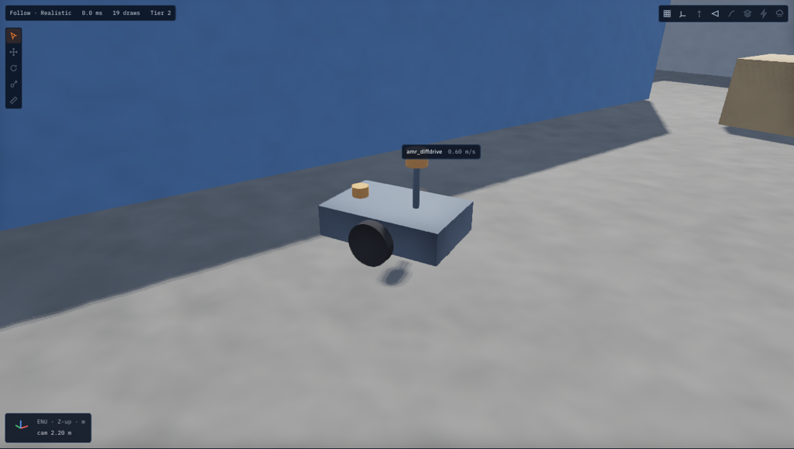

**The sample AMR** is a differential-drive robot with two lidars, an IMU, two drive motors and a
battery on a 48 V bus. It drives a demo loop round the sample warehouse until `/cmd_vel`
takes over, and Nav2 can drive it through the warehouse.

```bash
lagrange amr
```

[Tutorial: an AMR in a warehouse](tutorial-amr.md) · [Rigid body](../physics/rigid-body.md) ·
[Sensors](../physics/sensors.md) · [Motors](../physics/motors.md) · [Battery](../physics/battery.md)

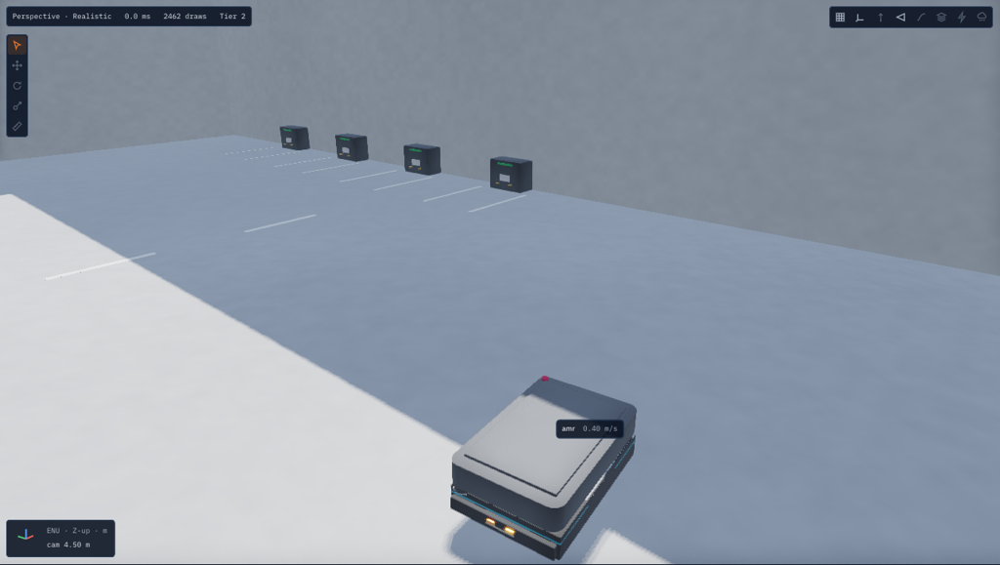

**A swerve AMR** (AMR_FMS), whose wheels steer on their own, so `/cmd_vel` with `linear.y` moves
it sideways. It runs in its own 60 m × 40 m warehouse.

```bash
lagrange swerve
```

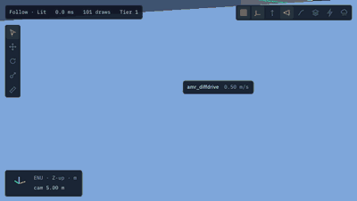

**People** walk round the robot, step by step, and steer away from it and from each other. The
lidars and cameras see them; [Tutorial: people around your robot](tutorial-humans.md),
[Humans](../physics/humans.md).


## Drones

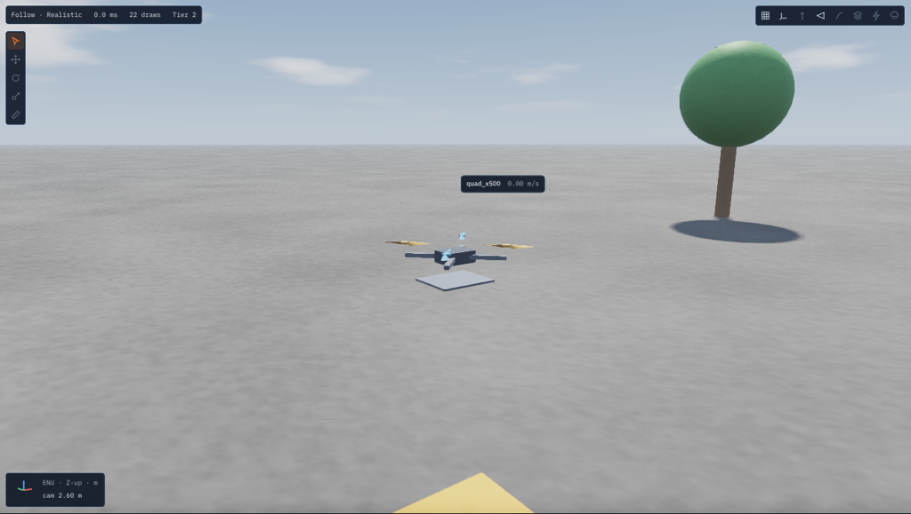

**The sample quadcopter** (500 mm, four rotors, a 4S battery, an IMU, GNSS, magnetometer and
barometer) takes off and hovers, flies by `/cmd_vel`, and flies PX4 and ArduPilot missions in
lockstep. Its rotors can be thrust coefficients or blade elements, and its downwash is
computed, fitted or live.

```bash
lagrange quad
```

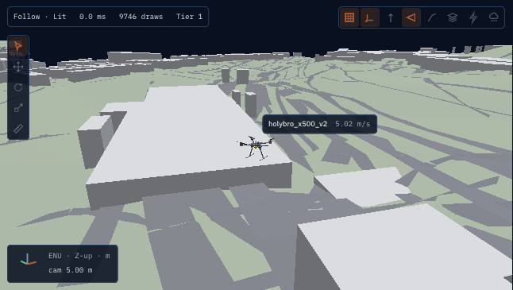

**The Holybro X500 V2**, PX4's reference frame, with its real mesh (fetched with
`ros2 run lagrange_assets fetch_assets holybro_x500_v2`), here over Zurich, a world built from
the Copernicus elevation model and OpenStreetMap.


[Tutorial: a quadcopter](tutorial-drone.md) ·
[Test your own drone](tutorial-custom-drone.md) · [Rotors](../physics/rotors.md) ·
[Downwash](../physics/downwash.md) · [Weather](../physics/weather.md)

## Cars and autonomous cars

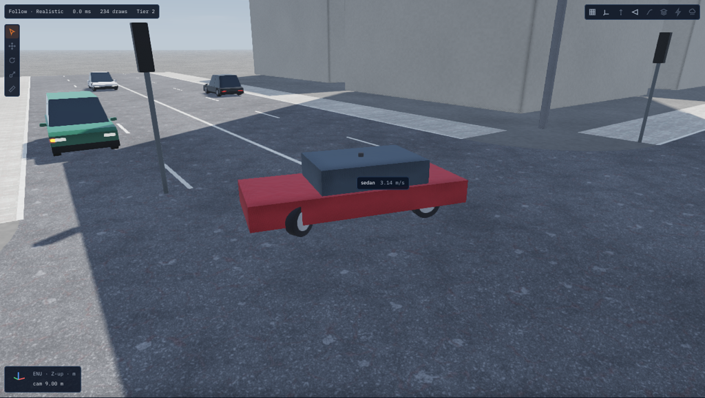

**The sample sedan** runs on vehicle dynamics: suspension, Magic Formula tyres, brakes,
Ackermann steering and an electric or engine powertrain. It drives round the city block among
traffic that follows its lanes and lights, has a radar and a camera, runs OpenSCENARIO
scenarios, and takes Autoware's commands.

```bash
lagrange sedan
```

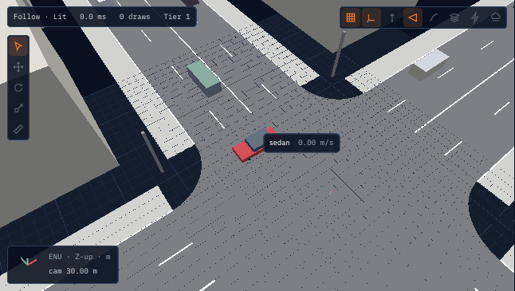

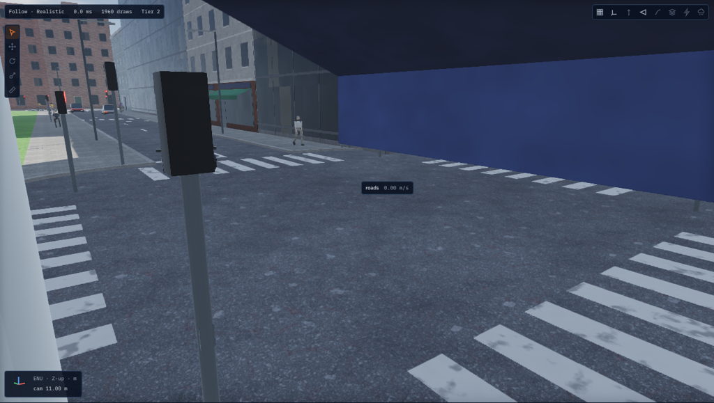

**The town**: working traffic lights, zebra crossings whose buttons people press, walking
people and self-driving cars. `lagrange drive` puts the sedan in it waiting for `/cmd_vel`.

```bash
lagrange town
```


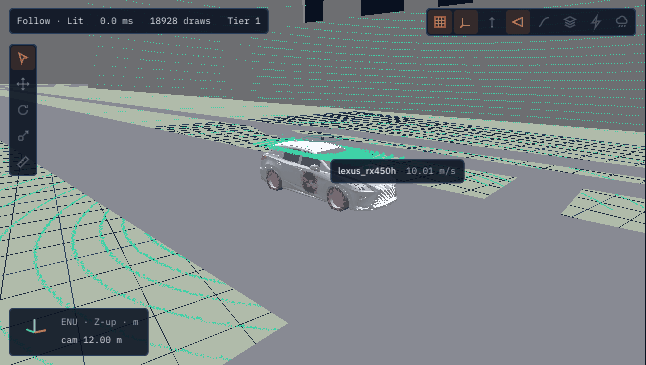

**The Lexus RX 450h**, Autoware's sample vehicle, with its mesh and dimensions, here in
Nishi-Shinjuku, Tokyo.

[Tutorial: a car in a city block](tutorial-cars.md) · [Autoware](autoware.md) ·
[Vehicles](../physics/vehicles.md) · [Traffic](../physics/traffic.md)

## Arms

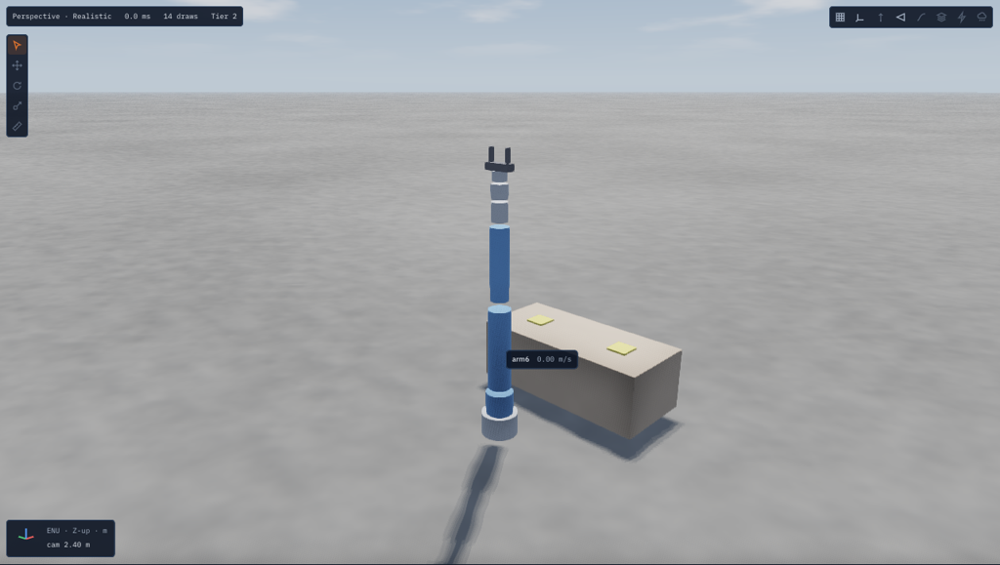

**The sample 6-DoF arm** on a 48 V bus, driven by MoveIt 2 through `joint_trajectory_controller`.
Its motors heat up, and an undersized set of motors derates and misses its moves.

```bash
ros2 launch lagrange_demos arm6_workcell.launch.py viewer:=true
```


[Tutorial: the sample arm with MoveIt 2](tutorial-arm.md) ·
[Thermal](../physics/thermal.md) · [Electrical network](../physics/electrical-network.md)

## Legged robots

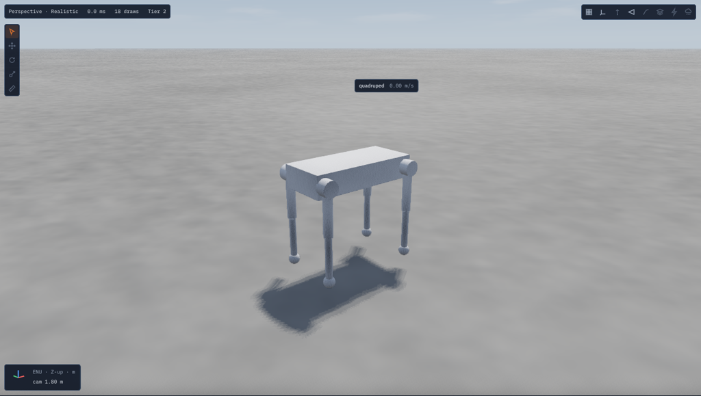

**A quadruped** settles into its stance and trots, joint by joint, from an ordinary ROS 2 node
(`examples/lagrange_example_quadruped`).

```bash
ros2 launch lagrange_example_quadruped trot.launch.py
```

## On and under water


Bodies float, sink and drift in a current and in waves; a vehicle can carry its own Fossen
added mass and damping, such as the BlueROV2 Heavy's. [Water](../physics/water.md).

## Worlds

| World | What is in it | Run it |
|---|---|---|
| Sample warehouse | Racks, pallets, walls | `lagrange amr` |
| AMR_FMS warehouse | 60 m × 40 m, docks | `lagrange swerve` |
| Open field | 50 m field, a landing pad, trees, a shed | `lagrange quad` |
| Drone building | A 12 m building to fly beside and over | `lagrange run profiles/examples/quad_x500_downwash.yaml` |
| Power line | A 400 A line next to a hovering drone | [Tutorial: weather, interference and radio links](tutorial-environment.md) |
| City block | OpenDRIVE roads, a junction, buildings, traffic | `lagrange sedan` |
| Town | Lights, crossings with buttons, people, cars | `lagrange town` |
| Tiled town | A world streamed in tiles round the robot | [Tutorial: huge worlds](tutorial-huge-worlds.md) |
| Zurich, Tokyo | Real places from open data, 40 km | `tools/ci/build_sample_world.sh --place zurich` |
| Pond | Water for floating and sinking | `lagrange --robot none --world assets/worlds/pond/pond.usda` |
| Workcell | The arm's table | `ros2 launch lagrange_demos arm6_workcell.launch.py` |

`lagrange samples` lists the samples. More clips are in the [feature videos](../videos/README.md).
