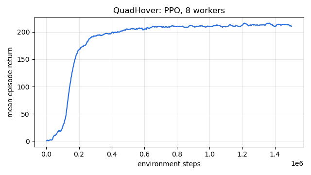
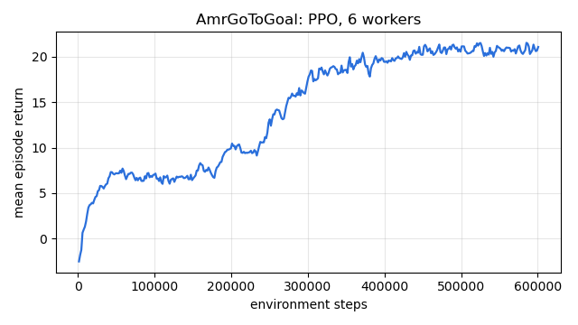

# Training a policy

Lagrange runs headless inside Python, one simulation per process, so a learning library can drive
it like any Gymnasium environment. `lagrange.tasks` holds ready tasks on the sample robots: what
the policy sees, what its actions do, the reward, and when an episode ends. This page trains two
of them with PPO from Stable-Baselines3 and measures the result against a random policy and the
built-in controller.

## 1. The tasks

```python
from lagrange.tasks import QuadHover, QuadWaypoint, AmrGoToGoal

env = QuadHover()
observation, info = env.reset(seed=1)
observation, reward, terminated, truncated, info = env.step(env.action_space.sample())
```

| Task | Robot and world | Action | Observation | Episode |
|---|---|---|---|---|
| `QuadHover` | sample quadcopter, open air | thrust and body rates (4) | position error, velocity, attitude, body rates (18) | 5 s at 50 Hz |
| `QuadWaypoint` | sample quadcopter, open air | thrust and body rates (4) | errors to this and the next waypoint, velocity, attitude, body rates (21) | 15 s, or the last waypoint |
| `AmrGoToGoal` | sample AMR, sample warehouse | forward speed and turn rate (2) | goal in the robot's frame, its distance, bearing and heading, speeds; with `lidar=True` 16 lidar sectors (9 or 25) | 20 s at 10 Hz, or the goal |

Each is a `LagrangeEnv`: a Gymnasium `Env` when Gymnasium is installed (`check_env` passes),
numpy alone otherwise. They build in worker processes through `ParallelEnvs` or `VectorEnv`:

```python
import functools
from lagrange.envs import VectorEnv
from lagrange.tasks import make

envs = VectorEnv(functools.partial(make, "AmrGoToGoal", lidar=True), 8)
```

### Why thrust and body rates for the quadcopter

The quadcopter tasks fly by collective thrust and body rates
(`Simulation.command_flight("rates", [thrust_over_mass, p, q, r])`): Lagrange's built-in
controller keeps its rate loop, its mixer and each rotor's speed loop, and the policy replaces its
position and attitude loops. Commanding each rotor instead would make the policy learn the
propellers' torque-to-thrust ratios and the motors' lag on top of flying, and its output would fit
no real autopilot; thrust and rates is what PX4 takes from an offboard computer as a rate set
point and what Betaflight's acro mode flies, and Kaufmann et al. ("A Benchmark Comparison of
Learned Control Policies for Agile Quadrotor Flight", ICRA 2022) found it the best of the action
spaces they compared. The motors stay simulated (`profiles/examples/quad_x500_rl.yaml`: the
electrical network at 50 µs, the sensors on ground truth): with ideal motors the built-in rate
loop rings once a disturbance has set it rolling.

### Rewards

Per step; the full definitions are in each class's docstring (`python/lagrange/tasks.py`).

**QuadHover** (target: the hover point plus up to ±1 m across, -0.5 to +1 m up; each start
kicked by a random thrust and rates for up to 0.2 s):

| Term | Range |
|---|---|
| `1 - tanh(|e|)`, e the position error (m) | 0..1: 1 at the target, 0.24 at 1 m |
| `-0.05 |ω|`, body rates (rad/s) | about -0.25..0 |
| `-0.01 |a|²`, the action | -0.04..0 |
| crash: within 0.3 m of the ground, tilted past 80°, or 3 m off | -10, and the episode ends |

Success: still flying at 5 s, within 0.2 m of the target.

**QuadWaypoint** (four points, each 1 to 2.5 m from the last): `10 (d_before - d_after)` for
progress, +5 at each waypoint (within 0.3 m), the same rate and action terms, -10 for a crash or
straying 4 m. Success: the last waypoint.

**AmrGoToGoal** (a goal 1 to 4 m from the start in the warehouse aisle): `5 (d_before -
d_after)` for progress, -0.01 a step, +10 at the goal (within 0.3 m; with `heading_tolerance`
also facing its heading), -10 when the body touches a wall or a rack. Success: the goal.

### Baselines

`step_builtin()` steps each task with a reference controller instead of an action: for the
quadcopter Lagrange's own cascade, flown by velocity commands towards the target; for the AMR,
which has no built-in go-to-goal controller, a hand-written law (turn towards the goal, drive as
the heading allows).

## 2. Train

Stable-Baselines3 (MIT) and torch (BSD-3-Clause) are not dependencies of Lagrange; put them in a
virtual environment that also sees the ROS Python packages:

```bash
python3 -m venv --system-site-packages ~/venvs/rl
~/venvs/rl/bin/pip install torch --index-url https://download.pytorch.org/whl/cpu
~/venvs/rl/bin/pip install stable-baselines3 matplotlib
source ~/venvs/rl/bin/activate
ros2 launch lagrange_example_rl train.launch.py task:=quad_hover workers:=8 steps:=1000000
ros2 launch lagrange_example_rl train.launch.py task:=amr_goal workers:=8 steps:=300000
```

(Without them, the launch says so in its `RESULT:` line and ends.) The script,
`examples/lagrange_example_rl/scripts/ppo.py`, wraps `ParallelEnvs` in Stable-Baselines3's
`VecEnv` interface, normalises observations and rewards (`VecNormalize`), and trains a 64×64
MLP. It writes to `$XDG_STATE_HOME/lagrange/rl/<task>/`: `curve.csv` and `curve.png`, the model
(`model.zip`), the actor as plain arrays (`policy.npz`, which `lagrange.tasks.NumpyPolicy` runs
without torch), and `report.json`.

## 3. What it gives

Two runs on a 20-thread laptop CPU shared with other jobs (load 50 to 110 during the runs), PPO
with Stable-Baselines3 2.9.2 and torch 2.15.0 on the CPU: 64×64 tanh MLP, `log_std_init` -1,
512 per minibatch, 10 epochs, clip 0.2, learning rate 3e-4, advantage λ 0.95, γ 0.99, 256 steps per
environment per update, observations and rewards normalised. Then 20 episodes each, seeded
10000 to 10019, with the policy (its mean action), a random policy (uniform actions) and the
reference controller:

| Task | Workers | Steps | Wall time | PPO | Random | Built-in |
|---|---|---|---|---|---|---|
| `QuadHover` | 8 | 1,501,184 | 1354 s (23 min) | 20/20, return 218.8 | 0/20, 1.4 | 20/20, 210.2 |
| `AmrGoToGoal` (lidar) | 6 | 600,576 | 1065 s (18 min) | 20/20, return 20.5, 41 steps | 0/20, -2.0 | 20/20, 20.2, 65 steps |



The hover policy crashes through most episodes of its first 100,000 steps, has a mean return
of 137 at 166,000 and about 200 by 400,000, and ends a little above the built-in cascade on
this reward (218.8 against 210.2 over the 20 episodes).



The AMR policy reaches every goal in 41 steps on average (4.1 s) against the hand-written
law's 65. A first run without the bearing in the observation (only the goal's x and y in the
robot's frame, which normalised to nearly nothing near the goal; also 128 steps per update and
γ 0.98) stalled at a return of about 7
after 400,000 steps: it came within a metre and then turned on the spot, 4 goals of 20. The
turn rate the AMR reaches is also well below the one asked for when it turns on the spot (about
0.7 of 1.5 rad/s): joint control's wheel speed loop is proportional only, and the casters and
tyre scrub load it; the policy learns with what it gets.

Throughput: a `QuadHover` step (20 ms of flight, the electrical network at 50 µs) costs about
1.4 ms in one process, an `AmrGoToGoal` step (100 ms, two lidars) about 6 ms; with PPO's own
work in the main process the runs above made about 1,100 and 560 steps a second.

The trained policies are in `examples/lagrange_example_rl/policies/` (`quad_hover.npz`,
`amr_goal.npz`, 24 kB each); `ppo.py TASK --evaluate POLICY.npz` repeats the evaluation, and the
commands of section 2 retrain them (the numbers move with the machine and its load, not with
the seeds: the runs are seeded, but worker processes on a shared machine step in a different
order).

## 4. Watch it fly

`fly_policy` lets the built-in controller take off, then flies the trained hover policy
through five targets in turn (4 s each: 1 m to the side, up, across, down, home), records the
run, and prints how close it settled to each (all within 0.05 m with the committed policy).
`lagrange_server --replay` serves the recording to the viewer:

```bash
ros2 run lagrange_example_rl fly_policy quad_hover --hold 4 \
    $(ros2 pkg prefix lagrange_example_rl)/share/lagrange_example_rl/policies/quad_hover.npz hover.mcap
ros2 run lagrange_server lagrange_server --replay hover.mcap --listen unix:/tmp/hover.sock &
ros2 run lagrange_viewer lagrange_viewer --connect unix:/tmp/hover.sock \
    --scope body/base_link/pose.x,body/base_link/pose.y,body/base_link/pose.z
```

`fly_policy amr_goal POLICY.npz OUT.mcap` drives the AMR policy to four goals in the warehouse
the same way.
