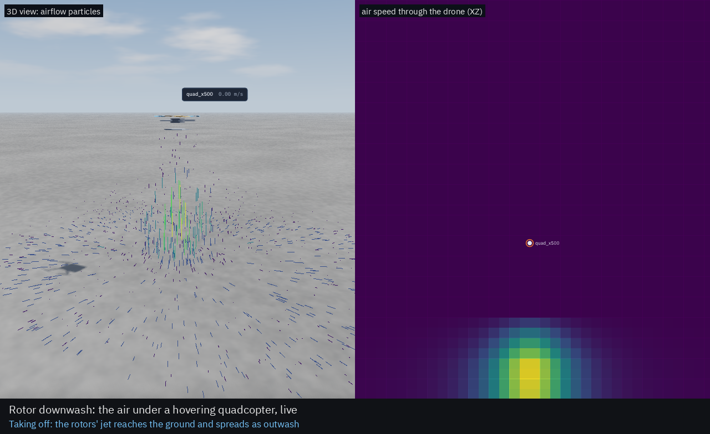
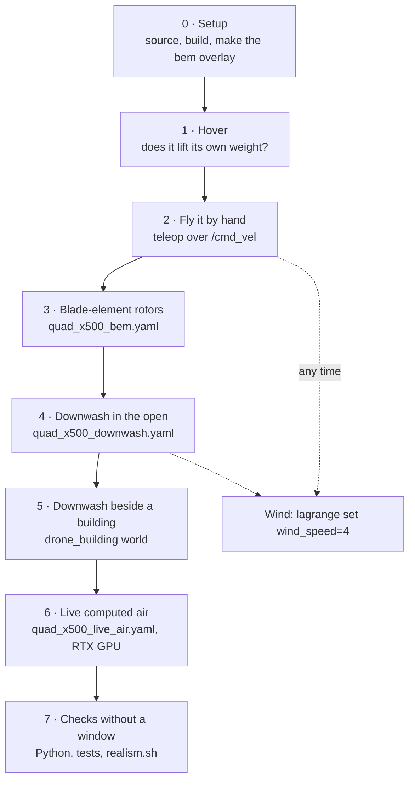
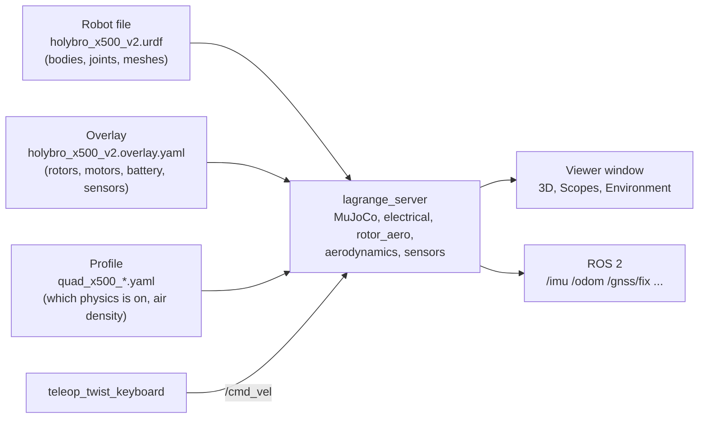
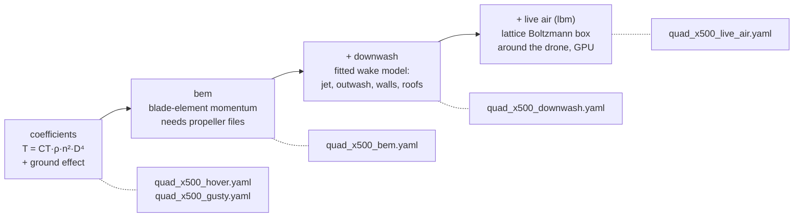
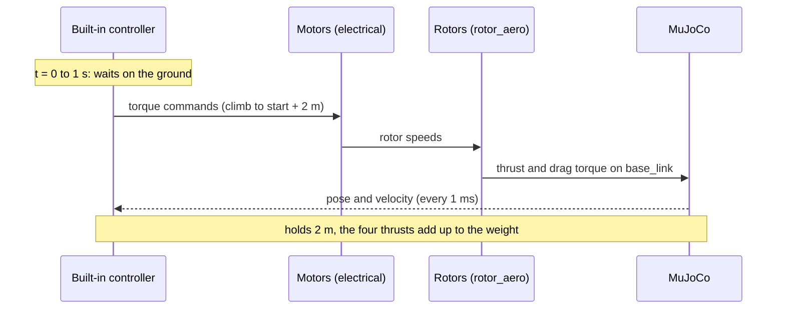
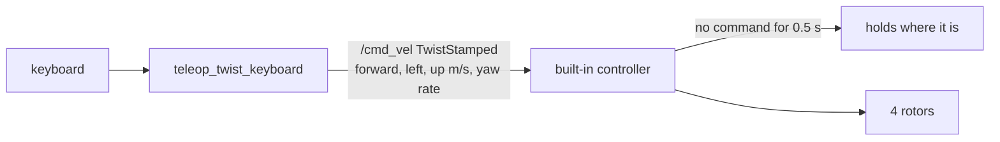
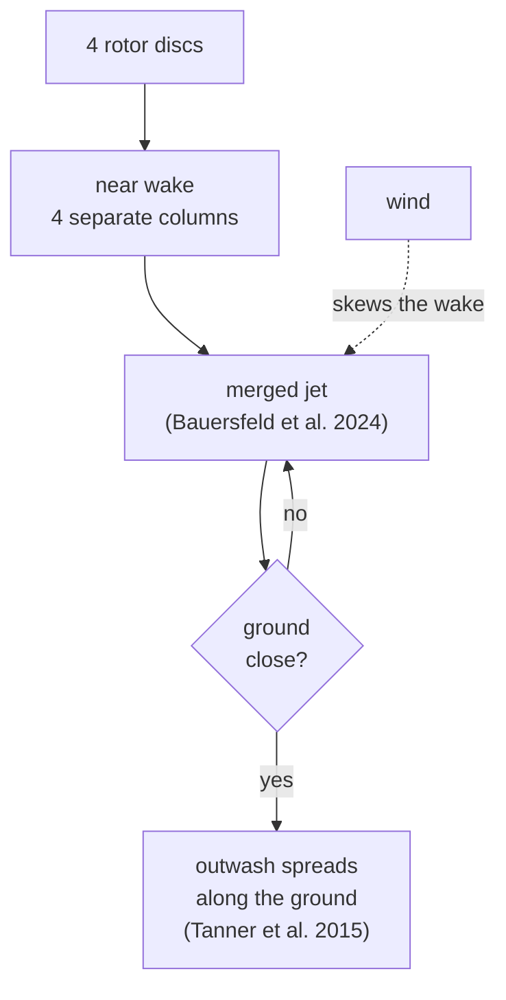
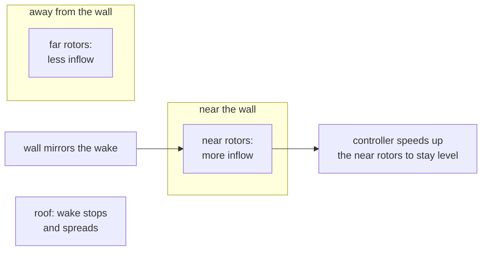
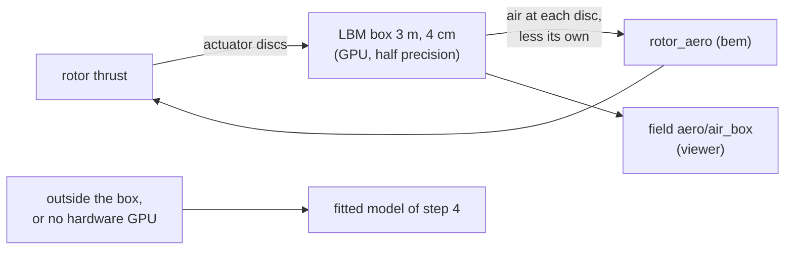
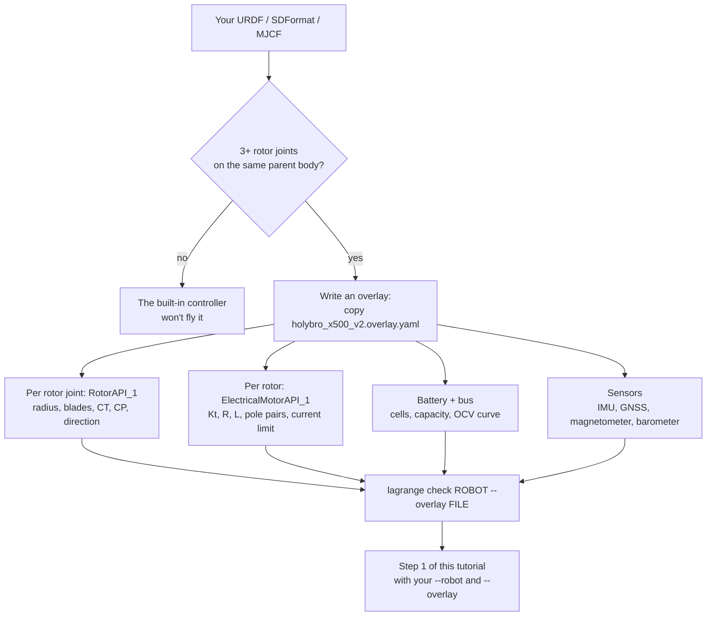

# Tutorial: test your own drone, step by step

This tutorial takes a drone that is not one of Lagrange's samples, the Holybro X500 V2 (PX4's
model, in `assets/robots/holybro_x500_v2/`), and tests it from a first hover up to live computed
air. The same steps work for any multirotor of yours: swap in your URDF and overlay (see
[Your own drone](#your-own-drone) at the end).

You need Lagrange built and the Holybro's meshes fetched once
(`ros2 run lagrange_assets fetch_assets holybro_x500_v2`).



The videos below are of the sample quadcopter, `quad_x500`; the Holybro does the same.

## The whole path at a glance



Each step adds one physics model on top of the last, so when something looks wrong you know
which model to blame.

## What goes into a run

Every command in this tutorial has the same three inputs:



- The **robot file** is the shape: links, joints, meshes. A plain URDF can't say "this joint is a
  rotor with a 10 inch propeller driven by a 920 KV motor".
- The **overlay** says exactly that: `RotorAPI_1` on each rotor joint, a motor on each, a 4S
  battery, a bus, and the IMU, GNSS, magnetometer and barometer.
- The **profile** picks which physics runs and how detailed it is.

The first argument to `lagrange` is always the profile. The robot goes after `--robot` and the
overlay after `--overlay`. Putting the overlay first gives `unknown key apply; a run file has ...`.

## How detailed are the rotors?

The profiles go from simple to detailed:



The Holybro overlay gives each rotor a thrust and power coefficient (APC 10x4.7 from the UIUC
database) but no blade geometry. Steps 3 to 6 need blade geometry, so in step 0 you make a copy
of the overlay that names propeller files.

## Step 0 · Setup

Run these lines in **every** new terminal:

```bash
cd ~/Documents/Research/Lagrange
source /opt/ros/lyrical/setup.bash
source install/setup.bash
```

Build once, if you haven't since the last pull:

```bash
MAKEFLAGS=-j8 colcon build --symlink-install --parallel-workers 2 \
    --cmake-args -DCMAKE_BUILD_TYPE=RelWithDebInfo
```

Make the overlay copy with propeller files (`generic_10in_2blade`, a 10 inch two-blade
propeller, the Holybro's size):

```bash
P=$PWD/assets/propellers
sed -e "s|^\( *\)aero:rotor:direction: ccw|&\n\1aero:rotor:propeller: $P/generic_10in_2blade_ccw.prop.yaml|" \
    -e "s|^\( *\)aero:rotor:direction: cw|&\n\1aero:rotor:propeller: $P/generic_10in_2blade_cw.prop.yaml|" \
    assets/robots/holybro_x500_v2/holybro_x500_v2.overlay.yaml > /tmp/holybro_bem.overlay.yaml
grep -c "aero:rotor:propeller" /tmp/holybro_bem.overlay.yaml     # must print 4
```

Short names for the rest of the tutorial (set them again in each new terminal):

```bash
R="--robot assets/robots/holybro_x500_v2/holybro_x500_v2.urdf"
O="--overlay assets/robots/holybro_x500_v2/holybro_x500_v2.overlay.yaml"
B="--overlay /tmp/holybro_bem.overlay.yaml"
```

## Step 1 · Hover

```bash
lagrange profiles/examples/quad_x500_hover.yaml $R $O --world none
```

The terminal shows, among other lines:

```text
[profile] applied; the run restarted at t = 0
[stage] loaded assets/robots/holybro_x500_v2/holybro_x500_v2.urdf · 5 bodies, 5 joints, ...
[controller] multicopter: the built-in controller takes off after 1 s and hovers 2 m above the start
[sensors] IMU imu on base_link at 250 Hz
[sensors] GNSS gnss on base_link at 10 Hz
```

Two lines at the very top, `the rotors do not run without the site's air density` and
`GNSS ... do not run without the site's geo origin`, come from before the profile is applied.
Ignore them when `[profile] applied` follows.

What happens:



**Check it:**

- **Height:** it lifts off after 1 s and stops about 2 m up. In a headless run it settled at
  z = 2.23 m (it starts at 0.23 m).
- **Thrust:** in the viewer's Scopes, plot `rotor/rotor_1_joint/thrust` to `rotor_4_joint`.
  They add up to the weight: 2.064 kg × 9.81 = 20.25 N, so about 5.06 N each. (Measured: 20.24 N.)
- **Battery:** `battery/battery/terminal_voltage` and `battery/battery/soc` drop slowly while it
  hovers.

## Step 2 · Fly it by hand

Leave step 1 running. In a **second terminal** (do step 0's `source` lines first):

```bash
ros2 run teleop_twist_keyboard teleop_twist_keyboard --ros-args -p stamped:=true
```

Keep that terminal focused while you press keys:

| Key | Does |
|---|---|
| `i` / `,` | forward / back |
| `J` / `L` (Shift) | left / right, sideways |
| `j` / `l` | turn left / right |
| `t` / `b` | up / down |
| `k` | stop |
| `q` / `z` | faster / slower |



**Check it:**

- **Moving:** it goes where you send it and tilts into the motion.
- **Stopping:** when you stop pressing, it holds its position after 0.5 s.
- **Ground effect:** go down with `b` to about 0.3 m and plot `joint/rotor_1_joint/velocity`.
  The rotors slow down: near the ground each turn of the blades gives more thrust, and the
  controller needs only the weight.
- **Limit:** it never descends faster than 2 m/s (the controller's cap).

**Wind, any time from here on:** in a third terminal,

```bash
lagrange set wind_speed=4 wind_from=270     # 4 m/s from the west
lagrange set wind_speed=0                   # back to still air
```

For wind in the hover profile, use `quad_x500_gusty.yaml` instead (8 m/s with Dryden
turbulence). The drone leans into the wind and drifts while the controller catches up.

## Step 3 · Blade-element rotors

Close step 1's viewer (that also stops its server), then:

```bash
lagrange profiles/examples/quad_x500_bem.yaml $R $B --world none
```

Now each rotor's thrust comes from its blades: the twist and chord of every section, the air
coming through the disc, and the tip losses.

**Check it:**

- **Blades:** the propellers are drawn as blades.
- **Hover:** it still hovers at about 2 m, with a slightly different rotor speed
  (`joint/rotor_1_joint/velocity`) than in step 1.
- **Climb:** with teleop, climb fast with `t` and plot `joint/rotor_1_joint/velocity`. The
  rotors spin faster for the same thrust while climbing, because the air coming in from above
  unloads the blades. Step 1's coefficients don't show that.

## Step 4 · Downwash in the open

```bash
lagrange profiles/examples/quad_x500_downwash.yaml $R $B --world none \
    -- --overlays airflow --slice aero/wind_speed:xz
```

Everything after `--` goes to the viewer: `airflow` turns on the particles and
`--slice aero/wind_speed:xz` shows a vertical slice of the air speed.



**Check it:**

- **Wake:** particles fall in four columns under the rotors, merge into one jet, and spread out
  along the ground.
- **Slice:** the Environment workspace's Slice 2D panel shows the same air speed.
- **Wind:** `lagrange set wind_speed=4 wind_from=270`, and the wake leans downwind.
- **Low hover:** fly down to about 0.5 m. The outwash ring gets wider and faster.


## Step 5 · Downwash beside a building

```bash
lagrange profiles/examples/quad_x500_downwash.yaml $R $B \
    --world assets/worlds/drone_building/drone_building.urdf -- --overlays airflow
```



**Check it:**

- **Beside the wall:** fly to about half a metre from it. In Scopes, plot
  `rotor/rotor_1_joint/air_velocity` (its `z`) for a rotor near the wall and one away from it.
  The near rotor gets more air pushed down through it.
- **Controller response:** the near rotors' `joint/rotor_N_joint/velocity` goes up, because the
  controller works to keep the drone level.
- **Over the roof:** climb with `t` and fly over the roof. The wake stops on the roof and spreads
  over it instead of reaching the ground.


## Step 6 · Live computed air (RTX GPU)

```bash
lagrange profiles/examples/quad_x500_live_air.yaml $R $B --world none
```

This puts a 3 m box of lattice Boltzmann air, with 4 cm cells, around the drone. It follows the
drone and runs on the GPU. The rotors fly in the computed air instead of the fitted model.



**Check it:**

- **Speed:** it runs at about 0.75× real time on an RTX laptop GPU.
- **Fountain:** fly down to 0.5 m. The four jets meet under the drone and some air rises up
  between them (the fountain). Steps 4 and 5 can't show this.


- **Fallback:** without a hardware GPU it prints `the live air box needs a hardware GPU` and
  uses step 4's model.

## Step 7 · Checks without a window

### In Python

Python takes no overlay, so import the robot with its overlay to USD first. That also loads
faster every time after.

```bash
ros2 run lagrange_server lagrange_import assets/robots/holybro_x500_v2/holybro_x500_v2.urdf \
    /tmp/holybro_bem.usda --overlay /tmp/holybro_bem.overlay.yaml
```

It prints a few `Coding Error ... xformOp:orient` lines from the Holybro's DAE meshes. They are
harmless, and the file is written.

```python
import lagrange

sim = lagrange.Simulation(
    "/tmp/holybro_bem.usda", world=None, profile="profiles/examples/quad_x500_downwash.yaml"
)
for t in (1.0, 3.0, 6.0, 10.0):
    sim.step_until(t)
    print(t, "z =", round(sim.read("body/base_link/pose")[2], 2))
thrust = sum(sim.read(f"rotor/rotor_{i}_joint/thrust")[0] for i in range(1, 5))
print("thrust", round(thrust, 2), "N, weight 20.25 N")
```

Measured: z = 0.23, 2.23, 2.24, 2.24 m, with a total thrust of 20.24 N.

### The automated tests

```bash
build/lagrange_server/test_server --gtest_filter='DownwashPair.*'   # a drone under a drone (Kiran et al. 2025)
tools/ci/realism.sh --offline                                        # every check against measured data
```

`realism.sh` writes its numbers to `realism-results/realism.md`. Drop `--offline` to also fly
the rotor models against the NeuroBEM flights (627 MB, downloaded once).

## What you can't test with the Holybro yet

| Effect | Why not | What to use instead |
|---|---|---|
| Vortex ring state, fully | `bem` models it, but the built-in controller caps descent at 2 m/s, about 0.3 of the Holybro's hover induced velocity (6.4 m/s); the effect is strongest near 1 | PX4 or ArduPilot SITL (`tools/ci/px4_mission.sh`) |
| A second drone under it | a robot added with `--add-robot` isn't flown and falls | `DownwashPair` tests in step 7 |
| Ceiling effect | it is modelled, but no sample world has an overhang to fly under | a world of your own with a fixed box overhead |
| Power-line EMI | the Holybro overlay has no `EmiSusceptibilityAPI_1` | `lagrange profiles/examples/quad_x500_power_line.yaml --robot assets/robots/quad_x500/quad_x500_emi.usda --world assets/worlds/power_line/power_line.usda` |

## Your own drone



1. **Rotor joints:** your robot needs at least three continuous joints, the rotors, all on the
   same parent link.
2. **Overlay:** copy `assets/robots/holybro_x500_v2/holybro_x500_v2.overlay.yaml` and change the
   `prim:` names to your joints. Then set your propeller's radius and coefficients, your motor's
   constants and your battery. The overlay format is in `docs/design/formats.md` §9.
3. **Directions:** set each rotor's `direction: ccw` or `cw` to match your real spin directions.
   If they're wrong, the drone spins on the spot as soon as it lifts off.
4. **Propeller file (steps 3 to 6):** pick the closest file in `assets/propellers/` or write
   your own (`formats.md` §3.3.1).
5. **Run:** start from step 1 with `--robot YOUR.urdf --overlay YOUR.overlay.yaml`.

If something fails, the first error line in the terminal says which input is wrong: the profile,
the overlay, or the robot.
