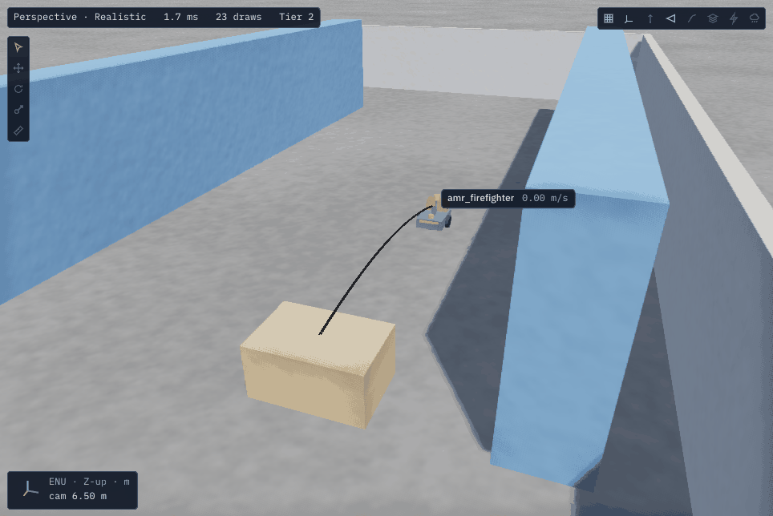
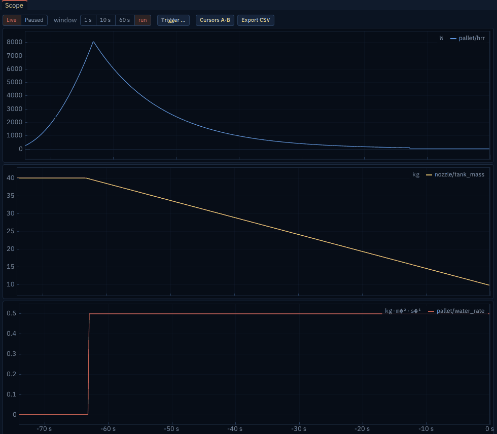

# Tutorial: a robot puts out a fire

A pallet burns in the sample warehouse. A small AMR with a 40 L water tank and a water monitor
(a nozzle on a pan and a tilt joint) drives up, aims, and puts it out, while you watch the heat
release rate fall on ROS 2 and in the viewer. The models are in
[Fire](../physics/fire.md) and [the nozzle and tank](../physics/actuators.md#the-nozzle-and-tank).

## 1. The robot and the fire

`assets/robots/amr_firefighter/amr_firefighter.urdf` is the sample AMR with two additions. The
tank and the nozzle are Gazebo-style blocks on their links:

```xml
<gazebo reference="tank_link">
  <water_tank name="tank" capacity="0.04" initial="1"/>
</gazebo>
<gazebo reference="tilt_link">
  <nozzle name="nozzle" xyz="0.12 0 0" axis="1 0 0" diameter="0.008"
          discharge_coefficient="0.95" pressure="50000" agent="water"
          spray_half_angle="0.03" pump_efficiency="0.5" tank="tank"/>
</gazebo>
```

An 8 mm bore behind 0.5 bar gives `v0 = 0.95·√(2·50 000/998.2) = 9.5 m/s` and
`ṁ = ρ·A·v0 = 0.48 kg/s` (29 L/min), so the 40 L last 84 s. The values are illustrative, of the
size a small firefighting robot carries, not a product's datasheet. The water is a weight at the
tank that shrinks as it empties; the jet pushes the barrel back with `ṁ·v0 = 4.5 N`.

The world is `assets/worlds/warehouse_fire/warehouse_fire.usda`: the pallet ignites at the start
and grows as a fast t² fire (`Q = 46.9·t²` W). The run file puts the robot 4 m in front of it:

```bash
lagrange assets/worlds/warehouse_fire/warehouse_fire_amr.yaml
```

It runs the robot under joint control (`control: joints`), so every joint takes
`/joint_commands`, and maps the fire's heat release rate, state and water to ROS topics
(`fire_topics.yaml`). A joint that has not been commanded gets no torque: hold the wheels first,
or the jet will push the robot away.

## 2. Aim and spray

The nozzle's topics are made for you: `/nozzle/command` (the valve, 0 to 1) and
`/nozzle/pressure_command` (Pa) in; `/nozzle/impact` (where the jet lands, in the `world`
frame), `/nozzle/flow` and `/nozzle/tank` out. A firefighter aims by eye; this node aims by where
the jet lands, raising the barrel when it falls short of the pallet's middle and lowering it when
it goes long:

```python
import math

import rclpy
from geometry_msgs.msg import Vector3Stamped
from rclpy.node import Node
from sensor_msgs.msg import JointState
from std_msgs.msg import Float64

TARGET = (5.6, 1.3)  # the pallet's middle, m
GAIN = 1.0 / 15.0  # rad per metre short: dR/dθ ≈ 2v²cos 2θ/g ≈ 15 m/rad here


class Aim(Node):
    def __init__(self) -> None:
        super().__init__("aim_and_spray")
        self.joints = self.create_publisher(JointState, "/joint_commands", 10)
        self.valve = self.create_publisher(Float64, "/nozzle/command", 10)
        self.create_subscription(Vector3Stamped, "/nozzle/impact", self.landed, 10)
        self.tilt = 0.25
        self.last = self.get_clock().now()
        self.create_timer(0.5, self.command)

    def command(self) -> None:
        names = ["left_wheel_joint", "right_wheel_joint", "pan_joint", "tilt_joint"]
        self.joints.publish(JointState(name=names, position=[0.0, 0.0, 0.0, self.tilt]))
        self.valve.publish(Float64(data=1.0))

    def landed(self, impact: Vector3Stamped) -> None:
        now = self.get_clock().now()
        if math.isnan(impact.vector.x) or (now - self.last).nanoseconds < 1e9:
            return
        self.last = now
        short = math.hypot(TARGET[0] - impact.vector.x, TARGET[1] - impact.vector.y)
        if impact.vector.x > TARGET[0]:
            short = -short
        if abs(short) > 0.05:
            self.tilt += GAIN * short
        self.get_logger().info(f"lands at x {impact.vector.x:.2f} m; tilt {self.tilt:.3f}")


def main() -> None:
    rclpy.init()
    rclpy.spin(Aim())


if __name__ == "__main__":
    main()
```

Run it beside the simulation (`python3 aim_and_spray.py`). It settles within a few seconds at a
tilt of about 0.30 rad with the jet on the pallet's top, x 5.6 m, z 0.6 m:

```text
[aim_and_spray]: lands at x 5.61 m; tilt 0.297
```

The barrel needs more than the 0.27 rad a drag-free jet from the pivot would: the position loop
sags under the barrel's weight and the robot leans back on its casters under the full tank. As
the tank empties the robot comes up and the jet creeps back, which the node corrects.



The jet is drawn as a line from the nozzle to where it lands (the viewer draws a styled stream
in a later step of RFC 0022).

## 3. Watch it go out

```bash
ros2 topic echo /fire/pallet/hrr
ros2 topic echo /fire/pallet/water_rate
ros2 topic echo /nozzle/tank
```

All of the jet lands on the fuel, so the water rate is the flow over the burning area,
`0.48/0.96 = 0.50 kg/(m²·s)` (mm/s of water), well over the pallet's critical rate. The heat
release rate stops growing and decays as Evans' law gives it, with `τ = 3.0·0.50^(−1.85) = 10.9 s`;
the fire is out (`/fire/pallet/state` 4) when it is down to 1 %, `τ·ln 100 = 50 s` after the
water arrives. In the viewer's Signals workspace (`-- --workspace Signals --scope
fire/pallet/hrr,act/nozzle/tank_mass,fire/pallet/water_rate`, window `run`):



`server/test/test_nozzle_run.cpp` runs the same thing and checks it: the jet lands within 15 cm
of the pallet's middle, the water rate is `ṁ/A` to 1e-6, the fire is out 50.4 s after the water
arrived against `τ·ln 100 = 50.4 s`, and the tank has lost `ṁ` every second.

The rate is beyond the 0.026 to 0.133 mm/s Evans fitted his law to (NISTIR 5254), so the decay
time is an extrapolation of a power law, and the jet's reach is drag-free, an upper bound on a
real stream's. Both are stated in the physics pages.

## 4. Variations

- **Turn the valve down.** `ros2 topic pub /nozzle/command std_msgs/msg/Float64 "data: 0.03"`:
  0.015 kg/(m²·s) is under the critical rate, and the fire keeps growing.
- **Less pressure.** `/nozzle/pressure_command` at 30 000 Pa (7.4 m/s): the jet falls short and
  the node raises the barrel to reach. At 20 000 Pa (6.0 m/s) no elevation reaches the pallet.
- **Foam.** `agent="foam" foam_expansion="8"` on the nozzle and `fire:foamBlanketThickness` on
  the fuel: the jet lays a blanket instead (`fire/pallet/foam_coverage`).
- **A drone's downwash.** A multicopter near a fire writes its wake there
  (`fire/<n>/downwash`): it leans the flame, and blows out a small one with a blow-off speed
  (`server/test/test_fire_downwash.cpp`).
- **Without the actuators.** `--domain actuators=off`: every valve stays shut.
