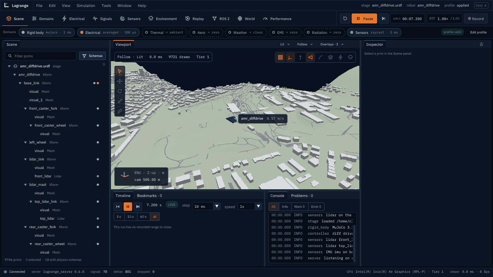

# Tutorial: huge worlds

In this tutorial you drive a robot through a world streamed in tiles, watch the floating origin
follow it, put robots kilometres apart, and build a world of your own from open data: terrain
from an elevation model and buildings from OpenStreetMap. It takes about 30 minutes.

`tools/ci/tutorial_huge_worlds.sh` runs every step below without the viewer and checks the
results (the 40 km sample only with `--network`), so the commands here are known to work.

## Before you start

You need Lagrange built as in the [README](../../README.md#build). In every terminal, from the
source tree:

```bash
source /opt/ros/lyrical/setup.bash
cd ~/lagrange_ws/src/lagrange && source ../../install/setup.bash
```

## 1. A world in tiles

`assets/worlds/tiled_town/tiled_town.usda` is a 2 km square town made by
`make_tiled_town.py`. It holds no buildings itself: each of its 68 prims has `WorldTileAPI_1`
and a payload, a file in `tiles/` that holds one tile's content. Four coarse tiles of 1024 m
show blocks for whole quarters; 64 fine tiles of 256 m hold the buildings with their colliders.

```bash
ros2 run lagrange_server lagrange_server --world assets/worlds/tiled_town/tiled_town.usda \
    --spawn 1036,1036
ros2 run lagrange_viewer lagrange_viewer --connect unix:$XDG_RUNTIME_DIR/lagrange/default.sock
```

The server opens the town with every payload unloaded and loads tiles around the robot on
worker threads: the fine tiles with colliders within 300 m (`world.streaming.collision_radius`),
coarse ones out to 600 m (`load_radius`). It drops tiles beyond 800 m (`unload_radius`), and it
never lets the robot drive onto a tile whose colliders are not in physics yet: the run waits
instead. The **World** workspace shows the tiles loaded, by level of detail.

From Python:

```python
import lagrange

sim = lagrange.Simulation(
    lagrange.sample_robot(), world=lagrange.sample_tiled_town(), spawn=[1036, 1036]
)
sim.step_until(5.0)
sim.colliders()  # the buildings of the tiles near the robot, about a hundred
```

A run without ROS, like this one, loads its tiles in the step: the same path gives the same
tiles at the same times, and `state_hash()` the same values.

## 2. The floating origin

Physics engines and GPUs compute in single precision inside, where a metre has about 1 mm of
resolution 10 km from the origin. Lagrange keeps every world position in double and moves the
origin of the frame physics sees, the region frame, to stay near the robot. Start the robot
just short of 1000 m out:

```python
sim = lagrange.Simulation(lagrange.sample_robot(), spawn=[999.5, 0])
sim.region_origin()  # [0, 0, 0]: within 1000 m, no move at load
sim.step_until(20.0)
sim.region_origin()  # [1000, 0, 0]: it drove past 1000 m, and the origin followed
```

Every 100 ms of simulated time the server checks the distance; past 1000 m it moves the
origin by whole metres between two steps and carries the run's state over. Poses on the bus
jump by the move, but ROS `/odom` and TF stay continuous, and the viewer keeps its camera on the
same place.

## 3. Robots far apart

`--add-robot NAME=FILE@X,Y` puts more robots in one run (their names prefixed `NAME_`; they
are passive for now). Robots kilometres apart should not share one physics scene: each gets a
region of its own, with its own origin and its own tiles. `server::RegionHost` does this in
C++ (huge-worlds.md §3.1); `server/test/test_regions.cpp` runs two robots 10 km apart, and the
far one drives exactly as a robot alone at the origin.

## 4. A world from open data

`lagrange_build_world` writes the same tiled layout from open data: terrain from an elevation
raster (GeoTIFF or any format GDAL reads), buildings and roads from OpenStreetMap XML, and 3D
Tiles for show. The script makes a small OpenStreetMap file of its own; with a real extract the
command is the same:

```bash
ros2 run lagrange_geospatial lagrange_build_world /tmp/my_world --name my_world \
    --origin 35.6812,139.7671,40 --size 1024 --osm my_area.osm
```

The world's frame is the ENU frame at `--origin`: run it with
`--geo-origin 35.6812,139.7671,40`, so that GNSS and the magnetometer agree with it.

Elevation models give heights above the geoid, and the world needs heights above the WGS84
ellipsoid. The tool never guesses: give it the geoid (`--geoid
/usr/share/proj/egm96_15.gtx`, from proj-data) or say the heights are ellipsoidal
(`--assume-ellipsoidal`). Terrain becomes one height field per fine tile, which physics and the
lidar use exactly.

`tools/ci/build_sample_world.sh` builds the 40 km sample around Zurich from the Copernicus DEM
and OpenStreetMap (it needs the network; nothing it writes is committed, and the data's notices
go into the world's `ATTRIBUTION.md`):

```bash
tools/ci/build_sample_world.sh ~/.cache/lagrange/worlds/zurich_40km
ros2 run lagrange_server lagrange_server --world ~/.cache/lagrange/worlds/zurich_40km/zurich_40km.usda \
    --geo-origin 47.397742,8.545594,0
```

<p align="center">
  
  <br><sub>Terrain produced using Copernicus WorldDEM-30 © DLR e.V. 2010-2014 and © Airbus Defence
  and Space GmbH 2014-2018 provided under COPERNICUS by the European Union and ESA; all rights
  reserved. Buildings and roads © OpenStreetMap contributors (ODbL).</sub>
</p>
