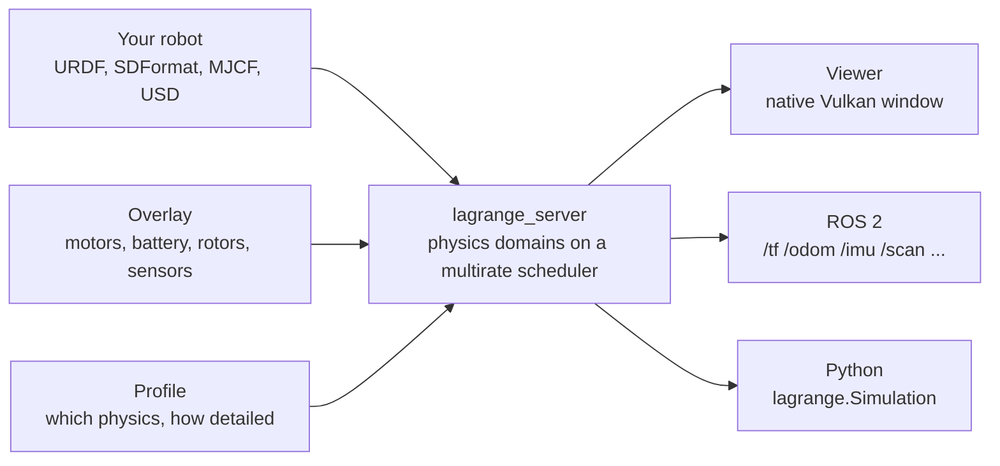
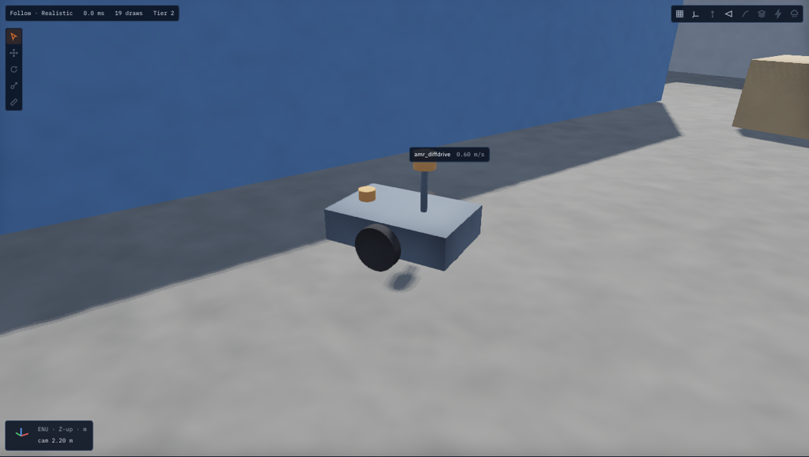
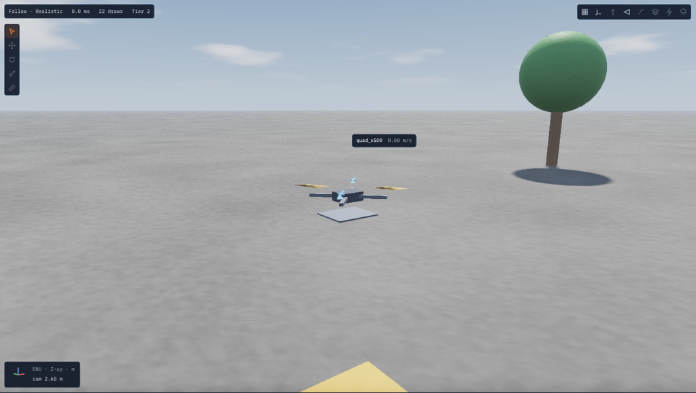
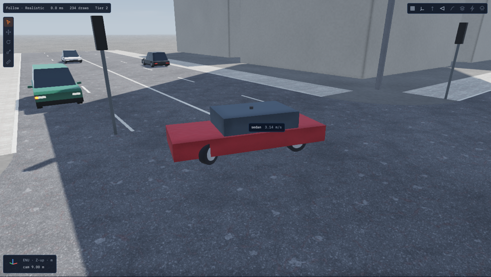
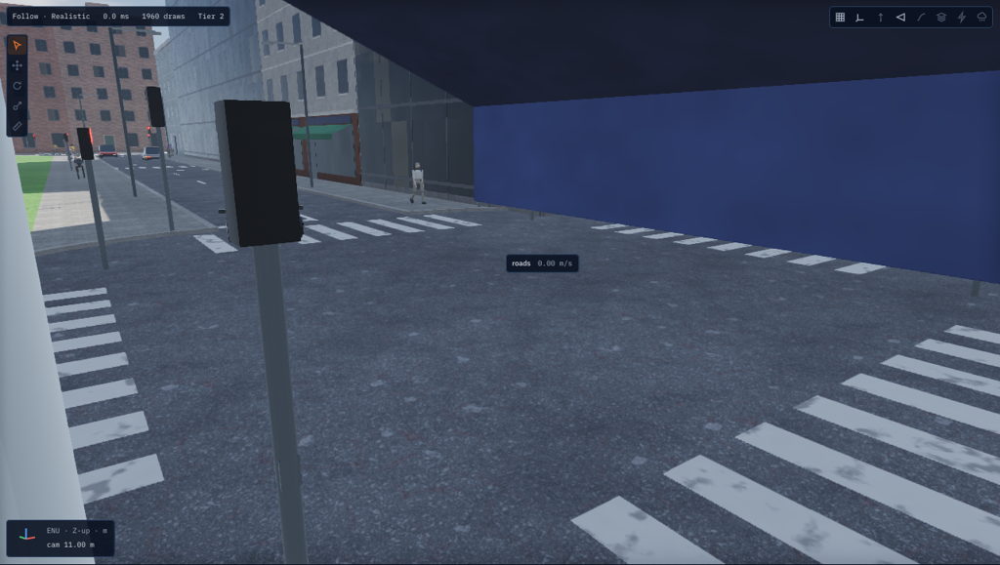

# Lagrange

Lagrange is an open-source (Apache-2.0), GPU-accelerated robot simulator for ROS 2 Lyrical on
Ubuntu 26.04. It runs rigid-body physics, electrical, thermal, aerodynamics, weather, EMI and
sensors together, and you can turn each one off or swap it for a simpler stand-in.




## A few things it does

| | |
|---|---|
|  |  |
| A Holybro X500 V2 over Zurich, a world built from open data | A Lexus RX 450h in Nishi-Shinjuku, Tokyo |
|  |  |
| The air under a hovering quadcopter, live | People walking round the AMR, seen by its lidars |

|  |  |
| The sample AMR in its warehouse | The sample quadcopter over the open field |
|  |  |
| The sedan at the city block junction, among traffic | The town: lights, crossings with buttons, people |

Every robot and world, with the command that runs it: [Robots and worlds](guide/robots.md). More in the
[feature videos](videos/README.md).

## Where to start

| You want to | Read |
|---|---|
| See what it simulates | [Robots and worlds](guide/robots.md): AMRs, drones, cars, an arm, a quadruped, water |
| Install it | [Installing Lagrange](guide/install.md): ROS 2 Lyrical, then from source, as debs or in a container |
| See it run in five minutes | [Tutorial: an AMR in a warehouse](guide/tutorial-amr.md) |
| Fly a drone, or test your own | [Tutorial: a quadcopter](guide/tutorial-drone.md), then [Test your own drone](guide/tutorial-custom-drone.md) |
| Load your own robot | [The run file](guide/run-file.md) and [The `lagrange` command](guide/cli.md) |
| Drive a car, or run Autoware | [Tutorial: a car in a city block](guide/tutorial-cars.md), then [Autoware](guide/autoware.md) |
| Know how a number is computed | [Physics reference](physics/index.md): every model, its equations and its checks |
| Know how far to trust it | [Validation report](validation/report.md) |
| Extend it | [Writing a module](guide/writing-a-module.md), [Writing a plugin](guide/writing-a-plugin.md) |

```{toctree}
:hidden:
:caption: Overview

guide/robots
videos/README
```

```{toctree}
:hidden:
:caption: User guide

guide/README
guide/install
guide/tutorial-amr
guide/tutorial-drone
guide/tutorial-custom-drone
guide/tutorial-power
guide/tutorial-environment
guide/tutorial-huge-worlds
guide/tutorial-arm
guide/tutorial-cars
guide/tutorial-humans
guide/tutorial-heat-and-emi
guide/autoware
guide/run-file
guide/concepts
guide/profiles
guide/cli
guide/writing-a-module
guide/writing-a-plugin
```

```{toctree}
:hidden:
:caption: Physics reference

physics/index
physics/rigid-body
physics/vehicles
physics/water
physics/rotors
physics/downwash
physics/aerodynamics
physics/motors
physics/battery
physics/electrical-network
physics/thermal
physics/sensors
physics/weather
physics/emi-and-radio
physics/traffic
physics/humans
physics/tether
physics/heat-conduction
```

```{toctree}
:hidden:
:caption: Validation

validation/report
```

```{toctree}
:hidden:
:caption: Design
:glob:

design/domains/README
design/domains/*
design/architecture
design/formats
design/protocol
design/viewer
design/huge-worlds
design/robot-classes
design/security
design/benchmarks
design/dependencies
```

```{toctree}
:hidden:
:caption: Releases
:reversed:
:glob:

release/v*
```
