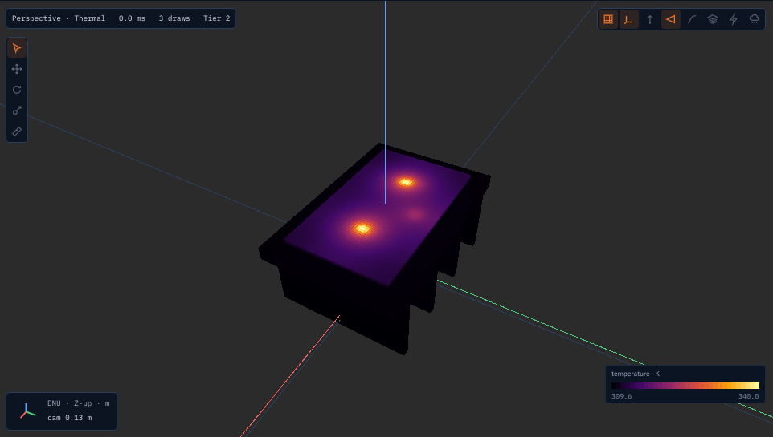
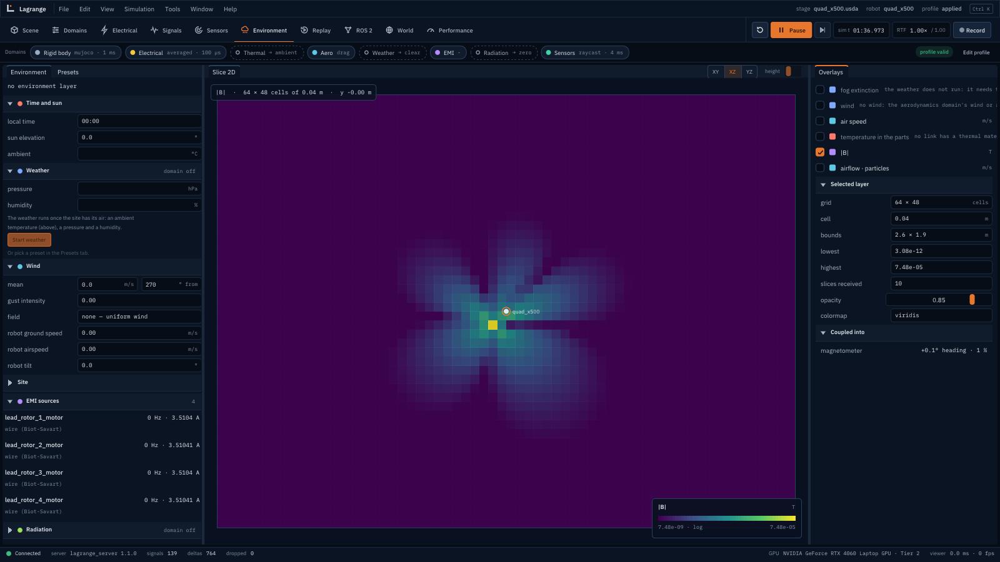
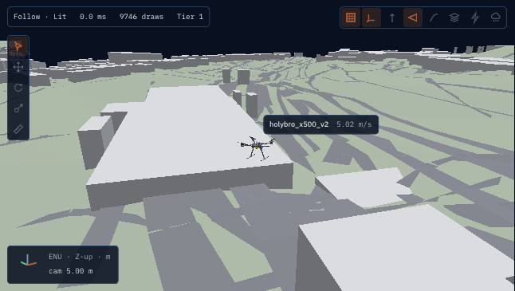
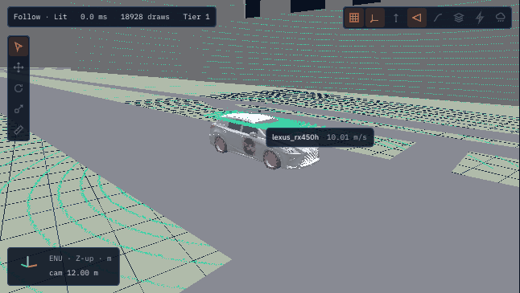

# Lagrange

:::{container} lg-hero

<p class="lg-new"><a href="release/v1.3.0.html"><span>New in v1.3</span> 37 more sensors, a 4D
imaging radar, sensor faults, and runs 4 to 12 times faster →</a></p>

<p class="lg-tagline">Simulate the whole robot, not only its rigid bodies: its battery and motors,
the heat in its parts, the air round its rotors, the weather on its sensors and the interference
of its own wiring, together on the GPU. Switch any of them off.</p>

<p class="lg-sub">Open source (Apache-2.0) · ROS 2 Lyrical on Ubuntu 26.04 · URDF, SDFormat, MJCF
and USD as they are · a native Vulkan viewer · a deterministic CPU mode, bit for bit</p>

<p class="lg-cta">
<a class="lg-btn lg-btn-primary" href="#try-it">Install in one command</a>
<a class="lg-btn" href="validation/comparison.html">Measured against Gazebo</a>
<a class="lg-btn" href="guide/tutorial-amr.html">The five-minute tutorial</a>
<a class="lg-btn" href="https://github.com/Open-Physical-Systems/Lagrange">GitHub</a>
</p>

:::

<div class="lg-wall">

<figure class="lg-tile">
<video src="videos/drone_live_air.mp4" autoplay muted loop playsinline preload="auto" title="A lattice Boltzmann air box round a hovering quadcopter"></video>
<figcaption><strong>Live air on the GPU.</strong> A lattice-Boltzmann box of air in 4 cm cells follows the drone; its rotors fly in it. <a href="physics/downwash.html">How</a></figcaption>
</figure>

<figure class="lg-tile">
<video src="videos/builder.mp4" poster="imgs/builder-poster.jpg" autoplay muted loop playsinline preload="auto" title="The robot builder: parts, a revolute joint, sensors from the catalog, a mesh's hull, then Test"></video>
<figcaption><strong>Build a robot in the viewer.</strong> Parts, joints and sensors from the catalog, one click to test it in a simulator, saved as URDF. <a href="guide/builder.html">How</a></figcaption>
</figure>

<figure class="lg-tile">
<video src="videos/town_rainy.mp4" autoplay muted loop playsinline preload="auto" title="The town in the rainy season"></video>
<figcaption><strong>Weather the sensors feel.</strong> Rain, fog, snow and dust cut lidar range, veil cameras and take grip from tyres. <a href="physics/weather.html">How</a></figcaption>
</figure>

<figure class="lg-tile">
<video src="videos/lidar_materials.mp4" autoplay muted loop playsinline preload="auto" title="Retroreflector, white paint, asphalt and black rubber walls to a lidar"></video>
<figcaption><strong>Sensors with physics.</strong> Lidar returns by material and angle; 45 sensors, from a 4D imaging radar to bumpers, each with faults. <a href="guide/sensors.html">All 45</a></figcaption>
</figure>

<figure class="lg-tile">

<figcaption><strong>Heat inside every part.</strong> Conduction cell by cell from each part's material, checked against OpenFOAM. <a href="physics/heat-conduction.html">How</a></figcaption>
</figure>

<figure class="lg-tile">

<figcaption><strong>Its own interference.</strong> The battery leads' field, and how many degrees it turns the compass. <a href="physics/emi-and-radio.html">How</a></figcaption>
</figure>

<figure class="lg-tile">

<figcaption><strong>Real places, 40 km wide.</strong> Terrain and OpenStreetMap streamed in tiles, in double precision. <a href="guide/tutorial-huge-worlds.html">How</a></figcaption>
</figure>

<figure class="lg-tile">
<video src="videos/town_junction.mp4" autoplay muted loop playsinline preload="auto" title="The town: lights change, people press a button and cross, cars stop and go"></video>
<figcaption><strong>Traffic and people.</strong> Lights, crossings with buttons, self-driving cars and walking crowds. <a href="physics/traffic.html">How</a></figcaption>
</figure>

<figure class="lg-tile">

<figcaption><strong>Cars with real tyres.</strong> Magic Formula tyres, OpenDRIVE, OpenSCENARIO and an Autoware interface. <a href="guide/tutorial-cars.html">How</a></figcaption>
</figure>

</div>

<div class="lg-stats">
<div><b>9</b><span>physics domains, coupled, each with a stand-in</span></div>
<div><b>45</b><span>sensors: 8 types and 37 built-in kinds, each with faults</span></div>
<div><b>12.9×</b><span>real time: the sedan in the city with camera, lidar and radar<sup><a href="design/benchmarks.html">1</a></sup></span></div>
<div><b>1 799</b><span>tests; models checked against closed forms and measurements<sup><a href="validation/report.html">2</a></sup></span></div>
</div>

<p class="lg-footnote">1. Headless on a laptop (i9-13900H, RTX 4060 Laptop GPU), shared with
other jobs, ±30 %: <a href="design/benchmarks.html">benchmarks</a> §4–§5. 2. What is met and
what is not: the <a href="validation/report.html">validation report</a>.</p>

## Against Gazebo, measured

Same scenes, same machine, headless, as fast as each goes; the median of five runs. The
[comparison](validation/comparison.md) has the method, the raw output, the physics accuracy, and
where Lagrange is worse: a younger project, one platform, a slower camera here, many contacts on
its MuJoCo backend.

| | Lagrange 1.3.0 | Gazebo Jetty 10.5.0 |
|---|---|---|
| AMR in a warehouse, physics only (real-time factor) | **96.6** | 14.8 |
| The same with 2D and 3D lidars and an IMU | **54.1** | 12.7 |
| One 640 × 480 camera at 30 Hz | 10.7 | **12.3** |
| Start-up to the first step | **0.07 s** | 2.4 s |
| Peak memory, AMR with sensors | **78 MB** | 961 MB |

## What it simulates

::::{container} lg-cards

:::{container} lg-card
**[Rigid bodies](physics/rigid-body.md)**

MuJoCo or Jolt: contacts, joints, force-torque sensing.
:::

:::{container} lg-card
**[Power](physics/electrical-network.md)**

Batteries, buses, motors and their drives at 100 µs; brown-outs and derating.
:::

:::{container} lg-card
**[Heat](physics/heat-conduction.md)**

Lumped nodes, or conduction inside each part from its material.
:::

:::{container} lg-card
**[Air](physics/rotors.md)**

Rotors, drag, wind and gusts, downwash, a GPU air box and an OpenFOAM link.
:::

:::{container} lg-card
**[Weather](physics/weather.md)**

Fog, rain, snow and dust, and what they do to lidars, cameras and grip.
:::

:::{container} lg-card
**[EMI and radio](physics/emi-and-radio.md)**

Power lines, a robot's own wiring, compasses, CAN errors, radio links.
:::

:::{container} lg-card
**[Sensors](physics/sensors.md)**

Lidar, camera, thermal camera, radar, IMU, GNSS, magnetometer, barometer, and [37 more](guide/sensors.md).
:::

:::{container} lg-card
**[Vehicles and traffic](physics/vehicles.md)**

Tyres, suspension, powertrains; lanes, lights, crossings and people.
:::

:::{container} lg-card
**[Water and cables](physics/water.md)**

Buoyancy, currents and waves; tethers that sag, snag and tangle.
:::

::::

## Why Lagrange

::::{container} lg-why

:::{container} lg-point
**Turn any physics off.** Every domain has a stand-in: an ideal motor, a constant ambient,
ground-truth sensors, or a recording. Test your planner without the battery, or your battery
without the physics.
:::

:::{container} lg-point
**Check every number.** Each model is tested against a closed form, a published measurement or
OpenFOAM, and the [validation report](validation/report.md) says what is met and what is not.
A [measured comparison](validation/comparison.md) with Gazebo, MuJoCo and PyBullet says where others are
better.
:::

:::{container} lg-point
**Bring your robot as it is.** URDF, SDFormat, MJCF or USD; ROS 2 topics, `ros2_control`, Nav2,
MoveIt 2, PX4 and ArduPilot SITL work with it.
:::

:::{container} lg-point
**Same run, same answer.** A deterministic CPU reference mode, bit for bit, beside the GPU paths;
worlds tens of kilometres wide in double precision.
:::

::::

## Try it

On Ubuntu 26.04 (amd64), one command installs ROS 2 Lyrical and Lagrange from the latest
release; nothing is built ([other ways to install](guide/install.md)):

```bash
curl -fsSL https://raw.githubusercontent.com/Open-Physical-Systems/Lagrange/main/packaging/install.sh | bash
```

Then:

```bash
source /opt/ros/lyrical/setup.bash
lagrange amr        # the sample AMR in its warehouse, with the viewer
lagrange quad       # a quadcopter that takes off and hovers
lagrange town       # traffic lights, crossings, cars and people
```

or from Python, headless:

```python
import lagrange

sim = lagrange.Simulation(lagrange.sample_robot(), world=lagrange.sample_world())
sim.step_until(2.0)
print(sim.read("body/base_link/pose"))
```

## Where to go next

| You want to | Read |
|---|---|
| See every robot and world | [Robots and worlds](guide/robots.md), and the [feature videos](videos/README.md) |
| Install it | [Installing Lagrange](guide/install.md): from source, as debs or in a container |
| Fly a drone, or test your own | [Tutorial: a quadcopter](guide/tutorial-drone.md), then [Test your own drone](guide/tutorial-custom-drone.md) |
| Load your own robot | [The run file](guide/run-file.md) and [The `lagrange` command](guide/cli.md) |
| Build a robot in the viewer | [The robot builder](guide/builder.md): links, joints, sensors from the catalog, Test, save as URDF |
| Find a sensor, add it, read it, break it | [Sensors](guide/sensors.md): every sensor Lagrange simulates, by robot |
| Drive a car, or run Autoware | [Tutorial: a car in a city block](guide/tutorial-cars.md), then [Autoware](guide/autoware.md) |
| Heat, and a robot's own EMI | [Tutorial: heat in the parts and a robot's own interference](guide/tutorial-heat-and-emi.md) |
| Know how a number is computed | [Physics reference](physics/index.md): every model, its equations and its checks |
| Extend it | [Writing a module](guide/writing-a-module.md), [Writing a plugin](guide/writing-a-plugin.md) |

```{toctree}
:hidden:
:caption: Overview

guide/robots
videos/README
```

```{toctree}
:hidden:
:caption: User guide

guide/README
guide/install
guide/tutorial-amr
guide/tutorial-drone
guide/tutorial-custom-drone
guide/tutorial-power
guide/tutorial-environment
guide/tutorial-huge-worlds
guide/tutorial-arm
guide/tutorial-cars
guide/tutorial-humans
guide/tutorial-heat-and-emi
guide/autoware
guide/run-file
guide/builder
guide/concepts
guide/profiles
guide/sensors
guide/cli
guide/writing-a-module
guide/writing-a-plugin
```

```{toctree}
:hidden:
:caption: Physics reference

physics/index
physics/rigid-body
physics/vehicles
physics/water
physics/rotors
physics/downwash
physics/aerodynamics
physics/motors
physics/battery
physics/electrical-network
physics/thermal
physics/sensors
physics/weather
physics/emi-and-radio
physics/traffic
physics/humans
physics/tether
physics/heat-conduction
```

```{toctree}
:hidden:
:caption: Validation

validation/report
validation/comparison
```

```{toctree}
:hidden:
:caption: Design
:glob:

design/domains/README
design/domains/*
design/architecture
design/formats
design/protocol
design/viewer
design/huge-worlds
design/robot-classes
design/security
design/benchmarks
design/dependencies
```

```{toctree}
:hidden:
:caption: Releases
:reversed:
:glob:

release/v*
```
