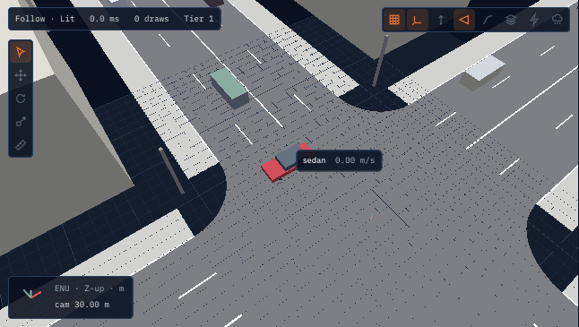
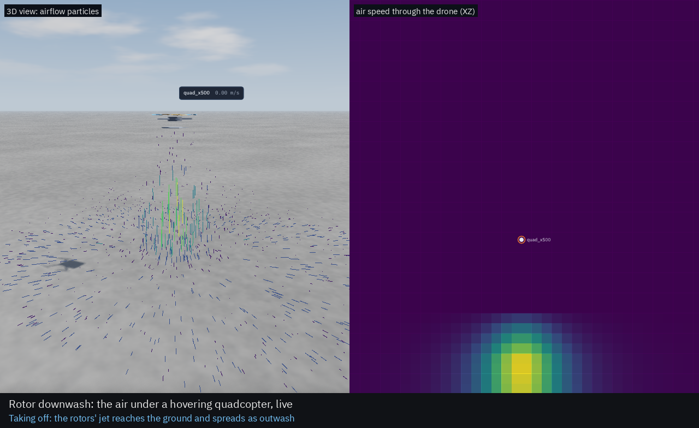

# Lagrange

:::{container} lg-hero

<p class="lg-tagline">The robot simulator where the physics, the power, the heat, the air, the
weather and the interference all run together, and any of them can be switched off.</p>

<p class="lg-sub">Open source (Apache-2.0) · ROS 2 Lyrical on Ubuntu 26.04 · GPU-accelerated,
with a deterministic CPU mode · a native Vulkan viewer</p>

<p class="lg-cta">
<a class="lg-btn lg-btn-primary" href="guide/install.html">Get started</a>
<a class="lg-btn" href="guide/tutorial-amr.html">The five-minute tutorial</a>
<a class="lg-btn" href="https://github.com/Open-Physical-Systems/Lagrange">GitHub</a>
</p>



:::

## See it run

::::{container} lg-gallery

:::{container} lg-shot


**Real places from open data.** A 40 km world of Zurich from a terrain model and
OpenStreetMap, streamed in tiles around the drone.
:::

:::{container} lg-shot


**The air under the rotors.** Each rotor by blade-element theory, the wake on the ground and on
other robots, and a live lattice-Boltzmann air box on the GPU.
:::

:::{container} lg-shot


**Heat inside every part.** Give a link a material and its LEDs a power, and see where the heat
goes, cell by cell, checked against OpenFOAM.
:::

:::{container} lg-shot


**A robot's own interference.** The field of its battery leads, and how many degrees off it
puts its compass.
:::

:::{container} lg-shot


**Cars with real tyres.** Magic Formula tyres, OpenDRIVE roads, OpenSCENARIO scenarios and an
Autoware interface.
:::

:::{container} lg-shot


**People, lidars, cameras.** Walking crowds, lidars with motion distortion and materials,
cameras with lens and noise models, and a thermal camera that sees them.
:::

::::

## What it simulates

::::{container} lg-cards

:::{container} lg-card
**[Rigid bodies](physics/rigid-body.md)**

MuJoCo or Jolt: contacts, joints, force-torque sensing.
:::

:::{container} lg-card
**[Power](physics/electrical-network.md)**

Batteries, buses, motors and their drives at 100 µs; brown-outs and derating.
:::

:::{container} lg-card
**[Heat](physics/heat-conduction.md)**

Lumped nodes, or conduction inside each part from its material.
:::

:::{container} lg-card
**[Air](physics/rotors.md)**

Rotors, drag, wind and gusts, downwash, a GPU air box and an OpenFOAM link.
:::

:::{container} lg-card
**[Weather](physics/weather.md)**

Fog, rain, snow and dust, and what they do to lidars, cameras and grip.
:::

:::{container} lg-card
**[EMI and radio](physics/emi-and-radio.md)**

Power lines, a robot's own wiring, compasses, CAN errors, radio links.
:::

:::{container} lg-card
**[Sensors](physics/sensors.md)**

Lidar, camera, thermal camera, radar, IMU, GNSS, magnetometer, barometer, and [36 more](guide/sensors.md).
:::

:::{container} lg-card
**[Vehicles and traffic](physics/vehicles.md)**

Tyres, suspension, powertrains; lanes, lights, crossings and people.
:::

:::{container} lg-card
**[Water and cables](physics/water.md)**

Buoyancy, currents and waves; tethers that sag, snag and tangle.
:::

::::

## Why Lagrange

::::{container} lg-why

:::{container} lg-point
**Turn any physics off.** Every domain has a stand-in: an ideal motor, a constant ambient,
ground-truth sensors, or a recording. Test your planner without the battery, or your battery
without the physics.
:::

:::{container} lg-point
**Check every number.** Each model is tested against a closed form, a published measurement or
OpenFOAM, and the [validation report](validation/report.md) says what is met and what is not.
A [measured comparison](validation/comparison.md) with Gazebo, MuJoCo and PyBullet says where others are
better.
:::

:::{container} lg-point
**Bring your robot as it is.** URDF, SDFormat, MJCF or USD; ROS 2 topics, `ros2_control`, Nav2,
MoveIt 2, PX4 and ArduPilot SITL work with it.
:::

:::{container} lg-point
**Same run, same answer.** A deterministic CPU reference mode, bit for bit, beside the GPU paths;
worlds tens of kilometres wide in double precision.
:::

::::

## Try it

On Ubuntu 26.04 (amd64), one command installs ROS 2 Lyrical and Lagrange from the latest
release; nothing is built ([other ways to install](guide/install.md)):

```bash
curl -fsSL https://raw.githubusercontent.com/Open-Physical-Systems/Lagrange/main/packaging/install.sh | bash
```

Then:

```bash
source /opt/ros/lyrical/setup.bash
lagrange amr        # the sample AMR in its warehouse, with the viewer
lagrange quad       # a quadcopter that takes off and hovers
lagrange town       # traffic lights, crossings, cars and people
```

or from Python, headless:

```python
import lagrange

sim = lagrange.Simulation(lagrange.sample_robot(), world=lagrange.sample_world())
sim.step_until(2.0)
print(sim.read("body/base_link/pose"))
```

## Where to go next

| You want to | Read |
|---|---|
| See every robot and world | [Robots and worlds](guide/robots.md), and the [feature videos](videos/README.md) |
| Install it | [Installing Lagrange](guide/install.md): from source, as debs or in a container |
| Fly a drone, or test your own | [Tutorial: a quadcopter](guide/tutorial-drone.md), then [Test your own drone](guide/tutorial-custom-drone.md) |
| Load your own robot | [The run file](guide/run-file.md) and [The `lagrange` command](guide/cli.md) |
| Find a sensor, add it, read it, break it | [Sensors](guide/sensors.md): every sensor Lagrange simulates, by robot |
| Drive a car, or run Autoware | [Tutorial: a car in a city block](guide/tutorial-cars.md), then [Autoware](guide/autoware.md) |
| Heat, and a robot's own EMI | [Tutorial: heat in the parts and a robot's own interference](guide/tutorial-heat-and-emi.md) |
| Know how a number is computed | [Physics reference](physics/index.md): every model, its equations and its checks |
| Extend it | [Writing a module](guide/writing-a-module.md), [Writing a plugin](guide/writing-a-plugin.md) |

```{toctree}
:hidden:
:caption: Overview

guide/robots
videos/README
```

```{toctree}
:hidden:
:caption: User guide

guide/README
guide/install
guide/tutorial-amr
guide/tutorial-drone
guide/tutorial-custom-drone
guide/tutorial-power
guide/tutorial-environment
guide/tutorial-huge-worlds
guide/tutorial-arm
guide/tutorial-cars
guide/tutorial-humans
guide/tutorial-heat-and-emi
guide/autoware
guide/run-file
guide/concepts
guide/profiles
guide/sensors
guide/cli
guide/writing-a-module
guide/writing-a-plugin
```

```{toctree}
:hidden:
:caption: Physics reference

physics/index
physics/rigid-body
physics/vehicles
physics/water
physics/rotors
physics/downwash
physics/aerodynamics
physics/motors
physics/battery
physics/electrical-network
physics/thermal
physics/sensors
physics/weather
physics/emi-and-radio
physics/traffic
physics/humans
physics/tether
physics/heat-conduction
```

```{toctree}
:hidden:
:caption: Validation

validation/report
validation/comparison
```

```{toctree}
:hidden:
:caption: Design
:glob:

design/domains/README
design/domains/*
design/architecture
design/formats
design/protocol
design/viewer
design/huge-worlds
design/robot-classes
design/security
design/benchmarks
design/dependencies
```

```{toctree}
:hidden:
:caption: Releases
:reversed:
:glob:

release/v*
```
