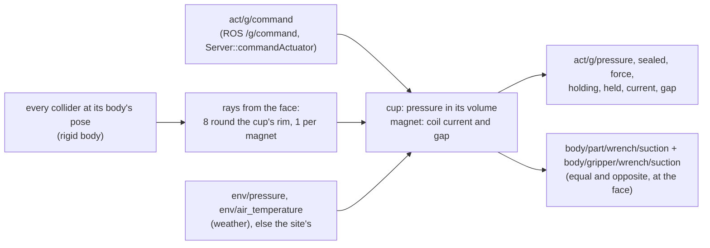

# Actuators: grippers and lead screws

Grippers that hold a part without fingers (RFC 0020, phase 1): a suction cup
(`SuctionGripperAPI_1`) and an electromagnet or electropermanent magnet (`MagnetGripperAPI_1`).
`lagrange_actuators` (the `actuators` domain) runs them every 1 ms. It runs whenever the stage
has one.

A gripper never welds the part to itself. It pulls the part toward its face, and pulls itself
toward the part, with one pair of equal and opposite forces: `body/<part>/wrench/suction` (or
`/magnet`) and `body/<gripper's body>/wrench/...`, both applied at the face. The physics engine's
contact between the gripper and the part carries the reaction and the friction. So a part held by
a cup slips when friction cannot hold it, peels off when it is pulled harder than the cup holds,
and falls when the cup leaks, on MuJoCo, Jolt and a plugin backend alike.



## Using it

On a URDF link, whose origin is the centre of the cup's lip:

```xml
<gazebo reference="suction_cup">
  <suction_cup diameter="0.03" volume="1.0e-5" flow="1.0e-4" ultimate_pressure="20000"
               axis="0 0 1"/>
</gazebo>
```

or in an overlay or USD (`act:suction:diameter`, ...; formats.md §3.16). The four numbers without
a fallback come from the datasheets of the cup and the vacuum generator: the effective diameter,
the volume evacuated (the cup and its hose), the generator's suction flow at atmospheric pressure
in kg/s, and its ultimate vacuum as an absolute pressure. A magnet:

```xml
<gazebo reference="magnet">
  <magnet_gripper turns="600" pole_area="4e-4" iron_path_length="0.06" iron_permeability="2000"
                  coil_resistance="24" coil_inductance="0.12" rated_voltage="24" axis="0 0 1"/>
</gazebo>
```

What a part is made of goes on its link: `<sensor_material air_permeability="2e-6"
relative_permeability="1000"/>` (USD `sensmat:airPermeability`, `sensmat:relativePermeability`).
A part with neither is airtight and not magnetic.

The sample arm with a suction tool picks a parcel off the pick station of its workcell:

```bash
lagrange assets/robots/arm6/arm6_suction.urdf assets/worlds/workcell_arm6/workcell_suction.sdf
ros2 topic pub --once /suction_cup/command std_msgs/msg/Bool "{data: true}"
```

Move the arm with `/joint_commands` (or the viewer); `/suction_cup/state` says whether it holds
and `/suction_cup/pressure` (`sensor_msgs/FluidPressure`) is the cup's pressure, the signal a real
vacuum switch reads.

## The suction cup

The cup and its hose are a volume `V` of air at the ambient temperature `T`. Its pressure `p`
follows the mass of air in it:

```text
V / (R T) · dp/dt = ṁ_in − ṁ_gen
ṁ_gen = q0 · (p − p_min) / (p_atm − p_min)          (the generator, on)
```

The generator's flow falls on a line from `q0` at atmospheric pressure to zero at its ultimate
vacuum `p_min`. Switched off, the cup vents back through the generator along the same line, which
is how an ejector cup lets go. Air comes in:

- **through a porous part** the cup is sealed on: `ρ_atm · κ · A · (p_atm − p)`, with `κ` the
  part's air permeance (`sensmat:airPermeability`, m/(Pa·s)) and `A` the cup's area;
- **through an open cup**, by ISO 6358's flow through a conductance `C`
  (`act:suction:leakConductance`): `C · p_atm · ρ0 · √(T0/T)`, choked while `p/p_atm` is below
  the critical ratio `b = 0.528`, then falling on an ellipse to zero. Without a rated `C` an open
  cup is at atmospheric pressure at once.

The terms that are linear in `p` are integrated exactly over each step, so a sealed cup on an
airtight part follows the closed form `p = p_min + (p_atm − p_min) e^(−t/τ)`,
`τ = V (p_atm − p_min) / (R T q0)`, to rounding.

**Sealing.** Eight rays go from the lip's rim along the cup's axis. The cup seals when every ray
finds a surface within `act:suction:sealGap` (2 mm) of the lip, all on one body, each facing the
cup within `act:suction:maxTilt` (0.26 rad). A cup over an edge, over two parts, or tilted too far
does not seal. The rays use the run's colliders at the bodies' poses, the same exact queries as
the CPU lidar, on every tier.

**Holding.** While sealed, the cup pulls the part with `F = (p_atm − p) · A` along its axis. The
atmosphere is `env/pressure` when the weather runs, else the site's (`--site pressure=`), else
101 325 Pa.

## The magnet

The coil is an R–L circuit, `L di/dt = V − R i`, at its rated voltage while commanded. One ray from
the pole faces measures the gap `g` to the part. The flux across the gap, with two gaps in series
with the iron (half the iron path in the core, half in the part), and the Maxwell stress on both
poles:

```text
B = μ0 · N · i / (2 g + l_iron/2 / μr_core + l_iron/2 / μr_part),   B ≤ saturation
F = B² · A_pole / μ0
```

A part with `sensmat:relativePermeability` of 1 or less (aluminium, plastic) is not pulled. An
electropermanent magnet latches: switched on it holds as at its rated current and draws nothing,
until switched off. `act/<g>/power` is the coil's `i² R`. The pull is left out beyond 0.1 m.

## Signals

| Signal | Unit | |
|---|---|---|
| `act/<g>/command` | 1 | in: 1 on, 0 off (a scalar, as ROS topic inputs write it) |
| `act/<g>/force` | N | the pull on the part |
| `act/<g>/holding` | Int | the body held (index), −1 for none |
| `act/<g>/held` | Bool | holding a body |
| `act/<g>/pressure`, `sealed` | Pa, Bool | a cup |
| `act/<g>/current`, `gap`, `power` | A, m, W | a magnet |
| `body/<b>/wrench/suction`, `/magnet` | N, N·m | the force pair, summed into `external_wrench` |

ROS 2 (written by the server with no `--ros-topics` needed): `/<g>/command` (`std_msgs/Bool`, in),
`/<g>/state` (`std_msgs/Bool`), and `/<g>/pressure` (`sensor_msgs/FluidPressure`) for a cup or
`/<g>/current` (`std_msgs/Float64`) for a magnet. A `--ros-topics` map that uses the topic or the
signal replaces the default. `Server::commandActuator(name, value)` commands a gripper without ROS.

## Substitutes

| `domains.actuators.substitute` | |
|---|---|
| `ideal` | holds when commanded and sealed (or in front of iron), at once: the cup at its ultimate vacuum, the coil at its rated current, no leak |
| `zero`, `constant` (and `--domain actuators=off`) | never holds; no force |

## Sizing a cup

Lagrange computes the physics without a safety factor. The vacuum makers' sizing rules add one:
Schmalz's "Theoretical holding force of a suction cup" gives the force a cup must hold as
`m · (g + a) · S` for a horizontal cup lifting vertically, `m · (g + a/μ) · S` for a horizontal cup
moved sideways, and `(m/μ) · (g + a) · S` for a vertical cup, with `S` at least 1.5 for smooth,
dense parts and 2 or more for porous, rough or oily ones, and `μ` measured on the part (0.5 for
wood, metal, glass and stone in their table). The sample's parcel (0.3 kg) moved at up to 5 m/s²
with `S = 2` needs `0.3 · (9.81 + 5) · 2 = 8.9 N`; the sample cup holds 57.5 N at full vacuum.

## How far to trust it

Checked in `modules/actuators/test/test_gripper.cpp` and `server/test/test_grippers_run.cpp`
(MuJoCo):

| Check | Reference | Result |
|---|---|---|
| Evacuation of a sealed cup | the closed form above | within 4.4e-15 of the vacuum drawn over 5 τ |
| Holding force | `F = Δp·A` (the definition of pressure) | 102.196 N of 102.196 N (40 mm cup), 57.485 N (the sample's 30 mm cup on MuJoCo) |
| Steady pressure on a porous part, of an open cup | the balance of the flows, solved apart | 77 828 Pa against 77 828 Pa (porous), 39 585 Pa against 39 585 Pa (open cup); 67 217 Pa on MuJoCo from a URDF part |
| A hanging part lets go | its weight against `Δp·A` | held at 0.99 of it (no motion in a second), gone at 1.01 (0.2 m in a second) |
| A part held sideways slides | its weight against `μ·Δp·A` | at 0.97 of it the part creeps 7 mm/s (MuJoCo's soft friction), at 1.03 it slides 0.61 m/s |
| A cup over an edge, two parts or tilted past `maxTilt` | never seals | sealed: never |
| Magnet pull at 0.2, 0.5, 1, 2 and 4 mm | `B²A/μ0` with the series circuit | equal to rounding: 913.8 N at 0.2 mm down to 2.796 N at 4 mm |
| Coil current after one time constant | `(1 − e⁻¹) V/R` | to 1e-9 |
| The arm picks and places the parcel | | picked at (0.55, 0.25), lifted 0.10 m, put down at (0.549, −0.249) on the place station |
| The same run twice | bit for bit (`stateHash`, `lagrange determinism`) | the same `stateHash` after the pick and place; 51 hashes over 5 s identical |

What it leaves out: the cup's lip as a spring (the bellows' stroke and the lip's stiffness are the
cup collider's contact), heating of the air as it expands (isothermal), the magnet's flux leakage
and fringing (the series circuit is the textbook first estimate, which overestimates the pull at
large gaps), the magnet's hysteresis and an electropermanent magnet's switching pulse, and the
coil's load on the robot's power bus (its power is a signal; wiring it to a bus load is a later
step). A gripper on a body that does not move (welded to the world) cannot tell its own colliders
from the world's: put it on a moving body.

## Lead screws

A motor on a prismatic joint turns a screw: `elec:gearRatio` is motor radians per metre, 2π over
the lead. A screw loses more one way than the other, and a screw whose thread is steep enough
for its friction holds its load with the motor off. For a thread of lead angle `λ`
(`tan λ = lead / (π·dm)`, `dm` the pitch diameter) and friction angle `φ`
(`tan φ = μ / cos αn`, `αn` the flank's angle in the plane normal to the thread), the two
efficiencies are those of the power-screw equations (Budynas and Nisbett, *Shigley's Mechanical
Engineering Design*, chapter 8, "The Mechanics of Power Screws"):

```
η        = tan λ / tan(λ + φ)       the motor drives the load
η_back   = tan(λ − φ) / tan λ       the load drives the motor; ≤ 0 when φ ≥ λ: self-locking
```

`elec:gearBackEfficiency` on `ElectricalMotorAPI_1` holds `η_back` (0 for a self-locking screw;
its fallback −1 means "the same as `gearEfficiency`", which is how every gear behaved before).
When it is set, the back-driven losses are not a factor on the motor's torque but a Coulomb
friction on the joint that grows with the load, `joint/<j>/friction_limit`:

```
friction = (1 − η_back)·|F|     while the load drives the screw, or it stands against the load
friction = 0                    while the motor drives against the load (its torque then reaches
                                the joint through η: F = 2π·η·T / lead)
```

`F` is what the joint carries besides the drive: effective inertia × acceleration − the drive's
force − the joint's constraint force (friction and limits), all from physics, one physics step
old. Moving, the direction decides who drives; about still (under 1 mm/s) the motor drives once
its force is larger than the load. A self-locking screw (η_back = 0) then holds the whole load
with the motor shorted, off or failed; a back-drivable one sinks until the motor's braking
force carries `η_back` of the load. Both rigid-body engines take the friction limit as an input
(MuJoCo: the dof's `frictionloss`; Jolt: the slider's or hinge's maximum friction), so the
holding is the engine's own Coulomb friction, and a worm gear on a hinge works the same way.
With the electrical domain off the friction limit is not written: the ideal torque source has
no screw.

### Using it

An overlay gives the thread and the loader works out the gear:

```yaml
  - prim: lift_a
    create_child: lift_a_motor
    schemas:
      ElectricalMotorAPI_1:
        elec:motorType: dc_brushed
        # ... resistance, inductance, torque constant, current limit, joint, power port
        lead_screw: {lead: 0.002, diameter: 0.011, friction: 0.15, thread_angle: 0.2618}
```

`lead` and `diameter` (the pitch diameter) in m, `friction` the flanks' coefficient (a ball
screw's rolling friction, with `thread_angle` 0), `thread_angle` the flank's half-angle in rad
(0 square, 15° metric trapezoidal, 14.5° Acme; 0 when left out). It sets `elec:gearRatio`,
`gearEfficiency` and `gearBackEfficiency`, and is refused beside any of them. The friction
coefficient is the user's: lubrication, materials and wear change it more than anything here.

The sample, `assets/robots/screw_lift`, is two vertical lifts on one base: `lift_a` carries
100 kg on a Tr12x2 (η 0.269, self-locking), `lift_b` 20 kg on a 16x5 ball screw (η 0.952,
η_back 0.949), each with a brushed motor in voltage mode on a 24 V bus:

```bash
lagrange assets/robots/screw_lift/screw_lift.urdf --world none \
    --overlay assets/robots/screw_lift/screw_lift.overlay.yaml
```

Under `lagrange` (`--joint-control`) both drives hold 0 V until told volts, so `lift_a` stays
where it is and `lift_b` sinks to its stop at 47 mm/s; `/joint_commands` with 24 V in the
effort field for `lift_a` lifts it at 58 mm/s. Signals: `joint/<j>/friction_limit` beside the
motor's `motor/<m>/*`.

### Checked

| Check | Reference | Result |
|---|---|---|
| Efficiencies of a ball screw 16x5 (μ 0.005) and a Tr12x2 (μ 0.15, 15°) | Shigley's raising and lowering torques | equal to 1e-12 for square threads (0.9517 and 0.9493); 0.2691 within 1e-4 for the trapezoid (Shigley takes α where the code takes αn), self-locking where Shigley's lowering torque is positive |
| Thrust | `F = 2π·η·T / lead` | to 1e-9, at rest and driving |
| Back-driven torque | `T = η_back·F·lead / (2π)` with the friction `(1 − η_back)·F` | the drive's torque within 0.1 %, motor force plus friction balance the load to 0.1 % |
| Friction limit as an engine input | a 10 kg slide at 120 N; at half its weight; on a hinge | held: 9.8 µm in 10 s on MuJoCo (its soft friction, stiffened for these joints), 0 on Jolt; falls at g/2 and turns at (τ − limit)/I within 1 %; a changing limit restores bit for bit |
| A self-locking screw holds 100 kg, motor shorted, 60 s (conformance suite) | | settles 24 µm (MuJoCo), 31 µm (Jolt, `jolt_abi`) in 0.1 s, then moves 59 µm (MuJoCo) and 0 (Jolt) in 60 s |
| The same screw lifts it at 24 V | `i = m·g/(η·N·Kt)`, `v = (V − R·i)/(Kt·N)` | 0.05793 m/s and 11.60 A against 0.05793 and 11.60, friction 0, every engine |
| A ball screw sinks, 20 kg, motor shorted | `v = η_back·m·g·R / (N²·Kt²)` | 0.04716 m/s against 0.04716 on MuJoCo, Jolt and `jolt_abi`; from a restored checkpoint bit for bit |
| The same run twice | `lagrange determinism` on the sample with `--joint-control` | 121 state hashes over 12 s identical |

What it leaves out: the screw's own inertia beyond the motor's `elec:rotorInertia`, its
stiffness and backlash, the change of friction with speed (a single Coulomb coefficient), the
motor's extra torque to lower a self-locking screw (with η_back clamped at 0 the friction equals
the load, so lowering needs only a push), and end-of-travel switches (the joint's limits).
`lagrange check` still sizes a screw's holding by its motor.

## References

- J. Schmalz GmbH, "Theoretical holding force of a suction cup" (vacuum knowledge, system design
  calculation example):
  https://www.schmalz.com/en/vacuum-knowledge/the-vacuum-system-and-its-components/system-design-calculation-example/theoretical-holding-force-of-a-suction-cup
- ISO 6358-1:2013, pneumatic fluid power, flow-rate characteristics (sonic conductance `C`,
  critical ratio `b`); ISO 8778, its reference atmosphere (TODO(verify): the clauses, the
  standards are sold; the critical ratio here is the ideal nozzle's, `(2/(γ+1))^(γ/(γ−1))`).
- E. P. Furlani, *Permanent Magnet and Electromechanical Devices*, Academic Press, 2001, the chapter
  "Electromechanical Devices" (TODO(verify) the equation and its page, as RFC 0020 notes).
- R. G. Budynas and J. K. Nisbett, *Shigley's Mechanical Engineering Design*, 11th ed.,
  McGraw-Hill, chapter 8, "The Mechanics of Power Screws" (TODO(verify) the page and equation
  numbers, as RFC 0020 notes; the equations used are the standard raising and lowering torques).
- The design: [RFC 0020](https://github.com/Open-Physical-Systems/Lagrange/blob/main/rfcs/0020-actuators.md).
