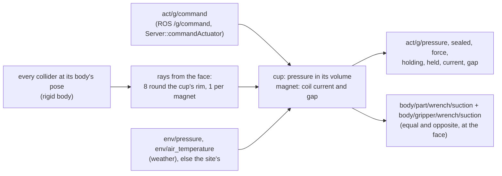
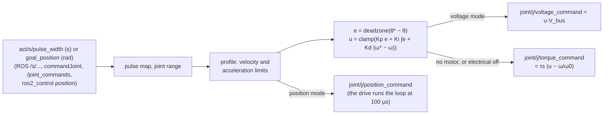
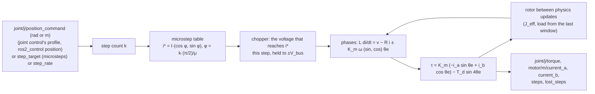

# Actuators: grippers, lead screws, nozzles, tanks, servos, steppers, solenoids and brakes

Grippers that hold a part without fingers (RFC 0020, phase 1): a suction cup
(`SuctionGripperAPI_1`) and an electromagnet or electropermanent magnet (`MagnetGripperAPI_1`).
`lagrange_actuators` (the `actuators` domain) runs them every 1 ms. It runs whenever the stage
has one.

A gripper never welds the part to itself. It pulls the part toward its face, and pulls itself
toward the part, with one pair of equal and opposite forces: `body/<part>/wrench/suction` (or
`/magnet`) and `body/<gripper's body>/wrench/...`, both applied at the face. The physics engine's
contact between the gripper and the part carries the reaction and the friction. So a part held by
a cup slips when friction cannot hold it, peels off when it is pulled harder than the cup holds,
and falls when the cup leaks, on MuJoCo, Jolt and a plugin backend alike.



## Using it

On a URDF link, whose origin is the centre of the cup's lip:

```xml
<gazebo reference="suction_cup">
  <suction_cup diameter="0.03" volume="1.0e-5" flow="1.0e-4" ultimate_pressure="20000"
               axis="0 0 1"/>
</gazebo>
```

or in an overlay or USD (`act:suction:diameter`, ...; formats.md §3.16). The four numbers without
a fallback come from the datasheets of the cup and the vacuum generator: the effective diameter,
the volume evacuated (the cup and its hose), the generator's suction flow at atmospheric pressure
in kg/s, and its ultimate vacuum as an absolute pressure. A magnet:

```xml
<gazebo reference="magnet">
  <magnet_gripper turns="600" pole_area="4e-4" iron_path_length="0.06" iron_permeability="2000"
                  coil_resistance="24" coil_inductance="0.12" rated_voltage="24" axis="0 0 1"/>
</gazebo>
```

What a part is made of goes on its link: `<sensor_material air_permeability="2e-6"
relative_permeability="1000"/>` (USD `sensmat:airPermeability`, `sensmat:relativePermeability`).
A part with neither is airtight and not magnetic.

The sample arm with a suction tool picks a parcel off the pick station of its workcell:

```bash
lagrange assets/robots/arm6/arm6_suction.urdf assets/worlds/workcell_arm6/workcell_suction.sdf
ros2 topic pub --once /suction_cup/command std_msgs/msg/Bool "{data: true}"
```

Move the arm with `/joint_commands` (or the viewer); `/suction_cup/state` says whether it holds
and `/suction_cup/pressure` (`sensor_msgs/FluidPressure`) is the cup's pressure, the signal a real
vacuum switch reads.

## The suction cup

The cup and its hose are a volume `V` of air at the ambient temperature `T`. Its pressure `p`
follows the mass of air in it:

```text
V / (R T) · dp/dt = ṁ_in − ṁ_gen
ṁ_gen = q0 · (p − p_min) / (p_atm − p_min)          (the generator, on)
```

The generator's flow falls on a line from `q0` at atmospheric pressure to zero at its ultimate
vacuum `p_min`. Switched off, the cup vents back through the generator along the same line, which
is how an ejector cup lets go. Air comes in:

- **through a porous part** the cup is sealed on: `ρ_atm · κ · A · (p_atm − p)`, with `κ` the
  part's air permeance (`sensmat:airPermeability`, m/(Pa·s)) and `A` the cup's area;
- **through an open cup**, by ISO 6358's flow through a conductance `C`
  (`act:suction:leakConductance`): `C · p_atm · ρ0 · √(T0/T)`, choked while `p/p_atm` is below
  the critical ratio `b = 0.528`, then falling on an ellipse to zero. Without a rated `C` an open
  cup is at atmospheric pressure at once.

The terms that are linear in `p` are integrated exactly over each step, so a sealed cup on an
airtight part follows the closed form `p = p_min + (p_atm − p_min) e^(−t/τ)`,
`τ = V (p_atm − p_min) / (R T q0)`, to rounding.

**Sealing.** Eight rays go from the lip's rim along the cup's axis. The cup seals when every ray
finds a surface within `act:suction:sealGap` (2 mm) of the lip, all on one body, each facing the
cup within `act:suction:maxTilt` (0.26 rad). A cup over an edge, over two parts, or tilted too far
does not seal. The rays use the run's colliders at the bodies' poses, the same exact queries as
the CPU lidar, on every tier.

**Holding.** While sealed, the cup pulls the part with `F = (p_atm − p) · A` along its axis. The
atmosphere is `env/pressure` when the weather runs, else the site's (`--site pressure=`), else
101 325 Pa.

## The magnet

The coil is an R–L circuit, `L di/dt = V − R i`, at its rated voltage while commanded. One ray from
the pole faces measures the gap `g` to the part. The flux across the gap, with two gaps in series
with the iron (half the iron path in the core, half in the part), and the Maxwell stress on both
poles:

```text
B = μ0 · N · i / (2 g + l_iron/2 / μr_core + l_iron/2 / μr_part),   B ≤ saturation
F = B² · A_pole / μ0
```

A part with `sensmat:relativePermeability` of 1 or less (aluminium, plastic) is not pulled. An
electropermanent magnet latches: switched on it holds as at its rated current and draws nothing,
until switched off. `act/<g>/power` is the coil's `i² R`. The pull is left out beyond 0.1 m.

## Signals

| Signal | Unit | |
|---|---|---|
| `act/<g>/command` | 1 | in: 1 on, 0 off (a scalar, as ROS topic inputs write it) |
| `act/<g>/force` | N | the pull on the part |
| `act/<g>/holding` | Int | the body held (index), −1 for none |
| `act/<g>/held` | Bool | holding a body |
| `act/<g>/pressure`, `sealed` | Pa, Bool | a cup |
| `act/<g>/current`, `gap`, `power` | A, m, W | a magnet |
| `body/<b>/wrench/suction`, `/magnet` | N, N·m | the force pair, summed into `external_wrench` |

ROS 2 (written by the server with no `--ros-topics` needed): `/<g>/command` (`std_msgs/Bool`, in),
`/<g>/state` (`std_msgs/Bool`), and `/<g>/pressure` (`sensor_msgs/FluidPressure`) for a cup or
`/<g>/current` (`std_msgs/Float64`) for a magnet. A `--ros-topics` map that uses the topic or the
signal replaces the default. `Server::commandActuator(name, value)` commands a gripper without ROS.

## Substitutes

| `domains.actuators.substitute` | |
|---|---|
| `ideal` | holds when commanded and sealed (or in front of iron), at once: the cup at its ultimate vacuum, the coil at its rated current, no leak |
| `zero`, `constant` (and `--domain actuators=off`) | never holds; no force |

## Sizing a cup

Lagrange computes the physics without a safety factor. The vacuum makers' sizing rules add one:
Schmalz's "Theoretical holding force of a suction cup" gives the force a cup must hold as
`m · (g + a) · S` for a horizontal cup lifting vertically, `m · (g + a/μ) · S` for a horizontal cup
moved sideways, and `(m/μ) · (g + a) · S` for a vertical cup, with `S` at least 1.5 for smooth,
dense parts and 2 or more for porous, rough or oily ones, and `μ` measured on the part (0.5 for
wood, metal, glass and stone in their table). The sample's parcel (0.3 kg) moved at up to 5 m/s²
with `S = 2` needs `0.3 · (9.81 + 5) · 2 = 8.9 N`; the sample cup holds 57.5 N at full vacuum.

## How far to trust it

Checked in `modules/actuators/test/test_gripper.cpp` and `server/test/test_grippers_run.cpp`
(MuJoCo):

| Check | Reference | Result |
|---|---|---|
| Evacuation of a sealed cup | the closed form above | within 4.4e-15 of the vacuum drawn over 5 τ |
| Holding force | `F = Δp·A` (the definition of pressure) | 102.196 N of 102.196 N (40 mm cup), 57.485 N (the sample's 30 mm cup on MuJoCo) |
| Steady pressure on a porous part, of an open cup | the balance of the flows, solved apart | 77 828 Pa against 77 828 Pa (porous), 39 585 Pa against 39 585 Pa (open cup); 67 217 Pa on MuJoCo from a URDF part |
| A hanging part lets go | its weight against `Δp·A` | held at 0.99 of it (no motion in a second), gone at 1.01 (0.2 m in a second) |
| A part held sideways slides | its weight against `μ·Δp·A` | at 0.97 of it the part creeps 7 mm/s (MuJoCo's soft friction), at 1.03 it slides 0.61 m/s |
| A cup over an edge, two parts or tilted past `maxTilt` | never seals | sealed: never |
| Magnet pull at 0.2, 0.5, 1, 2 and 4 mm | `B²A/μ0` with the series circuit | equal to rounding: 913.8 N at 0.2 mm down to 2.796 N at 4 mm |
| Coil current after one time constant | `(1 − e⁻¹) V/R` | to 1e-9 |
| The arm picks and places the parcel | | picked at (0.55, 0.25), lifted 0.10 m, put down at (0.549, −0.249) on the place station |
| The same run twice | bit for bit (`stateHash`, `lagrange determinism`) | the same `stateHash` after the pick and place; 51 hashes over 5 s identical |

What it leaves out: the cup's lip as a spring (the bellows' stroke and the lip's stiffness are the
cup collider's contact), heating of the air as it expands (isothermal), the magnet's flux leakage
and fringing (the series circuit is the textbook first estimate, which overestimates the pull at
large gaps), the magnet's hysteresis and an electropermanent magnet's switching pulse, and the
coil's load on the robot's power bus (its power is a signal; wiring it to a bus load is a later
step). A gripper on a body that does not move (welded to the world) cannot tell its own colliders
from the world's: put it on a moving body.

## Lead screws

A motor on a prismatic joint turns a screw: `elec:gearRatio` is motor radians per metre, 2π over
the lead. A screw loses more one way than the other, and a screw whose thread is steep enough
for its friction holds its load with the motor off. For a thread of lead angle `λ`
(`tan λ = lead / (π·dm)`, `dm` the pitch diameter) and friction angle `φ`
(`tan φ = μ / cos αn`, `αn` the flank's angle in the plane normal to the thread), the two
efficiencies are those of the power-screw equations (Budynas and Nisbett, *Shigley's Mechanical
Engineering Design*, chapter 8, "The Mechanics of Power Screws"):

```
η        = tan λ / tan(λ + φ)       the motor drives the load
η_back   = tan(λ − φ) / tan λ       the load drives the motor; ≤ 0 when φ ≥ λ: self-locking
```

`elec:gearBackEfficiency` on `ElectricalMotorAPI_1` holds `η_back` (0 for a self-locking screw;
its fallback −1 means "the same as `gearEfficiency`", which is how every gear behaved before).
When it is set, the back-driven losses are not a factor on the motor's torque but a Coulomb
friction on the joint that grows with the load, `joint/<j>/friction_limit`:

```
friction = (1 − η_back)·|F|     while the load drives the screw, or it stands against the load
friction = 0                    while the motor drives against the load (its torque then reaches
                                the joint through η: F = 2π·η·T / lead)
```

`F` is what the joint carries besides the drive: effective inertia × acceleration − the drive's
force − the joint's constraint force (friction and limits), all from physics, one physics step
old. Moving, the direction decides who drives; about still (under 1 mm/s) the motor drives once
its force is larger than the load. A self-locking screw (η_back = 0) then holds the whole load
with the motor shorted, off or failed; a back-drivable one sinks until the motor's braking
force carries `η_back` of the load. Both rigid-body engines take the friction limit as an input
(MuJoCo: the dof's `frictionloss`; Jolt: the slider's or hinge's maximum friction), so the
holding is the engine's own Coulomb friction, and a worm gear on a hinge works the same way.
With the electrical domain off the friction limit is not written: the ideal torque source has
no screw.

### Using it

An overlay gives the thread and the loader works out the gear:

```yaml
  - prim: lift_a
    create_child: lift_a_motor
    schemas:
      ElectricalMotorAPI_1:
        elec:motorType: dc_brushed
        # ... resistance, inductance, torque constant, current limit, joint, power port
        lead_screw: {lead: 0.002, diameter: 0.011, friction: 0.15, thread_angle: 0.2618}
```

`lead` and `diameter` (the pitch diameter) in m, `friction` the flanks' coefficient (a ball
screw's rolling friction, with `thread_angle` 0), `thread_angle` the flank's half-angle in rad
(0 square, 15° metric trapezoidal, 14.5° Acme; 0 when left out). It sets `elec:gearRatio`,
`gearEfficiency` and `gearBackEfficiency`, and is refused beside any of them. The friction
coefficient is the user's: lubrication, materials and wear change it more than anything here.

The sample, `assets/robots/screw_lift`, is two vertical lifts on one base: `lift_a` carries
100 kg on a Tr12x2 (η 0.269, self-locking), `lift_b` 20 kg on a 16x5 ball screw (η 0.952,
η_back 0.949), each with a brushed motor in voltage mode on a 24 V bus:

```bash
lagrange assets/robots/screw_lift/screw_lift.urdf --world none \
    --overlay assets/robots/screw_lift/screw_lift.overlay.yaml
```

Under `lagrange` (`--joint-control`) both drives hold 0 V until told volts, so `lift_a` stays
where it is and `lift_b` sinks to its stop at 47 mm/s; `/joint_commands` with 24 V in the
effort field for `lift_a` lifts it at 58 mm/s. Signals: `joint/<j>/friction_limit` beside the
motor's `motor/<m>/*`.

### Checked

| Check | Reference | Result |
|---|---|---|
| Efficiencies of a ball screw 16x5 (μ 0.005) and a Tr12x2 (μ 0.15, 15°) | Shigley's raising and lowering torques | equal to 1e-12 for square threads (0.9517 and 0.9493); 0.2691 within 1e-4 for the trapezoid (Shigley takes α where the code takes αn), self-locking where Shigley's lowering torque is positive |
| Thrust | `F = 2π·η·T / lead` | to 1e-9, at rest and driving |
| Back-driven torque | `T = η_back·F·lead / (2π)` with the friction `(1 − η_back)·F` | the drive's torque within 0.1 %, motor force plus friction balance the load to 0.1 % |
| Friction limit as an engine input | a 10 kg slide at 120 N; at half its weight; on a hinge | held: 9.8 µm in 10 s on MuJoCo (its soft friction, stiffened for these joints), 0 on Jolt; falls at g/2 and turns at (τ − limit)/I within 1 %; a changing limit restores bit for bit |
| A self-locking screw holds 100 kg, motor shorted, 60 s (conformance suite) | | settles 24 µm (MuJoCo), 31 µm (Jolt, `jolt_abi`) in 0.1 s, then moves 59 µm (MuJoCo) and 0 (Jolt) in 60 s |
| The same screw lifts it at 24 V | `i = m·g/(η·N·Kt)`, `v = (V − R·i)/(Kt·N)` | 0.05793 m/s and 11.60 A against 0.05793 and 11.60, friction 0, every engine |
| A ball screw sinks, 20 kg, motor shorted | `v = η_back·m·g·R / (N²·Kt²)` | 0.04716 m/s against 0.04716 on MuJoCo, Jolt and `jolt_abi`; from a restored checkpoint bit for bit |
| The same run twice | `lagrange determinism` on the sample with `--joint-control` | 121 state hashes over 12 s identical |

What it leaves out: the screw's own inertia beyond the motor's `elec:rotorInertia`, its
stiffness and backlash, the change of friction with speed (a single Coulomb coefficient), the
motor's extra torque to lower a self-locking screw (with η_back clamped at 0 the friction equals
the load, so lowering needs only a push), and end-of-travel switches (the joint's limits).
`lagrange check` still sizes a screw's holding by its motor.
## The nozzle and tank

A water, foam or CO2 nozzle (`NozzleAPI_1`, RFC 0022 §8) on a link, fed from a tank
(`TankAPI_1`) or a hose, its valve on `act/<z>/command` (0 to 1).

**Flow.** Behind the pump's gauge pressure Δp (`act:nozzle:pressure`, or
`act/<z>/pressure_command` while over 0), the exit velocity is Bernoulli's with the nozzle's
discharge coefficient, `v0 = C_d·√(2Δp/ρ)`, and the mass flow `ṁ = u·ρ·A·v0`, `A = πd²/4`, `u` the
valve's opening. The opening scales the flow at the same exit velocity (a valve pulsing between
shut and open); a throttling valve's pressure drop is not modelled: lower the pressure instead.
The pump draws `Δp·Q/η` (`act/<z>/pump_power`, and the `power_demand` of a signal-model
`ElectricalLoadAPI_1` on the nozzle's prim, so the bus carries it).

**Reaction.** The jet pushes the nozzle's body back with `F = ṁ·v0` against the jet, at the
exit (`body/<b>/wrench/nozzle`): 4.5 N for the sample's 0.48 kg/s at 9.5 m/s, enough to roll a
robot on free wheels (the tutorial holds them).

**Path.** Ballistic and drag-free from the exit, `x(t) = x0 + v0·t + g·t²/2`, cast as 5 cm chords
against every collider at the bodies' poses (the scene rays the lidar uses) until one is met,
passing through the nozzle's own robot (its bodies joined by joints) and whatever the exit is
inside. On level ground it lands where the projectile does,
`R = v·cos θ·(v·sin θ + √(v²·sin²θ + 2gh))/g`. A real stream breaks up and falls short of this
(RFC 0022 §8: no openly readable fire-stream reach correlation was found, TODO(verify)), so
treat the reach as an upper bound. The landing disc's radius is `d/2 + L·tan(sprayHalfAngle)`, `L`
the path's length. The fire domain turns the impact, flow and disc into each fire's water
([fire.md](fire.md#water-from-a-nozzle)).

**Tank.** Its agent is a weight `m·g` at the tank's prim (`body/<b>/wrench/tank`), `m` falling by
`ṁ·dt` each step until empty; open nozzles share what is left by their demand. The body's own
mass is the empty tank's: the engines' masses do not change during a run, and the water's
inertia and sloshing are left out (RFC 0022 open question 12), which understates the inertia of
a drone carrying a large tank.

| Signal | Type | Unit | |
|---|---|---|---|
| `act/<z>/command` | Scalar | 1 | in: the valve, 0 to 1 |
| `act/<z>/pressure_command` | Scalar | Pa | in: over 0 replaces `act:nozzle:pressure` |
| `act/<z>/flow` | Scalar | kg/s | |
| `act/<z>/velocity` | Scalar | m/s | exit velocity while it sprays |
| `act/<z>/reaction` | Scalar | N | `ṁ·v0` |
| `act/<z>/impact` | Vec3 | m | where the jet lands, world-local; NaN when it does not |
| `act/<z>/landed` | Bool | 1 | |
| `act/<z>/footprint` | Scalar | m | radius of the landing disc |
| `act/<z>/path` | ScalarArray | m | 32 points along the jet, NaN past its end |
| `act/<z>/tank_mass` | Scalar | kg | |
| `act/<z>/pump_power` | Scalar | W | |
| `body/<b>/wrench/nozzle`, `body/<b>/wrench/tank` | Wrench | N | |

ROS: `/<z>/command` and `/<z>/pressure_command` (`std_msgs/Float64`) in; `/<z>/tank`,
`/<z>/flow` (`std_msgs/Float64`) and `/<z>/impact` (`geometry_msgs/Vector3Stamped`, frame
`world`) out. `Server::commandActuator(name, value)` opens it from code. The substitutes: `ideal`
sprays as the model does (a nozzle has no dynamics to idealise), `zero` and `constant` keep every
valve shut. Everything runs on the CPU on every tier, deterministically, at 10 ms.

Checked by `modules/actuators/test/test_nozzle.cpp`: Bernoulli's `v0` and `ṁ`; the landing point
against the closed form at 0°, 15°, 30°, 45° and 60° from 0.5 m (worst 2.4e-5, against RFC
0022's 0.5 %); 45° the longest on level ground, 30° and 60° landing together, straight up rising
`v²/2g` and coming back down; the reaction `ρAv0²` and its moment; the tank at `m0 − ṁ·t` and its
weight, empty at `m0/ṁ`; the shut substitute; the same run twice. `server/test/test_nozzle_run.cpp`
runs the firefighting AMR (docs/guide/tutorial-fire.md).

## Servos

A servo is a motor, a gear and a board that closes a position loop (RFC 0020 §4.3). A hobby PWM
servo's board compares the angle a pulse asks for with its potentiometer and drives its brushed
motor with a duty in proportion to the error; a smart (Dynamixel-class) servo's board adds an
encoder, integral and derivative gains, velocity and acceleration profiles, a current limit,
other operating modes and an overload shutdown. `ServoAPI_1` on a joint is that board; the motor
is the joint's ordinary `ElectricalMotorAPI_1`, `dc_brushed`, so current, back-EMF, bus load and
heat stay the electrical domain's.



Each step (1 ms) the servo module (`actuators/servos`, in `lagrange_actuators`):

```
θ*  = angleMin + (pulse − pulseMin)/(pulseMax − pulseMin)·(angleMax − angleMin)   (a pulse)
      or goal_position; held to the joint's range; through the profile when one is set
e   = deadzone(θ* − quantise(θ, resolution), deadband)     0 inside ±band, e ∓ band outside
u   = clamp(Kp·e + Ki·∫e + Kd·(ω* − ω), u_min, u_max)        u in −1…1, the duty cycle
```

and drives the joint one of three ways:

- **Voltage mode** (`elec:controlMode = voltage`, electrical domain on): `joint/<j>/voltage_command
  = u·V_bus`, `V_bus` from `bus/<b>/voltage`. The motor model then gives the servo's datasheet
  curves: stall torque `τs = η·N·Kt·V/R`, no-load speed `ω0 = V/(N·Ke)` (`Ke = Kt` for a brushed
  motor) and the straight line between them, all varying with the supply voltage. A smart servo's
  duty is also held where the armature current `(u·V − N·Ke·ω)/R` stays within `elec:maxCurrent`;
  a hobby board's bare H-bridge has no limit.
- **Position mode** (`elec:controlMode = position`, appended by RFC 0020): the drive runs the same
  loop itself, at its own step (100 µs), on `joint/<j>/position_command`, with the gains of the
  joint's `ServoAPI_1` and its current held to `elec:maxCurrent`: a smart servo's loop on its own
  motor drive. The module writes the profiled set point; a NaN set point turns the torque off
  (the winding open).
- **Ideal** (no motor, or the electrical domain off): `joint/<j>/torque_command = τs·(u − ω/ω0)`
  from `act:servo:stallTorque` and `noLoadSpeed`, the datasheet's two numbers. This is the same
  line as the motor's at full duty; back-driven against its duty it brakes harder than `τs`, as a
  DC motor does.

Smart servos also follow `act/<s>/goal_velocity` (`operatingMode = velocity`, a PI loop with
`velocityKp`, `velocityKi`) or `act/<s>/goal_current` (`current`, the duty `(R·i + N·Ke·ω)/V`
that drives that current, voltage mode only). The overload shutdown (open question 6) turns the
torque off when the output stays saturated (full duty from the proportional term, or the current
at its limit) for `overloadTime`, or the winding (`thermal/<motor>/temperature`) reaches
`maxTemperature`; it stays off until `act/<s>/torque_enable` goes to 0 and back to 1. A pulse
width of 0 lets a hobby servo go, as losing its signal does. Torque off in voltage mode is 0 V
across the winding (the H-bridge's low sides on, so the motor brakes); in position mode and
in the ideal fidelity the joint is free.

### Using it

The sample is a pan-tilt head on two hobby servos, `assets/robots/pan_tilt`: brushed motors behind
200:1 gears in voltage mode on a 2S battery (6.56 V), boards mapping 1.0–2.0 ms to ±45° with
`Kp = 20` per rad and a dead zone of 0.01 rad:

```bash
lagrange assets/robots/pan_tilt/pan_tilt.urdf --world none \
    --overlay assets/robots/pan_tilt/pan_tilt.overlay.yaml
ros2 topic pub --once /pan/pulse_width std_msgs/msg/Float64 '{data: 0.0018}'   # +27°
ros2 topic pub --once /tilt/goal_position std_msgs/msg/Float64 '{data: -0.4}'
```

The servo on a joint, in an overlay (formats.md §3.16):

```yaml
  - prim: pan
    schemas:
      ServoAPI_1:
        act:servo:kind: pwm
        act:servo:pulseMin: 0.001       # s
        act:servo:pulseMax: 0.002       # s
        act:servo:angleMin: -0.7854     # rad
        act:servo:angleMax: 0.7854      # rad
        act:servo:kp: 20.0              # duty per rad
        act:servo:deadband: 0.01        # rad
```

Commands: `act/<s>/pulse_width` (s), `goal_position` (rad), `goal_velocity`, `goal_current`,
`torque_enable` (ROS `/<s>/pulse_width`, `/<s>/goal_position` (or `goal_velocity`,
`goal_current`), `/<s>/torque_enable` by default); `Server::commandJoint(s, "position", rad)`
and `/joint_commands`' position go to the servo, not to joint control, which leaves servo joints
out. Under ros2_control, `LagrangeSystem`'s `position` command interface on a servo joint is its
goal (a servo in velocity mode takes `velocity`), and its `effort` state is the servo's present
load. Out: `act/<s>/present_position` (quantised by `resolution`), `present_velocity`,
`present_load` (N·m), `goal` (the set point), `overload`, and with a motor `present_current` and
`temperature`; ROS `/<s>/present_position`, `/<s>/present_load`, `/<s>/overload`.

A Dynamixel's control table gives `Position P Gain` as `KPP = KPP(TBL)/128` (likewise
`KPD = KPD(TBL)/16`, `KPI = KPI(TBL)/65536`; ROBOTIS e-Manual, XM430-W350) with no unit; the
e-Manual does not state the units of the error and of the output. Read as an error in encoder
pulses (4096 a turn) and an output in PWM counts (885 is 100 %), `act:servo:kp =
KPP·(4096/2π)/885`: the default 800 gives 4.6 per rad. TODO(verify): that reading, and the
loop's period for `KPI` and `KPD`, against ROBOTIS before relying on it.

Substitutes (`--domain actuators=off`, profile `domains.actuators`): `zero` turns every servo's
torque off, `constant` holds the start position and ignores commands, `ideal` runs a perfect
board (no dead zone, no sensing step, no profile, no shutdown).

### Checked

`test_servo` (the board's equations) and `test_servos_run` (whole runs on MuJoCo):

| Check | Reference | Result |
|---|---|---|
| Stall torque and no-load speed of a smart servo fitted to the XM430-W350's 12 V row (R from 2.3 A, N·Kt from 46 rev/min, η from 4.1 N·m) | the same table at 11.1 V and 14.8 V | 3.79 N·m and 42.6 rev/min against 3.8 and 43 at 11.1 V; 56.9 rev/min against 57 at 14.8 V; the stall torque at 14.8 V is 5.06 N·m against 4.8 (5 % over: the table's 2.7 A is under the linear motor's 2.84 A) |
| Ideal line against the motor's line at full duty, 0–95 % of ω0 | `τ = N·Kt·η·(V − N·Ke·ω)/R` | within 2 % (exact, with no other losses) |
| 60° step of a hobby servo, saturated until 1/Kp from the goal | `θ = ω0 (t − τm (1 − e^(−t/τm)))`, `τm = J ω0/τs` | within 1 %; 0.12 s for 60° (the "s/60°" figure) within 5 % |
| The pan-tilt's 60° pan step at the run's 6.56 V (electrical) | the same closed form | 0.1060 s against 0.1062 s |
| The same step with the electrical domain off (ideal, from the overlay's stall torque and no-load speed) | the same | 0.1060 s against 0.1062 s: the fidelities agree |
| Holding: stiffness under a load below stall; back-driven past stall | `e = τ/(Kp τs)`; `ω = −ω0 (τ/τs − 1)` | within 1 % |
| The tilt holding its camera block (0.0294 N·m) | between `band + η²·τ_g/(Kp τs)` and `band + τ_g/(Kp τs)`: the gear's losses side with the motor or against it | 0.01298 rad, between 0.01222 and 0.01452; still to 0.1 mrad over 0.5 s, the drive pushing the same way throughout |
| Dead zone | a step inside it; a 20° step | nothing moves; it stops in the band with the duty never changing sign (a deliberately over-tuned loop without a dead zone hunts, > 10 sign changes) |
| Profile | trapezoid `d/v + v/a`; triangle `2√(d/a)`, peak `√(a d)` | within 1 % and 2 %; the smart servo's joint cruises at 1.9999 rad/s for a 2 rad/s profile |
| Smart servo in position mode, unloaded | `46 rev/min × V/12 V` at the run's 13.12 V | 5.2667 rad/s against 5.2667 |
| Overload | 6 kg 0.1 m out, past what its current lifts, `overloadTime` 0.5 s | `overload` set, torque off (0 A), the arm falls |
| The same run twice; the domain off | | state hashes equal; off, the pan does not turn and the tilt sinks |

What it leaves out: the pulse's period and jitter (a pulse width is taken as it is written),
the potentiometer's nonlinearity, the gear's backlash and compliance, the Dynamixel serial
protocol and error-status bits (open question 7), the motor's cogging and brush drop, and the
board's own current draw. A hobby servo's board here samples every 1 ms; a real analog board is
continuous.

## Steppers

A stepper turns by steps: its driver puts a pattern of currents on two phases, and the rotor's
teeth line up with it (RFC 0020 §4.5). It needs no encoder, so nothing tells the driver when the
rotor did not follow: an overload, too fast a start or too high a speed and the rotor slips to
another equilibrium, a whole tooth away, and stays there, the position silently lost. That is
the behaviour this model exists for. A stepper is an `ElectricalMotorAPI_1` with
`elec:motorType = stepper`, so its current, bus load and `loss_power` heat stay the electrical
domain's; there is no `actuators` module for it.



Each electrical step (100 µs), for a two-phase hybrid stepper of `N_r` rotor teeth (50 for 1.8°
steps) with rotor angle `θ`, `θe = N_r·θ`:

```
v_a = R·i_a + L·di_a/dt − K_m·ω·sin θe
v_b = R·i_b + L·di_b/dt + K_m·ω·cos θe
τ   = −K_m·i_a·sin θe + K_m·i_b·cos θe − T_d·sin 4θe
```

- **The driver's table.** Microstep `k` of `μ` per full step asks for `i_a* = I·cos φ`,
  `i_b* = I·sin φ`, `φ = k·(π/2)/μ`: one current vector of length `I` whose equilibrium is
  `θe = φ`. `I` is `elec:maxCurrent` while it steps and `elec:stepper:holdCurrent` once the count
  has not changed for 0.2 s (a modelling choice; drivers make it a setting).
- **The chopper.** Each phase gets the voltage that brings its current to the reference by the
  end of the step, the exact solution of its R–L circuit with the back-EMF held, held to
  `±V_bus`: a chopper averaged over its PWM period. At low speed the currents follow; past the
  corner where `V_bus/|Z|` falls under `I` (`|Z| = √(R² + (N_r ω L)²)`) the bridge saturates,
  the currents lag and shrink, and the torque falls with speed. The pull-out curve comes out of
  the circuit; it is not a table.
- **Holding torque.** `torqueConstant` is `K_m`, the torque per phase ampere, so a current vector
  of `I` holds `K_m·I` a full step from equilibrium. A datasheet's holding torque is measured with
  two phases on at the rated current, a vector of `√2·I`: `K_m = T_hold/(√2·I_rated)`, and a
  microstepping driver holds `1/√2` of the datasheet figure.
- **The rotor.** The torque–angle curve is stiff (`K_m·I·N_r`, 21 N·m/rad for the sample's
  motor), stiffer than a 1 ms physics step can resolve on a light load. So between physics
  updates the driver integrates the rotor itself on the joint's effective inertia, with the load
  estimated from the last window, and takes the physics position and speed at each update, the
  speed prediction of architecture.md §8 extended to the angle. Physics gets the window's mean
  torque.
- **Lost steps.** A load past the curve's peak (a load angle beyond a quarter tooth, one full
  step) pulls the rotor to the next equilibrium, a whole electrical period (four full steps)
  away. `motor/<m>/lost_steps` is how many full steps the rotor is behind the count, always a
  multiple of four: ground truth for tests, which a real open-loop driver does not know, so
  `motor/<m>/fault` stays 0.

The count comes from `joint/<j>/position_command` (rad, or m on a slide, the joint's position;
0 microsteps is where the joint starts) when it is written, read between the controller's
updates by linear extrapolation; else `joint/<j>/step_target` (Int, microsteps); else
`joint/<j>/step_rate` (microsteps/s, signed, a step/dir input). `joint/<j>/stepper_enable` (Bool,
default on) is the enable pin: off, no current, and the rotor is free but for detent. A jump in
the count is taken at once, as a burst of step pulses would be: more than about two full steps
in one electrical step and the rotor cannot follow. A warning is logged once when the rotor turns
faster than the electrical step resolves (fewer than 20 steps per electrical period).

### Using it

The sample is a two-axis gantry, `assets/robots/gantry`: x on a GT2 belt (40 mm a turn), y on a T8
lead screw (8 mm lead), each a NEMA 17 at 1/16 microstepping from 24 V. The motor is
STEPPERONLINE's 17HS19-2004S1 as its drawing gives it: 2.0 A, 1.60 Ω, 3.00 mH, 0.59 N·m holding
torque (two phases on), 1.8°, 82 g·cm² (its detent torque is not on the drawing: 0 here):

```bash
lagrange assets/robots/gantry/gantry.urdf --world none \
    --overlay assets/robots/gantry/gantry.overlay.yaml
ros2 topic pub --once /joint_commands sensor_msgs/msg/JointState \
    '{name: [x, y], position: [0.1, -0.03]}'
```

Joint control (the default for your own robot under `lagrange`) moves a stepper by a trapezoidal
profile written to `position_command`, at the joint's URDF velocity limit (0.5 rad/s or 0.05 m/s
without one), reaching it in 0.25 s, toward a position target or at a velocity target: a motion
controller's job, since a stepper started at full speed loses steps. ros2_control's position
interface goes to `position_command` unchanged.

In an overlay (formats.md §9):

```yaml
  - prim: x
    create_child: x_motor
    schemas:
      ElectricalMotorAPI_1:
        elec:motorType: stepper
        elec:windingResistance: 1.6     # ohm per phase
        elec:inductance: 0.003          # H per phase
        elec:torqueConstant: 0.2086     # N·m per phase ampere: 0.59 / (2√2)
        elec:maxCurrent: 2.0            # A, the run current
        elec:stepper:holdCurrent: 1.0   # A at standstill
        elec:stepper:microsteps: 16
        elec:stepper:rotorTeeth: 50     # 1.8° steps (the fallback)
        elec:stepper:detentTorque: 0.0  # N·m
        elec:rotorInertia: 0.0000082    # kg·m²
        elec:gearRatio: 157.08          # rad per m: 2π / 0.04 m a turn
        elec:joint: x
        elec:powerPort: power/dc_24v
```

### Checked

`test_stepper` (the motor and driver, and the network on a carriage stepped at 1 ms) and
`test_steppers_run` (the gantry on MuJoCo), with the 17HS19-2004S1 at 24 V:

| Check | Reference | Result |
|---|---|---|
| Static torque, ±2 full steps, at 0.5–2 A | `τ = −K_m·I·sin(N_r·Δθ)` | within 1 % of `K_m·I`; the peak, the holding torque, `K_m·I` within 1 % at every current |
| Hold current | `K_m·I_hold` after 0.2 s still | 1e-3 N·m |
| Pull-out torque with sine voltages of 24 V on the phases (a voltage-mode driver), 100–4000 full steps/s | the phase circuit's steady state: `τ_po = (K_m/|Z|)·(V − K_m·ω·R/|Z|)`, whose first term is the RFC's `K_m·V/√(R² + (N_r ω L)²)` | within 0.14 % at every speed |
| Pull-out with the chopper, 100–6000 full steps/s | `K_m·I` below the corner (2524 full steps/s); the RFC's `K_m·min(I, V/|Z|)` above | 0.4170–0.4161 N·m against 0.4172 to 1000 full steps/s; 0.3486, 0.2824, 0.2346, 0.2017 N·m at 3000–6000 against 0.3519, 0.2646, 0.2120, 0.1768 (the saturated chopper's square wave beats a sine of `V`: up to 14 % over), falling monotonically |
| A rotor and pulley run up to 1000 full steps/s with a load rising over 0.2 s | the pull-out torque there | at 0.95 of it no step lost; at 1.05 it falls out of step and stays out |
| 1.3× the holding torque for 10 ms at standstill | a slip lands on another equilibrium | 52 full steps lost (a multiple of four), then 200 full steps forward land on the count less those 52, to 0.01 full step |
| Microstep position, 1/16 | without detent: `θe = φ`; with `T_d` = 0.03 N·m: the root of `K_m·I·sin(φ − θe) = T_d·sin 4θe` | 0.000 microsteps off; with detent within 1 % of a microstep of the root, the worst microstep 0.73 microsteps from its table angle |
| The network's stepper on a 1 kg carriage stepped at 1 ms, 1000 full steps/s on the belt with 0.25 s ramps | the step count | at 0.099988 m for 7999 microsteps, to the microstep; 0 lost; asked 3000 full steps/s at once, it loses 892 full steps |
| The gantry, joint control to x = 0.1 m, y = −0.03 m | the count, the profile's time | x at 0.100000 m (8000 microsteps), y at −0.030000 m (−12000 microsteps): to the microstep |
| A 150 kg beam asked for 0.8 m/s² | 120 N needed, 65 N available | 432 full steps lost, the carriage at 0.0136 m of 0.1 m, `fault` 0 |
| The same run twice | | state hashes equal; the network alone bit-identical |

What it leaves out: the chopper's own ripple and decay modes (it is averaged over its PWM
period), the driver's stall detection (StallGuard-style, RFC 0020 open question 8), its
resonance damping and current-reduction features beyond the hold current, the detent harmonic's
phase on the real motor (here aligned with the start position), iron losses and saturation, the
back-driven friction of a self-locking screw on a stepper axis (the lead screw's
`gearBackEfficiency` applies to the other motor types only), and the ideal substitute that moves
the joint exactly by the steps: with the electrical domain off, joint control drives a stepper
joint as an ideal position servo. The pull-out curve is checked against the circuit, not against
a measured motor (TODO(verify): no published measured curve with full motor parameters was found
for this pass).

## Solenoids

A solenoid (`SolenoidAPI_1`, RFC 0020 §4.6) is a plunger in a coil, on a prismatic joint. The
joint's position `x` is how far the plunger has gone in, 0 at rest and `act:solenoid:stroke`
fully in. The joint's limits are the stops. `actuators/solenoids` (`modules/actuators`, 100 µs)
keeps the coil's flux linkage `λ = L(x)·i` as its state:

```
dλ/dt = v − R·i,       i = λ / L(x)
F     = ½·i²·dL/dx − (F0 + k·x)
```

`L(x)` is the table `act:solenoid:inductanceStrokes`/`inductances`, linear between its points,
so `dL/dx` is the slope of the segment that holds `x`. The pull `½·i²·dL/dx` is the co-energy
force of a coil whose inductance does not depend on its current (no saturation). Each step solves
the R–L circuit exactly at the plunger's position, from the current `λ/L(x)`. A plunger that
moved since the last step keeps its flux, so its current falls by the ratio of the inductances.
That is the current's dip as the plunger pulls in, which a valve driver watches to tell that the
valve has moved. The pull and the spring push the joint through `joint/<j>/torque_command` (N on a
slide), which the electrical domain (or its ideal substitute) passes on, as for any joint without
a motor. The joint is made actuated whatever its file says.

The command `act/<s>/command` (0 to 1) puts that share of `act:solenoid:ratedVoltage` across the
coil: 1 on, 0 off, between them a PWM duty as the coil sees it on average (its current ripple is
left out). The supply is not a bus of the electrical network yet, as for `MagnetGripperAPI_1`
(TODO(RFC 0020): a solenoid as a load on its bus).

### Using it

```bash
lagrange assets/robots/solenoid_bench/solenoid_bench.urdf --world none \
  --overlay assets/robots/solenoid_bench/solenoid_bench.overlay.yaml
ros2 topic pub --once /plunger/command std_msgs/msg/Float64 "{data: 1.0}"
ros2 topic echo /plunger/current
```

| Signal | Unit | Meaning |
|---|---|---|
| `act/<s>/command` | 1 | In: 0 to 1, the share of the rated voltage (optional, 0) |
| `act/<s>/current` | A | The coil's current |
| `act/<s>/voltage` | V | Across the coil |
| `act/<s>/force` | N | The magnetic pull alone, `½·i²·dL/dx` |
| `act/<s>/position` | m | The plunger's stroke, held to 0 … `stroke` |
| `act/<s>/power` | W | Drawn from the supply, `v·i` |

ROS: `/<s>/command` (`std_msgs/Float64`) in, `/<s>/current` and `/<s>/position` out;
`Server::commandActuator(name, value)`. Substitutes: `ideal` puts the steady current `V/R` through
the coil at once (no delay, no dip); `zero` and `constant` leave it unpowered. The spring acts in
every one, since it is the device's and not its electronics'.

The sample is a 12 V push-pull solenoid of 24 Ω on a bench, with a 20 g plunger and 10 mm of
stroke, `L` from 30 mH at rest to 90 mH fully in. Its numbers are illustrative, of the size a
small open-frame solenoid's datasheet gives, not a real product's.

### Checked

`test_solenoid` (the coil and the pull) and `test_solenoids_run` (the bench on MuJoCo):

| Check | Reference | Result |
|---|---|---|
| Pull at 1, 5 and 9.5 mm, the current settled | `½·(V/R)²·ΔL/Δx` of the table's segment | within 1e-6 |
| Current with the plunger held, at ½τ, τ, 3τ, steps of 0.1 and 1 ms | `V/R·(1 − e^(−t/τ))`, `τ = L/R` | within 1 % |
| The plunger jumped from rest to the stop in 1 µs | the flux kept: `i·L(0)/L(stroke)` | within 1 %, then back to `V/R` without overshoot |
| Pull-in of the bench, from rest | the same coil, spring and 20 g plunger integrated at 1 µs with hard stops | 63.0 ms against 61.9 ms; current peak 0.500 A (0.499), dip 0.389 A (0.370) |
| At the stop | `V/R`, the last segment's pull, `V²/R` | 0.5 A, 2.5 N, 6 W, each within 1 % |
| Off | the spring | back at rest, no current |
| The actuators domain off | | unpowered, at rest |
| The same run twice | | bit for bit |

What it leaves out: saturation of the iron (the inductance does not depend on the current), eddy
currents and the plunger's magnetic hysteresis, the coil's heating (its resistance is constant),
the latching kind with a permanent magnet, the PWM ripple, and a closed form for `L(x)` from a
magnetic circuit (the table is given). The stops are the joint's limits; both engines hold the plunger on them to micrometres (`AJointLimitIsAStop`). The
co-energy force is the textbook result for a linear magnetic circuit (TODO(verify): cite an
edition; no openly readable text was found in this pass, as RFC 0020 §4.6 notes).

## Holding brakes

A holding brake (`BrakeAPI_1`, RFC 0020 "Also worth adding") sits on a revolute, continuous or
prismatic joint, as on nearly every industrial arm's joints. It is spring-applied and power-off:
springs press a friction disc, and a coil pulls the armature off it when powered. With no power
it holds, which is what makes an arm safe when its drives trip. `actuators/brakes`
(`modules/actuators`, 1 ms) keeps the coil's current. The coil is an R–L circuit with a
freewheeling diode across it, so the current rises as `V/R·(1 − e^(−t/τ))` when powered and
decays as `e^(−t/τ)` when not, with `τ = L/R`. The armature lets go at `releaseCurrent` and the
springs apply it again at `dropoutCurrent`, a hysteresis. So the brake releases
`−τ·ln(1 − I_r/I_0)` after power on and is applied `−τ·ln(I_d/I_0)` after power off.

While applied, the brake writes `joint/<j>/friction_limit`, the engines' Coulomb limit of the lead
screws (§ "Lead screws"). Because the limit has a writer, MuJoCo makes the joint's friction row
stiff and the brake holds without creeping. At rest, below 1e-3 rad/s, the limit is the holding
torque. While the joint slips it is the dynamic torque. A joint whose motor has a lead screw's
`elec:gearBackEfficiency` is refused, since both would write its friction limit. The joint is
made actuated whatever its file says.

### Using it

```bash
lagrange assets/robots/brake_arm/brake_arm.urdf --world none \
  --overlay assets/robots/brake_arm/brake_arm.overlay.yaml
ros2 topic pub --once /shoulder/release std_msgs/msg/Bool "{data: true}"
```

| Signal | Unit | Meaning |
|---|---|---|
| `act/<b>/release` | 1 | In: 0 to 1, the share of the rated voltage on the coil (optional, 0: held) |
| `act/<b>/current` | A | The coil's current |
| `act/<b>/voltage`, `power` | V, W | On the coil |
| `act/<b>/engaged` | Bool | The springs apply the disc |
| `act/<b>/torque` | N·m (N) | The friction limit it writes |

ROS: `/<b>/release` (`std_msgs/Bool`) in, `/<b>/engaged` out; `Server::commandActuator(name, 1)`;
in ros2_control, a `<gpio>` with command interface `release` and state interface `engaged`.
Substitutes: `ideal` switches at once on the command, `constant` always holds, and `zero` never
holds, as if the joint had no brake.

The sample is a one-joint arm: 1 kg, 0.3 m out on a horizontal shoulder, 2.94 N·m of gravity at
the horizontal, with a 5 N·m brake (4 N·m dynamic) on a 24 V coil of 48 Ω and 0.5 H. Its numbers
are illustrative, of the size a small servo motor's brake datasheet gives, not a real product's.

### Checked

`test_brake` (the coil and the armature) and `test_brakes_run` (the arm on MuJoCo):

| Check | Reference | Result |
|---|---|---|
| Release after power on, steps of 0.01, 0.1 and 1 ms | `−τ·ln(1 − I_r/I_0)` = 12.54 ms | within one step |
| Applied after power off, the same steps | `−τ·ln(I_d/I_0)` = 12.54 ms | within one step |
| Between dropout and release currents | the armature's hysteresis | it stays as it was |
| The arm held at the horizontal for 1 s | no motion | 3.2e-6 rad |
| Released for 0.1 s, then applied | an independent integration of the arm with the 4 N·m dynamic torque | stopped at 0.5391 rad against 0.5391 rad, then 1.4e-6 rad in 0.5 s |
| Release and apply in the run | 12.54 ms | 13.0 ms each (the run's 1 ms step) |
| The actuators domain off (zero) | | never holds: the arm falls |
| The same run twice | | bit for bit |

What it leaves out: the disc's wear and its friction's change with temperature and speed (the
dynamic torque is one number), the armature's own travel time (only the coil's current decides),
overexcitation and holding-voltage reduction of brake drivers, the suppression by a Zener or
varistor instead of a diode (they apply the brake sooner), and the brake's heat when it is
slipped. The release and dropout currents' fallbacks, 0.7 and 0.3 of the rated current, are of
the order brake datasheets give for pull-in and drop-out voltages (TODO(verify) against a named
datasheet).

## ros2_control GPIO

Every actuator's signals can also be reached from ros2_control (RFC 0020 §5). In the URDF's
`<ros2_control>` block for `lagrange_ros2_control/LagrangeSystem`, a `<gpio>` names an actuator.
Each of its command interfaces writes `act/<gpio>/<interface>` and each state interface reads it,
once every controller cycle:

```xml
<ros2_control name="bench" type="system">
  <hardware><plugin>lagrange_ros2_control/LagrangeSystem</plugin></hardware>
  <gpio name="plunger">
    <command_interface name="command"/>
    <state_interface name="current"/>
    <state_interface name="position"/>
  </gpio>
</ros2_control>
```

`gpio_controllers/GpioCommandController` then commands it: its `~/commands`
(`control_msgs/DynamicInterfaceGroupValues`) set the command interfaces, and its `~/gpio_states`
publish the state interfaces. A suction gripper's RFC names are aliases: `vacuum` is `command`,
`holding` is `held`, `tank` is `tank_mass`. An interface can name any signal with
`<param name="signal">`. The signal's unit and type come from the actuator signal of that name
(`held`, `sealed` and `overload` are flags), or from `<param name="unit">` and
`<param name="type">bool</param>` for any other; a name Lagrange does not know without a unit
stops the start. A command interface reads NaN until a controller sets it, and the actuators take
NaN as "no command yet". With a GPIO's command interface in the block, the actuator's own
`/<name>/command` topic is not subscribed, so the signal has one writer (`test_gpio`).

## References

- J. Schmalz GmbH, "Theoretical holding force of a suction cup" (vacuum knowledge, system design
  calculation example):
  https://www.schmalz.com/en/vacuum-knowledge/the-vacuum-system-and-its-components/system-design-calculation-example/theoretical-holding-force-of-a-suction-cup
- ISO 6358-1:2013, pneumatic fluid power, flow-rate characteristics (sonic conductance `C`,
  critical ratio `b`); ISO 8778, its reference atmosphere (TODO(verify): the clauses, the
  standards are sold; the critical ratio here is the ideal nozzle's, `(2/(γ+1))^(γ/(γ−1))`).
- E. P. Furlani, *Permanent Magnet and Electromechanical Devices*, Academic Press, 2001, the chapter
  "Electromechanical Devices" (TODO(verify) the equation and its page, as RFC 0020 notes).
- R. G. Budynas and J. K. Nisbett, *Shigley's Mechanical Engineering Design*, 11th ed.,
  McGraw-Hill, chapter 8, "The Mechanics of Power Screws" (TODO(verify) the page and equation
  numbers, as RFC 0020 notes; the equations used are the standard raising and lowering torques).
- Hughes and Drury, *Electric Motors and Drives*, Newnes (Elsevier), 2019, chapter 3, "D.C.
  motors" (the linear torque–speed line; TODO(verify) the section, as RFC 0020 notes).
- ROBOTIS e-Manual, XM430-W350 (specifications and control table, read 2026-11-17):
  https://emanual.robotis.com/docs/en/dxl/x/xm430-w350/
- STEPPERONLINE, 17HS19-2004S1 drawing A0842 rev. 0 (2.0 A, 1.60 Ω, 3.00 mH, 0.59 N·m, 1.8°,
  82 g·cm²; read 2026-11-17):
  https://static.maritex.eu/file/display/5sXxpHH1SP-JwnhJEZ0lhfX-xdYKZRi3/17HS19-2004S1_Full_Datasheet.pdf
- P. Acarnley, *Stepping Motors: a guide to theory and practice*, 4th ed., IET, 2002
  (DOI 10.1049/PBCE063E), and T. Kenjo and A. Sugawara, *Stepping Motors and their Microprocessor
  Controls*, 2nd ed., Oxford, 1994: the two-phase hybrid model (TODO(verify) the chapters and the
  detent term's harmonic, as RFC 0020 notes).
- The design: [RFC 0020](https://github.com/Open-Physical-Systems/Lagrange/blob/main/rfcs/0020-actuators.md).
