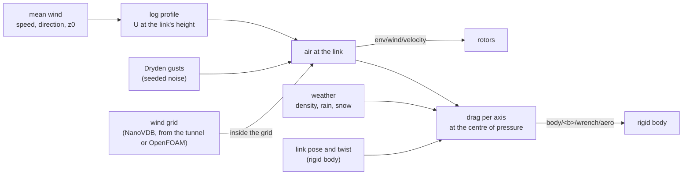

# Aerodynamics: drag, wind and the wind tunnel

Every link with `AeroAPI_1` feels the air: drag against its velocity through the wind, at its
centre of pressure, and a damping of its spin. The wind it moves through is the site's mean wind
with a height profile, gusts on top, and, where a wind grid is given, the grid. This page covers
those forces and the two offline tools that compute flow round a robot's shape, `lagrange tunnel`
and `lagrange foam`. The propellers and the air they push are on their own pages:
[Rotors](rotors.md) and [Downwash](downwash.md).

## The equations

**Drag.** Each link has a drag coefficient and an area per body axis. With $\mathbf v_{rel}$ the
link's velocity less the air's, in the body frame, and $\rho$ the air density:

$$
\mathbf F = -\tfrac12\,\rho\,|\mathbf v_{rel}|\,\big(C_d \circ A \circ \mathbf v_{rel}\big)
$$

($\circ$ is the product per axis), applied at the link's centre of pressure, with an angular
damping against the link's spin. The air density is the site's (`air_density`), or the weather's
moist-air density from temperature, pressure and humidity when the weather runs:
$\rho = p/(R_{specific}\,T)$ with a humidity correction, $R_{specific} = 287.05$ J/(kg·K) for dry
air.

**The mean wind** grows with height by the logarithmic profile of a neutral surface layer, from the
speed $U_{ref}$ given at a reference height $h_{ref}$ and the terrain's roughness length $z_0$:

$$
U(h) = U_{ref}\,\frac{\ln(h/z_0)}{\ln(h_{ref}/z_0)}, \qquad U = 0 \text{ below } z_0
$$

**Gusts** are Dryden turbulence (MIL-F-8785C §3.7.3, low altitude): white noise from the
counter-based random generator, so a run repeats, shaped by forming filters at the link's airspeed
$V$. Longitudinal and, for the lateral and vertical components, with their own scale length $L$
and intensity $\sigma$:

$$
H_u(s) = \sigma_u\sqrt{\frac{2L_u}{\pi V}}\;\frac{1}{1 + \frac{L_u}{V}s},\qquad
H_{v,w}(s) = \sigma\sqrt{\frac{L}{\pi V}}\;\frac{1 + \sqrt3\,\frac{L}{V}s}{\big(1 + \frac{L}{V}s\big)^2}
$$

Below 1000 ft, with $h$ in feet and $W_{20}$ the mean wind at 20 ft: $L_w = h$,
$L_u = L_v = h/(0.177 + 0.000823\,h)^{1.2}$, $\sigma_w = 0.1\,W_{20}$,
$\sigma_u = \sigma_v = \sigma_w/(0.177 + 0.000823\,h)^{0.4}$.

**Wind grids.** With `--weather wind_field=FILE.nvdb` (or the profile's `weather.wind_field`), a
link inside the grid takes the grid's velocity, interpolated trilinearly, instead of the mean
wind. Grids come from the wind tunnel (`flow.nvdb`), from OpenFOAM (`lagrange_foam_to_vdb`), or
from `lagrange_make_fields wind_shear`.

**Rain and snow** push every link with the momentum of the drops that stop on it: Marshall–Palmer
drop sizes, the fall speed of Atlas et al. 1973, inelastic impact. It is small, as in the air:
25 mm/h on the sample quadcopter's 0.09 m² top is 3.7 mN against its 20 N weight.

## Solving it

The drag is evaluated every step from the link's state at the start of the step (1 ms for drones,
10 ms for ground vehicles by default). Each Dryden filter is integrated exactly over the step for
the white noise held over it, so the gusts' statistics do not depend on the step size. The
aerodynamics module writes its wrench as `body/<b>/wrench/aero`; `wrench_sum` adds it to the rotors'
and the water's before physics reads it.

## The wind tunnel: `lagrange tunnel`

`lagrange tunnel ROBOT` puts the robot's collision shapes in a uniform grid of cubes and runs air
past them, offline, to see where the air goes and to make a wind grid for a run. It is a lattice
Boltzmann solver (D3Q19, BGK): populations $f_i$ move along 19 lattice directions $\mathbf c_i$ and
relax towards equilibrium,

$$
f_i(\mathbf x + \mathbf c_i\Delta t,\,t + \Delta t) = f_i(\mathbf x, t) - \frac1\tau\big[f_i - f_i^{eq}\big],
\qquad
f_i^{eq} = w_i\rho\Big[1 + 3\,\mathbf c_i\!\cdot\mathbf u + \tfrac92(\mathbf c_i\!\cdot\mathbf u)^2 - \tfrac32|\mathbf u|^2\Big]
$$

in lattice units, with viscosity $\nu = (\tau - \tfrac12)/3$. Turbulence the grid cannot resolve is
a Smagorinsky eddy viscosity from the non-equilibrium stress $Q_{\alpha\beta}$ (Hou et al. 1996,
$C_s = 0.17$):

$$
\tau_{eff} = \tfrac12\Big(\tau + \sqrt{\tau^2 + 18\sqrt2\,C_s^2\sqrt{Q_{\alpha\beta}Q_{\alpha\beta}}/\rho}\Big)
$$

Walls are half-way bounce-back; `--ground` adds a rolling road under the body (a moving wall, Ladd
1994), with `--clearance` setting the gap, never under two cells. The force on the body is the
momentum exchanged across its wall links; reports give
$C_d = F_x / (\tfrac12\rho U^2 A)$ and $C_l$ alike. The inlet is at equilibrium, the outlet copies its
last column, the sides wrap round.

The CPU path, threaded by slabs, is the deterministic reference (bit-reproducible); on a real GPU
`gpu/kernels/fields/lbm.slang` steps the same update in float, about 500 million cell updates a
second on an RTX 4060 against about 60 million on the CPU. `--study` runs a quarter, a half and all
the cells and says whether $C_d$ and $C_l$ stopped changing (within 5 %). It writes `report.json`,
`flow.vti` (ParaView), `flow.nvdb` (a wind grid), `flow_view.usda` (streamlines, a slice and
surface pressure to open as a world) and, with `--frames N`, frames of the wake moving.

## OpenFOAM: `lagrange foam`

`lagrange foam ROBOT` writes an OpenFOAM case from the same collision shapes and runs it with an
installed OpenFOAM or its container: snappyHexMesh fits a mesh to the body with layers,
simpleFoam iterates the steady mean flow (SIMPLE), with k-omega SST turbulence and wall functions
for the boundary layer. It reads $C_d$, $C_l$ and each link's force back into `report.json` (the mean
of the last fifth of the iterations, with half its range as "moves"), and draws the pressure on
the body. OpenFOAM is a separate GPL-3 program: Lagrange writes its input and reads its output and
never links it. `lagrange_foam_to_vdb` turns the result into a wind grid for a run.

**Which to use:** `lagrange foam` for force numbers, `lagrange tunnel` for seeing and animating the
flow. The table below is why.

## How far to trust it

| Check | Result | Test |
|---|---|---|
| Terminal velocity of a falling sphere | within 0.5 % of the closed form | `Aerodynamics.AFallingSphereReachesItsTerminalVelocity` |
| Mean wind at a held sphere | the logarithmic profile | `Aerodynamics.AHeldSphereFeelsTheMeanWindFromTheProfile` |
| Dryden gusts | variances of the three components within 5 % of σ², longitudinal autocorrelation within 0.03 of $e^{-\tau V/L}$; the periodogram band check is **owed** | `Aerodynamics.DrydenTurbulenceHasItsSpecifiedVarianceAndCorrelation` |
| Inside a wind grid, the grid is the wind | met | `Aerodynamics.InsideAWindGridTheGridIsTheWind` |
| Rain's fall speed and water content | Atlas against Gunn and Kinzer's drops within 0.15 m/s; water 11–17 % under Marshall and Palmer's | `Precipitation.*` in `test_aerodynamics` |
| Tunnel: a shear wave's decay | within 1 % | `Lbm.AShearWaveDecaysAtTheViscosityAsked` |
| Tunnel: a sphere at Re 20 and 50, 10 cells across | 25 % over Schiller and Naumann (blockage and the staircase surface) | `Lbm.ASpheresDragFollowsThePublishedCurve` |
| Tunnel: a plate and a cube face-on | 0.97 and 1.03 against Hoerner's 1.17 and 1.05 | `Lbm.ABluffPlatesDragIsTheRightSizeAtHighReynolds`, `WindTunnel.ACubeGivesItsDragAndItsFiles` |
| Tunnel: the GPU against the CPU, repeatability | agree; the same run gives the same bits | `Lbm.TheGpuAgreesWithTheCpu`, `Lbm.TheSameRunGivesTheSameBits` |
| Tunnel: the Ahmed body at 25° (measured Cd 0.2875–0.298) | **over four times too high**: Cd 1.26 on 8M cells | [cfd.md](../design/domains/cfd.md) §6 |
| Tunnel: wall friction on a flat plate | **3.1 times too high**: Cf 0.0130 against the turbulent law's 0.0042 | `Lbm.DISABLED_AFlatPlatesFrictionAgainstTheTurbulentLaw` |
| OpenFOAM: the Ahmed body at 25° | Cd 0.288 and 0.266 on 219k and 750k cells: the measurement's size, but 8 % apart between meshes | [cfd.md](../design/domains/cfd.md) §6 |
| OpenFOAM: the Ahmed body at 35° | not trustworthy yet (reads above 25°; the reference is unverified) | [cfd.md](../design/domains/cfd.md) §6 |
| OpenFOAM: the Lexus RX 450h body | Cd 0.241 against a published 0.33–0.34, about 28 % low (smoothed underside, still wheels) | [cfd.md](../design/domains/cfd.md) §6.2 |
| Against measured wind on a real robot | **owed**: no data | — |

**The tunnel's drag is not a number to use** for a streamlined body. Its walls carry no wall
model, so friction is too high, and the air leaves the staircase surface at a nose shoulder
without coming back, which looks like where the extra pressure drag comes from (a lead, not proven); every change tried against this (wall
functions, curved walls, sponges, other boundary conditions) moved the references further away and
were not adopted ([cfd.md](../design/domains/cfd.md) §7). Bluff bodies with sharp edges, which
separate where their edges are, come out about right. A known checkerboard of 1–2 % of the wind
speed sits upstream of a body. The sample sedan and Lexus collide as one box each, so the tunnel
sees a box unless you give it the car's shape (`lagrange bake`).

Not modelled: lift tables for links, the drag of a body's own wake on another (except rotor
wakes, [Downwash](downwash.md)), a moving air box round a ground robot in a run, local grid
refinement in the tunnel.

The full model and its signals are in [aerodynamics.md](../design/domains/aerodynamics.md), and
the CFD methods and every result in [cfd.md](../design/domains/cfd.md).
