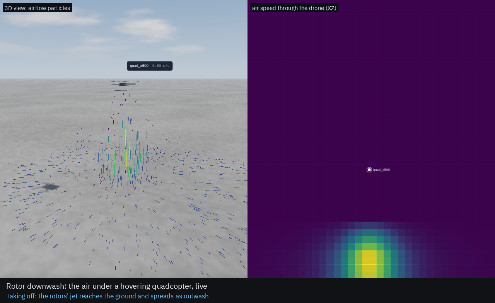
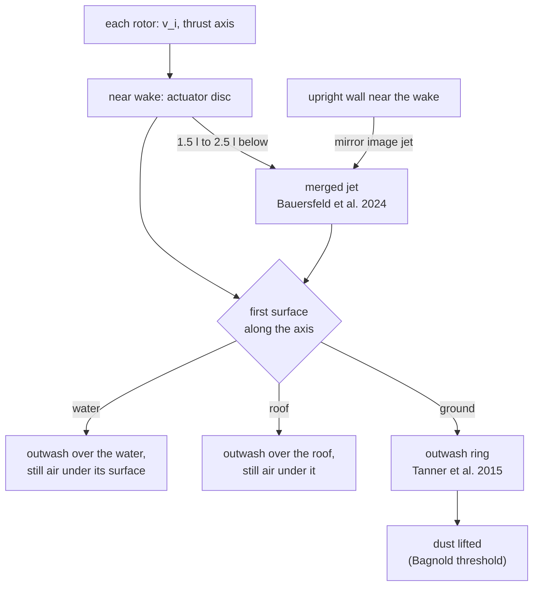
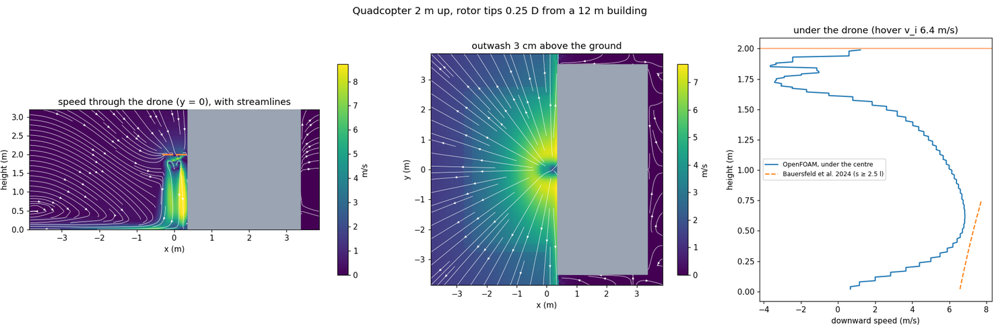
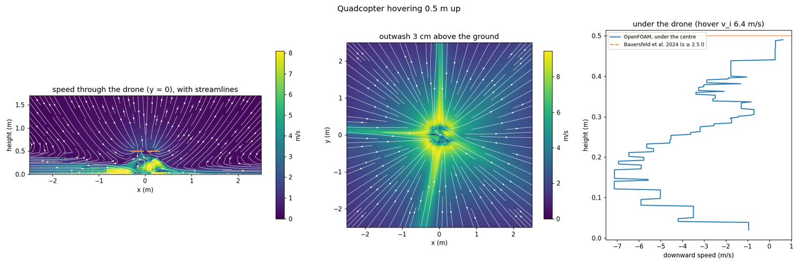
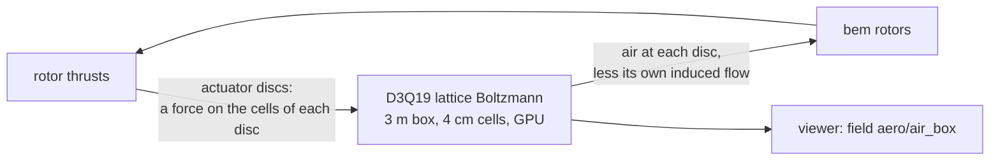
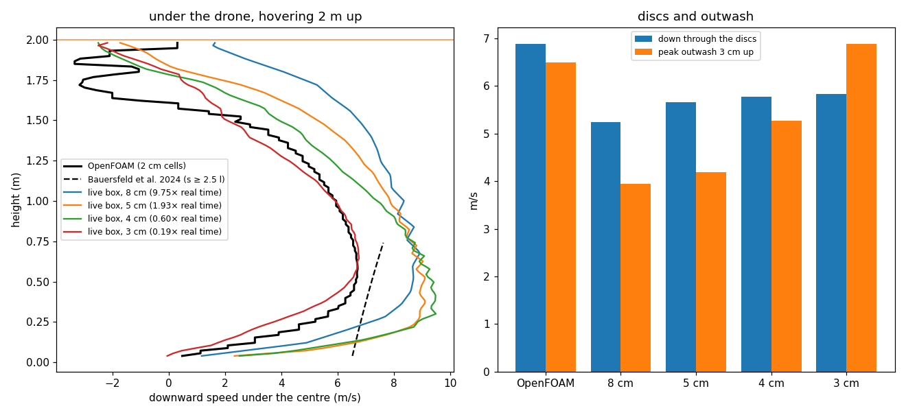
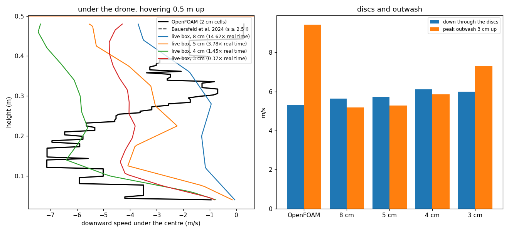

# Downwash

The air a drone pushes down, and what it does to everything around it. The aerodynamics domain
builds it from what the rotors already computed (`rotor/<j>/thrust`, `induced_velocity` and
`thrust_axis`). It runs whenever the run has rotors and an air density; the profile's
`aerodynamics.downwash: false` turns it off.

Two models are available, picked by `aerodynamics.downwash_model`:

| Model | What it is | Cost | Where |
|---|---|---|---|
| fitted (the default) | closed-form wake shapes fitted to measurements | microseconds, CPU | everywhere |
| `lbm` | lattice Boltzmann air in a box around the drone | about 0.75× real time, GPU | a 3 m box; the fitted model outside it |

## The fitted model

($l$ is the motor-to-motor diagonal, $R$ the rotor radius, $v_i$ the induced velocity at the
disc.)

### 1. Under each rotor

Just below a rotor the air follows momentum theory's actuator disc. At distance $s$ below it:

$$
w(s) = v_i\left(1 + \frac{s}{\sqrt{s^2 + R^2}}\right)
$$

So the air goes $v_i$ at the disc and $2v_i$ far below, and the column narrows to $R/\sqrt2$ to
carry the same mass.

### 2. The merged jet

A few diagonals down, the four columns have become one round jet. Its centre speed and width
are Bauersfeld et al.'s (2024) fit to jets measured under six drones from 0.23 to 6.3 kg:

$$
U_C(s) = U_H\,\frac{10.11}{s/l + 5.817}, \qquad r_{1/2}(s) = 0.07668\,(s + 5.817\,l)
$$

The jet slows down and widens as it goes. The model blends the near and far wakes linearly
between $1.5\,l$ and $2.5\,l$.

### 3. Wind

In wind or forward flight the whole wake leans with the air going past the drone (Leishman's
wake skew).

### 4. The ground

Where the jet meets the ground it turns into an outwash ring. Tanner et al. (2015, NASA)
measured its peak at 1.7–1.8 R from the axis, at about 1.9 times the hover induced velocity,
just above the ground. The model scales that by the speed and width of the jet that actually
arrives, so a higher drone gives a weaker, wider ring.

### 5. Buildings

The scenery's fixed boxes are obstacles:

- **Roofs:** the wake stops on the first face along its axis and spreads over it as outwash, up
  to the edges. Under it the air is still.
- **Walls:** a wall beside the wake works as a mirror (the method of images), so the air can't
  go through it. The wake hugs the wall and gets stronger there.
- **A wall beside the drone itself:** the rotors nearest it get more air pushed down through
  them and the far ones less. In Lagrange's own OpenFOAM runs, which the model is fitted to, the
  near rotors took about 2 % more air and the far ones about 1.3 % less. The drone tilts
  towards the wall unless the controller corrects it.

### 5a. Over water

A body of water (`WaterAPI_1`, `--water`) is a surface too: a wake over it stops on the water's
surface, not on the ground under it, and spreads over it as the same outwash ring (Tanner et
al.'s fit, scaled by the jet that arrives). Nothing moves under the surface, and no dust lifts
from water. The profile's `aerodynamics.downwash_water: false` lets wakes go through to the
ground as before.

Two quantities on the surface feed the water's height field and its spray:

- **Pressure.** Where the jet stops, it pushes the surface with its stagnation pressure,
  $p = \tfrac12\,\rho_{air}\,u_n^2$, $u_n$ the free jet's speed along the surface normal. An
  impinging jet's wall pressure is wider than its $\tfrac12\rho u^2$ profile: the model takes it
  at a point $\sqrt2$ times nearer the jet's axis, so the pressure over the surface adds up to the
  jet's whole momentum flux, the thrust far below a rotor ($\int p\,dA = \int \rho u^2\,dA$).
  Where the rotor jets merge, the near wake's and the merged jet's pressures are blended, not
  their speeds.
- **Friction velocity.** Along the surface, the outwash's friction velocity is
  $u_* = 0.05\,u_m$, $u_m$ the wall jet's peak at that radius (the same $u_*$ the dust uses), and
  the stress on the water is $\tau = \rho_{air} u_*^2$, outwards.

### 5b. Spray off water

Air blowing fast enough over still water makes its surface unstable: below the Kelvin–Helmholtz
onset (Lamb §268; Chandrasekhar 1961 §101) gravity and surface tension hold it flat,

$$
U_{KH}^2 = 2\,\frac{\rho_a + \rho_w}{\rho_a\rho_w}\sqrt{g\,\sigma\,(\rho_w - \rho_a)}
\approx (6.6\ \text{m/s})^2 .
$$

Where the outwash's peak $u_m$ passes it, the model tears water off the surface at
$E = C\,\rho_a\,u_*\,(1 - (U_{KH}/u_m)^2)$ kg/(m²·s), shared equally between drops of 50, 150
and 450 µm. The drops are parcels carried by the air (the wind and every wake) with their drag
(Stokes's with Schiller and Naumann's correction; terminal speeds within 10 % of Gunn and
Kinzer's), gravity, and a turbulent random walk (25 % of the local air speed, 0.05 s), until they
fall back. $C = 0.01$ is behavioural: it gives about a gram of water per cubic metre in the
spray at its densest, a heavy fog's.

For the sample quadcopter the outwash passes the onset with the rotor plane below about 2.3 m
over the water. At 0.5 m it tears off 5 g/s, carried out in a ring 1.5 to 2.5 m from the axis
and up to half a metre high.

**Recirculation.** Low over a surface a rotor's wall jet separates and rolls up into a ring
vortex that carries what it lifted back up and in, into the rotor's inflow: the re-ingestion
behind helicopter brownout and whiteout (Leishman, *Principles of Helicopter Aerodynamics*,
2006, ch. 14; TODO(verify) the section and the numbers); our own OpenFOAM hover runs show the
jets meeting under the frame and turning up (§6, the fountain). The fitted wake has no flow up, so the
drops (only they) also ride a behavioural ring vortex (`recirculation()`): a Rankine vortex in
each meridian plane, 1.5 arrival radii out and half the rotors' height up, its core half that
height, turning outward along the water and inward at the top, its edge speed 30 % of the
arriving jet's, falling linearly to nothing at 1.5 wake widths (motor-to-motor diagonals) up.
For the sample quadcopter it brings about 3 g/m³ of spray to the drone at 0.3 m and 2.5 g/m³ at
0.5 m, and none at 2 m. Unsteadiness: the jet's load on the water also carries a turbulent
pressure fluctuation, 10 % of its mean rms (`kJetPressureFluctuation`, TODO(verify) a measured
p_rms/p_s), band-limited on a 9 cm lattice, from the run's Philox streams: it rings the surface
(water.md). The rings it sends out are about a tenth of the mean dimple near the jet (the
quasi-static answer, $\eta' \approx p'/(\rho_w g)$ for a fluctuation of a tenth of the mean),
falling off outward: sub-millimetre to about 2 mm for the sample's size of drone, so the
viewer's `--water-relief` is needed to see them at a distance; it scales the drawn slopes only.

The spray does what rain does (aerodynamics.md §3.2, weather.md):

- **Impact.** Its drops hit every link they meet at their own velocity (`impactForce`).
- **Sensors.** Its extinction, $\sum 3W_i/(\rho_w D_i)$ (drops much larger than the wavelength,
  $Q_{ext} = 2$), of the spray within 2.5 m of the drone, joins the weather's for lidars and
  cameras; the drops' flux onto the drone wets every lens as rain does. Both need the weather in
  the run (the site's temperature, pressure and humidity).
- **Signals.** `water/<w>/outwash_peak`, `water/<w>/spray_rate` (kg/s), `rotor/<j>/spray` and
  `env/spray/downwash` (kg/m³ within 0.25 m), `env/spray/extinction`, `env/spray/rate` (m/s of
  water, as a rain rate), and `aero/spray_drops` (each parcel's position) for the viewer.
  `aerodynamics.downwash_spray: false` turns it off.

### 6. The fountain under a low drone

Low over the ground, each rotor's jet hits the ground before merging. The four outwashes meet
under the frame and push it up. The model adds that push as a share of the thrust, fitted to
our OpenFOAM runs of the sample at 0.5 to 2 m: 12.7 % of the thrust at one diagonal up,
fading to nothing by four.

### 7. Who feels it

- **Other robots' links** get drag from the air.
- **Other robots' rotors** fly in it through `rotor/<j>/air_velocity`, which `bem` rotors use.
  This is how a drone under another loses thrust.
- **Dust** lifts from the ground where the outwash's friction velocity passes Bagnold's
  threshold, if the site gives a dust size and concentration.

A drone never feels its own wake, because its rotor data already describe isolated rotors.

## The live box (`lbm`)

Here the air is computed rather than fitted. The box follows the drone, and each rotor is an
actuator disc that pushes on the air in its cells. The jets merging, the outwash and the
fountain then come out of the flow itself. Outside the box, or without a hardware GPU, the
fitted model is used.

On an RTX 4060 Laptop GPU, at 4 cm cells, the box alone keeps up with real time, and a whole run
of the hovering sample goes at about 0.75× real time. 3 cm cells match OpenFOAM best but run at
a third of real time; 5 cm and coarser merge the jets too early to be worth it.

## How far to trust it

| Check | Result | Test |
|---|---|---|
| Merged jet against Bauersfeld et al. 2024 | fitted to it; its momentum carries the thrust within 5 %; our OpenFOAM centreline is about 10 % under it | `test_downwash` |
| Outwash against Tanner et al. 2015 | fitted at one height (1 R); between 1 and 2 R the model's peak rises where the measurement fades | `test_downwash` |
| A drone under a drone, against Kiran et al. 2025 (stacked Crazyflies) | 76 % of the thrust kept at 4 l, **measured 65 %**; 87 % at 19 l, measured 95–98 % | `DownwashPair.*` |
| Wall beside a drone | fitted to our own OpenFOAM; the fade length 3.5 ± 2.7 D is weak and may reach too far | `test_downwash_pair` |
| Fountain | fitted to our own OpenFOAM only, within 0.23 N; **no measurement** | `test_downwash` |
| A jet stopped by water | pressure adds up to the thrust within 2 % from 1 m up, 7 % at 0.5 m (where the jets merge); the outwash over water is the ground's at the same height | `Downwash.TheSurfaceCarriesTheJetsMomentumAsPressure`, `Downwash.AWakeStopsOnWaterAsOnTheGround` |
| Spray back at the drone (recirculation) | about 3 g/m³ within 0.25 m of the sample at 0.3 m, none at 2 m; the vortex turns outward along the water and in at its top; **behavioural, no measurement** (TODO(verify)) | `DownwashSpray.TheRecirculationBringsSprayBackToALowDrone` |
| The jet's unsteadiness on the water | rings of 0.5 mm rms reach 0.5 m out before 0.9 m; none without it; the mean dimple within 0.5 % of the steady one; the 10 % share unmeasured (TODO(verify)) | `DownwashOnWater.AFluctuatingJetSendsRingsOutAndKeepsItsMeanDimple` |
| Spray onset | the Kelvin–Helmholtz speed, 6.6 m/s, against the outwash's peak: the sample below 2.3 m; **no measurement of rotor-wash spray onset or amount** (TODO(verify)); the rate is behavioural | `DownwashSpray.*` |
| Drops' fall | terminal speeds within 10 % of Gunn and Kinzer (0.1–0.5 mm) | `DownwashSpray.DropsFallAtGunnAndKinzersSpeeds` |
| Live box against our OpenFOAM | at 3 cm the centreline within 20 % and the outwash within 6 %; at 4 cm the outwash 19 % low; the air through the discs 15–20 % low | `test_lbm_box` |

Not modelled: inflow above the disc, swirl, unsteadiness, rotors of one drone affecting each
other, and scenery other than boxes, still water and the ground plane. Over water: the
surface's own motion under the wake (millimetres, see water.md), a moving water surface's
different friction from a rigid wall's (the 0.05 is a smooth wall's, TODO(verify) over water),
and the live box (`lbm`) still has no water in it, only the ground. Spray: the recirculation
is behavioural, for the drops only (the links and the rotors do not feel it), and no
measurement backs its strength or reach; rotors taking in water (thrust and torque); the spray's
size distribution and rate, which no measurement here backs; drops hitting and breaking on
the water; spray as a lidar return (only its extinction).

The fitted model is **quasi-steady**: each step it builds the wake afresh from the rotors' thrust
and the drone's velocity, with no memory. A wake leans back in forward flight (§3), but the air a
moving drone left behind goes still at once instead of drifting down for a few seconds, and a
sudden stop moves the whole wake at once. The live box (`lbm`) carries the air on from step to
step, so it has that memory, inside its 3 m box.

The viewer's airflow particles are tracers moved through this air, sent 20 times a second in a
5.4 m box round the drone. They draw the field; they don't push anything themselves.

The derivation, every constant and its source are in
[rotor_aero.md](../design/domains/rotor_aero.md) §2, the live box in §8.
