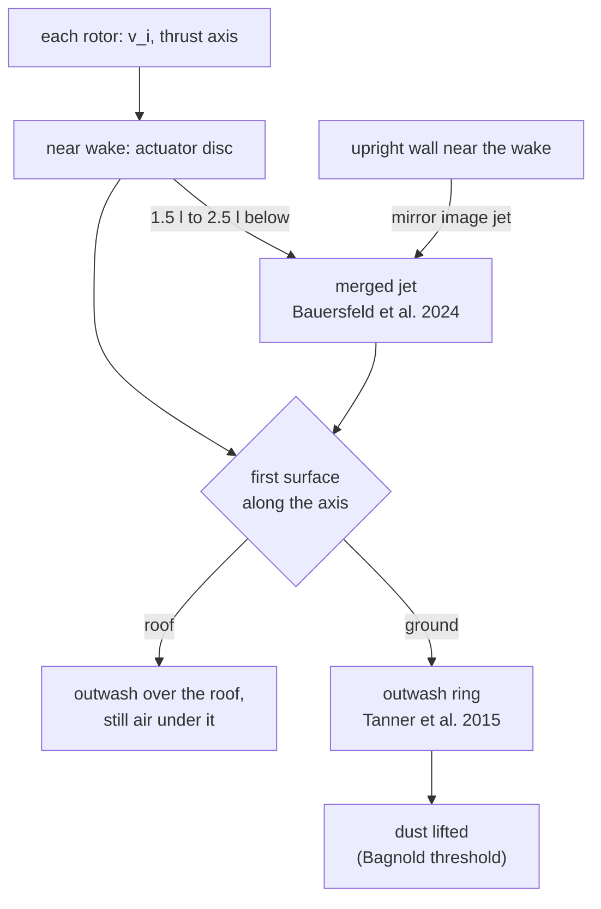
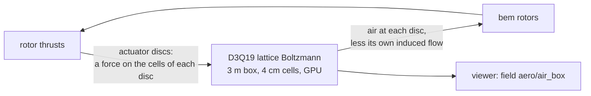

# Downwash

The air a drone pushes down, and what it does to everything around it. The aerodynamics domain
builds it from what the rotors already computed (`rotor/<j>/thrust`, `induced_velocity` and
`thrust_axis`). It runs whenever the run has rotors and an air density; the profile's
`aerodynamics.downwash: false` turns it off.

Two models are available, picked by `aerodynamics.downwash_model`:

| Model | What it is | Cost | Where |
|---|---|---|---|
| fitted (the default) | closed-form wake shapes fitted to measurements | microseconds, CPU | everywhere |
| `lbm` | lattice Boltzmann air in a box around the drone | about 0.75× real time, GPU | a 3 m box; the fitted model outside it |

## The fitted model

($l$ is the motor-to-motor diagonal, $R$ the rotor radius, $v_i$ the induced velocity at the
disc.)

### 1. Under each rotor

Just below a rotor the air follows momentum theory's actuator disc. At distance $s$ below it:

$$
w(s) = v_i\left(1 + \frac{s}{\sqrt{s^2 + R^2}}\right)
$$

So the air goes $v_i$ at the disc and $2v_i$ far below, and the column narrows to $R/\sqrt2$ to
carry the same mass.

### 2. The merged jet

A few diagonals down, the four columns have become one round jet. Its centre speed and width
are Bauersfeld et al.'s (2024) fit to jets measured under six drones from 0.23 to 6.3 kg:

$$
U_C(s) = U_H\,\frac{10.11}{s/l + 5.817}, \qquad r_{1/2}(s) = 0.07668\,(s + 5.817\,l)
$$

The jet slows down and widens as it goes. The model blends the near and far wakes linearly
between $1.5\,l$ and $2.5\,l$.

### 3. Wind

In wind or forward flight the whole wake leans with the air going past the drone (Leishman's
wake skew).

### 4. The ground

Where the jet meets the ground it turns into an outwash ring. Tanner et al. (2015, NASA)
measured its peak at 1.7–1.8 R from the axis, at about 1.9 times the hover induced velocity,
just above the ground. The model scales that by the speed and width of the jet that actually
arrives, so a higher drone gives a weaker, wider ring.

### 5. Buildings

The scenery's fixed boxes are obstacles:

- **Roofs:** the wake stops on the first face along its axis and spreads over it as outwash, up
  to the edges. Under it the air is still.
- **Walls:** a wall beside the wake works as a mirror (the method of images), so the air can't
  go through it. The wake hugs the wall and gets stronger there.
- **A wall beside the drone itself:** the rotors nearest it get more air pushed down through
  them and the far ones less. In Lagrange's own OpenFOAM runs, which the model is fitted to, the
  near rotors took about 2 % more air and the far ones about 1.3 % less. The drone tilts
  towards the wall unless the controller corrects it.

### 6. The fountain under a low drone

Low over the ground, each rotor's jet hits the ground before merging. The four outwashes meet
under the frame and push it up. The model adds that push as a share of the thrust, fitted to
our OpenFOAM runs of the sample at 0.5 to 2 m: 12.7 % of the thrust at one diagonal up,
fading to nothing by four.

### 7. Who feels it

- **Other robots' links** get drag from the air.
- **Other robots' rotors** fly in it through `rotor/<j>/air_velocity`, which `bem` rotors use.
  This is how a drone under another loses thrust.
- **Dust** lifts from the ground where the outwash's friction velocity passes Bagnold's
  threshold, if the site gives a dust size and concentration.

A drone never feels its own wake, because its rotor data already describe isolated rotors.

## The live box (`lbm`)

Here the air is computed rather than fitted. The box follows the drone, and each rotor is an
actuator disc that pushes on the air in its cells. The jets merging, the outwash and the
fountain then come out of the flow itself. Outside the box, or without a hardware GPU, the
fitted model is used.

On an RTX 4060 Laptop GPU, at 4 cm cells, the box alone keeps up with real time, and a whole run
of the hovering sample goes at about 0.75× real time. 3 cm cells match OpenFOAM best but run at
a third of real time; 5 cm and coarser merge the jets too early to be worth it.

## How far to trust it

| Check | Result | Test |
|---|---|---|
| Merged jet against Bauersfeld et al. 2024 | fitted to it; its momentum carries the thrust within 5 %; our OpenFOAM centreline is about 10 % under it | `test_downwash` |
| Outwash against Tanner et al. 2015 | fitted at one height (1 R); between 1 and 2 R the model's peak rises where the measurement fades | `test_downwash` |
| A drone under a drone, against Kiran et al. 2025 (stacked Crazyflies) | 76 % of the thrust kept at 4 l, **measured 65 %**; 87 % at 19 l, measured 95–98 % | `DownwashPair.*` |
| Wall beside a drone | fitted to our own OpenFOAM; the fade length 3.5 ± 2.7 D is weak and may reach too far | `test_downwash_pair` |
| Fountain | fitted to our own OpenFOAM only, within 0.23 N; **no measurement** | `test_downwash` |
| Live box against our OpenFOAM | at 3 cm the centreline within 20 % and the outwash within 6 %; at 4 cm the outwash 19 % low; the air through the discs 15–20 % low | `test_lbm_box` |

Not modelled: inflow above the disc, swirl, unsteadiness, rotors of one drone affecting each
other, and scenery other than boxes and the ground plane.

The derivation, every constant and its source are in
[rotor_aero.md](../design/domains/rotor_aero.md) §2, the live box in §8.
