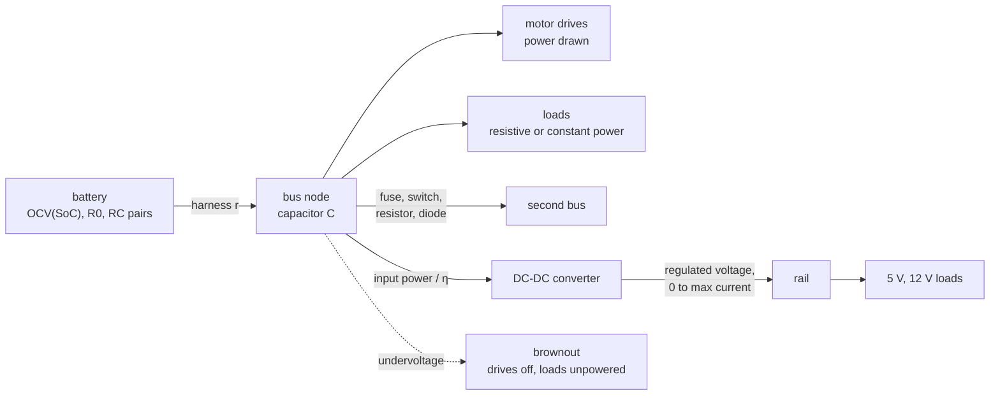

# The electrical network: buses, converters and the parts between them

A robot's power system is batteries, buses, motor drives, loads and DC-DC converters, joined by
the parts a schematic draws between two buses: resistors (a harness), fuses, switches and diodes.
The electrical domain solves it every 100 µs by default (the profile's `electrical.dt`, 10 µs to
1 ms) with averaged models: the mean over a switching cycle, never the switching itself, which
stays offline in ngspice. This page is the network; the parts on it have their own pages:
[Motors](motors.md) and [Battery](battery.md).

## The equations

**A bus** is a node with a capacitance $C$ (1 µF with a warning when none is given), so its voltage
$V$ is a state. Kirchhoff's current law at the node, with the capacitor's backward-Euler companion
over a step $\Delta t$:

$$
C\,\frac{V_{n+1} - V_n}{\Delta t} = \sum_{\text{batteries}} \frac{E_k - V_{n+1}}{r_k} + \sum_{\text{branches}} I_b - \sum_{\text{drives, loads}} I_j
$$

Each battery enters as its Thévenin source: the equivalent circuit's voltage $E_k$ behind its
series resistance $r_k$, which includes its harness (`wireResistance`). Drives and loads draw at the
previous step's voltage (explicitly), so a load notices a brownout one electrical step late.

**Loads.** A resistive load takes its resistance from its power at the bus's starting voltage,
$R = V_0^2/P$; a constant-power load draws $I = P/V$; both can be switched off by
`load/<l>/powered` when the bus browns out.

**A drive** draws its electrical power from the bus, $i_{bus} = 1.5\,(v_d i_d + v_q i_q) /
(\eta_{inv} V_{bus})$ (see [Motors](motors.md)). Braking turns it round: regeneration charges the
bus, the battery takes what it can up to its charge limit, and above the overvoltage trip a brake
resistor switches in, or the drives switch off when there is none.

**A DC-DC converter** (`ElectricalConverterAPI_1`) is an averaged regulator. On its output bus it
is an ideal source at `outputVoltage` inside the node equation, giving 0 to `maxOutputCurrent` (no
reverse flow); at the limit the rail sags and its loads drop at their `minVoltage`. On its input
bus it draws the output power over its efficiency,

$$
P_{in} = \frac{V_{out}\,I_{out}}{\eta}
$$

one step late, as loads do. It stops while its input bus is browned out. One converter per output
bus.

**Parts between buses** (`ElectricalBranchAPI_1`, RFC 0010), each a two-terminal branch from bus
$a$ to bus $b$:

| Kind | Behaviour |
|---|---|
| `resistor` | $I = (V_a - V_b)/R$ |
| `fuse` | a resistor until $\int I^2\,dt$ reaches its rating (A²s), then open until the run restarts |
| `switch` | a resistor while `branch/<b>/command` is above 0.5, else open |
| `diode` | $I = (V_a - V_b - V_{drop})/R$ forward, open backward |

**Trips.** Under the bus's `undervoltage` every drive latches a fault until the bus has recovered
by 2 % and its torque command is back to zero; loads come back with the bus. A battery is cut off
when its open-circuit voltage reaches `cutoffVoltage` (empty), not on the terminal voltage under
load: sag under load is the bus trip's job.

## Solving it

A bus with no branch keeps the single-node solve above, a scalar equation per step, so a robot
without parts between buses runs exactly as before RFC 0010. Buses joined by branches are solved
together: nodal analysis of all of them in one linear system, with the capacitors' companions,
solved densely with partial pivoting (a few dozen nodes at most, no allocation in the step). What
is piecewise (a diode conducting or not, a battery at its charge limit, a converter at its
current limit) is settled by repeating the solve while any of them changes state. A bus behind a
part starts at what reaches it with nothing drawn.

## Where the circuit comes from

The same network can be authored three ways, and all three become the same schemas at load:

- **An overlay file** (`--overlay robot.overlay.yaml`): batteries, buses, motors, loads,
  converters and branches as YAML ([formats.md](../design/formats.md) §9).
- **A SPICE netlist** (`--overlay power.cir`): a `V` source with its series chain is a battery, the
  node it reaches with its `C` a bus, `R n 0` a resistive load, a `B` source of `P / V(n)` a
  constant-power load, `R a b` between two buses a resistor branch, and `*lagrange` comment lines
  say what SPICE cannot (`battery`, `bus`, `motor`, `converter`, `fuse R_x i2t=`,
  `switch R_x`, `diode D_x drop= r=`). Anything else, inductors, transistors, subcircuits, is
  refused by line, every problem together ([formats.md](../design/formats.md) §9.1). A KiCad
  schematic comes through `kicad-cli sch export netlist --format spice`.
- **A URDF `<lagrange>` block** naming the netlist, with no flag (§9.2).

The other way, `lagrange export spice|modelica` writes the robot's power system as an ngspice
netlist or a Modelica model, with the drives as averaged power sinks. The viewer's Electrical
workspace draws the nets with their live values.

## How far to trust it

| Check | Result | Test |
|---|---|---|
| Hand circuits: harness, resistor, constant power, RC pair, two batteries, charge drained, converter, sloped curve, resistor and diode between buses, a fuse opening at $I^2t$, an open switch, a motor on a flywheel | Lagrange within 0.5 % of the formula, ngspice within 0.1 %, each from an overlay, a netlist and a URDF block, on random values every round | `tools/ci/check_electrical.py`, `test_electrical_check` |
| Energy balance over a drive cycle | closed to 0.5 % | `ElectricalNetwork.EnergyBalancesOverADriveCycle` |
| Netlist round trip through ngspice | bus voltage within 0.05 % (sag within 0.16 % RMS) with a drive cycle sagging a weak pack by 2.4 V | `SpiceExport.TheNetlistRunsInNgspiceAsTheNetworkRan` |
| Brownout of a stalled AMR on a low battery | the bus trips, the computer loses power, both recover | `ElectricalNetwork.AStalledAmrOnALowBatteryBrownsOutAndRecovers` |
| Regeneration into a full battery | the bus rises until the brake resistor takes it | `ElectricalNetwork.RegenerationIntoAFullBatteryRaisesTheBusUntilTheBrakeResistorTakesIt` |
| A converter's regulation, its input power, its current limit | met | `ElectricalNetwork.AConverterRegulatesItsBusAndDrawsItsPowerOverItsEfficiency`, `ElectricalNetwork.AConverterAtItsCurrentLimitLetsItsBusSagUntilTheLoadsDrop` |
| A switch between buses follows its command | met | `ElectricalNetwork.ASwitchFollowsItsCommandBetweenBuses` |
| Netlist import: parts between buses, refusals | met | `Netlist.PartsBetweenBuses`, `Netlist.RefusesWhatItCannotSimulateEveryProblemTogether` |
| Deterministic, and restores its state | met | `ElectricalNetwork.ItIsDeterministicAndRestoresItsState` |
| Against a measured robot's power system | **owed**: no bench recording yet | — |

Not modelled: switching ripple (the models are averaged), inductors and transformers, op-amps,
regulators as circuits (a regulator is a DC-DC converter), a capacitor between two buses, reverse
flow through a converter, and the cost of a large branched network has not been measured. The hand
check does not cover thermal effects, trips or regeneration; the tests above do.

The full model and its signals are in [electrical.md](../design/domains/electrical.md) §2, §9 and
§10, and the parts between buses in [RFC 0010](../../rfcs/0010-electrical-nodes.md).
