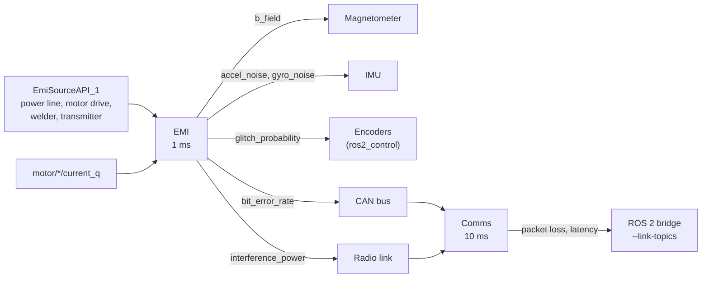

# EMI and radio links

Two domains that work together. **EMI** (`lagrange_emi`, every 1 ms) computes the disturbance
fields of sources in the scene, a power line, a motor drive, a welder, a transmitter, at each
victim, and what they do to it. **Comms** (`lagrange_comms`, every 10 ms) computes the quality of
each radio link and CAN bus, with that interference in its noise. The sensors, the ros2_control
bridge and the ROS 2 bridge then apply the results: a magnetometer heading that swings near a
power line, encoder glitches, lost and late messages.

This is behaviourally correct interference for testing robot software. It is **not** an
electromagnetic compatibility certification tool.

## The EMI equations

**Sources.** Each is analytic, or a NanoVDB field map in the source's frame scaled by its
current. Alternating sources carry $\sqrt2\,(\sin\omega t + \sum_k h_k \sin k\omega t)$ at the
scene's `emi:frequency`, which is a site parameter with no default (50 or 60 Hz by region).

- A power line is an infinite straight conductor, by the right-hand rule:
  $$B = \frac{\mu_0 I}{2\pi d}, \qquad \mu_0 = 1.25663706212\times10^{-6}\ \mathrm{N\,A^{-2}}$$
- A motor drive and a welder are magnetic dipoles along `emi:direction`, of moment
  `emi:dipoleMomentPerAmpere` times the current (the motor's `current_q` when the electrical
  network runs); the welder's duty cycle is an RMS weight:
  $$\mathbf B = \frac{\mu_0}{4\pi}\,\frac{3\,\hat r(\hat r\cdot\mathbf m) - \mathbf m}{r^3}$$
- A transmitter is a free-space far field, RMS:
  $$E = \frac{\sqrt{30\,P_{EIRP}}}{d}$$

Distances under 1 cm are taken as 1 cm.

**Victims** (`EmiSusceptibilityAPI_1`; `emi.coupling` in the profile picks which are active):

| Victim | Effect |
|---|---|
| Magnetometer | adds the instantaneous $\mathbf B$, scaled by `emi:magneticGain`, sampled at the sensor's own rate, so a mains field aliases as a real one does |
| IMU | Gaussian noise of RMS proportional to $\lvert E\rvert$ on the accelerometer and gyro |
| Encoder | each edge an extra or missing count with probability $p = 1/\big(1 + (E_{50}/\lvert E\rvert)^4\big)$ |
| CAN bus | bit-error rate $\mathrm{BER} = \mathrm{BER}_0\,(\lvert E\rvert/E_{ref})^2$, capped at 0.5 |
| Radio | interference power $P = \frac{E^2}{Z_0}\,\frac{\lambda^2}{4\pi}$ times the band overlap |
| Harness loop | induced voltage $V = 2\pi f B A_{loop}$ (RMS) |

The encoder and CAN curves are behavioural, chosen to give a threshold you can set; they are not
derived from first principles. The parameters exist so that someone with measurements can fit
them. A per-victim `emi:shieldingEffectiveness` stands for shielding.

## The radio equations

**Received power.** Log-distance path loss from Friis at a reference distance $d_0$, plus a fixed
loss for each wall the straight line from transmitter to receiver crosses (the fixed scenery's
collision shapes, `comms:wallLoss` each), plus log-normal shadowing correlated over the
receiver's travel (Gudmundson):

$$
PL(d) = 20\log_{10}\frac{4\pi d_0}{\lambda} + 10\,n\,\log_{10}\frac{d}{d_0} + n_{walls}\,L_{wall} + X_\sigma
$$

**Noise and SNR.** Thermal noise times the noise figure, plus the EMI domain's interference:

$$
N = k\,T_0\,B\,F + P_{int}, \qquad k = 1.380649\times10^{-23}\ \mathrm{J/K},\ T_0 = 290\ \mathrm K
$$

**Packets.** Bit errors in additive white Gaussian noise for BPSK and QPSK (exact) and 16- and
64-QAM (nearest-neighbour approximation), one symbol per hertz; for BPSK
$p_b = Q\big(\sqrt{2\,E_b/N_0}\big)$. `packet_error_rate` is the loss after `comms:maxRetries`,
`latency` the expected airtime with retries, `throughput` the bit rate times the delivered
fraction, and the link is `up` while at least half the packets arrive.

**CAN fault confinement** (ISO 11898-1): the frame error rate follows from the bit-error rate; the
transmit error counter rises by 8 on an error and falls by 1 on a success, the node is error
passive above 127 and bus off above 255, and recovers after 128 × 11 recessive bits. The bus is
taken as fully loaded by the node, the worst case.

**Applied.** `lagrange_server --link-topics FILE.yaml` puts ROS 2 topics on a link: each message
is lost with the link's packet loss (always while it is down) and the rest arrive its latency
later, with their original stamps; incoming `/cmd_vel` too.

## Computing it

Both run on the CPU on every tier: a few analytic evaluations per victim, and a handful of ray
casts per link for the walls (Embree). Powers and ratios on the bus are linear SI values; decibels
appear only in the viewer.

## How far to trust it

| Check | Result | Test |
|---|---|---|
| Field of a straight conductor and of a dipole | closed form within 1e-6 relative | `EmiFields.StraightConductorByTheRightHandRule`, `EmiFields.DipoleOnItsAxisAndAtItsEquator` |
| Transmitter far field | Friis within 1e-6 relative | `EmiFields.FarFieldMatchesFriis` |
| Mains aliasing | a 60 Hz field sampled at 100 Hz peaks at 40 Hz, exactly | `Emi.AMainsFieldAliasesAtTheMagnetometersRate` |
| The sample: 400 A line, quadcopter 9.9 m away | 8.08 µT RMS, as $\mu_0 I/(2\pi d)$ gives | a run of `profiles/examples/quad_x500_power_line.yaml` |
| Behavioural victim curves, shielding, harness pickup | as specified | `EmiVictims.BehaviouralCurves`, `Emi.TransmitterNoiseInterferenceAndShielding`, `Emi.AHarnessLoopPicksUpTheMainsField` |
| Free-space path loss and noise floor | Friis within 1e-9 relative; $kTB$ exact | `CommsBudget.FriisAndTheNoiseFloor` |
| Bit-error curves | the BPSK 1e-5 point and Q(3) | `CommsBudget.BitErrorCurves` |
| CAN fault confinement | transitions exact (transmit counter) | `CommsCan.FaultConfinementTransitions`, `Comms.ANoisyCanBusGoesBusOffAndRecovers` |
| Walls and shadowing | wall count; shadowing spread | `CommsWalls.CountsTheWallsBetween`, `Comms.ShadowingHasItsSpread` |
| Field near a real power line against published measurements | **owed** | — |
| Heading error of a real robot near a known source | **owed**: no recording (Q16) | — |
| Indoor path-loss parameters traced to ITU-R P.1238 | **owed**, TODO(verify) | — |
| RSSI of a real AMR driving away from an access point | **owed**: no recording (Q16) | — |

Not modelled: occlusion and shielding by the scene's geometry (beyond the per-victim factor),
two-ray ground reflection, low-frequency E fields, the welder's on/off timing; for radio, coding
gain, MAC contention, multipath and fast fading; the CAN receive error counter; the MAVLink
bridge's telemetry on a link.

The full models and their signals are in [emi.md](../design/domains/emi.md) and
[comms.md](../design/domains/comms.md).
