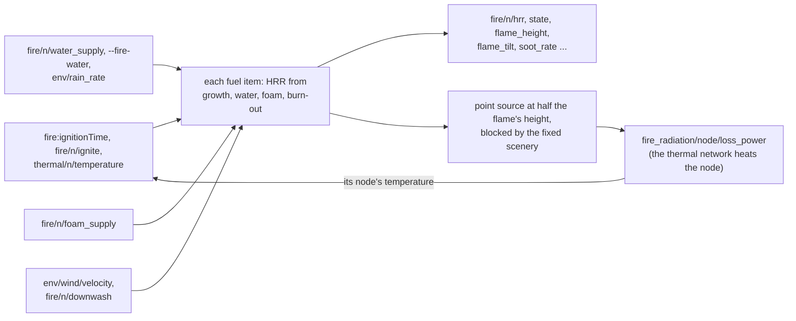

# Fire

Fuel items that ignite, grow, burn out, heat what is near them, spread, and go out under water,
foam or wind (`FireAPI_1`, RFC 0022). `lagrange_fire` runs every 100 ms. The model is the set of
engineering correlations fire protection engineers use, not CFD: a t² or pool-fire heat release
rate, Heskestad's flame height, a point-source radiation model and Evans' sprinkler suppression.
The numbers are for testing robot software, not for designing buildings or proving safety.



## Using it

On a fuel item in USD (its collider gives the burning area and the flame's base, the top of the
collider):

```usda
over "pallet" ( prepend apiSchemas = ["FireAPI_1"] )
{
    double fire:alpha = 46.889            # W/s², the fast t² class
    double fire:hrrPerArea = 1000000      # W/m² at full involvement
    double fire:fuelMass = 80             # kg
    double fire:heatOfCombustion = 12000000  # J/kg
    double fire:radiativeFraction = 0.3
    double fire:sootYield = 0.015         # kg/kg
    double fire:criticalWaterRate = 0.02  # kg/(m²·s)
    double fire:ignitionTime = 0          # s
}
```

or from an overlay or a URDF `<gazebo reference="L"><fire alpha="fast" .../></gazebo>`
(formats.md §3.14, where every attribute is listed). The numbers above show the form; a fuel's
values come from its data, with their source. The presets (`fire:preset`) ship empty until their
cited values are confirmed (RFC 0022 open question 3).

The sample is a pallet fire in the sample warehouse, which a sprinkler's rate of water reaches at
60 s:

```bash
lagrange assets/worlds/warehouse_fire/warehouse_fire.yaml
# or: lagrange_server --robot none --world assets/worlds/warehouse_fire/warehouse_fire.usda \
#       --fire-water pallet=0.133@60
```

`--fire-water NAME=RATE[@T]` (run file `fire_water: [{fire, rate, at}]`) puts water on a fire at
RATE kg/(m²·s), which is mm/s of water, from T s on. It stands in for a sprinkler until nozzles
and sprinklers are placed in the scene (RFC 0022 step 6). Plugins and ROS topic inputs can write
`fire/<n>/water_supply` and `fire/<n>/foam_supply` instead; rain (`env/rain_rate`) falls on every
fire when the weather runs.

`--domain fire=off` (or a profile's `fire: {enabled: false, substitute: zero}`) is the zero
substitute: no fire. `substitute: constant` holds every fire at its full involvement from the
start, unaffected by water, foam and wind: a steady fire for sensor and planner tests.

## How it computes

**Ignition.** At `fire:ignitionTime`, when `fire/<n>/ignite` turns true, or when the
`ThermalAPI_1` node on the item's own prim reaches `fire:ignitionTemperature` (spread, below).

**Growth.** `t_squared`: `Q = α·(t − t_i)²`, capped at `q''·A`. The named classes are 2.9306,
11.722 and 46.889 W/s² for slow, medium and fast (Evans and Stroup, NBSIR 85-3167, the DETACT-T2
listing: 1000 Btu/s at 600, 300 and 150 s) and 1000 Btu/s at 75 s for ultrafast (TODO(verify)
against NFPA 72's annex). `pool`: `Q = ṁ''∞·(1 − e^(−kβ·D))·ΔH_c·A`, D the equivalent diameter
`√(4A/π)` (Babrauskas 1983), at once. `fire:hrrCurve` replaces both with a measured curve.

**Burn-out.** The fuel burnt is `∫Q dt/ΔH_c`. When less than `fire:decayFraction` (0.2) of the
fuel remains, Q is scaled by the remaining share of that fraction. Q is then proportional to the
remaining mass, so it falls exponentially in time; the fire is out when the tail is down to 1 %.
This is a modelling choice (RFC 0022 open question 5), not a measured law.

**Flame.** Heskestad's mean flame height `L = 0.235·Q^(2/5) − 1.02·D` (L, D in m, Q in kW; SFPE
Handbook 5th ed. ch. 13), never below 0. In wind it leans by the AGA correlation as Mudan and
Croce give it: `u* = u_w/(g·ṁ''·D/ρ_a)^(1/3)`, `cos θ = 1` for `u* ≤ 1` and `u*^(−1/2)` above, with
`u_w` the horizontal wind (`env/wind/velocity`) plus the rotors' wake at the fire
(`fire/<n>/downwash`, which the aerodynamics domain will write, RFC 0022 step 6) and `ṁ''` the
fire's mass burning flux. ρ_a is `env/air_density` or the site's; without either the flame stays
upright. `fire/<n>/flame_tilt` is the flame's axis.

**Radiation into robots.** The point-source model: the flame radiates `χ_r·Q` from a point at half
its height along its axis, and the flux at distance R is `q'' = χ_r·Q/(4π·R²)`. A lumped
`ThermalAPI_1` node with a `thermal:radiativeArea` absorbs `ε·q''·A_rad/4` (ε its
`thermal:emissivity`; `A_rad/4` is the mean projected area of a convex body, so the direction it
faces does not enter), written as `fire_radiation/<node>/loss_power`. The thermal network adds
that to the node as it adds a motor's losses, so robots near a fire heat, derate and trip their
limits through the thermal paths that exist. A ray from the source to each node through the fixed
scenery removes what a wall or a rack blocks (the fuel item's and the node's own colliders do not
count). The model is "accurate in the far-field, but ... overly conservative within a few fire
diameters" (McGrattan, Baum and Hamins, NISTIR 6546, §3); the module warns once when a node is
within two fire diameters (TODO(verify): a published R/D limit). A node with no radiative area
takes no heat. The conduction fidelity's cells (RFC 0012) are not heated yet.

**Spread.** A fuel item with `fire:ignitionTemperature` and a `ThermalAPI_1` node on its own prim
ignites when its node reaches that temperature, the node heated by the fires around it as above.
This is the surface-temperature ignition criterion applied to a lumped node; it is crude for thick
solids, whose surface heats ahead of their mean temperature, and ignites them late.

**Water.** Water reaches a fire as an application rate `w''` (kg/(m²·s), numerically mm/s) over
its burning area. At or above `fire:criticalWaterRate` the fire stops growing and decays by Evans'
law (NISTIR 5254, 1993, eq. 3): `dQ/dt = −Q/τ`, `τ = 3.0·w''^(−1.85)` s, 410 s at 0.07 mm/s, the
value the report states for 0.61 m wood cribs. Evans fitted it to Walton's 305 and 610 mm crib
tests "within ± 50 %", over 0.026 to 0.133 mm/s; the report warns that at low rates the power law
over-predicts the time to put the fire out. Below the critical rate the fire still grows. If the
water stops, it grows again from where it is along its t² law. The decay never reaches 0, so the
fire is out when Q falls below 1 % of Q when the water arrived (a modelling choice). Water does not
put out class `b` (a burning liquid: it sinks under the fuel); on class `c` (energised equipment)
it raises `fire/<n>/hazard`. `fire/<n>/water_cooling` is the heat the water takes up, never more
than it can boil, `ṁ_w·(c_w·(100 °C − T_w) + h_fg)` with h_fg = 2.256 MJ/kg (about 2.6 MJ/kg from
20 °C), nor more than the fire's own Q; `steam_rate` is that over the heat per kilogram. T_w is the
air temperature, or latent heat only when no temperature is known. The water's cooling and Evans'
decay are separate: a fire goes out by its fuel's surface cooling below pyrolysis, not by the
water absorbing its whole heat release.

**Foam.** Finished foam laid down at `fire/<n>/foam_supply` (m/s of depth) covers the share
`φ = depth/fire:foamBlanketThickness` of the burning area, which shrinks as `A·(1 − φ)`; the fire is
out when it is covered (state 7). Without a blanket thickness foam does nothing. NFPA 11's
application rates and thicknesses are not openly readable (TODO(verify)), so there is no default.

**Wind.** A flame with `fire:blowOffSpeed` (from a measurement; there is no general correlation
for fuel items) goes out at the step the air speed at it passes that speed, while its Q is below
`fire:blowOffMaxHrr` if given. Large fires do not blow off: they lean. Wind does not raise a pool
fire's burning rate in this model (RFC 0022 open question 8).

## Signals

| Signal | Type | Unit | |
|---|---|---|---|
| `fire/<n>/hrr` | Scalar | W | heat release rate |
| `fire/<n>/state` | Int | 1 | 0 not ignited, 1 growing, 2 fully involved, 3 decaying, 4 out: water, 5 out: burnt, 6 out: blown off, 7 out: smothered (8, out of oxygen: compartments, later) |
| `fire/<n>/flame_height` | Scalar | m | |
| `fire/<n>/flame_tilt` | Vec3 | 1 | the flame's axis, world-local |
| `fire/<n>/base` | Vec3 | m | the centre of the flame's base, world-local |
| `fire/<n>/radiative_power` | Scalar | W | χ_r·Q |
| `fire/<n>/fuel_remaining` | Scalar | kg | |
| `fire/<n>/soot_rate` | Scalar | kg/s | `y_s·Q/ΔH_c`, for the smoke (RFC 0022 step 4) |
| `fire/<n>/water_rate` | Scalar | kg/(m²·s) | applied, over the burning area |
| `fire/<n>/water_cooling` | Scalar | W | heat the water takes up |
| `fire/<n>/steam_rate` | Scalar | kg/s | |
| `fire/<n>/foam_coverage` | Scalar | 1 | |
| `fire/<n>/hazard` | Bool | 1 | water on class `c` |
| `fire/<n>/ignite` | Bool | 1 | in |
| `fire/<n>/water_supply` | Scalar | kg/(m²·s) | in |
| `fire/<n>/foam_supply` | Scalar | m/s | in |
| `fire/<n>/downwash` | Vec3 | m/s | in, from the aerodynamics domain (step 6) |
| `fire_radiation/<node>/loss_power` | Scalar | W | per thermal node with a radiative area |

## Not yet

Smoke and what it does to cameras and lidars, flames seen by thermal and visible cameras, the
nozzle and tank, the downwash at fires, compartments and oxygen, the viewer's flames and smoke,
heat flux on people, and `lagrange fds` are later steps of RFC 0022.

## Checked against

`modules/fire/test/test_correlations.cpp` and `test_fires.cpp`; each test states its tolerance and
source.

| Check | Against | Tolerance |
|---|---|---|
| t² classes | reach 1000 Btu/s (1055 kW) at 600, 300, 150, 75 s (NBSIR 85-3167) | 0.1 % |
| Pool fire | Babrauskas' closed form, 1 m pool | 0.1 % |
| Flame height, virtual origin, plume velocity | Heskestad's closed forms | 0.1 % |
| Tilt | AGA at u* = 0.5, 2, 4 | 1e-6 |
| Radiant flux | point source at 5 positions, one behind a wall | 0.1 %; 0 when hidden |
| Heating a node | steady temperature of its energy balance with the thermal network | 1 % |
| Water | τ = 410 s at 0.07 mm/s (NISTIR 5254); exponential decay | 0.5 %; 0.1 % |
| Water energy | cooling never over what the water can boil, nor over Q | always |
| Class B, foam | water at any rate leaves a pool burning; full foam cover puts it out | qualitative, and at the step |
| Blow-off | out at the step the air passes the speed | at the step |
| Burn-out | energy released `M·ΔH_c` less the 1 % tail | 0.5 % |
| Spread | ignites within a step of its node reaching the ignition temperature | 2 steps |
| Determinism | the same run twice; save and restore | identical |

Not yet checked: a measured pool-fire radiant flux with all its inputs (RFC 0022 Validation,
TODO(verify)), and Lagrange against an FDS run.
