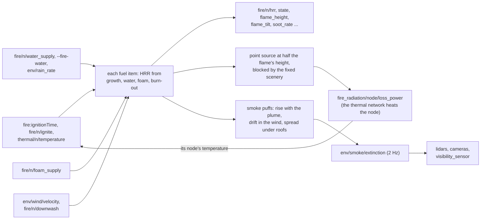

# Fire

Fuel items that ignite, grow, burn out, heat what is near them, spread, and go out under water,
foam or wind (`FireAPI_1`, RFC 0022). `lagrange_fire` runs every 100 ms. The model is the set of
engineering correlations fire protection engineers use, not CFD: a t² or pool-fire heat release
rate, Heskestad's flame height, a point-source radiation model and Evans' sprinkler suppression.
The numbers are for testing robot software, not for designing buildings or proving safety.



## Using it

On a fuel item in USD (its collider gives the burning area and the flame's base, the top of the
collider):

```usda
over "pallet" ( prepend apiSchemas = ["FireAPI_1"] )
{
    double fire:alpha = 46.889            # W/s², the fast t² class
    double fire:hrrPerArea = 1000000      # W/m² at full involvement
    double fire:fuelMass = 80             # kg
    double fire:heatOfCombustion = 12000000  # J/kg
    double fire:radiativeFraction = 0.3
    double fire:sootYield = 0.015         # kg/kg
    double fire:criticalWaterRate = 0.02  # kg/(m²·s)
    double fire:ignitionTime = 0          # s
}
```

or from an overlay or a URDF `<gazebo reference="L"><fire alpha="fast" .../></gazebo>`
(formats.md §3.14, where every attribute is listed). The numbers above show the form; a fuel's
values come from its data, with their source. The presets (`fire:preset`) ship empty until their
cited values are confirmed (RFC 0022 open question 3).

The sample is a pallet fire in the sample warehouse under a roof 3 m up, with the sample AMR and
a visibility meter near the roof; a sprinkler's rate of water reaches the fire at 60 s:

```bash
lagrange assets/worlds/warehouse_fire/warehouse_fire.yaml
# or: lagrange_server --robot none --world assets/worlds/warehouse_fire/warehouse_fire.usda \
#       --fire-water pallet=0.133@60
```

`--fire-water NAME=RATE[@T]` (run file `fire_water: [{fire, rate, at}]`) puts water on a fire at
RATE kg/(m²·s), which is mm/s of water, from T s on. It stands in for a sprinkler. A robot's
nozzle (`NozzleAPI_1`, [the nozzle and tank](actuators.md#the-nozzle-and-tank)) wets the fire its
jet lands on, by the share of the jet's landing disc that covers the burning area. Plugins and ROS topic inputs can write
`fire/<n>/water_supply` and `fire/<n>/foam_supply` instead; rain (`env/rain_rate`) falls on every
fire when the weather runs.

`--domain fire=off` (or a profile's `fire: {enabled: false, substitute: zero}`) is the zero
substitute: no fire. `substitute: constant` holds every fire at its full involvement from the
start, unaffected by water, foam and wind: a steady fire for sensor and planner tests.

## How it computes

**Ignition.** At `fire:ignitionTime`, when `fire/<n>/ignite` turns true, or when the
`ThermalAPI_1` node on the item's own prim reaches `fire:ignitionTemperature` (spread, below).

**Growth.** `t_squared`: `Q = α·(t − t_i)²`, capped at `q''·A`. The named classes are 2.9306,
11.722 and 46.889 W/s² for slow, medium and fast (Evans and Stroup, NBSIR 85-3167, the DETACT-T2
listing: 1000 Btu/s at 600, 300 and 150 s) and 1000 Btu/s at 75 s for ultrafast (TODO(verify)
against NFPA 72's annex). `pool`: `Q = ṁ''∞·(1 − e^(−kβ·D))·ΔH_c·A`, D the equivalent diameter
`√(4A/π)` (Babrauskas 1983), at once. `fire:hrrCurve` replaces both with a measured curve.

**Burn-out.** The fuel burnt is `∫Q dt/ΔH_c`. When less than `fire:decayFraction` (0.2) of the
fuel remains, Q is scaled by the remaining share of that fraction. Q is then proportional to the
remaining mass, so it falls exponentially in time; the fire is out when the tail is down to 1 %.
This is a modelling choice (RFC 0022 open question 5), not a measured law.

**Flame.** Heskestad's mean flame height `L = 0.235·Q^(2/5) − 1.02·D` (L, D in m, Q in kW; SFPE
Handbook 5th ed. ch. 13), never below 0. In wind it leans by the AGA correlation as Mudan and
Croce give it: `u* = u_w/(g·ṁ''·D/ρ_a)^(1/3)`, `cos θ = 1` for `u* ≤ 1` and `u*^(−1/2)` above, with
`u_w` the horizontal wind (`env/wind/velocity`) plus the rotors' wake at the fire
(`fire/<n>/downwash`, which the aerodynamics domain writes whenever rotors fly: every robot's
wake half way up the flame, since at the base itself, on the fuel, a wake stagnates) and `ṁ''` the
fire's mass burning flux. ρ_a is `env/air_density` or the site's; without either the flame stays
upright. `fire/<n>/flame_tilt` is the flame's axis.

**Radiation into robots.** The point-source model: the flame radiates `χ_r·Q` from a point at half
its height along its axis, and the flux at distance R is `q'' = χ_r·Q/(4π·R²)`. A lumped
`ThermalAPI_1` node with a `thermal:radiativeArea` absorbs `ε·q''·A_rad/4` (ε its
`thermal:emissivity`; `A_rad/4` is the mean projected area of a convex body, so the direction it
faces does not enter), written as `fire_radiation/<node>/loss_power`. The thermal network adds
that to the node as it adds a motor's losses, so robots near a fire heat, derate and trip their
limits through the thermal paths that exist. A ray from the source to each node through the fixed
scenery removes what a wall or a rack blocks (the fuel item's and the node's own colliders do not
count). The model is "accurate in the far-field, but ... overly conservative within a few fire
diameters" (McGrattan, Baum and Hamins, NISTIR 6546, §3); the module warns once when a node is
within two fire diameters (TODO(verify): a published R/D limit). A node with no radiative area
takes no heat. The conduction fidelity's cells (RFC 0012) are not heated yet.

**Spread.** A fuel item with `fire:ignitionTemperature` and a `ThermalAPI_1` node on its own prim
ignites when its node reaches that temperature, the node heated by the fires around it as above.
This is the surface-temperature ignition criterion applied to a lumped node; it is crude for thick
solids, whose surface heats ahead of their mean temperature, and ignites them late.

**Water.** Water reaches a fire as an application rate `w''` (kg/(m²·s), numerically mm/s) over
its burning area. At or above `fire:criticalWaterRate` the fire stops growing and decays by Evans'
law (NISTIR 5254, 1993, eq. 3): `dQ/dt = −Q/τ`, `τ = 3.0·w''^(−1.85)` s, 410 s at 0.07 mm/s, the
value the report states for 0.61 m wood cribs. Evans fitted it to Walton's 305 and 610 mm crib
tests "within ± 50 %", over 0.026 to 0.133 mm/s; the report warns that at low rates the power law
over-predicts the time to put the fire out. Below the critical rate the fire still grows. If the
water stops, it grows again from where it is along its t² law. The decay never reaches 0, so the
fire is out when Q falls below 1 % of Q when the water arrived (a modelling choice). Water does not
put out class `b` (a burning liquid: it sinks under the fuel); on class `c` (energised equipment)
it raises `fire/<n>/hazard`. `fire/<n>/water_cooling` is the heat the water takes up, never more
than it can boil, `ṁ_w·(c_w·(100 °C − T_w) + h_fg)` with h_fg = 2.256 MJ/kg (about 2.6 MJ/kg from
20 °C), nor more than the fire's own Q; `steam_rate` is that over the heat per kilogram. T_w is the
air temperature, or latent heat only when no temperature is known. The water's cooling and Evans'
decay are separate: a fire goes out by its fuel's surface cooling below pyrolysis, not by the
water absorbing its whole heat release.

**Foam.** Finished foam laid down at `fire/<n>/foam_supply` (m/s of depth) covers the share
`φ = depth/fire:foamBlanketThickness` of the burning area, which shrinks as `A·(1 − φ)`; the fire is
out when it is covered (state 7). Without a blanket thickness foam does nothing. NFPA 11's
application rates and thicknesses are not openly readable (TODO(verify)), so there is no default.

**Smoke.** The soot made, `ṁ_s = y_s·Q/ΔH_c` (`fire/<n>/soot_rate`), leaves each flame's tip as
one Lagrangian puff per step: a Gaussian of mass `ṁ_s·dt`, `σ_h` across and `σ_v` up. A puff rises
at Heskestad's plume centreline velocity `u0` at its height above its fire's virtual origin (the
flame section above, with `env/air_temperature` and `env/air_density` or the site's; without them
it drifts but does not rise, and the module says so once) and is carried by `env/wind/velocity`.
While it rises its width is the plume's, `σ = b/√(2 ln 2)` with `b = 0.12·(z − z0)` (the half-value
radius; TODO(verify) the coefficient and its temperature factor, SFPE Handbook ch. 13, which was not
readable), never under half a voxel. A ray up through the fixed scenery finds the ceiling above it:
nothing of the puff is above that, and once its top reaches it the puff stops a `σ_v` below it and
spreads sideways at the plume velocity it arrived with, `dσ_h/dt = 0.12/√(2 ln 2)·u0` (a modelling
choice; a ceiling-jet law, Alpert 1972, is owed). It leaves beyond the smoke box, 30 m across from
the fires and 20 m above them. Beyond 2000 puffs the two
oldest merge, keeping their mass, centre and second moments. There is no deposition, no flow round
walls and no filling: a layer under a roof keeps its depth instead of coming down as the room
fills, and smoke passes through walls. It is deterministic, with no random numbers.

At 2 Hz the puffs are spread over the voxels within 3σ of them (0.5 m voxels), their weights normalised so that the field holds each puff's mass, into
`env/smoke/extinction`: `σ = K_m·ρ_soot` (1/m), with `K_m = 8700 m²/kg`, the specific extinction
coefficient of flame-generated smoke at 633 nm (Mulholland and Croarkin, *Fire and Materials* 24,
2000; the FDS 6.11.1 guides give "8700 m²/kg ± 1100 m²/kg at a wavelength of 633 nm"). The viewer's
Environment workspace shows it as the field *smoke extinction* (horizontal and upright slices).

What the sensors see of it (sensors.md):

- **Lidars** add its optical depth along each beam, scaled to their wavelength by `633 nm/λ`
  (0.70 at 905 nm, 0.41 at 1550 nm), to the fog's in the lidar equation, `r·e^(σr + τ) ≤ R`:
  a return is kept only when its target is within the range the smoke leaves. Smoke at the sensor
  adds to the fog's clutter (false near returns) through the same model. Soot's extinction goes as
  `1/λ` from 543.5 to 1565 nm (Zhu, Choi, Mulholland et al., *Proc. Combust. Inst.* 29, 2002:
  `K_m·ρ_s·λ` roughly constant), which is where the scaling comes from.
- **Cameras** veil each pixel through it as through fog, `L = L0·e^(−τ) + L_air·(1 − e^(−τ))`,
  τ its optical depth to the pixel's depth. The air light is the weather's grey, not soot's black
  (the viewer's smoke drawing is a later step). Thermal cameras do not take smoke yet: soot's
  extinction in 8–14 µm is not measured (TODO(verify)).
- **`visibility_sensor`** adds the smoke's σ at its place to the weather's, and also writes
  `sign_visibility` and `light_visibility`, `S = C/σ` with `C = 3` for a light-reflecting sign and
  `C = 8` for a light-emitting one (FDS 6.11.1 User's Guide eq. 22.23, `VISIBILITY_FACTOR`, after
  Mulholland's SFPE Handbook chapter). A meter can be fixed in the scenery, as the sample's is.

How far to trust it: the puffs put roughly the right mass in roughly the right place above and
downwind of a fire, and under a roof; they do not reproduce a filling room, smoke round obstacles,
or the plume's own turbulence. For those, compare with FDS (RFC 0022 step 9).

**Wind.** A flame with `fire:blowOffSpeed` (from a measurement; there is no general correlation
for fuel items) goes out at the step the air speed at it passes that speed, while its Q is below
`fire:blowOffMaxHrr` if given. Large fires do not blow off: they lean. Wind does not raise a pool
fire's burning rate in this model (RFC 0022 open question 8).

## Water from a nozzle

Each nozzle's jet (actuators.md) ends at `act/<z>/impact` with `act/<z>/flow` kg/s spread over a
disc of radius `act/<z>/footprint`. A jet that lands on a fire's fuel (from the bottom of its
colliders to the base, within 5 cm) gives it

`w'' = ṁ·f/A`, with `f = A_overlap(d, r_f, R)/(π·r_f²)`,

`A` the burning area, `R = √(A/π)` the disc of the same area, `r_f` the footprint, `d` the
horizontal distance from the fire's centre to the impact and `A_overlap` the lens two circles
share. A solid stream (footprint 0) counts whole inside the disc and not at all outside it. Foam
solution lays `ṁ/ρ·expansion·f/A` m/s of finished foam instead; CO2 waits for RFC 0022 step 7.
With `w''` over the fuel's critical rate the fire decays by Evans' law, `τ = 3.0·w''^(−1.85)` s,
and is out at `τ·ln 100` after the water arrives (the 1 % threshold). The sample robot's 0.48 kg/s
over the 0.96 m² pallet is 0.50 mm/s, above the 0.026 to 0.133 mm/s Evans fitted, so its τ of
10.9 s is an extrapolation of the power law (`test_nozzle_run` checks the run against it, not the
law against a crib test).

## Signals

| Signal | Type | Unit | |
|---|---|---|---|
| `fire/<n>/hrr` | Scalar | W | heat release rate |
| `fire/<n>/state` | Int | 1 | 0 not ignited, 1 growing, 2 fully involved, 3 decaying, 4 out: water, 5 out: burnt, 6 out: blown off, 7 out: smothered (8, out of oxygen: compartments, later) |
| `fire/<n>/flame_height` | Scalar | m | |
| `fire/<n>/flame_tilt` | Vec3 | 1 | the flame's axis, world-local |
| `fire/<n>/base` | Vec3 | m | the centre of the flame's base, world-local |
| `fire/<n>/radiative_power` | Scalar | W | χ_r·Q |
| `fire/<n>/fuel_remaining` | Scalar | kg | |
| `fire/<n>/soot_rate` | Scalar | kg/s | `y_s·Q/ΔH_c`, the smoke's source |
| `fire/<n>/water_rate` | Scalar | kg/(m²·s) | applied, over the burning area |
| `fire/<n>/water_cooling` | Scalar | W | heat the water takes up |
| `fire/<n>/steam_rate` | Scalar | kg/s | |
| `fire/<n>/foam_coverage` | Scalar | 1 | |
| `fire/<n>/hazard` | Bool | 1 | water on class `c` |
| `fire/<n>/ignite` | Bool | 1 | in |
| `fire/<n>/water_supply` | Scalar | kg/(m²·s) | in |
| `fire/<n>/foam_supply` | Scalar | m/s | in |
| `fire/<n>/downwash` | Vec3 | m/s | in, from the aerodynamics domain |
| `act/<z>/flow`, `impact`, `footprint` | | | in, every nozzle's jet (actuators.md) |
| `fire_radiation/<node>/loss_power` | Scalar | W | per thermal node with a radiative area |
| `env/smoke/extinction` | Field3D | 1/m | the smoke's σ at 633 nm, at 2 Hz |
| `env/smoke/mass` | Scalar | kg | soot in the smoke box |

## Not yet

Flames seen by thermal and visible cameras (and smoke in the thermal band), the downwash on the
smoke puffs, smoke in the live air box, compartments and oxygen, the
viewer's flames and smoke volume, heat flux on people, and `lagrange fds` are later steps of RFC
0022.

## Checked against

`modules/fire/test/test_correlations.cpp` (the lens of two discs), `test_fires.cpp` (a jet's
water by its share, Evans' decay under a jet and the fire out at `τ·ln 100` to the step, foam),
`test_smoke.cpp`, `server/test/test_nozzle_run.cpp`, `test_fire_downwash.cpp`, and the sensors'
smoke tests (`test_sensors`, `test_camera`, `test_kinds_visibility_sensor`,
`test_weather_effects`); each test states its tolerance and source.

| Check | Against | Tolerance |
|---|---|---|
| t² classes | reach 1000 Btu/s (1055 kW) at 600, 300, 150, 75 s (NBSIR 85-3167) | 0.1 % |
| Pool fire | Babrauskas' closed form, 1 m pool | 0.1 % |
| Flame height, virtual origin, plume velocity | Heskestad's closed forms | 0.1 % |
| Tilt | AGA at u* = 0.5, 2, 4 | 1e-6 |
| Radiant flux | point source at 5 positions, one behind a wall | 0.1 %; 0 when hidden |
| Heating a node | steady temperature of its energy balance with the thermal network | 1 % |
| Water | τ = 410 s at 0.07 mm/s (NISTIR 5254); exponential decay | 0.5 %; 0.1 % |
| Water energy | cooling never over what the water can boil, nor over Q | always |
| Class B, foam | water at any rate leaves a pool burning; full foam cover puts it out | qualitative, and at the step |
| Blow-off | out at the step the air passes the speed | at the step |
| Burn-out | energy released `M·ΔH_c` less the 1 % tail | 0.5 % |
| Spread | ignites within a step of its node reaching the ignition temperature | 2 steps |
| Smoke: one puff | peak `K_m·m/((2π)^(3/2)·σ_h²·σ_v)`; the field holds its mass | 1 %; 0.1 % |
| Smoke: steady source in wind | a Gaussian line, `K_m·ṁ/(2π·u·σ_h·σ_v)` on its axis | 2 % |
| Smoke: rise | `(z − z0)^(4/3)` grows as `(4/3)·A·t` (Heskestad's `u0 = A·(z − z0)^(−1/3)`) | 0.5 % |
| Smoke under a roof | stops a σ below it, spreads; nothing above it; mass in the field | 2 % |
| Smoke mass | the field's integral against `∫ṁ_s dt` while no puff has left | 2 % |
| Lidar in smoke | walls kept within `lidarDetectionRange` at σ·633/905, lost beyond | exact |
| Camera in smoke | `L0·e^(−σd) + L_air·(1 − e^(−σd))` | 1 code |
| Visibility | a uniform smoke box: `3/σ` and `8/σ`, alone and with the weather's σ | 1 % |
| Determinism | the same run twice; save and restore (smoke too) | identical |

Not yet checked: a measured pool-fire radiant flux with all its inputs (RFC 0022 Validation,
TODO(verify)), and Lagrange against an FDS run.
