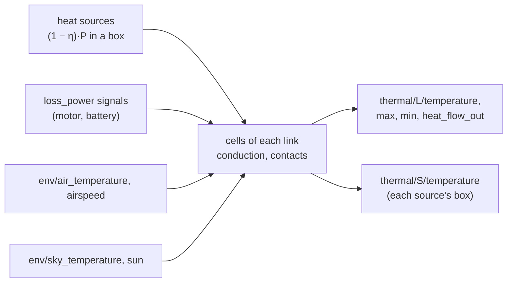
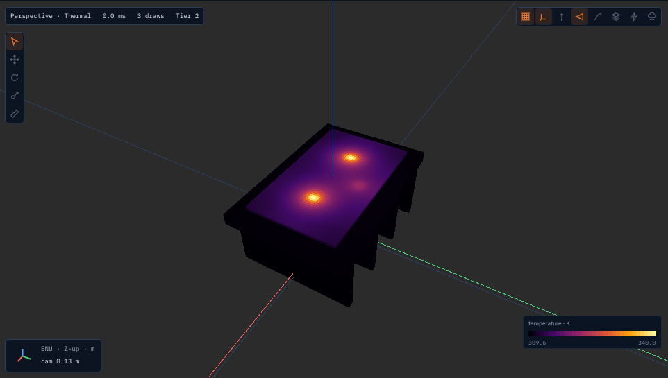

# Heat conduction in solids

How hot each part of a robot gets, and where on it (RFC 0012). Give a link a material and heat
sources, and the thermal domain's `conduction` fidelity cuts the link into small cubes (cells),
works out the temperature of every cell, passes heat between neighbouring cells and across to
the parts it is bolted to, and loses it to the air and the sky from every outside face. An LED
on a board, a motor driver on a heat sink and a battery in a closed housing are the usual cases.



It runs every 100 ms beside the lumped network (`ThermalAPI_1` nodes keep working), whenever a
link has a thermal material and the site's ambient temperature is given (`--ambient-temperature
K` or the profile's `thermal.ambient_temperature`; there is no default).

## Using it

In a URDF, on the link:

```xml
<gazebo reference="led_board">
  <!-- in-plane 20 W/(m·K) from its copper planes, through the board 0.3 -->
  <thermal_material preset="fr4" conductivity="20" conductivity_along="0.3" axis="0 0 1"
                    contact_conductance="3000"/>
  <heat_source name="led_1" power="3.0" efficiency="0.35" xyz="0.01 0 0.0016"
               size="0.003 0.003 0.001"/>
  <heat_source name="driver" power_signal="motor/left/loss_power"/>
</gazebo>
<gazebo reference="heat_sink">
  <thermal_material preset="aluminium_6061" emissivity="0.85"/>  <!-- anodised -->
</gazebo>
```

or the same in an overlay or USD (`ThermalMaterialAPI_1`, `HeatSourceAPI_1:<name>`; formats.md
§3.13). Then run with the site's ambient temperature:

```bash
lagrange_server --robot lamp.urdf --world none --ambient-temperature 298.15
```



The viewer's **Thermal** shading (Shading menu, or `--shading thermal`) colours every outside face
of each link's cells by its temperature (the server's field `thermal/cells`, one `FieldVolume`
per link in its frame, 5 times a second), with the legend's range from the coldest to the
hottest cell. The sample above is `assets/robots/led_heatsink/led_heatsink.urdf`:

```bash
lagrange assets/robots/led_heatsink/led_heatsink.urdf --ambient-temperature 298.15 --rtf 60 \
    -- --shading thermal
# or: lagrange_server --robot assets/robots/led_heatsink/led_heatsink.urdf --world none \
#       --ambient-temperature 298.15 --rtf 60
```

Signals, per link `L` with a material and per source `S`:

| Signal | Unit | |
|---|---|---|
| `thermal/L/temperature` | K | the link's volume average |
| `thermal/L/max_temperature`, `min_temperature` | K | its hottest and coldest cell |
| `thermal/L/heat_flow_out` | W | to the air and the sky |
| `thermal/L/overtemp` | 1 | 1 once any cell reaches `maxTemperature` |
| `thermal/S/temperature` | K | the average over the source's box (the case temperature) |
| `thermal/S/heat` | W | `(1 − η)·P`, what stays as heat |
| `thermal/S/radiant_power` | W | `η·P`, the light that leaves |

Profile keys (`domains.thermal`): `fidelity` (`conduction`, the default when a link has a
material, or `lumped` to leave the materials out), `cell` (m, default 0.002), `max_cells` (per
link, default 200000), `surface_coefficient` (W/(m²·K): one film coefficient for every face
instead of the correlations below).

## Temperature sensors

A thermal camera (`ThermalCameraAPI_1`, docs/physics/sensors.md) reads a link with a thermal
material at its `thermal/<L>/temperature` with the material's emissivity: bare aluminium
(0.09) reads near the room's temperature however hot it is, as through a real camera; paint
or anodising (0.8 to 0.9) close to its own.

The sample plugin `lagrange_thermal_probe` (`core/plugin_abi/samples/thermal_probe.c`, C ABI,
`--plugin lagrange_thermal_probe`) reads the thermal domain like a real sensor:

```xml
<gazebo reference="led_board">
  <sensor name="led_ntc" type="thermistor">
    <update_rate>10</update_rate>
    <thermistor><target>led_left</target><time_constant>2.0</time_constant>
      <noise><stddev>0.05</stddev></noise><resolution>0.0625</resolution></thermistor>
  </sensor>
</gazebo>
<gazebo reference="camera_arm">
  <sensor name="board_ir" type="ir_thermometer">
    <pose>0 0 0 0 1.5708 0</pose>  <!-- looking down -->
    <ir_thermometer><fov>0.2</fov><range>0.5</range><emissivity>0.95</emissivity>
      <ambient>298.15</ambient></ir_thermometer>
  </sensor>
</gazebo>
```

- **`thermistor`**, a contact sensor: `thermal/<target>/temperature` (a heat source's case, a
  link's mean, a lumped node; default its own link) through a first-order lag of `time_constant`
  s, with Gaussian `noise/stddev` (K) and quantisation to `resolution` (K; 0.0625 for a 12-bit
  digital sensor). Output `sensor/<name>/temperature`.
- **`ir_thermometer`**, a spot pyrometer along its +x: a 5 × 5 grid of rays over `fov` (rad, 0
  one ray) to `range`; what each ray meets is seen at its link's temperature with the target
  `emissivity` set on the sensor (as on a real one), the rest of the radiance reflected from the
  surroundings, so the reading is $(\overline{\varepsilon T^4 + (1-\varepsilon)T_{amb}^4})^{1/4}$
  (broadband, not in the sensor's band). The ambient is `env/air_temperature` when the weather
  runs, else `ambient` (no default). Outputs `sensor/<name>/temperature`, `valid`.

Checked by `test_plugins`' `TheThermalProbesReadTheHeatConduction`: the thermistor lags its LED
while it heats and meets it within 0.1 K; the infrared reading equals the grey-body formula for
the board's temperature within 0.05 K.

## In OpenFOAM: `lagrange foam-cht`

When the air's flow matters (a fan, a duct, parts that warm each other's air), give the same
robot to OpenFOAM's conjugate heat transfer solver:

```bash
lagrange foam-cht assets/robots/led_heatsink/led_heatsink.urdf --ambient 298.15 --out led_case
```

It writes a `chtMultiRegionSimpleFoam` case (`tools/cli/lagrange_foam_cht`): a solid region per
link with a material (its collision surfaces, `lagrange tunnel --export-surface`), still air
around them with buoyancy (laminar, the box's walls at the ambient, its top open), each heat
source as a `scalarSemiImplicitSource` on the cells of its box, a contact conductance as a thin
layer on the child's side of the interface, an orthotropic board as `constAnIso`. The numbers
come from `lagrange export thermal ROBOT --out FILE.json`, the same reading of the URDF as the
conduction fidelity's. It runs with an installed OpenFOAM or the container
(`opencfd/openfoam-default:2512`, `--procs` processes), reads each region's mean, max and min and
each source's mean into `report.json`, and `--compare RUN.json` sets a Lagrange run's beside them;
`--start-from RUN.json` starts the solids at its temperatures, which shortens the iterations (the
coupled solids converge slowly from the ambient). OpenFOAM is GPL-3 and stays a separate program:
files only. The case has no radiation: compare it with a run whose emissivities are 0.

**The sample against OpenFOAM** (2026-11-11; `led_heatsink.urdf` with its emissivities set to
0, 298.15 K, 203,000 cells, 8 processes, converged by iteration 1100 of 4000 and steady to 0.01 K
after; Lagrange run for an hour of simulated time to steady state, 3.000 W in and out):

| | OpenFOAM | Lagrange | |
|---|---|---|---|
| sink, mean | 353.2 K | 325.5 K | the air takes the heat half as well in OpenFOAM |
| board, mean | 357.7 K | 330.3 K | |
| LED, case | 379.4 K | 352.9 K | |
| LED over the sink | 26.2 K | 27.4 K | conduction inside agrees within 5 % |

Inside the solids the two agree; at the surface they do not. The correlations treat every face
as a free plate, and this sink has its fins facing down with 14 mm between them, where the air is
trapped: OpenFOAM's effective coefficient is about 4.5 W/(m²·K), the correlations' about 9. Where
the shape matters like this, run `lagrange foam-cht` once and set the run's
`thermal.surface_coefficient` to what it gives (here about 4.5), or keep the correlations for
open shapes. With `surface_coefficient: 4.5` Lagrange gives the sink 350.0 K and the LED 378.2 K,
within 3.2 K and 1.2 K of OpenFOAM's (6 % and 2 % of the rise). One mesh only: a mesh study of the OpenFOAM case is still owed.

## The model

**Cells.** Each link is cut into cubes in its own frame from its collision shapes (boxes,
spheres, cylinders, capsules, convex hulls). A cube is solid when its centre is inside a shape.
The cube side is `cell`, but at most half the link's thinnest shape (so a 1.6 mm board has two
cells through it) and coarser when the link would have more than `max_cells`.

**Conduction.** Between two neighbouring cells of side $h$ the conductance is $k\,h$ (area
$h^2$ over distance $h$). An orthotropic material (`conductivityAlong` with `axis` $\hat a$) has
$k_d = k_\perp + (k_\parallel - k_\perp)\,a_d^2$ along each axis $d$ of the link, exact when the
axis lies along one of them.

**Contacts.** Where a link's cell touches its parent link's cell (the nearest ancestor with a
material, at the joints' zero positions), the two exchange heat through
$R = \frac{h_a/2}{k_a A} + \frac{1}{h_c A} + \frac{h_b/2}{k_b A}$ with the child's
`contactConductance` $h_c$. Typical values: bare aluminium on aluminium in air 2,200–12,000
W/(m²·K), with thermal grease about 10⁵, a 1 mm gap pad about 2,000 (Incropera Tables 3.1–3.2;
Bergquist Gap Pad 2500 data sheet). Touching links without one exchange nothing, and the start
logs the pair.

**Surfaces.** Every other outside face loses $h\,A\,(T - T_{air})$ and
$\varepsilon\sigma A (T^2 + T_{sky}^2)(T + T_{sky})(T - T_{sky})$, the radiation exact at the
cell's temperature of the last step. The film coefficient $h$ comes from the link's mean surface
temperature and its size as it sits now:

- vertical faces: Churchill and Chu, $Nu = \{0.825 + 0.387\,Ra^{1/6}/[1 + (0.492/Pr)^{9/16}]^{8/27}\}^2$
  on the link's height (Incropera Eq. 9.26);
- horizontal faces, with $L = A/P$ of its footprint: the upper face of a hot link (or lower of a
  cold one) $0.54\,Ra^{1/4}$ up to $Ra = 10^7$ and $0.15\,Ra^{1/3}$ above, the other side
  $0.52\,Ra^{1/5}$ (Incropera Eqs. 9.30–9.32); inclined faces blend the two by $|n_z|$;
- forced, with `body/<b>/airspeed`: the flat plate over the link's longest side,
  $0.664\,Re^{1/2}Pr^{1/3}$ (laminar) or $(0.037\,Re^{4/5} - 871)Pr^{1/3}$ (Incropera Eqs. 7.30,
  7.38), combined as $h = (h_n^3 + h_f^3)^{1/3}$ (Churchill and Usagi, Incropera Eq. 9.65).

Air is taken at 300 K (Incropera Table A.4: $\nu = 15.89 \cdot 10^{-6}$ m²/s,
$k = 0.0263$ W/(m·K), $\alpha = 22.5 \cdot 10^{-6}$ m²/s, $Pr = 0.707$), $\beta = 1/T_{film}$. With
`env/solar_irradiance`, faces looking up absorb $\varepsilon\,G\,n_z$ (the sun overhead, a grey
surface).

**Sources.** A heat source's $(1-\eta)P$ is shared over the cells whose centres are in its box (the
nearest cell when none is); a `loss_power` signal named like the link is spread over all its
cells. A motor (`ElectricalMotorAPI_1`) with no lumped node of its own heats the link that holds
its stator, its joint's parent, in a 2 cm box at the joint, with `motor/<m>/loss_power` (copper
and drive losses, when the electrical network runs), as the source `<m>_mount`
(`thermal/<m>_mount/temperature`, the mount's; the winding's is a lumped node's).

**Time.** Backward Euler over the step, solved by conjugate gradients with a Jacobi
preconditioner from the last temperatures, to a relative residual of $10^{-12}$: stable at any
step, the same operations in the same order every run (bit-reproducible, CPU, every tier).

## Materials

Presets near 300 K. Values marked TODO(verify) in `modules/thermal/conduction/src/Materials.cpp`
were not read from the primary source.

| Preset | k (W/m·K) | ρ (kg/m³) | c_p (J/kg·K) | ε | Source |
|---|---|---|---|---|---|
| `aluminium_6061` | 167 | 2700 | 896 | 0.09 (anodised ≈ 0.8) | ASM/MatWeb data sheet |
| `aluminium_cast` | 151 | 2680 | 963 | 0.09 | A356-T6 data sheets |
| `copper` | 401 | 8933 | 385 | 0.03 | Incropera Table A.1 |
| `steel_304` | 14.9 | 7900 | 477 | 0.075 | Incropera Table A.1 |
| `fr4` | 0.81 in-plane, 0.29 through | 1850 | 1100 | 0.9 | IPC data via Wikipedia "FR-4" |
| `pla` | 0.13 | 1240 | 1800 | 0.9 | Prusament PLA TDS |
| `abs` | 0.17 | 1100 | 1400 | 0.9 | Ultimaker ABS TDS |
| `petg` | 0.2 | 1270 | 1300 | 0.9 | Prusament, eSun TDS |
| `nylon_pa12` | 0.23 | 1010 | 1600 | 0.9 | Weerg, Xometry data sheets |
| `polycarbonate` | 0.2 | 1190 | 1200 | 0.9 | Ultimaker PC TDS |
| `cfrp_epoxy` | 4 in-plane, 0.6 through | 1600 | 750 | 0.85 | PMC10339322 |
| `glass` | 1.4 | 2500 | 750 | 0.92 | Incropera Table A.3 |
| `silicone` | 0.2 | 1200 | 1270 | 0.9 | — |
| `thermal_pad` | 3 | 3300 | 900 | 0.9 | Bergquist data sheets |

The orthotropic presets take `axis` (default the link's z) as the through direction. A bare FR-4
board spreads heat poorly: 2 W from a 3 mm LED raises it some hundreds of kelvin above the rest
of the board, which is why power LEDs sit on metal-core boards (give the board's in-plane
conductivity of its copper, e.g. `conductivity="20"`, or model the metal core as its own link).

## Checked against

`modules/thermal/test/test_conduction.cpp`:

| Case | Reference | Result |
|---|---|---|
| A 1 cm copper cube cooling at h = 10 | lumped, $\exp(-hAt/\rho c V)$ | within 0.5 % |
| A 4 mm aluminium rod, 1 W into one end | the fin with a convecting tip (Incropera Table 3.4) | shape within 10⁻⁴, base 0.25 % at 0.5 mm cells, first order |
| A steel bar under 10⁵ W/m² | the semi-infinite solid (Carslaw and Jaeger §2.9) | within 0.01 % |
| Two copper blocks across 2000 W/(m²·K) | the two-node network | within 0.1 % |
| An orthotropic rod | the fin with $k_\parallel$ | within 2 % |
| Two runs | bit for bit | equal |

`modules/thermal/test/test_thermal_conduction.cpp` runs it on the bus (an LED board on a plate,
energy in equals out at steady state), and `test_server`'s `ThermalMaterials.*` from a URDF.

Not modelled: the air's flow (use `lagrange foam-cht` for conjugate heat transfer in OpenFOAM),
light's path (the radiant power just leaves), junction temperature, thermal expansion, melting.
