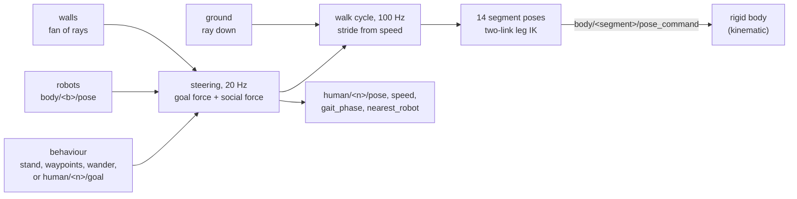

# Humans: people who walk

A `HumanAPI_1` prim is a person (RFC 0009): 14 rigid segments moved by a walk cycle, steering
round robots, walls and each other towards waypoints, a goal or a random spot. Lidars, radars and
cameras see the limbs, so a scan at knee height shows two legs that scissor. People are moved, not
simulated: nothing balances and no muscle pulls. The `humans` domain steps them on the CPU, on
every tier.

## The body

Pelvis, torso, head, and per side an upper arm, forearm, thigh, shin and foot: capsules with
matching meshes, every length a fraction of `human:height`. Each segment is a kinematic body
(MuJoCo mocap, Jolt kinematic) set by `body/human_<name>_<segment>/pose_command`. So a person
pushes a robot, and a robot cannot push a person; a person weighs nothing in physics.

## The equations

**Steering**, every 50 ms, is the social-force model (Helbing and Molnár 1995) that traffic uses.
A person heading for a target at distance $d$ wants the velocity $\mathbf v^0$ of speed
$\min(v_{walk},\, d/\tau)$ towards it, and accelerates towards it over the relaxation time
$\tau = 0.5$ s, pushed away from everything near:

$$
\dot{\mathbf v} = \frac{\mathbf v^0 - \mathbf v}{\tau} + \sum_k w_k\,A\,e^{-g_k/B}\,\mathbf n_k
$$

$g_k$ is the free gap to the other person, robot or wall $k$ (people are 0.3 m in radius, robots a
nominal 0.6 m), $\mathbf n_k$ the direction away from it, $A = 2$ m/s², $B = 0.3$ m, and $w_k$ is 1
for what is ahead and ½ for what is behind (a field of view). Walls are found by a fan of seven
rays at chest height, up to 2 m ahead. To pass instead of stopping nose to nose, an obstacle ahead
within 2.5 m adds a sideways push of $1.5\,v_{walk}/\tau \cdot e^{-g/0.8}$. Closer than 0.2 m to
something dead ahead, a person no longer walks towards it; one nearly stopped for 8 s skips to the
next target. Speed is capped at 1.3 times the walking speed and turning at 3 rad/s.

**The walk cycle.** Step length $L$ and rate $f$ (steps per second) follow from the speed by the
walk ratio, $L/(60f) = 0.0065$ m per step/min for a 1.75 m person (Sekiya et al. 1996), scaled with
height. With $v = Lf$:

$$
L = \sqrt{60 \cdot 0.0065\,\tfrac{h}{1.75}\cdot v}, \qquad f = v / L
$$

so at 1.34 m/s a 1.75 m person takes 0.72 m steps at about 112 a minute. Stance is 62 % of a stride.
Each stance foot is planted on the ground and the leg solved to reach it (two-link inverse
kinematics), rolling from heel to flat to toe; the swing foot follows an arc to the next footfall;
the arms swing with the opposite leg and the pelvis bobs twice a stride. Below 0.4 m/s the pose
blends to standing, so a person starts and stops smoothly. The body follows the ground under it,
found by a ray down.

## Solving it

Steering runs every fifth module step (10 ms steps, so 20 Hz) and the limbs every step (100 Hz).
Everything is on the CPU with a seed from the scheduler, so a run repeats; `human:seed` with the
run's seed picks a wanderer's spots. Per person the domain writes `human/<n>/pose` (the pelvis),
`speed`, `gait_phase` and `nearest_robot` (m, centre to centre), and reads the optional
`human/<n>/goal` (x, y, active above 0.5) that overrides the behaviour until the person arrives.

## How far to trust it

| Check | Result | Test |
|---|---|---|
| A straight walk's speed | within 2 % of `walkSpeed`, MuJoCo and Jolt | `Humans.WalksAtItsSpeedAlongItsWaypoints` |
| Step length and rate | 0.72 m (±0.02) at 112 (±4) steps/min, walk ratio within 0.006–0.007 | `Gait.StepsAsPeopleDo` |
| The stance foot does not skate | under 2 cm in every part of stance, 1.55–1.95 m people, 0.8–1.7 m/s | `Gait.TheStanceFootStaysPlanted` |
| Joint ranges | hip about 30° to −10°, knee up to about 60° in swing, against widely reported values (TODO(verify) against Winter's tables) | `Gait.JointRangesAreThoseOfWalking` |
| Waypoints in a loop, a goal override, wandering inside its circle and repeatable | met | `Humans.FollowsWaypointsInALoopAndTakesAGoal`, `Humans.WanderStaysInItsCircleAndIsRepeatable` |
| Walking past a stopped AMR | kept over 0.6 m and got past | `Humans.WalksRoundARobot` |
| Walls | stops at a wall instead of walking through | `Humans.DoesNotWalkThroughWalls` |
| A lidar sees two legs that scissor | met | `Humans.ALidarSeesTwoLegsThatScissor` |
| A robot cannot push a person | met | `Humans.ARobotCannotPushAPerson` |
| Against measured crowds | **owed**: the behaviour is tested (they walk, steer, stop), not compared with real people | — |

Cost, measured on the development machine: 50 wandering people with the sample AMR at 5.3 times
real time, headless.

Not modelled: contact the other way (people never fall or react to being hit), route planning (a
person heads straight for the next waypoint, so a route round a wall needs waypoints round it),
stairs and feet on slopes, people seeing traffic agents. Body proportions are from memory of
published tables and marked TODO(verify) in `modules/humans/include/lagrange/humans/Body.hpp`, and
several gait constants (pelvis height and bob, arm swing, lean) are illustrative. Lidar
reflectivity and radar cross-section are the defaults.

The design is in [RFC 0009](../../rfcs/0009-walking-humans.md), and how to use it in
[Tutorial: people around your robot](../guide/tutorial-humans.md).
