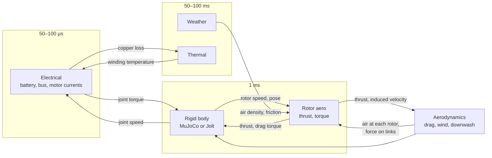

# Physics reference

How Lagrange computes each number, in plain words, with the main equations and how far the
result can be trusted. Each page links to its domain's design document, which holds the full
derivation, every constant and the signal listings.

## One step of a run

Every model is a module on the signal bus. The scheduler runs each at its own step and passes
values between them only as signals with units:

A value written by a slower or later module is read at its last update, so there is no loop
inside one step. See [Concepts](../guide/concepts.md) for the scheduler and substitutes.

## Every model

| Page | What it computes |
|---|---|
| [Rigid body](rigid-body.md) | MuJoCo and Jolt: joints with damping, friction and mimic, contacts and friction, mesh colliders as hulls, contact force and joint reaction |
| [Vehicles and wheeled bases](vehicles.md) | A car's suspension, Magic Formula tyres, brakes, steering and powertrain; the diff-drive and swerve controllers |
| [Water](water.md) | Buoyancy, drag, currents, waves, added mass and Fossen's model with a real vehicle's coefficients |
| [Rotors](rotors.md) | Thrust and torque of each propeller: coefficients or blade elements, ground and ceiling effect, vortex ring state |
| [Downwash](downwash.md) | The air a drone pushes: the jet under it, the outwash on the ground, walls and roofs, the live lattice Boltzmann box |
| [Aerodynamics and wind](aerodynamics.md) | Drag on links, the wind and its gusts, wind fields, rain pushing links; the wind tunnel and OpenFOAM |
| [Motors](motors.md) | Motor currents and torque from the bus voltage: the dq-frame model and its current loops |
| [Battery](battery.md) | Terminal voltage and state of charge: the equivalent circuit, and how it compares with a real cell |
| [Electrical network](electrical-network.md) | The buses, converters, fuses, switches and diodes between them, loads, and circuits from a netlist |
| [Thermal](thermal.md) | Lumped heat networks: copper and drive losses, heating, cooling, derating |
| [Sensors](sensors.md) | Lidar, camera, thermal camera, radar, IMU, GNSS, magnetometer, barometer, and sensor delays |
| [Weather](weather.md) | Air density, fog, rain, snow and dust extinction, wet and icy friction, dirty lenses, fields |
| [EMI and radio links](emi-and-radio.md) | Fields of power lines and motors and what they do to sensors; radio link budgets and CAN errors |
| [Traffic](traffic.md) | Cars following lanes and lights, lane changes, crossings, pedestrians, OpenSCENARIO |
| [Humans](humans.md) | People as moving capsules: walking with planted feet, steering round robots and each other |
| [Tethers](tether.md) | A cable from a winch to a drone or any body: sag, drag, snagging, tangling, its pull and its hits |
| [Heat conduction](heat-conduction.md) | Temperatures inside each part from its material: hot spots of LEDs and chips, contacts, convection |

Radiation is not built yet; its zero substitute stands in ([radiation.md](../design/domains/radiation.md)).

## Checked against

Each page ends with what its model was checked against. In short:

| Domain | Design document | Checked against |
|---|---|---|
| Rigid body | [rigid_body.md](../design/domains/rigid_body.md) | closed forms, MuJoCo against Jolt, the MCube pushing measurements |
| Electrical | [electrical.md](../design/domains/electrical.md) | closed forms, ngspice, the LG HG2 cell |
| Thermal | [thermal.md](../design/domains/thermal.md) | closed forms |
| Aerodynamics, wind | [aerodynamics.md](../design/domains/aerodynamics.md) | closed forms, NACA Report 640, NeuroBEM flights |
| Rotor downwash | [rotor_aero.md](../design/domains/rotor_aero.md) | Bauersfeld 2024, Tanner 2015, Kiran 2025, own OpenFOAM |
| Wind tunnel, CFD | [cfd.md](../design/domains/cfd.md) | OpenFOAM; the tunnel's wall friction is known to be 3.1 times too high |
| Weather | [weather.md](../design/domains/weather.md) | Koschmieder, Beer–Lambert, Marshall–Palmer, ICAO density |
| EMI | [emi.md](../design/domains/emi.md) | closed forms (conductor, dipole, far field) |
| Comms | [comms.md](../design/domains/comms.md) | Friis, thermal noise, bit errors, ISO 11898-1 |
| Sensors | [sensors.md](../design/domains/sensors.md) | analytic scenes, OpenCV calibration, EMVA 1288, radar equation, WMM 2025, ICAO, Planck |
| Vehicle dynamics | [vehicle_dynamics.md](../design/domains/vehicle_dynamics.md) | braking distance, the linear bicycle model, the Magic Formula's shape |
| Hydrodynamics | [hydrodynamics.md](../design/domains/hydrodynamics.md) | closed forms, von Benzon et al. 2022's BlueROV2 model (itself within about 10 % of pool runs) |
| Traffic | [traffic.md](../design/domains/traffic.md) | IDM equilibrium, light cycles |
| Radiation | [radiation.md](../design/domains/radiation.md) | not built yet |

The [Validation report](../validation/report.md) lists every check with its error and its test,
including the ones that fail. `tools/ci/realism.sh` runs the checks against measured data.
