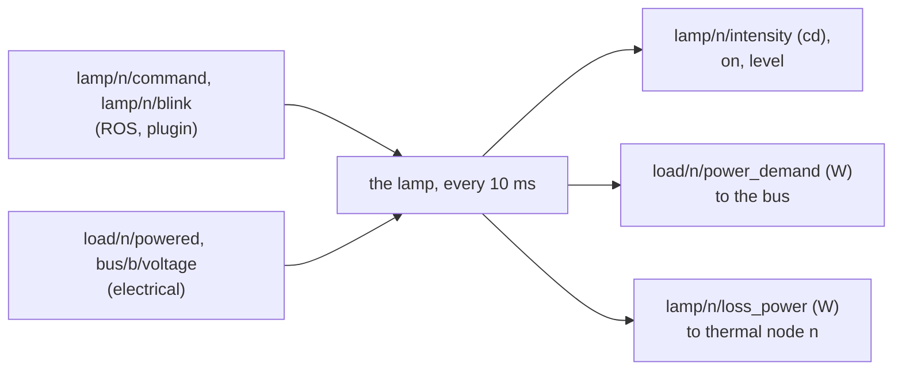

# Lights

Lamps a robot or a scene carries (`LampAPI_1`, RFC 0021): headlights, indicators, status LEDs,
spotlights and rotating beacons. `lagrange_lights` runs every 10 ms. It switches, dims and blinks
each lamp, turns a beacon, lets a lamp's light rise with its time constant, dims it with its
bus's voltage, and draws its power from the bus and puts its heat into its thermal node.

What a lamp lights is the next step: the `light_sensor` and the cameras (RFC 0021 steps 4–6). This
page covers the lamp itself.



## Using it

In a URDF, on any link:

```xml
<gazebo reference="base_link">
  <lamp name="headlamp" kind="spot" intensity="1500" beam_angle="0.35" field_angle="0.7"
        color_temperature="5700" efficacy="100" initial="1" xyz="0.31 0 0.08" rpy="0 0.1 0"/>
</gazebo>
```

From an overlay, with its power (formats.md §3.15):

```yaml
schema_version: 1
lamps:
  - name: headlamp
    link: base_link
    xyz: [0.31, 0.0, 0.08]
    rpy: [0.0, 0.1, 0.0]
    schemas:
      LampAPI_1:
        lamp:luminousIntensity: 1500.0    # cd, the datasheet's
        lamp:beamAngle: 0.35              # rad, full angle to 50 %
        lamp:colorTemperature: 5700.0     # K
        lamp:luminousEfficacy: 100.0      # lm/W
        lamp:initialCommand: 1.0
      ElectricalLoadAPI_1:
        elec:load:model: signal
        elec:load:power: 6.0
        elec:powerPort: power/dc_48v
```

SDFormat's `<light>` inside a `<link>` is read as a lamp too, but its `<intensity>` has no unit, so
the lamp gets a stated placeholder (100 cd per unit) and a note: put the datasheet value in the USD.

The sample AMR with a headlamp and an amber beacon:

```bash
ros2 run lagrange_server lagrange_server --robot assets/robots/amr_diffdrive/amr_diffdrive.urdf \
  --overlay assets/robots/amr_diffdrive/amr_diffdrive_lights.overlay.yaml \
  --ambient-temperature 293.15
ros2 topic pub --once /lights/headlamp/command std_msgs/msg/Float64 "{data: 0.3}"
ros2 topic pub --once /lights/beacon/blink std_msgs/msg/Bool "{data: true}"
ros2 topic echo /lights/headlamp/state
```

## The model

Per lamp, every step `dt` of 10 ms at time `t`:

```
c      = clamp(command, 0, 1) · blink(t) · powered
I_out += (c · I_v · g(V) − I_out) · (1 − e^(−dt/τ))
g(V)   = (V/V₀)^n for V < V₀, else 1
Φ      = I_v · Ω_eff
P_elec = Φ · c / η_v
P_heat = heatFraction · P_elec
```

- `I_v` is `lamp:luminousIntensity` (cd) on the axis at full command; `τ` is `lamp:riseTime`.
- `blink(t)` is a square wave of `lamp:blinkFrequency` and `lamp:blinkDuty`, on at t = 0, while
  `lamp/<n>/blink` is above 0.5. Its edges land at the first step at or after them, so within
  10 ms: a 1.5 Hz indicator (the middle of UN Regulation No. 48's 90 ± 30 flashes a minute) is
  on for 33 or 34 steps and off for 33 or 34.
- `powered` is the load's `load/<n>/powered`: a brownout, or a bus below the load's
  `elec:load:minVoltage`, turns the lamp off.
- `g(V)` dims a lamp whose driver does not regulate (`lamp:voltageExponent` n > 0; 0, the
  fallback, is a constant-current LED driver). `V₀` is the bus voltage the lamp first sees.
- The beam: the intensity falls from 1 on the axis to 0.5 at half the beam angle and 0.1 at half
  the field angle, a cosine-squared taper between, and is 0 beyond (the 50 % and 10 % definitions
  of ANSI C78.379 for reflector lamps; the taper itself is a drawing choice until measured beam
  files are read). A `point` lamp is the same all round; a `beacon` is a spot whose axis turns
  about the prim's +Z at `lamp:rotationSpeed`.
- `Ω_eff = ∫ f(θ) dΩ` over the beam, computed once at load (Simpson's rule on each smooth piece of
  the taper); for a sharp cone of half angle α it is `2π(1 − cos α)`.
- The power is drawn at the commanded flux even while the light ramps up: a filament's inrush
  current is not modelled.

What a lamp gives a surface (used from RFC 0021 step 4 by the light sensor and the renderer):
`E = I_out · f(θ) · cos(incidence) / d²` lux, the inverse-square law, unshadowed
(`lights::illuminance`).

## Signals

| Signal | Unit | |
|---|---|---|
| `lamp/<n>/command` | 1 | in: brightness 0–1, held; the lamp's `initialCommand` until written |
| `lamp/<n>/blink` | 1 | in: above 0.5, blink |
| `lamp/<n>/intensity` | cd | out: on the axis, now |
| `lamp/<n>/on` | 1 | out: above 1 % of full |
| `lamp/<n>/level` | 1 | out: the output as a share of full |
| `load/<n>/power_demand` | W | out, for a lamp that is a load: to the electrical network |
| `lamp/<n>/loss_power` | W | out, with an efficacy: to the thermal node named `<n>` |

ROS 2 (default, with the bridge): `/lights/<n>/command` (`std_msgs/Float64`), `/lights/<n>/blink`
(`std_msgs/Bool`) and `/lights/<n>/state` (`std_msgs/Float64`, the level, latched, sent when it
changes). `lamp_topics: false` in a `--ros-topics` file turns them off, as when a plugin writes
the lamps' commands (two writers of one signal stop the start).

Substitutes (`--domain lights=off`, or a profile's `domains.lights`): `zero` (dark, no power, no
heat; the default) and `constant` (each lamp at its `initialCommand`, commands ignored). A
recording replays the lamps with the rest of the run (`--replay`).

## How far to trust it

- Checked against closed forms (`test_lamp`): the taper at its 50 % and 10 % edges; the flux of a
  sharp cone, `Φ = I·2π(1 − cos α)`, within 0.5 %; the inverse-square law on the axis and at
  three angles at three distances, within 0.1 %; a 1.5 Hz blink's edges within one step; the
  rise time against the discrete first-order lag; dimming and a brownout.
- In a whole run (`test_lights_run`): the power the bus delivers to each lamp, `V·I`, equals
  what the lamp asks within 0.5 %; the headlamp's node settles at `T_amb + P_heat/(h·A)` within
  1 %; the same run twice gives the same state hash.
- Not modelled: shadows, light bouncing between surfaces, light scattered by fog, filament
  inrush, a lamp's output falling with its temperature, colour rendering beyond a colour
  temperature or an RGB colour.
