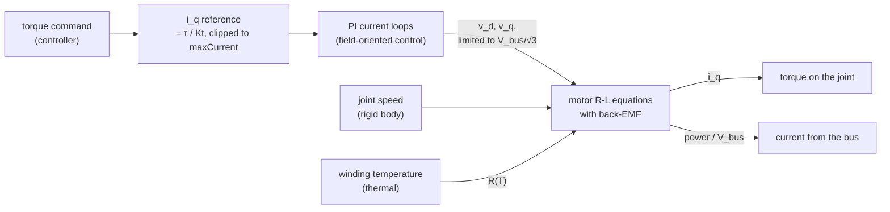

# Motors

Each `ElectricalMotorAPI_1` prim is a motor and its drive. The electrical domain runs them every
50–100 µs (the profile's `electrical.dt`): it turns the torque the controller asks for into
currents, limited by the bus voltage and the current limit, and gives back the torque the motor
actually makes and the current it draws from the bus.

## The equations

A brushless motor (`elec:motorType: bldc` or `pmsm`) is modelled in the dq frame, with $p$ the
pole pairs, $\omega_e = p\,N\,\omega_{joint}$ the electrical speed and $\lambda$ the magnet's flux
linkage:

$$
\begin{aligned}
v_d &= R\,i_d + L_d\,\frac{di_d}{dt} - \omega_e L_q\,i_q \\
v_q &= R\,i_q + L_q\,\frac{di_q}{dt} + \omega_e\,(L_d\,i_d + \lambda) \\
\tau &= 1.5\,p\,\big(\lambda\,i_q + (L_d - L_q)\,i_d\,i_q\big)
\end{aligned}
$$

The torque constant in the schema is the peak-amplitude one, $K_t = 1.5\,p\,\lambda$. A brushed
motor (`dc_brushed`) is the same with one axis: $v = R\,i + L\,di/dt + K_e\,\omega$.

**The drive.** The current loops are PI controllers tuned the way a drive is tuned:
$K_p = L\,\omega_c$ and $K_i = R\,\omega_c$, a first-order loop of bandwidth $\omega_c$. The
voltage they ask for is limited to $V_{bus}/\sqrt3$ (space-vector modulation). When it hits
that limit the integrators hold, which is how top speed and the loss of torque at high speed
come out.

**The bus current** follows from power balance through the inverter:
$i_{bus} = 1.5\,(v_d i_d + v_q i_q) / (\eta_{inv} V_{bus})$.

**Heating.** The winding resistance follows its temperature,
$R = R_{ref}\,(1 + \alpha\,(T - T_{ref}))$, when the thermal domain runs.

## Solving it

Each axis's R-L equation is solved exactly over the step for the voltage held across it. The
q-axis current and the rotor speed are solved together as one linear system, with the back-EMF
implicit. That keeps small, fast drone motors stable at 50 µs, where a simple explicit step
would blow up.

## How far to trust it

| Check | Result | Test |
|---|---|---|
| DC motor no-load speed, stall current, torque-speed line | within 0.5 % of the closed form | `BrushedDcTorqueSpeedLineMatchesTheClosedForm` |
| Motor coupled to a rotor inertia, against a 1 µs solution | within 2 % RMS for inertias from 6e-7 to 1e-2 kg·m², and the quadcopter's drive at 50 µs | `test_coupling` |
| Against a measured motor (bench data) | **owed**: no recording yet | — |

Not modelled: field weakening, PWM switching ripple (the model is averaged), cogging torque,
and iron losses beyond a simple term. The Holybro sample's resistance and inductance are
illustrative, not measured on its 2216 KV920 motors.

The full model and its signals are in [electrical.md](../design/domains/electrical.md) §2.
