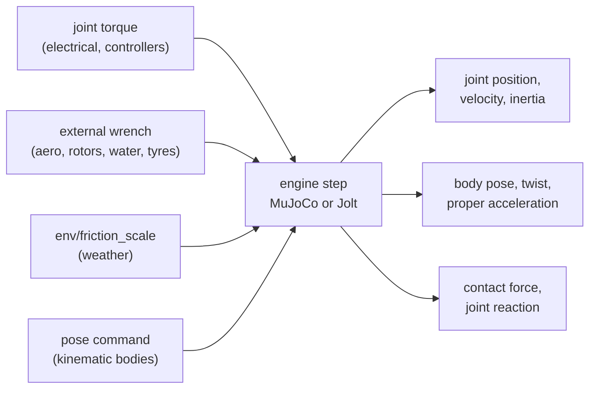

# Rigid body

The rigid-body domain moves every body and joint: links, wheels, loose boxes in a world. It is
not a solver of our own. Lagrange hands the robot and the scenery to a physics engine, MuJoCo
(the default and the deterministic CPU reference) or Jolt (`--physics jolt`, or a profile's
`rigid_body: {backend: jolt}`), steps it every 1 ms (the profile's `rigid_body.dt`, from 0.1 to
10 ms) and reads back the poses, speeds and forces as signals.

## The equations

Both engines solve the same model: rigid bodies in reduced (joint) coordinates, with the
equations of motion

$$
M(q)\,\ddot q + c(q, \dot q) = \tau + J^T f_c
$$

where $M$ is the joint-space inertia (the motors' reflected rotor inertia added on its diagonal
as *armature*), $c$ gravity and the Coriolis terms, $\tau$ the joint torques from the bus and
$f_c$ the contact and limit forces.

**Contacts and friction.** Contacts are between convex shapes (boxes, spheres, cylinders,
capsules, convex hulls) and height fields. Friction is Coulomb's: a contact holds while the
tangential force stays inside $|f_t| \le \mu\,f_n$ and slides at that limit otherwise. MuJoCo uses
its elliptic friction cone, because the pyramidal one slips about 1.5° before the Coulomb angle.
Where two bodies meet, the larger friction of the two is used, on both engines. The weather
scales every friction by `env/friction_scale` (wet ground, snow, ice). A collider with no
friction stays frictionless.

**Joint damping and dry friction.** A URDF `<dynamics damping friction>` (an SDFormat axis's
`damping` and `friction`, MJCF's `damping` and `frictionloss`) adds to a joint

$$
\tau_{joint} = \tau - d\,\dot q - f\,\mathrm{sign}(\dot q)
$$

with the dry part holding the joint still while $|\tau| < f$. Under a constant effort the joint
speed follows $\dot q(t) = \tfrac{\tau}{d}\,(1 - e^{-d t / I})$.

**Mimic joints.** A `<mimic joint multiplier offset>` joint follows $q = m\,q_{leader} + o$ and
takes no commands of its own. MuJoCo couples the two both ways (a joint equality); Jolt moves
only the copy, by a stiff motor (100 Hz) on it.

**Mesh colliders.** A collision mesh collides as the convex hull of its vertices (at most 256
points), convex to within a millionth of its size: points that close to a face count as on it,
so a nearly flat side (a CoACD part whose corner is a hair off) closes as one side. A mesh that fills less than 60 % of its hull is called concave and noted, and on a
fixed link it is skipped, since its hull would block what is inside it; `collision_bake` or
`lagrange bake` splits such a mesh into convex parts with CoACD.

**Kinematic bodies.** Traffic agents and people are kinematic: they go exactly where their
`body/<b>/pose_command` puts them (MuJoCo mocap bodies, Jolt kinematic bodies), push what they
touch, and nothing pushes them back.

**Contact force and joint reaction.** `body/<b>/contact_force` (N, world frame) is the sum of
what touches a moving body pushes it with. `joint/<j>/reaction` (a wrench in the world frame) is
what the parent does to the child at the joint, the motor included: what a force-torque sensor
there would read. MuJoCo gives both from its contact and constraint forces. Jolt gives no contact
impulses per step, so there the contact force comes from Newton's second law on each group of
bodies, $F_c = m\,\Delta v/\Delta t - m\,g - F_{ext} - F_{joints}$, and the joint reaction from
the joint constraint's impulses over the step.

**Gravity at run time.** `lagrange set gravity=1.62` (or the site's `gravity`) changes the
engine's gravity between steps; time and speeds carry on.

## Solving it

MuJoCo steps with its `implicitfast` integrator, which stays stable with joint damping. Jolt
applies joint damping explicitly, limited to what one step can take without turning the joint
round. Bodies of one kinematic tree do not collide with each other; separate trees do. The
engines' own substeps are internal and do not show to the scheduler. Jolt holds joints as
constraints between free bodies, which loses a little energy every step: a pendulum swinging
freely from 1 rad loses 16 % of its energy in 60 s at 1 ms, where MuJoCo keeps it within
0.1 %. A profile's `rigid_body: {substeps: N}` divides Jolt's step N times. That brings the loss
to 9 % at 2 sub-steps and 5 % at 4, at N times the cost
([rigid_body.md §8.1](../design/domains/rigid_body.md)). A run on MuJoCo is
bit-for-bit repeatable: two runs with the same seed give the same state hash, and a saved state
restored runs on bit-identically (Jolt passes the same check).

## How far to trust it

| Check | Result | Test |
|---|---|---|
| Free fall, pendulum, double pendulum energy | drift under 0.1 % over 10 s at 1 ms | `FreeFall.*`, `Pendulum.EnergyDriftAndLargeAnglePeriod`, `DoublePendulum.Rk4EnergyDrift` |
| Block on an incline | slips at the Coulomb angle within 1° | `Incline.EllipticConeSlipsAtTheCoulombAngle` |
| Joint-space inertia of a two-link arm | within 1e-9 of the analytic matrix | `Inertia.TwoLinkArmMatchesTheAnalyticMatrix` |
| Joint damping and dry friction | speed under a constant effort within 0.03 rad/s of the closed form, held below the friction, on MuJoCo and Jolt | `JointDynamics.DampingAndFrictionMatchTheClosedForm` |
| Mimic joint | $2\,q + 0.1$ within 0.02 rad, commands refused | `JointDynamics.AMimicJointCopiesItsLeaderAndTakesNoCommands` |
| MuJoCo against Jolt | arm joint-space inertia and fall within 2 %; the sample AMR within 0.02 m/s and 0.02 rad/s | `Backends.*` |
| Conformance suite (free fall, resting box, pendulum period 0.5 %, slope, stack, AMR loop, determinism) | MuJoCo, Jolt and Jolt as a plugin pass | `lagrange_physics_conformance` |
| Pendulum from 1 rad over 60 s at 1 ms | period within 0.25 % of the exact elliptic-integral period (MuJoCo −0.2 ppm, Jolt −0.15 % as its swing shrinks); energy MuJoCo −0.07 %, **Jolt −16.4 %** (−5.3 % with 4 sub-steps) | `Conformance.APendulumKeepsItsPeriodAndEnergy`, `Jolt.APendulumLosesEnergyAsJointsAsConstraintsDoAndSubstepsDivideIt` |
| Contact force and joint reaction | a box at rest held up by its weight within 0.5 %; a swinging pivot carries $m g + m d \omega^2$ within 1 % (11.349 N MuJoCo, 11.348 N Jolt) | `lagrange_physics_conformance`, `test_contact_forces_on_a_robot_at_rest_carry_its_weight`, `test_a_joints_reaction_is_what_it_carries` |
| Gravity changed while falling | the speed gained follows the new value within 0.05 m/s | `Site.GravityChangesWhileFalling` |
| Pushing a block, against 2000 measured pushes (Yu et al. 2016) | MuJoCo within 6 mm and 4–7° of the quasi-static theory, 3–41 mm and 10–17° from the measurements; **Jolt does not turn the block** (2° against about 75°) | `Conformance.APushedBlockMovesAsTheMcubeMeasurements` |
| Against a real robot's odometry | **owed**: no recording yet | — |

On Jolt the sample AMR's drive wheels slip while the drive ramps up (wheels and casters share the
load indeterminately), about 0.4 m behind MuJoCo after 6 s. Jolt keeps sliding friction and
friction about the contact normal on separate budgets, so a sliding block still resists turning
at full strength: use MuJoCo for pushing and manipulation.

Not modelled: soft bodies, cloth and fluids, and PhysX (not built). Jolt's contact force on a group of bodies fixed together goes
to the group's root body.

The full model, its signals, substitutes and the backend contract are in
[rigid_body.md](../design/domains/rigid_body.md).
