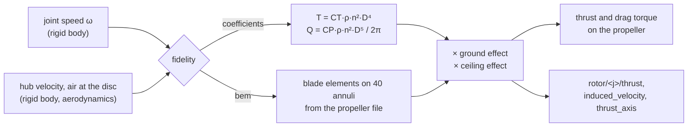

# Rotors

Each joint with `RotorAPI_1` is a propeller. Every 1 ms the rotor domain (`lagrange_rotor_aero`)
reads the joint's speed and the hub's motion, works out its thrust and its drag torque, and
puts them on the body and the joint. Its fidelity is set by the profile's
`rotor_aero.fidelity`: `coefficients` or `bem`.



## Coefficients

With $n$ the speed in revolutions per second, $D$ the diameter, $\rho$ the air density and
$C_T$, $C_P$ the rotor's `aero:rotor:thrustCoeff` and `powerCoeff`:

$$
T = C_T\,\rho\,n^2 D^4, \qquad Q = \frac{C_P\,\rho\,n^2 D^5}{2\pi}
$$

The thrust points along the joint axis when the rotor turns its own way
(`aero:rotor:direction`). The drag torque always opposes the rotation, which is what yaws a
multirotor when its cw and ccw rotors turn at different speeds. The air applies it to the
propeller alone; the motor drives the propeller against it, and the motor's reaction on the
frame is what turns the drone.

$\rho$ is the site's air density (`--air-density`), or with the weather running its own, from
the temperature, pressure and humidity, read every step: on a hot day at altitude the rotors
turn faster for the same thrust ($\omega \propto \rho^{-1/2}$), and draw more power. The
built-in controller follows the same density. Rain pushes the frame down a few millinewtons
([aerodynamics.md §3.1](../design/domains/aerodynamics.md)).

These are static coefficients: thrust doesn't change with climb, descent or forward speed. A
profile's `rotor_aero.inflow_time_constant` (s) can make the thrust follow its target with a
first-order lag. The induced velocity that the downwash uses comes from momentum theory,
$v_i = \sqrt{T / (2\rho A)}$.

The Holybro sample uses $C_T = 0.125$ and $C_P = 0.0507$, the UIUC database's static values for
an APC 10x4.7 SF.

## Blade-element momentum (`bem`)

The propeller file (`aero:rotor:propeller`, [formats.md](../design/formats.md) §3.3.1) gives
the blade's chord and twist along the radius, its section lift and drag, its blade count and
its hand. For each of 40 annuli, the solver finds the induced velocity $w$ at which the blade
elements' force equals the momentum given to the air through that ring:

$$
dT = 4\pi r\,\rho\,F\,|V + w|\,w\,dr
$$

$F$ is Prandtl's tip-loss factor and $V$ the axial speed of the air arriving at the disc. The
swirl gives the torque the same way. So thrust now changes with what the air does:

- **Climbing:** air arrives from above, the blades see a smaller angle, and thrust drops at the
  same speed.
- **Forward flight and wind:** the advancing blade sees more air than the retreating one. This
  gives translational lift, an in-plane H-force and a hub moment, averaged over 12 blade
  positions.
- **Vortex ring state:** when the rotor sinks into its own wake, momentum theory has no
  solution. Between $0 < V_d/v_h < 2$ each annulus takes NeuroBEM's empirical fit (Bauersfeld
  et al. 2021, eqs. 18–19):
  $\tilde v / v_h = 1 + 1.125x - 1.372x^2 + 1.718x^3 - 0.655x^4$, with $x = V_d / v_h$.
- **Wrong way round:** sections are defined over the full circle of angles, so a propeller on
  backwards or spun the wrong way gives little thrust for much power, as a real one does.

The propeller is solved once at load over every inflow angle, about 1 s per propeller, and each
step only looks values up. So `bem` costs little more than `coefficients` while running.

The details are in [aerodynamics.md](../design/domains/aerodynamics.md) §2.1.

## Ground and ceiling effect

Both fidelities apply these when the profile has `ground_effect: true`.

**Ground effect** (Cheeseman and Bennett, 1955), with $z$ the hub's height above the ground
plane and $R$ the radius:

$$
\frac{T}{T_\infty} = \frac{1}{1 - \left(\dfrac{R}{4z}\right)^2}, \qquad z \ge 0.5\,R
$$

It is +33 % at half a radius (the clamp), +6.7 % at one radius and +1.6 % at two.

**Over water** (`WaterAPI_1`, `--water`) the same formula takes $z$ to the water's surface
under the hub, not to the ground under the water: a rotor 0.2 m over a pond 1 m deep feels the
pond's surface, as Cheeseman and Bennett's image vortex sits under the first surface the wake
meets. When the water's own surface moves (the downwash's dimple, water.md "The surface under a
rotor"), its height under the hub counts; the dimple is millimetres, so it changes the factor
by well under 0.1 %. The profile's `aerodynamics.downwash_water: false` puts the ground effect
back on the ground plane only.

**Ceiling effect** (Hsiao and Chirarattananon 2019): a ray up each rotor's axis finds the
nearest fixed box of the scenery at distance $d$. With $\delta = R/d$ and $\alpha_0 = 1.6$:

$$
\gamma = \tfrac12 + \tfrac12\sqrt{1 + \alpha_0\,\delta^2/8}, \qquad
\frac{T}{T_\infty} = \gamma^{2/3}
$$

That's +11 % at half a radius, +3 % at one and under 1 % beyond two. It is left out beyond
6 R. $\alpha_0$ was fitted for a 23 mm propeller, so it is unchecked for larger ones.

## In water: marine thrusters

A rotor whose hub is in a body of water (`WaterAPI_1`) is a thruster. Its thrust and torque take
the water's density (`water:density`, a site parameter) over the share of its disc under the
surface. That share is the circular segment below the surface. The disc reaches `R·sin(tilt)` up
and down from the hub, so a level disc (a vertical axis) is in or out whole. A disc half out of
the water gets the mean of the two densities over its halves. Its ground effect is left out while
any of it is wet.

Marine propellers are described by their open-water chart: `K_T(J)` and `K_Q(J)` at the advance
ratio `J = V_a/(n·D)`, with `V_a` the hub's speed through the fluid along the thrust:

```
T = K_T(J)·ρ·n²·D⁴      Q = K_Q(J)·ρ·n²·D⁵
```

`aero:rotor:advanceRatios`, `thrustCoeffs` and `torqueCoeffs` give that chart, linear between
points and held at its ends. It replaces the static `CT` and `CP` (at `J = 0`, `K_T = CT` and
`K_Q = CP/2π`). It works in air too, for a propeller's own `CT(J)`. A rotor with a chart writes
`rotor/<j>/advance_ratio`, and every rotor in a world with water writes `rotor/<j>/immersion`
(0 to 1). The `bem` fidelity takes the water's density too, but its section polars are for air
Reynolds numbers.

Checked in `test_rotor_aero`:

| Check | Reference | Result |
|---|---|---|
| Thrust and torque on a chart at J = 0, 0.2, 0.6, 1.2 | `K_T(J)·ρ·n²·D⁴`, `K_Q(J)·ρ·n²·D⁵` | within 1e-9 |
| The wetted share at depths of −R, −R/2 … R | the circular segment `½ + (asin s + s√(1 − s²))/π` | within 1e-12 (0.8045 at R/2) |
| A level disc 1.5 m under sea water (1025 kg/m³) | the air thrust times 1025/1.225 | within 1e-9 |
| An upright disc with its hub at the surface | half the disc in water | immersion 0.5, the mean density |
| Moving at J = 0.6 through fresh water | the chart's `K_T`, `K_Q` there | within 1e-9 |

What it leaves out: ventilation and air drawn down into a thruster near the surface (a real one
loses much more than its dry share), the duct of a ducted thruster and the hull's wake (`V_a` is
the hub's own speed, with no wake fraction or water current), four-quadrant charts (turned
backwards the same chart stands in, mirrored), cavitation, and the propeller's drag when it is
stopped. A thruster's motor has to turn it against water: the electrical domain's motor takes the
torque, as in air. The charts in the tests are illustrative, of a Wageningen B-series' shape;
TODO(verify): a published open-water chart of a real thruster for a sample.

## A damaged blade

When a blade strikes a branch (ground.md, "Branches"), or a plugin writes it, `rotor/<j>/damage`
is the share of one blade's length lost from its tip. The rotor then keeps
$1 - (1-(1-d)^3)/B$ of its thrust and $1 - (1-(1-d)^4)/B$ of its torque (blade elements: the
tip carries the most), and its link takes the lost piece's imbalance, $F = m_{lost}\, r_{cg}\,
\omega^2$, turning with the rotor, with the smaller thrust and drag asymmetries. The frame and its
IMU shake at the rotor's speed of rotation, and the controller spins that rotor faster to make up
the thrust. The blade's mass is a folding propeller's `blade_mass`, or scaled from a 10-inch APC
propeller's 11.9 g. Details, sources and checks:
[rotor_aero.md §10](../design/domains/rotor_aero.md).

## How far to trust it

| Check | Result | Test |
|---|---|---|
| `bem` against NACA Report 640's measured propeller | CT within 2–7 %, CP within 0–7 % over the attached-flow range | `NacaReport640.*` in `test_bem` |
| `bem` against ideal momentum theory | within 3–4 % | `Bem.IdealRotorMeetsMomentumTheory` |
| Vortex ring state | NeuroBEM's fit exactly; thrust joins hover's within 0.1 % | `Bem.TheVortexRing*` |
| Against measured quadrotor flights (NeuroBEM, 13 held-out segments) | `coefficients` 1.46 N RMS (their own fit 1.49 N); `bem` 1.12 N (their BEM 0.98 N) | `tools/validation/neurobem.sh` |
| Ground effect | equals Cheeseman–Bennett for z/R from 0.5 to 3; **not yet compared with measurements** | `test_rotor_aero` |
| Ground effect over water | Cheeseman–Bennett with z to the water's surface, the ground under it ignored; **no measurement over water** (a moving surface may give less than a rigid one) | `RotorAero.OverWaterTheGroundEffectIsTakenFromItsSurface` |
| Static thrust against published propeller data | **owed** | — |

What isn't modelled: a rough or breaking water surface's weaker ground effect (the formula is
for a rigid plane), spray or water drawn into the rotor (only its impact on the airframe, in
downwash.md "Over water"), wake skew inside the disc (the fore-aft inflow gradient in forward flight),
blade flapping of rigid propellers beyond the hub moment, stall delay on rotating blades, and
Reynolds-number effects beyond what the section data cover.
