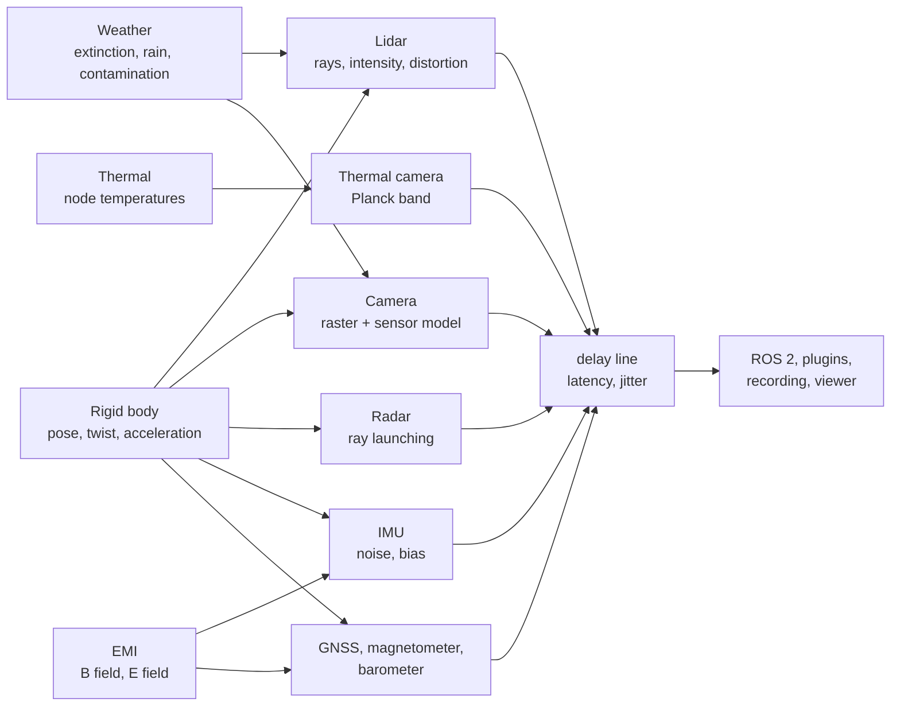

# Sensors

Each `SensorAPI_1` prim is a sensor. The sensors domain (`lagrange_sensors`) reads the bodies'
poses and motion, the weather's `env/*` signals and the EMI fields, and writes what a real sensor
would report: ranges and intensities, images, detections, specific force, a fix. The ROS 2 bridge
publishes them; plugins, recordings, Python and the viewer read the same signals.

Every sensor also has the `ground_truth` substitute: no rendering, exact values with the right
timing (`--domain sensors=off`, or `sensors: {enabled: false, substitute: ground_truth}`).

## Lidar

**Rays.** A lidar is rings of columns (SDFormat's horizontal and vertical samples). Each beam is
one ray, and its range is the first hit, with range noise (Philox, keyed by the module name) and
the minimum and maximum range applied after the cast.

- **Tier 0** casts on the CPU with exact closed-form tests in double. Embree's bounding-volume
  hierarchy only skips shapes a ray cannot reach, so the result is bit-identical to testing every
  shape, and the run stays deterministic. `--lidar auto` uses it.
- **Tier 1** (`--lidar gpu`) casts the same tests in float on the GPU
  (`gpu/kernels/lidar/bvh_traverse.slang`), one thread per beam. Shapes are taken relative to the
  sensor in double before the conversion, so grazing and distant rays keep their precision. It is
  declared not deterministic.

**Intensity.** Each beam's intensity is the reflected power relative to a white wall head-on at
1 m, capped at 1:

$$
I = \rho\,\big((1-s)\cos\theta + s\,\mathrm{lobe}(\theta)\big)\left(\frac{1\ \mathrm{m}}{r}\right)^2
$$

with $\rho$ the reflectivity at the lidar's wavelength (905 or 1550 nm), $\theta$ the incidence
angle from the true surface normal, $s$ the specular fraction and $\mathrm{lobe}$ a mirror's,
2° wide. A retroreflector gives $100\,\rho\,(1\,\mathrm{m}/r)^2$ at any angle. A surface gives no
return when its power is under what the lidar needs at its range limit for a target of
`max_range_reflectivity` (default 0.1), so water and dark surfaces drop out at a slant or from
far. Materials come from `SensorMaterialAPI_1` (`sensmat:preset`) or a URDF
`<sensor_material preset=.../>`; surfaces without one keep $\rho = 0.5$ and always return.

**Motion distortion.** A rotating lidar fires its columns one after another, so a moving robot's
scan skews. Column $c$ of $n$ fires at the fraction $(c+1)/n$ of the scan, from the sensor's pose
at that moment (linear position, slerp between the last scan's end and this one's). Only the
sensor's own motion counts. `/scan` and `/points` are stamped at the first column, with
`time_increment` and a per-point `time`, so the scan can be undone. On by default
(`sensor:lidar:motionDistortion`).

**Weather.** With the weather running, the lidar's range shrinks by the lidar equation at its
wavelength, solved for the range $r$ at which a reference target still returns:

$$
r\,e^{\sigma r} = R\,(1 - c)
$$

with $\sigma$ the extinction (1/m), $R$ the clear-air maximum range and $c$ the window's
contamination. Fog adds clutter from its backscatter (lidar ratio 18.5 sr, 5 ns pulse) about 2 m
out; rain adds returns from Marshall–Palmer drops of 0.5 mm and more within 2 m of the window
(about 1 % of beams at 2 mm/h, 5 % at 25 mm/h). A NanoVDB fog grid adds its optical depth along
each beam. See [Weather](weather.md).

## Camera

**Raster.** Colour, depth (m along the optical axis) and instance id (scene prim index per pixel)
come from the shared GPU renderer, colour multisampled so a pixel integrates its area. On a GPU
the colour is the viewport's realistic look (sun, sky, materials, season); a software device keeps
a simple shading. The look is drawn by eye, not calibrated; depth and instance are the same either
way.

**Sensor model** (`CameraSensorAPI_1`, each part only when asked for), applied on the CPU after
the render:

- **Lens distortion**, plumb-bob (Brown–Conrady) or equidistant, by remapping a wider pinhole
  render (at most twice the size). `camera_info` carries the coefficients.
- **Vignetting** as a fraction of $\cos^4\theta$.
- **Rolling shutter**: each row from the camera's orientation at its exposure time, the angular
  velocity held over the frame (rotation only).
- **Exposure and noise**, EMVA 1288's linear model: electrons $e = L \cdot k_e \cdot t$ from the
  render's linear value $L$, an electron rate $k_e$ and the exposure time $t$; Poisson shot noise
  and Gaussian read noise; full well, gain and bit depth; then display encoding again. Auto
  exposure aims the mean at 18 % of full scale (`sensor/<n>/exposure_time`).

In fog the camera gets Koschmieder's veil from its depth image,
$L = L_0\,e^{-\sigma d} + L_{air}\,(1 - e^{-\sigma d})$, the sky all air light.

## Thermal camera

A camera with `ThermalCameraAPI_1` draws the same raster frame and reads each pixel's instance id
as a surface of known temperature $T$ and emissivity $\varepsilon$:

- a prim under a `ThermalAPI_1` node is at that node's `thermal/<n>/temperature`;
- a person is at Fanger's mean skin temperature walking slowly, 32.5 °C, emissivity 0.98;
- everything else is at the site's ambient temperature $T_{amb}$;
- where nothing is hit, the clear sky of Swinbank (1963): $T_{sky} = 0.0552\,T_{air}^{1.5}$.

What a surface sends in the camera's band (8–14 µm by default) is

$$
L = \varepsilon\,B(T) + (1-\varepsilon)\,B(T_{amb})
$$

with $B$ Planck's radiance integrated over the band (the exact series of Widger and Woodall
1976). The camera reports the temperature a black body would need to send $L$, as radiometric
cameras do, plus Gaussian noise of `sensor:thermal:netd`. It refuses to start without the site's
temperature.

## Radar

`RadarAPI_1` launches rays at half the azimuth resolution over the field of view. Each echo's
cross-section is Lambertian back-scatter of the body's `sensmat:radarCrossSectionDensity`
$\rho_\sigma$ (0.1 without one):

$$
\sigma = \rho_\sigma\, r^2\, \Delta\Omega\, \cos\theta
$$

Echoes of one object in one range cell make one detection (power-weighted range and angles,
radial velocity from the bodies' twists). The SNR follows the radar equation,
$P_r \propto P_t G^2 \lambda^2 \sigma / \big((4\pi)^3 r^4\big)$, against the effective noise
floor; a fixed threshold stands in for CFAR; range and angle get noise of
resolution$/\sqrt{2\,\mathrm{SNR}}$. At most 64 detections, strongest first; ground hits are
dropped as clutter.

## IMU

Specific force and angular rate at the sensor frame from the body's acceleration and twist, plus,
per channel, the noise terms named after SDFormat's `<noise>` elements: white noise (per sample or
as a density $N$), a turn-on bias, a first-order Gauss–Markov bias instability, rate random walk
$K$, saturation at the range and quantisation. The Allan variance of a static record is then

$$
\sigma^2(\tau) = \frac{N^2}{\tau} + \frac{K^2\,\tau}{3}
$$

(IEEE Std 952), plus the bias instability's plateau. The bias draws from its own random stream and
is saved with the run's state. With EMI, `accel_noise` and `gyro_noise` add to it.

## GNSS, magnetometer, barometer

These place the sensor on the Earth through the world's geo origin (`--geo-origin` or the
profile's `world.geo_origin`); without one they are left out.

- **GNSS**: the antenna's pose through the geo origin to latitude, longitude and ellipsoidal
  height; velocity with the lever arm; white noise per fix.
- **Magnetometer**: the World Magnetic Model 2025 main field at the configured decimal year
  (default 2025.0), rotated into the sensor frame, white noise, plus the EMI domain's
  `emi/<n>/b_field` sampled at the sensor's own rate.
- **Barometer**: the ICAO standard atmosphere (troposphere) at the sensor's ellipsoidal height,
  $p = p_0\,(1 - L h / T_0)^{g M / (R L)}$, white noise.

## Timing: latency and jitter

A sample is taken on the scheduler at $k/\text{rate}$, and its ROS message goes out `latency`
plus jitter later (Gaussian, cut at 3σ, never out of order), still stamped with the sampling
time. The delay line (`sensors::DelayLine`, 1 kHz, so delays round up to the next millisecond)
writes `sensor/<n>/delayed/<q>` and `sensor/<n>/delayed/stamp` for plugins, recordings, Python
and the viewer; `sensor/<n>/<q>` stays on time as ground truth. Each sample's delay is a function
of the run seed, the sensor and the sampling time, so runs and restored checkpoints repeat.

## Computing it

The module runs at the smallest period any sensor needs (1 ms with an IMU) and each sensor fires on
its own schedule within it. Weather effects are applied per beam on the CPU after the cast on every
tier. Radar and the camera model run on the CPU on every tier.

## How far to trust it

| Check | Result | Test |
|---|---|---|
| Lidar geometry, every shape kind | exact closed-form casts; height fields within 1e-9 m | `Raycast.*`, `Lidar.*` in `test_sensors` |
| Tier 0 against every-shape testing | bit-identical | `ShapeCaster.IsBitIdenticalToEveryShapeAgainstEveryRay` |
| Tier 1 against Tier 0, 100 000 beams in 400 shapes | same shape for every beam; worst range error 0.16 mm (Iris Xe), 0.31 mm (llvmpipe) | `LidarTiers.RandomScenesAgreeWithTheCpuReference` |
| Lidar intensity formula | matches its closed form (Lambertian, water, retroreflector) | `test_lidar_materials` |
| Lidar intensity against a real lidar | **owed**: no measurement | — |
| Motion distortion | can be turned off; a restored run sweeps the same | `test_lidar_motion` |
| Lidar range in weather | solves the lidar equation | `LidarWeather.DetectionRangeSolvesTheLidarEquation` |
| Lidar in fog and rain against chamber data | **owed** (DENSE); fog clutter is uncalibrated | — |
| Camera projection | 0.066 px mean; calibration RMS 0.07 px (< 0.1 px) | `Raster.CheckerboardCornersLieWhereThePinholeModelPutsThem` |
| Lens, vignetting, rolling shutter, exposure | OpenCV's lens formulas and their inverse, cos⁴θ, skew under a pan, auto exposure | `test_camera_model` |
| Camera noise | photon-transfer variance within 3 % | `Noise.FollowsThePhotonTransferCurve` |
| Fog veil | Koschmieder | `CameraWeather.TheVeilIsKoschmieders` |
| Thermal radiometry | black-body fractions within 1e-5 of Incropera Table 12.1; band radiance within 1e-9 of Planck's integral; Swinbank's sky | `test_thermal_camera` |
| Radar | plate cross-section σ = ρ·A within 3 %; 10 m/s Doppler; detection range from the radar equation | `test_radar` |
| IMU noise | Allan deviation of a 4-hour static record within 1 % up to τ = 100 s, 4.3 % at 1000 s | `ImuNoise.AllanDeviationOfAStaticRecordMatchesTheDensityAndRandomWalk` |
| GNSS position | exact against `GeoOrigin` | `GeoSensors.GnssPlacesTheAntennaThroughTheGeoOrigin` |
| GNSS error statistics | **owed** | — |
| Magnetometer | NOAA's 100 WMM 2025 test points within 0.001 nT (worst 7e-4 nT) | `Wmm.MatchesNoaaTestValues` |
| Barometer | ICAO table values | `GeoSensors.TheBarometerFollowsTheIcaoStandardAtmosphere` |
| Sensor delay | the delayed signal is the scan of then; jitter stays in its bounds and repeats | `SensorDelay.*` |
| Any sensor against a real recording | **owed**: no recordings | — |

Not modelled: lidar beam divergence and multiple returns; camera motion blur, absolute radiance,
colour filter array, translation in the rolling shutter; atmosphere, sun and sky reflection in the
thermal image; radar rain attenuation, multipath and ghosts; IMU scale-factor and misalignment
errors; GNSS outages, multipath and latency; the crustal magnetic field and hard- and soft-iron
effects; the geoid (ellipsoidal height stands for altitude); sampling-instant jitter. The material
presets' reflectivities are illustrative, not measured.

The full models and their signals are in [sensors.md](../design/domains/sensors.md).
