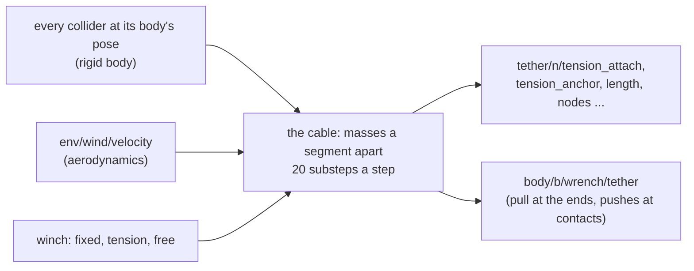

# Tethers

A cable from an anchor to a body (`TetherAPI_1`, RFC 0011), such as a power tether from a ground
station's winch to a drone. `lagrange_tether` runs every 1 ms. The cable sags, swings, goes taut
and drags in the wind. It lies on the ground, catches on edges and stays caught, and wraps and
tangles on itself. It hits the drone and any other body, and pulls on both ends. Each body it
touches or is tied to gets one wrench, `body/<b>/wrench/tether`.



## Using it

On any robot, from an overlay (an overlay's new prims have no pose, so `anchorPoint` places the
station, here in world coordinates):

```yaml
schema_version: 1
apply:
  - create: ground_station
    schemas:
      TetherAPI_1:
        tether:anchorPoint: [1.0, 0.0, 2.8]
        tether:attach: base_link
        tether:attachPoint: [0.0, 0.0, -0.05]
        tether:length: 1.0           # paid out at the start
        tether:maxLength: 20.0       # on the drum
        tether:diameter: 0.004
        tether:linearDensity: 0.0235
        tether:winch: tension
        tether:winchTension: 3.0
```

Or with no file: `lagrange_server ... --tether X,Y,Z,LINK[,LENGTH]` ties LINK to the world point
X,Y,Z, its length the distance plus 10 % unless given. Every attribute and its fallback is in
[formats.md](../design/formats.md) §3.12. The domain is `tether`; `--domain tether=off` (or the
profile's `domains.tether`) is the zero substitute: tensions 0, no cable, no force. Air drag needs
the site's air density (`--air-density`); without it the cable hangs in still air with no drag.

## The equations

**Masses and segments.** The cable is point masses about `segmentLength` apart, each carrying
half of the two segments beside it, $m_i = \mu (\ell_{i-1} + \ell_i) / 2$, with $\mu$ the mass
per metre. The first is held at the anchor, the last at the attach point.

**Extended position-based dynamics with small steps** (Macklin et al. 2019). Each 1 ms step is
split into $n$ substeps of $h$ (default 20). In each, every free mass is predicted under gravity
and drag, $v \leftarrow v + h\,(g + F/m)$, $p = x + h v$. Then each segment's length constraint
$C = |p_k - p_i| - \ell$ is corrected once, forward along the cable and back:

$$
\Delta\lambda = \frac{-C - \tilde\alpha\,\lambda - \gamma\,\nabla C\cdot(p - x)}{(1+\gamma)(w_i + w_k) + \tilde\alpha},
\qquad \tilde\alpha = \frac{\ell}{EA\,h^2},\quad \gamma = \frac{\ell}{EA}\frac{\beta}{h},
$$

where $w$ are the inverse masses and $\beta = 2\zeta\sqrt{k m}$ is the segment's axial damping
($k = EA/\ell$, $\zeta$ the damping ratio). A cable cannot push: $\lambda$ is kept at or below
zero, so a slack segment does nothing. The segment's tension is $T = -\lambda / h^2$. Then come
the bend term (when `bendStiffness` is set, a pinned beam's $48EI/s^3$ across each pair of
segments), the contacts, and the velocities $v = (p - x)/h$.

**Air drag.** Each segment of length $L$ and diameter $d$ is a cylinder in the air moving at
$u$ relative to it, split into $u_n$ across and $u_t$ along:
$F = \tfrac12 \rho\, C_d\, d\, L\, |u_n|\, u_n + \tfrac12 \rho\, \tfrac{C_d}{50}\, d\, L\, |u_t|\, u_t$,
half to each end. The air is the site's wind (ground truth and gusts, from the aerodynamics
domain). The drone's downwash on the cable is not in yet.

**Contacts.** Every mass is a sphere of the cable's radius. Against each collider near the cable
(every shape type, at its body's pose this step) the module finds the signed distance, normal and
nearest surface point:
- **Out.** A mass inside is moved out along the normal. Beyond undoing its own move in that
  substep, it comes out at most 1 m/s, so a cable laid through something is not thrown out of it.
- **Friction.** Coulomb, as a limit on the sliding over the substep (Macklin et al. 2014): within
  μ times the push-out it sticks (`caught`), beyond it slides.
- **Equal and opposite.** On a moving body, the mass's move times its mass over $h^2$ is the
  force on the body at the contact point, so the cable pushes the drone it hits and the drone
  pushes back.
- **Itself.** Segments that are not neighbours keep a diameter apart (closest points of two
  capsules). That is how it wraps and knots.

Within 0.5 m of either end the cable does not touch the robot that end is tied to, nor a shape
that holds the end, because it starts inside them (the drone's hull around its attach point).
Moving bodies are met first and scenery last, and a body feels only how far a mass ends up moved
away from it: a cable squeezed between a skid and the ground carries nothing between them.

**Laying it out.** On its first step each cable is laid between its ends where the bodies are
then, in a sag of its length in the vertical plane through them. Where that sag goes through the
ground or a box, it comes out at 1 m/s and pulls nothing meanwhile.

**The pull on each end.** The end segment's tension along it, plus the weight and drag of the
half segment the end carries, at the attach point; with the contact pushes, the body's wrench.

**The winch.** It pays cable out at the anchor or reels it in, at most `winchSpeed`. A new mass
appears on the first segment each time it grows past 1.5 segments, and one goes back on the drum
below 0.5. `tension` holds `winchTension` at the anchor (proportional and integral on the
anchor's tension, filtered over 50 ms). `free` pays out whatever pulls over 0.2 N and reels
nothing in. `fixed` holds the length. Paying out stops at `maxLength`.

## What it writes

| Signal | Unit | |
|---|---|---|
| `tether/<n>/tension_attach`, `tension_anchor` | N | at each end |
| `tether/<n>/length` | m | paid out |
| `tether/<n>/winch_speed` | m/s | positive paying out |
| `tether/<n>/contacts` | | masses touching anything this step |
| `tether/<n>/caught` | | held somewhere by static friction |
| `tether/<n>/nodes` | m | x, y, z of each mass, world; unused entries NaN |
| `body/<b>/wrench/tether` | N, N·m | for each body it is tied to or touches |

## Seeing it

The viewer draws every cable as an object in the viewport, always: its centre line and four lines
at its radius, a dark rubber colour, depth-tested like the meshes. The server sends each cable in
every scene delta (`Overlay` `KIND_CABLE`: radius, then the points), so a viewer that predates it
connects and shows no cable.

## How far to trust it

| Check | Against | Result | Test |
|---|---|---|---|
| A 12 m cable hung over 10 m | the catenary | sag 0.03 %, end tension 0.5 % | `Cable.HangsAsACatenary` |
| A taut string plucked | its fundamental, $\sqrt{T/\mu}/2L$ | 0.3 % | `Cable.ATautStringRingsAtItsFundamental` |
| Sliding over a fixed drum, μ 0.3, half a turn | the capstan equation, $e^{\mu\theta}$ | 0.35 % | `Cable.SlidesOverACylinderAsTheCapstanEquationSays` |
| Draped over a body's box | the weight held by the box and both ends | 0.7 % | `Cable.PushesABodyAsMuchAsTheBodyHoldsItUp` |
| 6 m piled on the ground | no segment within a diameter of another, none in the ground | holds | `Cable.PilesUpWithoutPassingThroughItself` |
| A tension winch, drone climbing | its set point, on average | 2.00 N of 2.00 | `Cable.ATensionWinchHoldsItsTension` |
| The sample quad hovering on 3 m of tether | the weight held by the station and the drone | 0.2 % | `TetherRun.AQuadcopterHoversOnItsTether` |
| Laid out 1.6 m into the ground | comes out at 1 m/s, pulling nothing | 1.00 m/s, 0 N | `Cable.LaidThroughTheGroundItComesOutSlowly` |

**Limits.**
- Twist and bending stiffness beyond the light bend term are not modelled: the model is for limp
  cables.
- Turns of the cable do not rub on each other (no friction between them).
- Two tethers do not touch each other.
- A convex hull's distance near an edge is its farthest face plane's.
- A nearly straight tether is stiff along itself, so each payout of a tension winch sends a pulse
  of tension along it; the mean holds the set point, a single step may not.
- No breaking, and no conductor heating yet (`tether:resistancePerLength` is read but not used).
