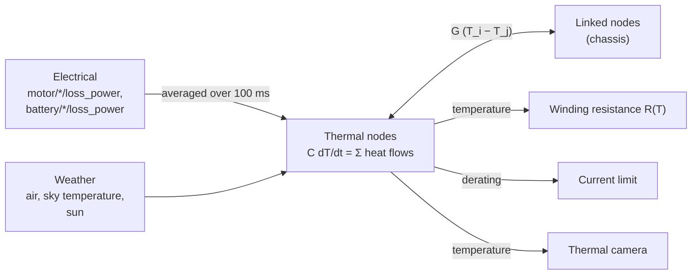

# Thermal

Each `ThermalAPI_1` prim is a lumped thermal node: one temperature for a motor, a battery, a
chassis. The thermal domain (`lagrange_thermal`, every 100 ms) heats the nodes with the
electrical losses, lets heat flow between them through `ThermalLinkAPI_1` links, and cools them
to the air and the sky. The electrical network reads back each node's temperature (winding
resistance) and its derating (current limit).

It runs when the robot has thermal prims **and** the site's ambient temperature is given
(`--ambient-temperature K` or the profile's `thermal.ambient_temperature`); there is no default.
The `ambient` substitute holds every node at the ambient temperature with no derating.

## The equations

Each node $i$ of heat capacity $C_i$ (J/K) obeys

$$
C_i\,\frac{dT_i}{dt} = P_i + \sum_j G_{ij}\,(T_j - T_i) - h_i A_i\,(T_i - T_{air}) - \varepsilon_i\,\sigma A_i\,(T_i^4 - T_{sky}^4) + \alpha_i A_{sun,i}\,G_{sun}
$$

- $P_i$, the internal source: every `<class>/<node>/loss_power` signal on the node's prim (the losses of
  the motors and the battery the electrical network computes), averaged over the thermal step, so a 100 ms step sees the
  mean of the electrical network's 100 µs losses.
- $G_{ij}$, the conductance of each `ThermalLinkAPI_1` link (W/K).
- Convection to the air, $h A (T - T_{air})$.
- Radiation to the sky, with $\sigma = 5.670374419\times10^{-8}\ \mathrm{W\,m^{-2}K^{-4}}$
  (CODATA 2018).
- The sun, $\alpha A_{sun} G_{sun}$, from `env/solar_irradiance` (0 when the weather does not give
  it).

$T_{air}$ and $T_{sky}$ are the weather's `env/air_temperature` and `env/sky_temperature`, and the
ambient temperature without it.

**Derating.** A node with `thermal:deratingStart` $T_1$ and `thermal:maxTemperature` $T_2$ gives

$$
d = \mathrm{clamp}\!\left(\frac{T_2 - T}{T_2 - T_1},\ 0,\ 1\right)
$$

which scales the motor's current limit; at $T \ge T_2$ the node's `overtemp` flag is raised.
**Heating the winding** raises its resistance, $R = R_{ref}\,(1 + \alpha\,(T - T_{ref}))$
([Motors](motors.md)).

## Solving it

Backward Euler on the network, linearised each step (radiation around the current temperature),
solved as one small linear system. It is unconditionally stable, so a 100 ms step is safe even for
small nodes. `heat_flow_out` is each node's convection and radiation computed with the same
linearisation, so the energy balances exactly.

## How far to trust it

| Check | Result | Test |
|---|---|---|
| A single node cooling | the closed-form exponential within 0.1 % | `LumpedNetwork.ASingleNodeCoolsExponentially` |
| Two linked nodes after a step | the closed-form two-pole response within 0.5 % | `LumpedNetwork.TwoNodesFollowTheTwoPoleStepResponse` |
| A sunlit plate | its radiative equilibrium within 0.5 K | `LumpedNetwork.ASunlitPlateReachesItsRadiativeEquilibrium` |
| Energy | stored energy and flows balance every step to 1e-9 | `LumpedNetwork.EnergyIsConserved` |
| Derating | falls linearly between its limits | `Derating.FallsLinearlyBetweenItsLimits` |
| A motor linked to the chassis | heats from its loss and derates; the closed-form steady state | `ThermalNetwork.TheMotorHeatsFromItsLossAndDerates` |
| The slow exchange with the electrical network | benign | `ThermalElectricalCoupling.TheSlowExchangeIsBenign` |
| Against a measured motor heat run, within 3 K at steady state | **owed**: no published or recorded heat run yet | — |

Not modelled: forced convection from airspeed (the convection coefficient does not rise with the
air moving past), the sun's direction (the sun-facing area is taken as facing it), temperature
gradients inside a node.

The full model and its signals are in [thermal.md](../design/domains/thermal.md).
