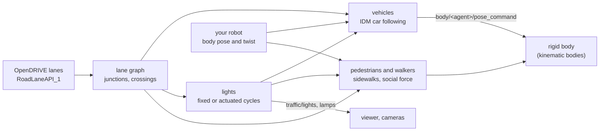

# Traffic: cars, lights, crossings and scenarios

On a world with road lanes (`RoadLaneAPI_1`, from OpenDRIVE), the traffic domain adds other road
users round your robot: cars that follow their lanes, traffic lights, people on the sidewalks and,
in the town, crossings with buttons. They are moved, not simulated: each agent is a kinematic body
with a collider, so sensors see it and your robot can touch it and be pushed by it, but nothing
pushes an agent. The domain runs every 10 ms on the CPU, on every tier. An OpenSCENARIO file can
take its place and drive scripted entities instead.

## The equations

**Car following** is the Intelligent Driver Model (Treiber, Hennecke and Helbing 2000). A car at
speed $v$, with free-road speed $v_0$ (the lane's speed limit), a gap $s$ to the car or robot ahead
and an approach speed $\Delta v = v - v_{leader}$, accelerates at

$$
\dot v = a\left[1 - \left(\frac{v}{v_0}\right)^4 - \left(\frac{s^*}{s}\right)^2\right],
\qquad
s^* = s_0 + \max\!\Big(0,\; vT + \frac{v\,\Delta v}{2\sqrt{ab}}\Big)
$$

with $a = 1.5$ m/s² (maximum acceleration), $b = 2$ m/s² (comfortable braking), $s_0 = 2$ m (jam
distance) and $T = 1.5$ s (time headway). On a free road the gap term is left out.

**Lane changes**, on roads with several lanes each way: a car held up within 40 m moves over when
that gives it at least 10 m more room and asks no more than 3 m/s² of braking of itself or of the
car behind it in the new lane (the safety criterion of MOBIL, Kesting, Treiber and Helbing 2007),
and not within 30 m of either end of the lane.

**Junctions.** Cars stop on red and yellow, and wait while a crossing or merging lane is taken or a
car nearer its line is about to take one: first come, first served, no priority rules. They stop
for anyone on a crossing ahead, and do not enter a junction without 9 m free beyond it, which keeps
a road grid out of gridlock. At a lane's end a car takes a seeded random successor.

**Lights.** Approaches facing each other share a group, and groups take turns at 20 s green, 3 s
yellow and 2 s all red (illustrative timings). A junction with crossings is actuated: a button cuts
the green to 8 s; after yellow and all red every car stops for an exclusive walk of 7 s and a
flashing clearance as long as the longest crossing takes at 1.2 m/s, held while the crossing is
not empty (at most 10 s). A lone crossing stays green for cars until someone presses.

**Pedestrians** on sidewalks walk at 1.34 m/s (Weidmann 1993), turn back at a sidewalk's end, and
step aside from each other and from robots by a social force (Helbing and Molnár 1995). For a
person at distance $d$ from another (each of radius $r$), the push across the sidewalk is

$$
f = A\,e^{-(d - 2r)/B}, \qquad A = 2\ \text{m/s}^2,\quad B = 0.3\ \text{m}
$$

taken up as a sideways speed over a relaxation time of 0.5 s and drifting back to the lane's
middle. On a world with crossings (the town), people are walking humans instead
([Humans](humans.md)): 60 % press the button on arrival and the others wait, pressing after 6 s if
nobody has, and they start across only on walk.

## Solving it

Every 10 ms each car's IDM acceleration is integrated along its lane's centre line, and each
person's offset across the sidewalk. Agents are written as `body/<agent>/pose_command`; MuJoCo moves
them as mocap bodies and Jolt as kinematic bodies. Lamps are kinematic bodies without colliders,
in front of their lens when lit and inside the housing when dark, so viewers, cameras and
recordings see the lights with no protocol change. All randomness comes from the run's seed
(`--traffic vehicles=N,pedestrians=M,seed=S`), so the same seed gives the same tracks.

## OpenSCENARIO

`--scenario FILE.xosc` runs a subset of OpenSCENARIO 1.x with Lagrange's own runner: parameters,
vehicle and pedestrian entities, `Init` teleports and speeds, speed actions (step, linear,
sinusoidal or cubic) and lane changes over a time or a distance, and start and stop triggers on
simulation time, position, relative distance, speed and travelled distance. The scenario's
OpenDRIVE is the world unless `--world` is given, its `Ego` is your robot (driven by your own
stack, so actions on it are not applied), and every other entity is a kinematic body
`scenario_<name>` moved along the lanes. `scenario/state` turns 1 when the stop trigger has held.
Anything else in the file is refused by name.

## How far to trust it

| Check | Result | Test |
|---|---|---|
| IDM equilibrium gap and free road | met, against the closed form | `Idm.EquilibriumAndFreeRoad` |
| The light cycle | green, yellow, red in turn | `Lights.TakeTurnsGreenYellowRed` |
| Cars follow, keep their distance and stop on red; no entry on red over three minutes | met on the city block | `CityBlock.VehiclesFollowKeepDistanceAndStopOnRed`, `CityBlock.NoVehicleEntersTheJunctionOnRed` |
| Lane changes without coming too close | met | `CityBlock.VehiclesChangeLanesWithoutComingTooClose` |
| Same seed, same tracks | identical | `CityBlock.TheSameSeedGivesTheSameTracks` |
| The town over four simulated minutes: every light colour, no green straight to red, people on the road only after walk, no car within 0.3 m of a person, no car stopped over 90 s | met | `python/test/test_town.py` |
| The cut-in scenario | lane change at 3.5 s, halfway at 5 s, in lane at 6.6 s, 8 m/s at 7.5 s, ended at 12 s | `CutIn.RunsToItsEndWithEventsWhereTheTriggersSay` |
| Pedestrians' fundamental diagram (speed against density) | **owed** | — |
| Scenario conformance on the ASAM example scenarios, against esmini | **owed** | — |
| Against measured traffic | **owed**: these check the logic, not real roads | — |

Not modelled: priority rules and right-before-left, parallel walk with turning traffic, real
signal timings for a site, SUMO co-simulation, OpenSCENARIO catalogs, routing and trajectory
actions and controllers. Traffic agents and walking humans do not see each other. Vehicle sizes
(sedans, hatchbacks, SUVs, vans, buses) are illustrative.

The full model and its signals are in [traffic.md](../design/domains/traffic.md).
