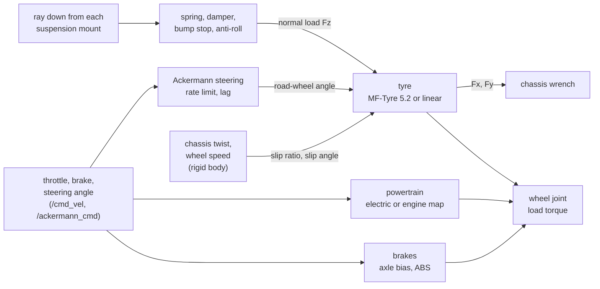

# Vehicles and wheeled bases

A road vehicle (a robot with `VehicleAPI_1` and `WheelAPI_1` prims, like the sample sedan or the
Lexus RX 450h) is a raycast vehicle: the chassis and wheels stay rigid bodies in MuJoCo or Jolt,
and `lagrange_vehicle_dynamics` computes, every 1 ms, what a contact solver models poorly: the
suspension, the tyre forces from slip, the brakes, the steering and the drivetrain. It pushes
the chassis with one wrench and each wheel joint with the tyre's reaction.

## The equations

**Suspension.** A ray down the chassis's up axis from each wheel's mount finds the ground. The
spring, damper and bump stop (10 times the spring rate) act along it:

$$
F_z = k\,(x_0 + x) + c\,\dot x
$$

Each spring is preloaded with its static share of the weight, by where the centre of mass sits
between the axles, so the model's wheel positions are the ride height. An anti-roll bar moves load
across an axle in proportion to the difference in travel. The ground is taken as level at the
contact, since a ray gives no normal.

**Slip.** At the contact, with $v_x$ and $v_y$ the ground speed along and across the wheel's
heading and $\omega R$ the tread's speed, the slip comes from first-order relaxation states of
relaxation length $\sigma$:

$$
\dot u = (\omega R - v_x) - \frac{|v_x|}{\sigma}\,u, \qquad
\dot w = v_y - \frac{|v_x|}{\sigma}\,w, \qquad
\kappa = \frac{u}{\sigma}, \quad \alpha = \frac{w}{\sigma}
$$

so the tyre's force builds up over a rolled distance instead of jumping. Below 3 m/s these states
act as undamped springs, so damping (ratio 0.7) is blended in, fading to none at 3 m/s.

**Tyre forces (`pacejka`, the default).** The Magic Formula of MF-Tyre 5.2, read from a `.tir`
file (`assets/tyres/*.tir`):

$$
F = D\,\sin\!\Big(C\,\arctan\big(B x - E\,(B x - \arctan(B x))\big)\Big)
$$

for the longitudinal force against $\kappa$ and the lateral force against $\alpha$, with the peak
$D$ and the stiffness changing with the load $F_z$ (twice the load gives less than twice the
peak), and the file's combined-slip weighting functions shrinking each force when the tyre both
brakes and corners. The friction is the tyre's × the ground's × `env/friction_scale` (wet roads,
snow). The `linear` model instead takes $F_x = C_\kappa\,\kappa$, $F_y = -C_\alpha\,\alpha$,
scaled back onto the friction ellipse of radius $\mu F_z$.

**Brakes.** The pedal sets a torque per wheel, split between the axles by the brake bias, never
more than stops the wheel within the step (a brake never reverses a wheel). Optional ABS starts
to release at a slip ratio of 0.12 and releases fully 0.08 beyond it.

**Steering.** The bicycle model's angle $\delta$ is turned into each front wheel's Ackermann
angle, so both wheels' axes meet on the rear axle's line:

$$
\tan\delta_{in,out} = \frac{L}{L/\tan\delta \mp y}
$$

with $L$ the wheelbase and $y$ half the track, after a rate limit and a first-order lag of the
actuator. The steering joints follow by a PD at 15 Hz; they are what you see, since the tyre
forces use the computed angles.

**Powertrain.** `electric`: throttle × `vehicle:maxDriveTorque`, split equally between the driven
wheels (an open differential), sent as torque commands to their motors or the electrical
substitute. `ice_map`: a full-throttle torque map over engine speed, a clutch that slips below
idle, an automatic gearbox with shift speeds (at least 0.8 s apart), a final drive and its
efficiency; reverse is first gear backwards.

**The driver.** Without a planner, `/cmd_vel` (speed and turn rate) goes through the car
controller: throttle from a PI on the speed error, brake when too fast, the steering angle from
the turn rate; with no command it drives a demo circle (5 m radius, 3 m/s) round the origin.

## Wheeled robots without a vehicle model

Robots without `VehicleAPI_1` drive on the rigid-body contacts alone, through a built-in
controller that writes wheel torque commands (the electrical domain, or its ideal substitute,
turns them into torque):

- **Differential drive** (the sample AMR): each wheel's target speed is
  $(v \mp \omega\,b/2)/r$ for track $b$ and wheel radius $r$, held by a PI loop with anti-windup.
- **Swerve** (the AMR_FMS sample): each module steers to its wheel's ground velocity
  $(v_x - \omega_z y_i,\; v_y + \omega_z x_i)$, never more than 90° (it steers the other way and
  reverses the wheel), drives only along where the wheel points ($\times\cos$ of the steering
  error), and holds its speed by a PI loop.

## Solving it

The relaxation states are integrated exactly over the step for constant inputs,
$u \leftarrow u\,e^{-r\Delta t} + s\,(1 - e^{-r\Delta t})/r$, and clipped at a locked or spinning
wheel (slip ratio 1.5) and a sideways slide (1.2 rad). The vehicle runs at the physics step,
1 ms, and reads the chassis's pose and twist and the wheel speeds from the step before.

With `--domain vehicle_dynamics=off` the `ideal` substitute takes over: a kinematic bicycle
model, the chassis following the commanded speed and the yaw rate $v\,\tan\delta / L$ exactly
(50 ms tracking), roll and pitch held level. It is for planner tests.

## How far to trust it

| Check | Result | Test |
|---|---|---|
| Magic Formula peak, slope at zero ($BCD$) and asymptote | exact to the formula | `MagicFormula.PeakSlopeAndAsymptote` |
| Pure slip from a `.tir` file, load sensitivity, wet road | peak and slope as the file's coefficients give them; forces oppose the slip | `Pacejka.PureSlipFollowsTheFileAndOpposesTheSlip` |
| Combined slip | braking shrinks the lateral force | `Pacejka.CombinedSlipShrinksEachForce` |
| Ride height and static axle loads | within 1 cm; loads sum to the weight within 1 % | `VehicleDynamics.SettlesAtRideHeightOnItsStaticLoads` |
| Braking distance from 20 m/s | within 5 % of $v^2/(2\mu g)$ (3.2 % long) | `VehicleDynamics.BrakingDistanceIsVSquaredOverTwoMuG` |
| Steady cornering at 15 m/s | yaw rate within 3 % of the linear bicycle model with its understeer gradient (1.4 %) | `VehicleDynamics.SteadyCorneringMatchesTheBicycleModel` |
| Ackermann geometry | both axes meet on the rear axle's line within 1e-9 m | `VehicleDynamics.AckermannTurnsTheInnerWheelMore` |
| Steering rate limit and lag, gear shifts, the ideal substitute | as specified | `VehicleDynamics.SteeringFollowsItsRateLimitThenItsLag`, `AnEngineShiftsUpThroughItsGears`, `TheIdealSubstituteFollowsTheBicycleModel` |
| Swerve base | moves sideways and turns on the spot | `SwerveSimulation.TheBaseMovesSidewaysAndTurnsOnTheSpot` |
| A published MF parameter set; the ISO manoeuvres (4138, 3888-2, 7401); a measured vehicle | **owed**: no openly licensed `.tir` found (the sample `generic_205_55R16.tir` is illustrative), no dataset chosen | — |

Not modelled: camber, shifts, conicity, ply steer, the aligning moment and turn slip of the
Magic Formula; sloped ground under a tyre (the contact is taken as level); camber and toe change
with suspension travel; tyre temperature and wear.

The full model and its signals are in
[vehicle_dynamics.md](../design/domains/vehicle_dynamics.md) §8.
