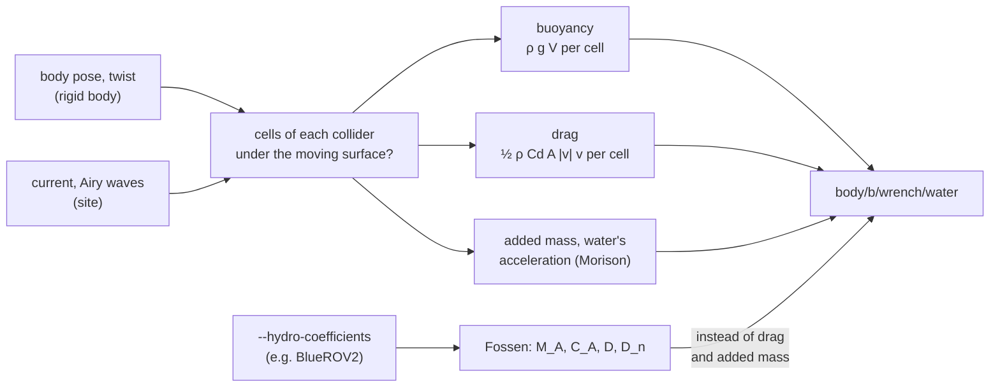
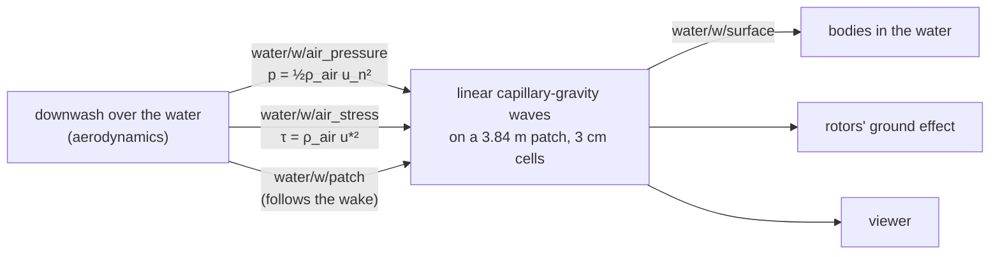
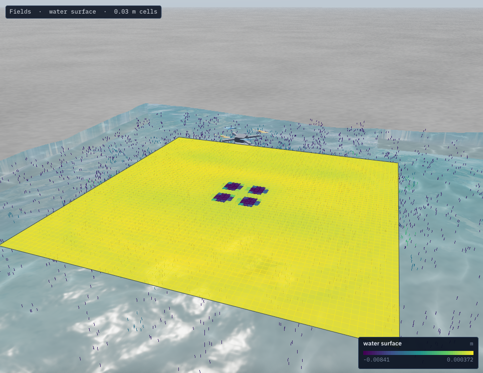

# Water

A box of water (`WaterAPI_1`, `--water X,Y,LEVEL,SIZE_X,SIZE_Y,DEPTH` or the run file's
`water:`) floats, sinks and drags whatever moving body enters it. `lagrange_hydrodynamics` runs
every 1 ms: it cuts each body's colliders into small cells, finds which are under the surface, and
writes one wrench per body, `body/<b>/wrench/water`, with the share of it under water,
`body/<b>/submerged`. A vehicle with its own measured coefficients (`--hydro-coefficients
FILE.yaml`) takes Fossen's manoeuvring model instead of the cells' drag.

## The equations

**Buoyancy and drag.** Each collider is cut into cells (6 a side, kept when their centre is
inside it, scaled to the shape's true volume). A cell under the surface is pushed up by the
water it displaces and dragged by its speed through the water $v$:

$$
F_b = \rho\,g\,V_{cell}, \qquad F_d = -\tfrac12\,\rho\,C_d\,A\,|v|\,v
$$

Because buoyancy acts at the wet cells, an off-centre or tilted hull rights itself. $C_d$ is
illustrative (1 by default), and the frontal area is taken as a box's.

**Moving water.** `--water-current VX,VY[,VZ]` is a steady current. `--water-waves
AMPLITUDE,PERIOD[,TOWARDS_DEG]` is one train of linear (Airy) waves over the water's depth $d$:

$$
\omega^2 = g\,k\,\tanh(k d), \qquad \eta = a\,\cos(k x - \omega t)
$$

with the water under the surface moving in the orbits of linear theory (Dean and Dalrymple
1991, ch. 3). Cells count as wet under the moving surface, and the drag works on a cell's speed
relative to the water there.

**Added mass.** A body that accelerates in water drags some water along, which acts as extra
mass. A submerged body gets Morison's inertia terms at its centre of mass,

$$
F_a = \rho\,V\,a_w + m_a\,(a_w - a_b), \qquad m_a = \tfrac12\,\rho\,V
$$

with $a_w$ the water's acceleration, $a_b$ the body's, and $m_a$ the added mass of a sphere in
potential flow (Lamb, §92), along every axis.

**Fossen's model.** A body named in `--hydro-coefficients` takes Fossen's model (*Handbook of
Marine Craft Hydrodynamics and Motion Control*, 2011, ch. 6) in its body frame, on its velocity
through the water $\nu_r = (u, v, w, p, q, r)$, scaled by the share of it under water:

$$
\tau = -M_A\,\dot\nu_r - C_A(\nu_r)\,\nu_r - \big(D + D_n(|\nu_r|)\big)\,\nu_r
$$

with a diagonal added mass $M_A = \mathrm{diag}(A_t, A_r)$, its Coriolis and centripetal terms
$-C_A\nu = (\omega \times A_t u,\; u \times A_t u + \omega \times A_r \omega)$, linear damping
$D$ and quadratic damping $D_n$, all measured for the vehicle. Buoyancy stays the cells', and the
water's acceleration still pushes the displaced volume. The sample is the BlueROV2 Heavy,
`assets/vehicles/bluerov2_heavy.hydro.yaml`, from von Benzon et al. 2022 (J. Mar. Sci. Eng. 10,
1898, Table A1, CC BY 4.0): damping identified from open-loop runs in a pool, added mass by
Eidsvik's method.

## The surface under a rotor

With rotors, the downwash and the site's air density in the run, the water's surface moves under
the wakes (`lagrange_hydrodynamics`'s `surface` module, every 40 ms). The profile's
`aerodynamics.downwash_water: false` keeps it flat.

**The equations.** The surface's height $\eta(x, y, t)$ over its still level obeys linear
potential-flow theory (Lamb, *Hydrodynamics*, 1932, §267 and §348). Each Fourier mode of
wavenumber $k$ is a damped oscillator,

$$
\ddot\eta_k + 2\gamma_k\dot\eta_k + \omega_k^2\,\eta_k
  = -\frac{k\tanh(kd)}{\rho_w}\,\hat p_k - \frac{\tanh(kd)}{kd}\,\frac{i\,\mathbf k\cdot\hat{\boldsymbol\tau}_k}{\rho_w},
\qquad
\omega_k^2 = \Big(g k + \frac{\sigma k^3}{\rho_w}\Big)\tanh(kd), \qquad \gamma_k = 2\nu k^2
$$

with $\sigma$ water's surface tension (72.75 mN/m at 20 °C, Vargaftik et al. 1983), $\nu$ its
viscosity and $d$ its depth. A steady pressure gives the hydrostatic dimple
$\eta = -p/(\rho_w g)$ (surface tension only smooths what is a few centimetres wide). The
tangential stress is taken as a force spread over the depth (shallow water's
$\partial_t^2\eta = g d\,\nabla^2\eta - \nabla\cdot\boldsymbol\tau/\rho_w$ with the pressure
term's depth factor), a modelling choice: what it sets up is under 1 % of the dimple. The
loads come from the downwash ([downwash.md](downwash.md) §5a).

**Solving it.** The modes are integrated exactly over each step (the load held), so the step
has no stability limit. The patch is 128 × 128 cells of 3 cm, periodic in the transform; its
outer eighth damps the water's velocity so waves leave and do not wrap round, and cells off the
water (the bank) are damped hard. The patch follows the first wake over the water by whole cells
and starts flat and still, centred on it. It costs nothing while nothing presses on it.

**Outputs.** `water/<w>/surface` (m, per cell), `surface_origin` (the grid's corner),
`surface_min` and `surface_max`. The water's cells are under the moved surface, so floating
bodies see it, and the rotors measure their ground effect to it ([rotors.md](rotors.md)).

**The sample quadcopter's dimple** (2.0 kg, 10-inch propellers), over still water:

| Rotor plane over the water | Jet arriving | Dimple | $\rho_{air}U^2/(2\rho_w g)$ |
|---|---|---|---|
| 0.5 m | 12.4 m/s (four jets) | 9.6 mm | 9.6 mm |
| 1 m | 10.2 m/s (merging) | 6.4 mm | 6.4 mm |
| 2 m | 6.5 m/s (merged) | 2.6 mm | 2.6 mm |

## Solving it

Added mass makes the force depend on the body's own acceleration, which an explicit exchange
with the physics engine handles badly: an added mass larger than the body's own would diverge.
So $a_b$ (and $\dot\nu_r$ per axis) is last step's acceleration smoothed with gain
$1/(1 + m_a/m)$; with this gain a steady push settles in one step on the exact $F/(m + m_a)$.

## How far to trust it

| Check | Result | Test |
|---|---|---|
| A floating box's draft; an off-centre hull floats level | the closed form | `Water.ABoxFloatsAtItsDraft`, `Water.AnOffCentreHullFloatsLevel` |
| A sinking box's terminal speed under quadratic drag | the closed form | `Water.ASinkingBoxReachesItsTerminalSpeed` |
| A sphere half as dense as water released under it | starts rising at $g(\rho V - m)/(m + \tfrac12\rho V) = g/2$ within 3 %, MuJoCo and Jolt | `Water.AReleasedSphereRisesWithItsAddedMass` |
| A floating box in a 0.5 m/s current | drifts with it within 0.02 m/s | `Water.AFloatingBoxDriftsWithTheCurrent` |
| A 0.4 m float on 0.1 m, 4 s waves | heaves 0.1 m within 1 cm | `Water.ASmallFloatRidesLongWaves` |
| BlueROV2 Heavy at full thrust (Fossen) | top speeds 0.729 / 0.626 / 0.713 m/s (surge, sway, heave) against the published model's 0.72 / 0.63 / 0.71; start acceleration within 3 % of $F/(m + m_a)$ | `Water.TheBlueRov2ReachesItsTopSpeedsWithFossensModel` |
| Against a real vehicle in a pool | through the published model only: it is within about 10 % of their pool runs | — |
| The dimple under a steady jet | $\rho_{air}U^2/(2\rho_w g)$ within 2 % for 5.7 to 16.6 m/s (2 to 17 mm), and within 0.5 % for the sample quadcopter at 0.5, 1 and 2 m; **no measurement of a rotor's dimple** | `SurfacePatch.TheDimpleUnderASteadyJetIsHydrostatic`, `DownwashOnWater.TheSampleQuadsDimpleIsItsJetsStagnationPressure` |
| Ripples | group velocity within 3 % of $d\omega/dk$ for gravity waves (λ 0.63 m, $c_g = c/2$), the slowest ripple (λ 1.7 cm, 0.23 m/s) and capillary waves (λ 2 mm, $c_g = 3c/2$); viscous decay $e^{-2\nu k^2 t}$ within 5 % | `SurfacePatch.Ripples*`, `SurfacePatch.ViscosityDamps*` |

The BlueROV2 check shows the model is implemented as published; it is as close to the real
vehicle as von Benzon et al.'s model is, for this vehicle only. A body without its own
coefficients takes a sphere's added mass and the cells' drag, which no measurement backs.

Not modelled at the surface under a rotor: anything non-linear (the dimple is millimetres, so
linear theory holds; a jet that would dig a cavity, or breaking waves, are out of it); the
jet's turbulence, which makes a real dimple flicker (the load is the mean flow's); the waves'
own push back on the air; the surface's cells under 3 cm (capillary ripples are only partly
resolved); the moved surface for the lidars and cameras (they see the still level, as the dimple
is far under their range noise); the viewer's water draws it (viewer.md).

Not modelled: added mass for shapes other than a sphere, and added inertia in rotation, without
coefficients; off-diagonal added mass and damping; wave radiation and diffraction (the waves pass
through bodies); thrusters as rotors in water; friction on what drives through water. Water has
no collider, and the viewer and the lidars see a flat surface (lidars as a mirror, with no
return at a slant or from the bottom).

The full model is in [hydrodynamics.md](../design/domains/hydrodynamics.md) §9.
