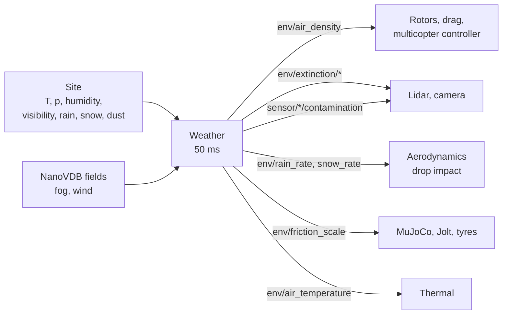

# Weather

The weather domain (`lagrange_weather`, every 50 ms) holds the state of the air at the site and
writes it as `env/*` signals: temperature, pressure, humidity, density, extinction of light at
each wavelength, rain and snow rates, how slippery surfaces are, and how dirty each sensor's
window is. Sensors, rotors, aerodynamics, thermal and the physics engines read them.

It runs only when the site's temperature, pressure and humidity are given (`--weather`, a
`WeatherAPI_1` prim or the profile's `weather` keys); there are no defaults. The `clear`
substitute keeps the same air with no fog, rain, dust or wind.

## The equations

**Air density.** Moist air from the ideal gas law for its dry and vapour parts, with the
saturation vapour pressure of Alduchov and Eskridge (1996):

$$
\rho = \frac{p - e}{R_d\,T} + \frac{e}{R_v\,T}, \qquad e = \phi\, e_s(T)
$$

with $\phi$ the relative humidity and $R_d = 287.05\ \mathrm{J\,kg^{-1}K^{-1}}$. Rotors, drag and
the built-in multicopter controller fly in this density, so a rotor turns faster in hot, thin
air: $\omega \propto \rho^{-1/2}$ at the same thrust.

**Fog.** The extinction coefficient comes from the visibility $V$ by Koschmieder at 550 nm (a 2 %
contrast threshold):

$$
\sigma_{550} = \frac{3.912}{V}
$$

and the Kim model's wavelength exponent carries it to the lidars' 905 and 1550 nm. Light through
a path of length $d$ keeps $e^{-\sigma d}$ (Beer–Lambert); a lidar's round trip keeps
$e^{-2\sigma r}$.

**Rain.** Drop sizes follow Marshall and Palmer (1948), with $R$ the rain rate in mm/h:

$$
N(D) = N_0\,e^{-\Lambda D}, \qquad N_0 = 8000\ \mathrm{m^{-3}\,mm^{-1}}, \qquad \Lambda = 4.1\,R^{-0.21}\ \mathrm{mm^{-1}}
$$

For drops much larger than the wavelength, the extinction is the integral of twice each drop's
cross-section, $\sigma = \pi N_0 / \Lambda^3$.

**Dust.** Quartz spheres at the median diameter, extinction from the mass concentration through a
tabulated extinction efficiency. Dust lifted by a rotor's outwash (`env/dust/downwash`) adds to it.

**Snow.** Extinction of 3.912e-3 1/m per mm/h of water (1 km visibility at 1 mm/h), illustrative:
Rasmussen et al. (1999) find 3 to 10 times that spread between storms.

**Friction.** `env/friction_scale` is the grip relative to dry. Surfaces wet with a time constant
of 120 s in rain of 1 mm/h or more and dry over 1800 s; wet grip is 0.7 of dry (or a material's
`sensmat:frictionWetScale`). Below freezing, snow cover brings it to 0.3 of dry and ice to 0.13.
MuJoCo, Jolt and the tyres apply it.

**Lens contamination.** Each sensor's window clouds with rain and dust:

$$
c = 1 - \exp\!\left(-\int \Big(\frac{R}{R_{ref}\,\tau_{rain}} + \frac{C}{C_{ref}\,\tau_{dust}}\Big)\,dt\right)
$$

with $R_{ref}$ = 10 mm/h, $\tau_{rain}$ = 600 s, $C_{ref}$ = 1 mg/m³ and $\tau_{dust}$ = 3600 s. A
lidar loses range by $(1 - c)$; a camera gets a haze.

**Rain and snow on a body.** Drops that stop on a link give it their momentum
(`impactForce`: Marshall–Palmer sizes, the fall speeds of Atlas et al. 1973, inelastic impact as
Haines and Luers 1983). It is small, as it is in the air: 25 mm/h on the sample quadcopter's
0.09 m² top is 3.7 mN against its 20 N weight.

**Fields.** A NanoVDB fog grid (`fog_field`, extinction in 1/m) adds its optical depth along each
lidar beam up to the hit and each camera pixel's ray; a wind grid (`wind_field`, m/s) is the mean
wind inside its bounds, for link drag and the rotors. `lagrange_foam_to_vdb` turns an OpenFOAM
case into one.

## Computing it

The state is a handful of scalars, updated every 50 ms on the CPU on every tier. What the
weather does to sensors is applied per lidar beam and per camera pixel by the sensors domain after
the cast ([Sensors](sensors.md)): the lidar equation for range, fog and rain clutter, and the fog
veil.

## How far to trust it

| Check | Result | Test |
|---|---|---|
| Koschmieder and Beer–Lambert | exact to rounding | `Extinction.KoschmiederAndBeerLambert` |
| Dry air at sea level | the ICAO density within 5e-4 | `Atmosphere.DryAirAtSeaLevelIsTheStandardAtmosphere` |
| Rain extinction | the Marshall–Palmer integral | `Extinction.RainIsTheMarshallPalmerIntegral` |
| Rain rate carried by the drop distribution, with Atlas's fall speeds | **not met**: 5 to 18 % more rain than it was built from (target 5 %; the test checks 20 %), the known looseness of the fit | `Extinction.MarshallPalmerCarriesItsRainRate` |
| Snow and ice grip | 0.20–0.35 for packed snow, about 0.10 for ice: a range check | `Winter.GripIsInThePublishedRanges` |
| Snowfall visibility | the visibility it was given | `Winter.SnowfallIsTheVisibilityItWasGiven` |
| Drop impact | Atlas fall speeds over Marshall–Palmer drops; momentum across the area; the domain uses the weather's air and rain | `Precipitation.*` in `test_aerodynamics` |
| Air density reaching a drone | hover at 5690 rpm (40 °C, 950 hPa) and 4990 rpm (−10 °C, 1030 hPa), ratio 1.140 = √(1.362/1.048), measured on the sample quadcopter | a run, [aerodynamics.md](../design/domains/aerodynamics.md) §3.1 |
| Lidar range in fog against chamber data (DENSE), within 20 % | **owed** | — |
| Lidar false returns in rain against rain-chamber statistics | **owed** | — |
| Wet friction against the literature range | **owed** | — |

The Kim model's wavelength table is TODO(verify) against Kim, McArthur and Korevaar 2001. Wet
friction and lens contamination are behavioural models: their time constants are modelling
choices, not measurements.

Not modelled: radar attenuation, a weather time series, rain streaks in the camera image, water
lying on a frame, rain on the propellers' lift, icing.

The full model and its signals are in [weather.md](../design/domains/weather.md); the weather on
a drone is in [aerodynamics.md](../design/domains/aerodynamics.md) §3.1.
