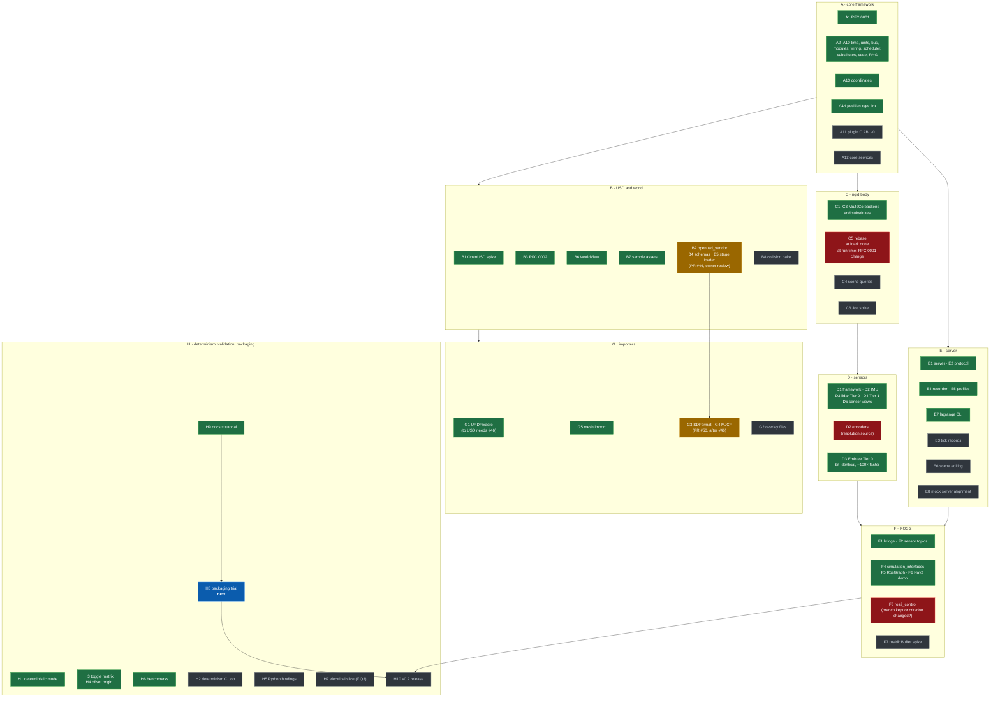

# Progress

Where the project stands against the [roadmap](roadmap.md). Updated 2026-10-24.

## The releases

```mermaid
flowchart LR
    v01["v0.1<br/>viewer, protocol,<br/>mock server<br/><b>released 2026-10-14</b>"]:::done
    v02["v0.2<br/>simulation core + AMR<br/>ROS 2, Nav2<br/><b>we are here</b>"]:::now
    v03["v0.3<br/>arms + electrical<br/>MoveIt 2"]:::todo
    v04["v0.4<br/>drones<br/>PX4 / ArduPilot SITL"]:::todo
    v05["v0.5<br/>weather + EMI"]:::todo
    v06["v0.6<br/>cars, autonomous cars<br/>OpenDRIVE, Autoware"]:::todo
    v07["v0.7<br/>huge worlds"]:::todo
    v10["v1.0<br/>stable schemas + plugin ABI<br/>ros-lyrical-* debs"]:::todo
    v01 --> v02 --> v03 --> v04 --> v05 --> v06 --> v07 --> v10

    classDef done fill:#1f6f43,stroke:#2ea043,color:#fff
    classDef now fill:#9a6700,stroke:#d29922,color:#fff
    classDef todo fill:#30363d,stroke:#6e7681,color:#c9d1d9
```

## v0.2, item by item

Green: merged. Amber: in progress or open for review. Red: blocked on a decision. Grey: not
started. Arrows show the order the work builds on.

## Decisions waiting on the owner

| Item | Question |
|---|---|
| #46 (B2, B4, B5) | Review and approve the vendored OpenUSD and the stage loader (schema changes need 2 approvals). #50 follows it |
| F3 | Keep the `feat/ros2-control` branch, or change acceptance criterion 1 |
| C5 | Draft the RFC 0001 change for rebasing while the run is going (a new module hook) |
| D2 | Where encoder resolution comes from (proposal: a `<param name="encoder_resolution">` in `<ros2_control>`) |
| H7 | Q3: whether v0.2 gets a thin electrical slice |

## Autonomous run (from 2026-10-24)

The owner asked for v0.2 and then v0.3 to be worked through without waiting for input, with
these standing answers:

- **Gated changes** (`schemas/`, `proto/`, `core/plugin_abi/`, accepting RFCs): merged by the
  agent acting for the owner, each with an RFC or change note marked *pre-approved by the owner
  on 2026-10-24 for autonomous work*, after local verification. Every one is listed below for
  review.
- **F3 ros2_control**: finish and merge; encoder resolution from
  `<param name="encoder_resolution">` in `<ros2_control>`; the Nav2 demo moves to
  `diff_drive_controller`.
- **C5 runtime rebase**: deferred to v0.7 (huge worlds); v0.2 rebases at load.
- **Releases**: prepared (notes, comparison, release PR), never merged to `main` or tagged by
  the agent.
- **F7** (`rosidl::Buffer`, CUDA): this machine has no NVIDIA GPU; desk study only.

### Work queue

v0.2, in order:

1. #46 OpenUSD vendor, schemas, stage loader (B2, B4, B5); then #50 SDFormat and MJCF (G3, G4)
2. F3 ros2_control with D2 encoders; Nav2 demo on `diff_drive_controller`
3. C5: record the deferral in the roadmap
4. A11 plugin C ABI v0; A12 core services
5. C4 scene queries (on `ShapeCaster`); E3 tick records; E6 scene editing; E8 mock server alignment
6. G2 overlay files; B8 collision bake; C6 Jolt spike
7. H2 determinism check; H5 Python bindings; F7 desk study
8. H8 packaging trial (Podman image running the Nav2 demo, bloom dry run, Q18 write-up)
9. H10 release preparation (not published)

Then v0.3, epic by epic as in [roadmap.md §4](roadmap.md).

### Merged under the autonomous mandate

| PR | Gated path | Note |
|---|---|---|
