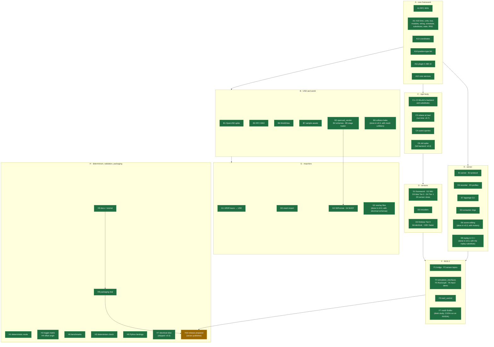

# Progress

Where the project stands against the [roadmap](roadmap.md). Updated 2026-10-25.

## The releases

```mermaid
flowchart LR
    v01["v0.1<br/>viewer, protocol,<br/>mock server<br/><b>released 2026-10-14</b>"]:::done
    v02["v0.2<br/>simulation core + AMR<br/>ROS 2, Nav2<br/><b>released 2026-10-25</b>"]:::done
    v03["v0.3<br/>arms + electrical<br/>MoveIt 2<br/><b>released 2026-10-25</b>"]:::done
    v04["v0.4<br/>drones<br/>PX4 / ArduPilot SITL<br/><b>released 2026-10-25</b>"]:::done
    v05["v0.5<br/>weather + EMI<br/><b>next</b>"]:::now
    v06["v0.6<br/>cars, autonomous cars<br/>OpenDRIVE, Autoware"]:::todo
    v07["v0.7<br/>huge worlds"]:::todo
    v10["v1.0<br/>stable schemas + plugin ABI<br/>ros-lyrical-* debs"]:::todo
    v01 --> v02 --> v03 --> v04 --> v05 --> v06 --> v07 --> v10

    classDef done fill:#1f6f43,stroke:#2ea043,color:#fff
    classDef now fill:#9a6700,stroke:#d29922,color:#fff
    classDef todo fill:#30363d,stroke:#6e7681,color:#c9d1d9
```

## v0.2, item by item

Green: merged. Amber: in progress or open for review. Red: blocked on a decision. Grey: not
started. Arrows show the order the work builds on.

## v0.2 status (2026-10-25)

Every v0.2 item is done or moved to v0.3 with a reason (below). Release notes, acceptance
evidence and the Gazebo Jetty comparison are in `docs/release/v0.2.0.md` and
`docs/release/v0.2.0-comparison.md`. Criteria 2 to 9 are met. **Criterion 1 is not:** a
10-minute Nav2 patrol through ros2_control did not get past Nav2's start-up on 2026-10-25
(known issue). Released as `v0.2.0` on 2026-10-25 at the owner's request, with criterion 1
open.

## v0.3 status (2026-10-25)

Every v0.3 epic of roadmap §4 is done, and so are the v0.2 items that moved here (G2, B8, E6,
E8). Release notes and acceptance evidence: `docs/release/v0.3.0.md`. Owed within the epics:
a motor heat run (Q16; the battery is checked against published cell data since 2026-10-25,
from 35 % state of charge up), the drive-design
review of the motor constants, FMI 2.0 FMUs (Q8), Jolt's wheel slip. Released as `v0.3.0` on 2026-10-25 at the owner's request, after v0.2.0.

## v0.5 plan (2026-10-25)

The owner started v0.5 (weather, EMI, comms; roadmap §6) on 2026-10-25 with the same mandate as
v0.4: gated paths pre-approved and listed below, OpenVDB vendored if apt's is not enough, demos
time-boxed. Order:

1. Schemas: `WeatherAPI_1`, `EmiSourceAPI_1`, `EmiSusceptibilityAPI_1`, `SensorMaterialAPI_1`,
   `RadioLinkAPI_1`, `CanBusAPI_1` (**done** 2026-10-25)
2. `modules/weather`: atmosphere state, mean wind and turbulence (from the aerodynamics config),
   fog by Koschmieder, rain by Marshall–Palmer, dust, wet friction, lens contamination; the
   `clear` substitute (**done** 2026-10-25: `lagrange_weather`, `--weather`, the profile's
   weather keys; weather.md §8. The wind stays in the aerodynamics config for now)
3. Sensor weather effects: lidar attenuation, backscatter and rain returns (CPU and the GPU
   kernel), camera fog and rain (**done** 2026-10-25: per beam on the CPU on every tier, the
   GPU kernel not needed; weather.md §8; fog clutter uncalibrated (owed: fog-chamber data);
   `profiles/examples/amr_fog.yaml`)
4. Fields infrastructure: OpenVDB/NanoVDB, field signals, CPU and GPU sampling, the viewer's
   volume overlays; wind and fog fields (NanoVDB, CPU sampling, the fog and wind grids through
   weather, lidar, camera and link drag **done** 2026-10-25: `lagrange_fields`, zlib-compressed
   `.nvdb`, samples in `assets/fields/`. GPU sampling not needed yet (per beam on the CPU); the
   server sends the viewer's Environment workspace its `EnvironmentState` and, for subscribed
   fields, 64 × 48 `FieldSlice`s of fog extinction and wind around the robot twice a second)
5. `modules/emi`: analytic sources and field maps, victims (magnetometer, IMU, encoder, CAN,
   radio) (**done** 2026-10-25: `lagrange_emi`, emi.md §8; the magnetometer and IMU apply it,
   the viewer gets the sources and |B| slices; the sample power line with the quadcopter,
   `profiles/examples/quad_x500_power_line.yaml`. Encoder glitches, CAN errors and the radio's
   SNR are applied with step 6)
6. `modules/comms`: link budget, packet errors, CAN fault confinement; bridges drop and delay
   what rides on a link (**done** 2026-10-25: `lagrange_comms`, comms.md §8; the ROS 2 bridge
   gates topics with `--link-topics`; sample `amr_diffdrive_wifi.usda`. Not yet: MAVLink
   telemetry and encoder glitches)
7. Offline CFD import: OpenFOAM results to a VDB wind field (**done** 2026-10-25:
   `lagrange_foam_to_vdb` and `readFoamVectorField`/`foamToWindField` in `lagrange_fields`;
   ASCII `C` and `U`, cells averaged into voxels; round trip of an analytic field. Owed: a run
   against files from a real OpenFOAM case, TODO(verify))
8. Samples, tutorial, release notes (**done** 2026-10-25: `docs/guide/tutorial-environment.md`
   run by `tools/ci/tutorial_environment.sh`; `docs/release/v0.5.0.md` drafted, not released)

## v0.4 status (2026-10-25)

Every v0.4 epic is done or moved: field sampling to v0.5 with the fields infrastructure, rebase
in flight to v0.7 with C5. Release notes and acceptance evidence: `docs/release/v0.4.0.md`.
Owed within the epics: small-propeller test data (the UIUC database states no licence),
measured ground effect, stall delay, the Dryden spectrum's periodogram check, the tutorial's
SITL steps in the container. Released as `v0.4.0` on 2026-10-25 at the owner's request.

## v0.4 plan (2026-10-25)

The owner asked to continue with v0.4 (drones) after publishing v0.2.0 and v0.3.0, with the same
standing answers as v0.3 (gated changes merged and listed below; autonomous loop), PX4 SITL built
on the host (v1.17.0, the latest stable release, BSD-3-Clause), and demos time-boxed. Order, each
step resting on the ones before:

1. `schemas/aero`: `AeroAPI_1`, `RotorAPI_1` (**done** 2026-10-25)
2. `modules/rotor_aero`: coefficient model, inflow lag, ground effect, the `ideal` substitute;
   thrust into `wrench_sum`, shaft torque into `joint/<j>/load_torque`; checks against closed
   forms and published propeller data (**done** 2026-10-25 against the closed forms; aerodynamics.md §8.
   Published propeller data comes with step 3's propeller. PX4 v1.17.0 SITL builds on the host:
   `~/PX4-Autopilot`, Python dependencies in its `.venv` made with uv, as `python3-venv` is not
   installed)
3. Sample quadcopter `assets/robots/quad_x500` (URDF, overlay with rotors, motors, 4S battery)
   and `assets/worlds/open_field`; hover by a simple attitude/thrust controller in a test
   (**done** 2026-10-25, the world too: `assets/worlds/open_field`, where the missions fly;
   rotors in the server with `--air-density`, the built-in
   multicopter controller, hover within 1 mm at 2 m for 60 s; robot-classes.md §5. Tuning found
   on the way: the position loop must be well below the attitude loop (0.6 and 3 Hz), and the
   rotor speed loop well above it)
4. Electrical at 50 µs for small fast motors; coupling tests at J = 1e-5 kg·m² (**done**
   2026-10-25: `DroneCoupling` runs the quadcopter's drive at 50 µs on 1e-5 and 9e-5 kg·m²
   rotors within 2 % RMS of a 1 µs monolithic solution; the quadcopter's profile runs at 50 µs)
5. Sensors: GNSS, magnetometer (world magnetic model data, licence checked), barometer
   (**done** 2026-10-25: `GnssAPI_1`, `MagnetometerAPI_1`, `BarometerAPI_1`; the world's geo
   origin (`world.geo_origin`, `--geo-origin`, a site parameter); WMM2025 (public domain) within
   0.001 nT of NOAA's 100 test points; the ICAO standard atmosphere; on the sample quadcopter
   with PX4 SITL's default home as the example site; on ROS 2 the same day: `/<sensor>/fix`,
   `/<sensor>/field`, `/<sensor>/pressure`, `/<sensor>/temperature`; before, the bridge took
   every sensor that was not a lidar or camera for an IMU and opened extra `/imu` publishers)
6. `modules/aerodynamics`: link drag, mean wind profile, Dryden turbulence (MIL-HDBK-1797)
   (**done** 2026-10-25: `AeroDrag`; the wind in the aerodynamics config until v0.5's weather;
   the sample quadcopter holds 2 m within 6 cm in 8 m/s with gusts, `quad_x500_gusty.yaml`;
   MIL-HDBK-1797 equation numbers marked TODO(verify))
7. `bridges/mavlink`: PX4 SITL lockstep (`HIL_SENSOR`, `HIL_GPS`, `HIL_ACTUATOR_CONTROLS`), then
   ArduPilot's JSON interface (PX4 **done** 2026-10-25: the square mission flies end to end with
   PX4 v1.17.0; `ros-lyrical-mavlink` is a new rosdep dependency (`sudo apt install
   ros-lyrical-mavlink`). ArduPilot **done** the same day: `--mavlink ardupilot`, the JSON
   interface at 1 kHz in lockstep; ArduCopter Copter-4.7.2 flies the square, calm and in 8 m/s
   gusts, `tools/ci/ardupilot_mission.sh [--wind]`; `test_ardupilot_json`)
8. The acceptance mission (take-off, square in 8 m/s gusts, land; low-battery thrust sag), the
   tutorial, and rebase in flight (the mission and the low-battery scenario **done** 2026-10-25,
   robot-classes.md §5. Rebase in flight needs the runtime rebase, C5, which the owner deferred
   to v0.7 (huge worlds): it moves there with it. The tutorial **done** the same day:
   `docs/guide/tutorial-drone.md`, run by `tools/ci/tutorial_drone.sh` with the PX4 step; in the
   container image too, without the SITL steps, which need PX4 and ArduPilot builds in the
   image: `podman run --rm lagrange:dev tools/ci/tutorial_drone.sh` passes)
9. Propellers as built (asked for by the owner on 2026-10-25: real blade shapes, hands and
   mounts instead of the drawn discs): (a) the `bem` fidelity, blade-element momentum on a
   propeller file, with hand (cw/ccw) and mount (puller/pusher) on `RotorAPI_1`, validated
   against measured full-scale propellers (**done** 2026-10-25: NACA Report 640's 5868-9 within
   8 % in CT and 6 % in CP over the attached-flow range, aerodynamics.md §7.1; the built-in
   controller and the PX4 and ArduPilot ESCs turn pushers the right way); (b) drawn blades made
   from the same file, sample propellers for the quadcopter (fixed two-blade, folding, three-
   blade) and a quadcopter variant with pushers (blades and the fixed two-blade **done**
   2026-10-25: generic 10-inch blades of each hand, NACA 6412 sections from NACA Report 586,
   static CT and CP matched to the measured APC 10x4.7 SF; `quad_x500_bem.yaml` hovers on them;
   a profile check from the viewer no longer drops the site's geo origin from its preview);
   (c) folding blades (hinged, opening as they spin up), the three-blade and the pusher variant
   (**done** 2026-10-25: `FoldingBlade`, quasi-static on its hinge between thrust, weight and
   spin, drawn as hinged scene prims (`ScenePrim::hinge`); `generic_10in_folding_*` and
   `quad_x500_folding.overlay.yaml`; `generic_10in_3blade_*`; `quad_x500_inverted`, motors under
   the arms with pushers, hovers as the sample does); (d) edgewise flow in forward flight
   (H-force, flapping) and wind at the rotors (**done** 2026-10-25: blade loads averaged round
   the disc with Glauert's mass flow, tabulated in normalised form; the H-force matches classical
   rotor theory within 1 %; `env/wind/velocity` from the aerodynamics domain reaches the rotors;
   the sample holds its spot in 8 m/s gusts at `bem`. Wake skew and flapping: not yet)

## Defaults taken during the autonomous run

| Item | Default | Why |
|---|---|---|
| H7 (Q3) | No thin electrical slice in v0.2 | v0.3 builds the full electrical domain (network, battery, motors, FOC); a slice now would be rewritten |
| E6 | Scene editing moves to v0.3 | Its acceptance test edits a motor parameter in a running sim; motors arrive with v0.3's electrical domain |
| G2 | Overlay files move to v0.3 | Its acceptance test gives an imported AMR motors and a battery; those schemas (`ElectricalMotorAPI`, `BatteryAPI`) come with v0.3's electrical domain |
| B8 | Collision bake moves to v0.3 | Needs mesh colliders in physics and in the lidar (none yet) and a CoACD vendor package; the sample warehouse's shelves are primitives today |
| E8 | Replay in the C++ server moves to v0.3 | The Python replay works for users today. v0.3's bench mode needs a C++ replay substitute (rigid body replaced by a recorded run); built once there as a module, it gives the server replay too |

## Autonomous run (from 2026-10-24)

The owner asked for v0.2 and then v0.3 to be worked through without waiting for input, with
these standing answers:

- **Gated changes** (`schemas/`, `proto/`, `core/plugin_abi/`, accepting RFCs): merged by the
  agent acting for the owner, each with an RFC or change note marked *pre-approved by the owner
  on 2026-10-24 for autonomous work*, after local verification. Every one is listed below for
  review.
- **F3 ros2_control**: finish and merge; encoder resolution from
  `<param name="encoder_resolution">` in `<ros2_control>`; the Nav2 demo moves to
  `diff_drive_controller`.
- **C5 runtime rebase**: deferred to v0.7 (huge worlds); v0.2 rebases at load.
- **Releases**: prepared (notes, comparison, release PR), never merged to `main` or tagged by
  the agent. Changed on 2026-10-25: the owner asked the agent to publish v0.2.0 and v0.3.0.
- **F7** (`rosidl::Buffer`, CUDA): this machine has no NVIDIA GPU; desk study only.

### Work queue

v0.2, in order:

1. #46 OpenUSD vendor, schemas, stage loader (B2, B4, B5); then #50 SDFormat and MJCF (G3, G4)
2. F3 ros2_control with D2 encoders; Nav2 demo on `diff_drive_controller`
3. C5: record the deferral in the roadmap
4. A11 plugin C ABI v0; A12 core services
5. C4 scene queries (on `ShapeCaster`); E3 tick records; E6 scene editing; E8 mock server alignment
6. G2 overlay files; B8 collision bake; C6 Jolt spike
7. H2 determinism check; H5 Python bindings; F7 desk study
8. H8 packaging trial (Podman image running the Nav2 demo, bloom dry run, Q18 write-up)
9. H10 release preparation (not published)

Then v0.3, epic by epic as in [roadmap.md §4](roadmap.md), in this order:

1. Torque commands: controllers write `joint/<j>/torque_command`; the electrical domain turns it
   into `joint/<j>/torque` (its ideal substitute until the network exists). **Done** (2026-10-25)
2. Electrical schemas (`ElectricalMotorAPI_1`, `BatteryAPI_1`, `PortAPI_1`, bus, load,
   converter); the stage collects their instances; G2 overlay files (**done** 2026-10-25)
3. Electrical network module (DC bus, battery ECM, averaged motor drives) and its tests
   (**done** 2026-10-25; the sample AMR runs on it by default. Owed: the battery check against a
   published cell dataset, sim-vs-real (Q16), the drive-design review of the motor constants
   (RFC 0002 resolution 2), rotor inertia in physics: domains/electrical.md §9. DC-DC
   converters followed the same day: averaged regulators between buses; and the battery check
   against published cell data (LG HG2, CC BY 4.0): within 20 mV from 35 % state of charge up,
   21.5 mV at 24 %)
4. Thermal module (lumped networks), coupled to electrical losses (**done** 2026-10-25; runs
   when the ambient temperature is given. Owed: a published or recorded motor heat run (Q16),
   airspeed and sun direction with the aero and weather domains: domains/thermal.md §8)
5. Coupling stability checks across the electrical, thermal and physics rates (**done**
   2026-10-25: architecture.md §8.1; the scheduler steps flow readers at their window's end)
6. FMU host (**done** 2026-10-25, on our `fmilibrary3_vendor`: Lyrical's `fmilibrary_vendor`
   pins FMI Library 2.2.3, FMI 2.0 only; reference FMU `lagrange_models/dc_drive`)
7. Bench mode: the replay substitute for rigid body (**done** 2026-10-25: `lagrange_recording`,
   `--bench`; 10 kHz electrical at about 59× real time. E8, replay in the C++ server, followed
   as item 15)
8. SPICE netlist and Modelica export; ngspice offline comparison (**done** 2026-10-25:
   `lagrange export`; netlist round trip in ngspice within 0.05 %; Modelica checked for
   structure only, no OpenModelica here)
9. Robot arm sample and MoveIt 2 (**done** 2026-10-25: `arm6`, its overlays and workcell;
   joint_trajectory_controller at 1 kHz; MoveIt 2 pick-and-place via moveit_py; the derating
   scenario passes with `tools/ci/arm_scenario.sh`. Fixed on the way: MuJoCo read revolute
   limits as degrees; the position servo lagged moving set points (now velocity feedforward);
   the Python bindings hid lagrange.viewer. Not yet: wrist camera, grasped object)
10. Raster camera sensor (**done** 2026-10-25, part A: image buffers on the signal bus; the
   mesh pipeline shared by the viewer and the camera in `lagrange_gpu_raster`; the camera
   module (colour, depth, instance ids; MSAA colour); cameras from URDF, SDFormat and USD
   (`CameraSensorAPI_1`); images to the viewer and as ROS `Image` + `CameraInfo`; arm6 wrist
   camera. Projection test: OpenCV finds checkerboard corners within 0.066 px mean of the
   pinhole model and calibration recovers fx, fy, cx, cy, RMS 0.07 px. Part B, done the same
   day: the Sensors workspace's camera view (06-sensors) shows the image as a GPU texture, in
   the 2x2 grid beside the lidar; depth and labels are not sent to the viewer yet. Not yet:
   the mock server's synthetic camera image (06-sensors SPEC asks for one; adding a prim to
   the sample shifts the prim ids the viewer's golden images use), the magnetometer view)
11. Jolt full backend (**done** 2026-10-25: every signal MuJoCo has (joint acceleration,
   effective inertia, limit torque, load torque, body acceleration for the IMU, friction
   scale); rotor inertia (armature) as joint torques from Jolt's own joint-space inertia;
   `--physics jolt` and a profile's `backend: jolt`; agreement suite `test_backends`. Found on
   the way: Jolt's default angular-velocity clamp (47 rad/s, before the constraint solve) threw
   joint torques on light links away; now 1e6 rad/s. Known: the AMR's wheels slip on Jolt's
   rigid contacts while ramping up, see Known issues)
12. Schema migration tools (`tools/`) (**done** 2026-10-25: package `lagrange_migrate` in
   `tools/migrate/` with `migrate_schema` (USD, at the layer level, so old schemas need not be
   registered; synthetic `ExampleMotorAPI_0 -> _1` with a unit change, a rename, a removal and
   time samples) and `migrate_profile` (version 0, no `schema_version`, to 1, comments kept);
   the stage loader notes older versions with the command and refuses two versions on a prim;
   the sample assets and example profiles are checked to be current)
13. E6 scene editing (**done** 2026-10-25: `GetAttributes` lists every schema value with
   unit and doc; `SetAttribute` checks a number as the loader would, rebuilds the run and
   carries its state across (scheduler save/restore), so an edit applies from the next step:
   the AMR's winding resistance ×10 raised its copper loss from 0.03 to 0.9 W mid-run;
   `save_to_session_layer` writes the edited model as a USD layer; the inspector edits numbers
   with Apply and Revert. Differences from the design, to confirm with the owner: the footer
   says "applies to the running simulation" (the design's "applies on next run" predates the
   server applying edits live), and nothing in the design lets the user ask for the session
   save yet. `SetTransform` is refused: the backends cannot set a pose yet);
   B8 collision bake: part 1 **done** 2026-10-25, convex hull colliders end to end (world
   tables, USD `physics:approximation "convexHull"` read and written, MuJoCo mesh geoms,
   Jolt convex hulls, the CPU lidar's exact face-plane casts, occupancy maps); the GPU lidar
   kernel refuses hulls for now. Part 2 **done** the same day: `collision_bake`
   (`lagrange_collision_bake`, CoACD 1.0.14 from PyPI, MIT) and the sample rack
   (`assets/worlds/rack_sample`): 13 hulls, the lidar sees between its boards and stops at a
   board's edge within 3 mm, a box rests on a board within 3 mm on MuJoCo and Jolt. The
   roadmap's AC names the warehouse shelves; the sample warehouse's shelves are boxes, so the
   rack stands in for them. Hulls in the GPU lidar kernel followed the same day: face planes
   per hull, tested as on the CPU; 100 % same shape against the CPU reference over 200 random
   hulls, worst 7.4 µm on llvmpipe
14. Viewer additions (schematic, electrical scopes) (**done** 2026-10-25: the server sends
   the power system in the snapshot (`ElectricalNet`: a net per bus, terminals for battery
   ports, motors and loads with their current signals, limits from the bus trips and port
   ratings) and attributes motor/battery/load/bus/thermal signals to their prims; so the
   Electrical workspace (Network, Schematic, Scopes) runs on the simulator, not only the mock.
   Scopes as the design lists them: bus voltage, the motors' q currents, the source current.
   The viewport's thermal false-colour shading followed the same day: the design tokens'
   inferno map over the thermal nodes' temperatures, each mesh taking its nearest ancestor's,
   with a legend; Unlit shading too; `--shading`. Not yet: the design's fuse and DC-DC nodes
   (no such components in the samples). Collision shading followed (the snapshot's new
   `colliders`; the design shows no look for it, so the colliders are drawn lit in the
   rigid-body domain colour in place of the visuals, a proposal to confirm). Wireframe shading followed (a line-fill pipeline where the GPU has fillModeNonSolid,
   else the menu entry stays disabled). The battery's
   `battery/<b>/power` followed the same day and is the Scopes' third plot, as designed)
15. E8 replay in the C++ server (**done** 2026-10-25, Q15 decided: `lagrange_server --replay
   run.mcap` and the protocol's OpenRecording; every recorded domain becomes a replay
   substitute, the recorder now stores the scene snapshot and each channel's prim, writer,
   rate and unit; seeking restores the nearest of the checkpoints saved every second and steps
   on from it; the run pauses at the recording's end; profiles are not applied to a replay.
   Test: a recorded AMR run replays every signal sample for sample, and poses after seeking
   back and forward match the recording. The Python mock server is a test tool now)

### Merged under the autonomous mandate

| PR | Gated path | Note |
|---|---|---|
| #46 OpenUSD vendor, schemas, stage loader | `schemas/` (sensor library, `lagrangeUnit` metadata, under the accepted RFC 0002) | Rebased onto #51–#58; `--spawn` fixed for USD. ASan/UBSan run not done: stopped by the system for low memory while building OpenUSD |
| #50 SDFormat and MJCF importers | none (stacked on #46) | Rebased; `--spawn` fixed for SDFormat and MJCF too |
| plugin C ABI v0 (A11) | `core/plugin_abi/` (new: `lagrange_plugin.h`, ABI 0.1, as RFC 0001 and architecture.md §13 specify) | C99 sample built with `-std=c99 -pedantic -Werror`; ASan/UBSan clean |
| plugin ABI schema queries | `core/plugin_abi/` (host functions answer from `World::schemaInstances`) | C99 sample's schema_probe reads two motors' values |
| thermal schemas | `schemas/` (new `schemas/thermal` library: `ThermalAPI_1`, `ThermalLinkAPI_1` from formats.md §3.2, under the accepted RFC 0002) | As drafted; changelog entry |
| electrical network (fallback doc fix) | `schemas/` (documentation of `elec:backEmfConstant`'s fallback corrected to Kt/1.5 for dq machines; changelog entry) | No attribute changed; the network refuses an authored Ke that disagrees with Kt by over 3 % |
| raster camera sensor | `schemas/` (`CameraSensorAPI_1` in the sensor library, from formats.md §3.8, under the accepted RFC 0002; changelog entry) | Pre-approved by the owner on 2026-10-24 for autonomous work. Applied to a UsdGeomCamera, whose lens gives the field of view |
| geo sensor schemas | `schemas/` (`GnssAPI_1`, `MagnetometerAPI_1`, `BarometerAPI_1` in the sensor library, under the accepted RFC 0002; changelog entry) | Pre-approved by the owner on 2026-10-25 for v0.4 |
| v0.5 schema libraries | `schemas/` (new `weather`, `emi`, `sensor_material`, `comms` libraries: `WeatherAPI_1`, `EmiSourceAPI_1`, `EmiSusceptibilityAPI_1`, `SensorMaterialAPI_1` from formats.md §3.4, §3.5, §3.7, and new `RadioLinkAPI_1`, `CanBusAPI_1` (§3.9); changelog entry) | Pre-approved by the owner on 2026-10-25 for v0.5. Additions to the drafts listed in the changelog |
| propeller files on rotors | `schemas/` (`RotorAPI_1`: `aero:rotor:propeller` replaces the unused `aero:rotor:bladeTable`, new `aero:rotor:mount`, `aero:rotor:direction` documented as the motor's sense; changelog entry) | Pre-approved by the owner on 2026-10-25 for v0.4. `RotorAPI_1` is unreleased, so no migration |
| aerodynamics schemas | `schemas/` (new `schemas/aero` library: `AeroAPI_1`, `RotorAPI_1` from formats.md §3.3, under the accepted RFC 0002; changelog entry) | Pre-approved by the owner on 2026-10-25 for v0.4. Two documentation additions to the draft, listed in the changelog |
| collision shapes in the snapshot | `proto/` (`Collider`, `SceneSnapshot.colliders` 11; protocol.md §4.3; golden frames regenerated) | Pre-approved by the owner on 2026-10-24 for autonomous work. New message and field only; `buf` is not installed here, so `buf breaking` was not run |
| electrical schemas and their loading | `schemas/` (new `schemas/electrical` library: six schemas from formats.md §3.1, under the accepted RFC 0002; `schemas/CHANGELOG.md` started) | Two additions to the drafts, listed in the changelog. Motor constant conventions still need the drive-design review RFC 0002 asks for before the network uses them |

### Known issues

- **Jolt: wheels and casters share load indeterminately** (2026-10-25): on Jolt's rigid contacts
  the sample AMR (two drive wheels, two casters) puts little load on the drive wheels; under
  0.5 N·m they spin up to 20 rad/s within 1 s while MuJoCo's roll. At speed both agree (the
  agreement suite checks that); after the 6 s demo drive Jolt is about 0.4 m behind. More
  solver iterations make it worse; Jolt has no contact compliance to share the load as MuJoCo's
  soft contacts do. MuJoCo stays the default; options: caster suspension in the asset, or
  Jolt's vehicle constraint for wheels. Time-boxed.
- **Nav2 demo start-up on one machine** (2026-10-25): with ros2_control, about half the launches
  have one ROS process never discover another's services (spawner and `/controller_manager`,
  patrol and AMCL). Once up, every patrol reached 6/6 waypoints without a collision. Mitigations
  in place: spawner retried in fresh processes, 30 s bond timeout, the patrol exits 3 when the
  stack never comes up and `nav2_demo.sh` relaunches once on that only. Root cause (Fast DDS
  discovery) not found; investigation stopped to keep the queue moving.
  Seen again in the container image (H8): with ros2_control in two runs out of two, and once
  with the built-in controller (Nav2's controller server never got `/odom`). So it is not
  ros2_control's: some process occasionally never discovers another's endpoint during the
  crowded start-up. The image defaults to the built-in controller.
