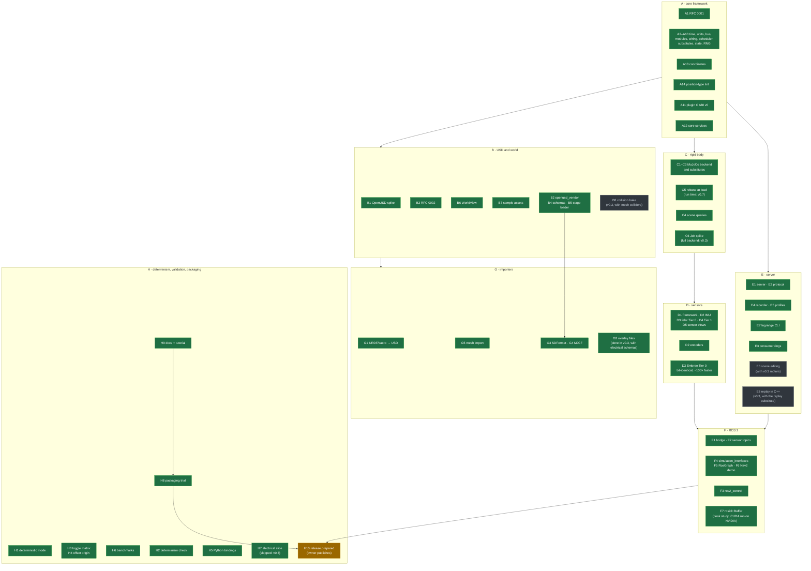

# Progress

Where the project stands against the [roadmap](roadmap.md). Updated 2026-10-24.

## The releases

```mermaid
flowchart LR
    v01["v0.1<br/>viewer, protocol,<br/>mock server<br/><b>released 2026-10-14</b>"]:::done
    v02["v0.2<br/>simulation core + AMR<br/>ROS 2, Nav2<br/><b>we are here</b>"]:::now
    v03["v0.3<br/>arms + electrical<br/>MoveIt 2"]:::todo
    v04["v0.4<br/>drones<br/>PX4 / ArduPilot SITL"]:::todo
    v05["v0.5<br/>weather + EMI"]:::todo
    v06["v0.6<br/>cars, autonomous cars<br/>OpenDRIVE, Autoware"]:::todo
    v07["v0.7<br/>huge worlds"]:::todo
    v10["v1.0<br/>stable schemas + plugin ABI<br/>ros-lyrical-* debs"]:::todo
    v01 --> v02 --> v03 --> v04 --> v05 --> v06 --> v07 --> v10

    classDef done fill:#1f6f43,stroke:#2ea043,color:#fff
    classDef now fill:#9a6700,stroke:#d29922,color:#fff
    classDef todo fill:#30363d,stroke:#6e7681,color:#c9d1d9
```

## v0.2, item by item

Green: merged. Amber: in progress or open for review. Red: blocked on a decision. Grey: not
started. Arrows show the order the work builds on.

## v0.2 status (2026-10-25)

Every v0.2 item is done or moved to v0.3 with a reason (below). Release notes, acceptance
evidence and the Gazebo Jetty comparison are in `docs/release/v0.2.0.md` and
`docs/release/v0.2.0-comparison.md`. Criteria 2 to 9 are met. **Criterion 1 is not:** a
10-minute Nav2 patrol through ros2_control did not get past Nav2's start-up on 2026-10-25
(known issue). Publishing (merging into `main`, tagging) stays with the owner.

## Defaults taken during the autonomous run

| Item | Default | Why |
|---|---|---|
| H7 (Q3) | No thin electrical slice in v0.2 | v0.3 builds the full electrical domain (network, battery, motors, FOC); a slice now would be rewritten |
| E6 | Scene editing moves to v0.3 | Its acceptance test edits a motor parameter in a running sim; motors arrive with v0.3's electrical domain |
| G2 | Overlay files move to v0.3 | Its acceptance test gives an imported AMR motors and a battery; those schemas (`ElectricalMotorAPI`, `BatteryAPI`) come with v0.3's electrical domain |
| B8 | Collision bake moves to v0.3 | Needs mesh colliders in physics and in the lidar (none yet) and a CoACD vendor package; the sample warehouse's shelves are primitives today |
| E8 | Replay in the C++ server moves to v0.3 | The Python replay works for users today. v0.3's bench mode needs a C++ replay substitute (rigid body replaced by a recorded run); built once there as a module, it gives the server replay too |

## Autonomous run (from 2026-10-24)

The owner asked for v0.2 and then v0.3 to be worked through without waiting for input, with
these standing answers:

- **Gated changes** (`schemas/`, `proto/`, `core/plugin_abi/`, accepting RFCs): merged by the
  agent acting for the owner, each with an RFC or change note marked *pre-approved by the owner
  on 2026-10-24 for autonomous work*, after local verification. Every one is listed below for
  review.
- **F3 ros2_control**: finish and merge; encoder resolution from
  `<param name="encoder_resolution">` in `<ros2_control>`; the Nav2 demo moves to
  `diff_drive_controller`.
- **C5 runtime rebase**: deferred to v0.7 (huge worlds); v0.2 rebases at load.
- **Releases**: prepared (notes, comparison, release PR), never merged to `main` or tagged by
  the agent.
- **F7** (`rosidl::Buffer`, CUDA): this machine has no NVIDIA GPU; desk study only.

### Work queue

v0.2, in order:

1. #46 OpenUSD vendor, schemas, stage loader (B2, B4, B5); then #50 SDFormat and MJCF (G3, G4)
2. F3 ros2_control with D2 encoders; Nav2 demo on `diff_drive_controller`
3. C5: record the deferral in the roadmap
4. A11 plugin C ABI v0; A12 core services
5. C4 scene queries (on `ShapeCaster`); E3 tick records; E6 scene editing; E8 mock server alignment
6. G2 overlay files; B8 collision bake; C6 Jolt spike
7. H2 determinism check; H5 Python bindings; F7 desk study
8. H8 packaging trial (Podman image running the Nav2 demo, bloom dry run, Q18 write-up)
9. H10 release preparation (not published)

Then v0.3, epic by epic as in [roadmap.md §4](roadmap.md), in this order:

1. Torque commands: controllers write `joint/<j>/torque_command`; the electrical domain turns it
   into `joint/<j>/torque` (its ideal substitute until the network exists). **Done** (2026-10-25)
2. Electrical schemas (`ElectricalMotorAPI_1`, `BatteryAPI_1`, `PortAPI_1`, bus, load,
   converter); the stage collects their instances; G2 overlay files (**done** 2026-10-25)
3. Electrical network module (DC bus, battery ECM, averaged motor drives) and its tests
   (**done** 2026-10-25; the sample AMR runs on it by default. Owed: the battery check against a
   published cell dataset, sim-vs-real (Q16), the drive-design review of the motor constants
   (RFC 0002 resolution 2), converters, rotor inertia in physics: domains/electrical.md §9)
4. Thermal module (lumped networks), coupled to electrical losses (**done** 2026-10-25; runs
   when the ambient temperature is given. Owed: a published or recorded motor heat run (Q16),
   airspeed and sun direction with the aero and weather domains: domains/thermal.md §8)
5. Coupling stability checks across the electrical, thermal and physics rates (**done**
   2026-10-25: architecture.md §8.1; the scheduler steps flow readers at their window's end)
6. FMU host (**done** 2026-10-25, on our `fmilibrary3_vendor`: Lyrical's `fmilibrary_vendor`
   pins FMI Library 2.2.3, FMI 2.0 only; reference FMU `lagrange_models/dc_drive`)
7. Bench mode: the replay substitute for rigid body (**done** 2026-10-25: `lagrange_recording`,
   `--bench`; 10 kHz electrical at about 59× real time. E8, replay in the C++ server, stays
   open: the viewer's replay seeks, the scheduler does not; open-questions.md Q15)
8. SPICE netlist and Modelica export; ngspice offline comparison (**done** 2026-10-25:
   `lagrange export`; netlist round trip in ngspice within 0.05 %; Modelica checked for
   structure only, no OpenModelica here)
9. Robot arm sample and MoveIt 2 (**done** 2026-10-25: `arm6`, its overlays and workcell;
   joint_trajectory_controller at 1 kHz; MoveIt 2 pick-and-place via moveit_py; the derating
   scenario passes with `tools/ci/arm_scenario.sh`. Fixed on the way: MuJoCo read revolute
   limits as degrees; the position servo lagged moving set points (now velocity feedforward);
   the Python bindings hid lagrange.viewer. Not yet: wrist camera, grasped object)
10. Raster camera sensor
11. Jolt full backend
12. Schema migration tools (`tools/`)
13. E6 scene editing; B8 collision bake
14. Viewer additions (schematic, electrical scopes)

### Merged under the autonomous mandate

| PR | Gated path | Note |
|---|---|---|
| #46 OpenUSD vendor, schemas, stage loader | `schemas/` (sensor library, `lagrangeUnit` metadata, under the accepted RFC 0002) | Rebased onto #51–#58; `--spawn` fixed for USD. ASan/UBSan run not done: stopped by the system for low memory while building OpenUSD |
| #50 SDFormat and MJCF importers | none (stacked on #46) | Rebased; `--spawn` fixed for SDFormat and MJCF too |
| plugin C ABI v0 (A11) | `core/plugin_abi/` (new: `lagrange_plugin.h`, ABI 0.1, as RFC 0001 and architecture.md §13 specify) | C99 sample built with `-std=c99 -pedantic -Werror`; ASan/UBSan clean |
| plugin ABI schema queries | `core/plugin_abi/` (host functions answer from `World::schemaInstances`) | C99 sample's schema_probe reads two motors' values |
| thermal schemas | `schemas/` (new `schemas/thermal` library: `ThermalAPI_1`, `ThermalLinkAPI_1` from formats.md §3.2, under the accepted RFC 0002) | As drafted; changelog entry |
| electrical network (fallback doc fix) | `schemas/` (documentation of `elec:backEmfConstant`'s fallback corrected to Kt/1.5 for dq machines; changelog entry) | No attribute changed; the network refuses an authored Ke that disagrees with Kt by over 3 % |
| electrical schemas and their loading | `schemas/` (new `schemas/electrical` library: six schemas from formats.md §3.1, under the accepted RFC 0002; `schemas/CHANGELOG.md` started) | Two additions to the drafts, listed in the changelog. Motor constant conventions still need the drive-design review RFC 0002 asks for before the network uses them |

### Known issues

- **Nav2 demo start-up on one machine** (2026-10-25): with ros2_control, about half the launches
  have one ROS process never discover another's services (spawner and `/controller_manager`,
  patrol and AMCL). Once up, every patrol reached 6/6 waypoints without a collision. Mitigations
  in place: spawner retried in fresh processes, 30 s bond timeout, the patrol exits 3 when the
  stack never comes up and `nav2_demo.sh` relaunches once on that only. Root cause (Fast DDS
  discovery) not found; investigation stopped to keep the queue moving.
  Seen again in the container image (H8): with ros2_control in two runs out of two, and once
  with the built-in controller (Nav2's controller server never got `/odom`). So it is not
  ros2_control's: some process occasionally never discovers another's endpoint during the
  crowded start-up. The image defaults to the built-in controller.
