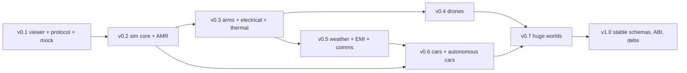

# Roadmap

Status: plan for review. Releases v0.1 and v0.2 are broken into epics and issues ready to be
filed. Later releases are at epic level. No dates are given: team size is not known (open
question Q19), and estimates are relative sizes.

Estimate scale: **S** up to 2 days, **M** 3–5 days, **L** 1–2 weeks, for one engineer who knows
the area. An issue larger than L must be split before it is filed.

Labels come from `.github/labels.yml` (`docs/plan/repo-tooling.md` §8): `area/*`, `type/*`,
plus `needs-rfc`, `good-first-issue`, `tier/0|1|2`.

## 1. Release dependency graph

| Release | Needs from earlier releases |
|---|---|
| v0.2 | Protocol and viewer (v0.1) to observe the real server; mock server's protocol frontend is reused |
| v0.3 | Scheduler, signal bus, substitutes, ros2_control bridge (v0.2) |
| v0.4 | Electrical (v0.3) for motor and battery behaviour; coordinates and rebase (v0.2) |
| v0.5 | Sensors (v0.2–v0.4), fields infrastructure; minimal weather state already in v0.3 |
| v0.6 | Sensors on Tier 2, weather (v0.5), rigid-body backend abstraction with a second backend (v0.2–v0.3) |
| v0.7 | Region ids and floating origin (v0.2), streaming-aware renderer (v0.1 design) |
| v1.0 | Migration tools exercised since v0.3; ABI checks since v0.2 |

## 2. v0.1 — native viewer, protocol, mock/replay server

**Scope.** `lagrange_viewer` (Vulkan + Dear ImGui docking) with the panels in CLAUDE.md §13.2, the
protocol in `docs/design/protocol.md`, and a mock server that plays recordings and serves a
sample scene. No physics.

**Acceptance criteria.**

1. On Ubuntu 26.04 amd64, `ros2 run lagrange_viewer lagrange_viewer` opens a native window under
   GNOME Wayland and under X11.
2. From a clean install, a user opens the bundled sample URDF and sees it in the 3D viewport
   within one minute, including reading the quick-start page.
3. Replaying the sample MCAP: the viewport runs at 60 fps with 8 scopes open, and 16 signals at
   10 kHz show zero dropped samples for 60 s (reference desktop).
4. The domain panel writes a YAML profile that validates against `profiles/schema.json`.
5. Cold start to first rendered frame with the sample URDF is under 5 s on a warm disk.
6. The headless viewer test passes on lavapipe in CI against the mock server, including the
   golden-image comparison.
7. The viewer links no simulation module and no `rclcpp`; a CI check proves it.
8. All repository tooling in `repo-tooling.md` is in place and green.

**How a URDF is shown without a simulator or C++ OpenUSD** is open question Q4. The issues below
assume the recommended option: the mock server (Python) converts URDF to protocol scene messages
directly with `urdfdom`'s Python bindings or its own small parser, and USD enters in v0.2.

### Epic 0.1-A: repository and tooling

| ID | Title | Description and acceptance criteria | Labels | Est. |
|---|---|---|---|---|
| A1 | Bootstrap repository files | Add `LICENSE`, `LICENSES/`, `REUSE.toml`, `README.md`, `CONTRIBUTING.md`, `CODE_OF_CONDUCT.md`, `SECURITY.md`, `GOVERNANCE.md`, `CHANGELOG.md`, `.editorconfig`, `.gitattributes`, `.gitignore` from `repo-tooling.md`. **AC:** `reuse lint` passes; files render on GitHub | `area/ci`, `type/chore` | S |
| A2 | Formatting and lint configs | Add `.clang-format`, `.clang-tidy` (with the corrected header filter, F6), `.pre-commit-config.yaml` with every `rev:` resolved and pinned, `pyproject.toml` (ruff, mypy), `.yamllint`, `.typos.toml`. **AC:** `pre-commit run --all-files` passes on the empty tree; pins recorded with their source in the PR | `area/ci`, `type/chore` | M |
| A3 | Colcon workspace skeleton | Top-level layout, `colcon.defaults`, `CMakePresets.json`, `cmake/LagrangeCompileOptions.cmake` (warnings, `-ffp-contract=off` option, sanitizer presets), an empty `lagrange_core` package that builds and runs one gtest. **AC:** `colcon build && colcon test` green in a `ros:lyrical` container on amd64 and arm64 | `area/core`, `type/chore` | M |
| A4 | CI: lint, build, test | `ci.yml` jobs `lint`, `build-test` (amd64, arm64), with ccache. Actions pinned to SHAs. **AC:** required checks listed in branch protection run on a PR | `area/ci`, `type/feature` | M |
| A5 | CI: sanitizers | ASan+UBSan and TSan jobs using presets from A3. **AC:** a deliberately broken test branch is caught by each sanitizer | `area/ci`, `type/feature` | S |
| A6 | Commit and DCO checks | commitizen `cz check` on PR title and commits; DCO check. **AC:** a PR without sign-off or with a bad title fails | `area/ci`, `type/chore` | S |
| A7 | Labels, templates, CODEOWNERS, Renovate | Add `.github/` files from `repo-tooling.md`. **AC:** label sync workflow creates the labels; issue forms require OS/GPU/driver for bugs | `area/ci`, `type/chore` | S |
| A8 | Security workflows | CodeQL (C++ and Python), OpenSSF Scorecard, secret scanning with push protection enabled in settings. **AC:** workflows run; findings triaged | `area/ci`, `type/security` | S |
| A9 | Docs site skeleton | Sphinx or MkDocs (decide in the issue; both are Python) building `docs/` with link checking. **AC:** docs job green; quick-start page exists | `area/docs`, `type/feature` | M |
| A10 | Dependency-graph check | Script that parses `package.xml` files and fails if `lagrange_viewer` depends on `lagrange_mod_*`, `lagrange_server` or `rclcpp`, or if a module depends on another module. **AC:** unit-tested with fixture trees; runs in `lint` | `area/ci`, `type/feature` | S |
| A11 | Local rosdep source | `packaging/rosdep/lagrange.yaml` with keys missing upstream (SDL3, Slang, …) and an upstream PR to `ros/rosdistro`. **AC:** `rosdep install --from-paths .` resolves every dependency in the container | `area/packaging`, `type/chore` | S |

### Epic 0.1-B: protocol

| ID | Title | Description and acceptance criteria | Labels | Est. |
|---|---|---|---|---|
| B1 | Accept RFC 0003 | Review and merge `rfcs/0003`; record decisions (encoding, transport, shm). **AC:** RFC status "accepted" | `area/proto`, `needs-rfc` | S |
| B2 | `lagrange_proto` package | `.proto` files from `protocol.md`, `buf.yaml`, C++ and Python code generation in CMake, installed targets. **AC:** `buf lint` clean; a C++ and a Python test each round-trip every message | `area/proto`, `type/feature` | M |
| B3 | `buf breaking` in CI | Job comparing against `main` with the `proto-break` label rule. **AC:** a field-number change without the label fails | `area/proto`, `area/ci` | S |
| B4 | Framing library (C++) | Length-prefixed frame reader/writer over a byte stream with a size limit and partial-read handling; no sockets inside. **AC:** unit tests for split frames, oversize, truncated input; libFuzzer target runs 5 minutes clean in CI | `area/proto`, `type/feature` | M |
| B5 | Transport: Unix socket and TCP | Non-blocking client connect, `poll` loop, reconnect, fd passing (`SCM_RIGHTS`) for Unix sockets. **AC:** integration test against a test server on both transports | `area/proto`, `type/feature` | M |
| B6 | Shared-memory regions | `memfd` arena with slot headers and generation checks (protocol §6), writer in Python (mock server) and reader in C++. **AC:** stress test with a writer reusing slots; reader never accepts a torn payload | `area/proto`, `type/feature` | L |
| B7 | Protocol conformance client | Python reference client that checks handshake, sequencing, catalog generations and gap-free runs. **AC:** runs in CI against the mock server; reused in v0.2 | `area/proto`, `type/test` | M |
| B8 | Golden frames | Recorded binary frames per message under `tests/protocol/golden/`. **AC:** C++ and Python decode them identically | `area/proto`, `type/test` | S |

### Epic 0.1-C: mock/replay server

| ID | Title | Description and acceptance criteria | Labels | Est. |
|---|---|---|---|---|
| C1 | Mock server skeleton | `lagrange_mock_server` package (Python, ruff + mypy strict): asyncio server, handshake, status, ping. **AC:** conformance client handshake passes | `area/mock`, `type/feature` | M |
| C2 | Recording format v1 | `proto/lagrange/record/v1` messages (`RunMeta`, catalog, state hash) and an MCAP writer/reader wrapper. **AC:** write and read back a file; `mcap` CLI lists the channels | `area/io`, `type/feature` | M |
| C3 | Sample recording generator | Deterministic script producing `sample_amr.mcap`: AMR driving a figure-eight with plausible joint, body, motor-current, bus-voltage and temperature signals at their native rates (10 kHz electrical). Clearly labelled synthetic. **AC:** file under 1 MB in repo or fetched with checksum; regenerating gives identical bytes | `area/mock`, `type/feature` | M |
| C4 | Replay engine | Play, pause, step, seek, real-time factor; emits `SceneDelta` and batched `SignalBlock`s with correct `first_index`. **AC:** conformance client sees no gaps at 1× and 4×; seek resyncs with a snapshot | `area/mock`, `type/feature` | L |
| C5 | Subscriptions and decimation | Per-client subscriptions, `MODE_FULL`, `MODE_MINMAX`, `MODE_STRIDE`. **AC:** min/max output matches a brute-force reference | `area/mock`, `type/feature` | M |
| C6 | Scene from URDF | Parse URDF (+ xacro through the `xacro` executable), resolve meshes (STL/DAE/OBJ via a Python mesh loader, TODO(verify) choice and license) and build `SceneSnapshot`. **AC:** the sample URDF and two public test URDFs load; unsupported elements are reported in the log | `area/mock`, `area/io` | L |
| C7 | Profile service | `GetProfile`, `ValidateProfile` (JSON Schema + extra checks), `ApplyProfile` (mock: updates `ProfileState` and catalog `substituted` flags). **AC:** invalid profiles return JSON-pointer issues | `area/mock`, `type/feature` | M |
| C8 | Attributes and electrical nets | Serve `GetAttributes` and `SceneSnapshot.nets` from a sidecar YAML describing schema attributes for the sample robot. **AC:** inspector and schematic panels have real data from the protocol | `area/mock`, `type/feature` | M |
| C9 | Log, sample field, fake ROS graph | `LogRecord` stream; a sample scalar field as a dense grid; `RosGraph` from MCAP channels. **AC:** panels show them | `area/mock`, `type/feature` | S |
| C10 | rosbag2 MCAP compatibility | Open an MCAP written by `ros2 bag record -s mcap` and expose `tf`, `joint_states` and numeric fields of common messages. **AC:** a recorded bag of a ROS demo plays in the viewer (transforms + scopes) | `area/mock`, `area/io` | L |
| C11 | Load test mode | `--stress` option producing 64 signals at 10 kHz and 5000 moving prims. **AC:** used by the performance tests in epic H | `area/mock`, `type/test` | S |

### Epic 0.1-D: GPU HAL and renderer

| ID | Title | Description and acceptance criteria | Labels | Est. |
|---|---|---|---|---|
| D1 | Accept RFC 0004 and RFC 0006 | Review and merge the tier and viewer-stack RFCs. **AC:** status "accepted" | `area/gpu`, `area/viewer`, `needs-rfc` | S |
| D2 | `gpu/hal` Vulkan device | Instance, device selection, queues, VMA allocator, command contexts, staging uploads, debug names, validation-layer option. No SDL includes. **AC:** unit tests run on lavapipe; validation layers clean | `area/gpu`, `type/feature` | L |
| D3 | Capability detection | `gpu/capability`: tier 0/1/2 from device features, `LAGRANGE_TIER` override, a `lagrange_gpu_info` tool. **AC:** reports Tier 0 on lavapipe-only, Tier 2 on the RTX runner | `area/gpu`, `tier/0`, `tier/1`, `tier/2` | M |
| D4 | Slang build integration | CMake function `lagrange_add_slang_module()` compiling `.slang` to SPIR-V at build time with reflection output; uses apt `slang-compiler`. **AC:** a triangle shader builds; SPIR-V validates; decision recorded on apt vs `slang_vendor` | `area/gpu`, `type/feature` | M |
| D5 | `gpu/scene` GpuScene | Mesh buffers, material table, instance transforms, `GpuSceneSource` interface. **AC:** unit test uploads and draws 1000 instances | `area/gpu`, `type/feature` | L |
| D6 | Frame graph and opaque pass | Pass description, attachments, depth pre-pass, opaque pass with UsdPreviewSurface-level shading in Slang. **AC:** golden image of a test scene on lavapipe | `area/viewer`, `area/gpu` | L |
| D7 | Overlay pass | Grid, axes, selection outline, id buffer picking, contact points and force arrows. **AC:** picking returns the right prim in a test scene | `area/viewer`, `type/feature` | M |
| D8 | Field slice rendering | Draw a slice plane of a 3D scalar grid with a colour map. **AC:** golden image | `area/viewer`, `type/feature` | M |
| D9 | Large-coordinate rendering | Camera-relative transforms in `double`, reversed-Z float depth. **AC:** a scene 500 km from the origin renders identically to the same scene at the origin (image diff) | `area/viewer`, `area/gpu` | M |

### Epic 0.1-E: viewer application

| ID | Title | Description and acceptance criteria | Labels | Est. |
|---|---|---|---|---|
| E1 | `imgui_vendor` | Vendor package with pinned docking-branch ImGui, SDL3 + Vulkan backends, freetype, ImPlot, node editor, ImGuizmo; versions and licenses recorded. **AC:** builds on amd64 and arm64; demo window test runs on lavapipe | `area/viewer`, `area/packaging` | M |
| E2 | Window and swapchain | SDL3 window, Vulkan surface, swapchain with resize and out-of-date handling, Wayland/X11 selection flags. **AC:** manual test on GNOME Wayland and X11; headless path for CI | `area/viewer`, `type/feature` | M |
| E3 | Frame loop | `FrameLoop` as in `viewer.md` §5 with `FrameStats`, minimised-window sleep, `runFrames(N)`. **AC:** unit test renders exactly N frames headless | `area/viewer`, `type/feature` | M |
| E4 | `ViewerClient` and stores | Worker thread, `SceneStore` triple buffer, `SceneEdit` queue, `SignalStore`. **AC:** TSan-clean integration test against the mock server; resync on dropped delta | `area/viewer`, `type/feature` | L |
| E5 | `ScopeBuffer` | Ring + min/max pyramid + gap tracking. **AC:** property tests against brute force; benchmark 16 × 10 kHz ingest at < 2 % of one core | `area/viewer`, `type/feature` | L |
| E6 | Panel framework and layouts | `Panel`, `PanelRegistry`, settings handler, presets, View menu. **AC:** layout round-trips; unknown panel ids ignored | `area/viewer`, `type/feature` | M |
| E7 | HiDPI and fonts | Display-scale handling, font atlas rebuild, Japanese glyphs, icon font; bundled fonts with license files. **AC:** test stage with Japanese prim names renders; moving the window between 1× and 2× monitors rescales without restart | `area/viewer`, `type/feature` | M |
| E8 | Viewport panel | Orbit/fly camera, selection, gizmo, toolbar, status readouts. **AC:** UI test selects a prim by click | `area/viewer`, `type/feature` | L |
| E9 | Scene tree panel | Virtualised tree, filter, schema badges, shared selection. **AC:** 100 000-prim stress scene scrolls within the frame budget | `area/viewer`, `type/feature` | M |
| E10 | Inspector panel | Attribute groups by schema with units, edit → `SetAttribute`, live signals with "add to scope". **AC:** UI test edits a value and sees the mock server echo it | `area/viewer`, `type/feature` | M |
| E11 | Domain panel | Toggles, substitutes, dt, YAML preview, validate/apply/save. **AC:** saved file validates with the JSON Schema in CI; cannot produce a disabled domain without a substitute | `area/viewer`, `type/feature` | L |
| E12 | Timeline panel | Transport controls, RTF, scrub bar with markers. **AC:** UI test seeks and the viewport updates | `area/viewer`, `type/feature` | M |
| E13 | Scope panel | Multi-instance, stacked axes by unit, freeze, window, cursors, trigger, drag-and-drop of signals. **AC:** budgets in `viewer.md` §11 met; gap markers shown when the stress server drops | `area/viewer`, `type/feature` | L |
| E14 | Schematic panel | Canvas interface + imgui-node-editor implementation, nets, animated current, auto layout, selection sync. **AC:** sample AMR schematic matches the nets in the scene; animation direction follows current sign | `area/viewer`, `type/feature` | L |
| E15 | Fields, console, ROS topics panels | Three smaller panels. **AC:** each shows mock data; console handles 100 000 lines | `area/viewer`, `type/feature` | M |
| E16 | File open and drag-and-drop | Open URDF/MCAP through `ImportRobot`/`OpenRecording`; remote content upload path. **AC:** dropping the sample URDF on the window shows it | `area/viewer`, `type/feature` | S |
| E17 | Settings and CLI | `--connect`, `--layout`, `--headless`, `--frames`, `--benchmark`, `--x11`, `--wayland`; XDG config and cache paths. **AC:** documented in `--help` and the docs | `area/viewer`, `type/feature` | S |
| E18 | Launch integration | `ros2 launch lagrange_viewer demo.launch.py` starts the mock server and viewer. **AC:** quick-start works from a clean container with a display | `area/viewer`, `type/feature` | S |

### Epic 0.1-F: profiles

| ID | Title | Description and acceptance criteria | Labels | Est. |
|---|---|---|---|---|
| F1 | Accept RFC 0005 | Review and merge the profile-format RFC. **AC:** status "accepted" | `area/profiles`, `needs-rfc` | S |
| F2 | `profiles/schema.json` and examples | The schema and eight example profiles from `formats.md`. **AC:** CI validates all examples; negative fixtures fail with the expected pointer | `area/profiles`, `type/feature` | M |
| F3 | Profile library (Python) | Load, validate, extra checks (whole-nanosecond `dt`, commensurate steps), canonical YAML output. **AC:** unit tests; used by the mock server | `area/profiles`, `type/feature` | M |
| F4 | Profile validation in the viewer (C++) | JSON Schema validation of the in-memory YAML; choose and record the validator library. **AC:** same fixtures as F2 give the same results as Python | `area/profiles`, `area/viewer` | M |

### Epic 0.1-G: viewer tests and performance

| ID | Title | Description and acceptance criteria | Labels | Est. |
|---|---|---|---|---|
| G1 | Headless viewer CI job | Install `mesa-vulkan-drivers`, set the lavapipe ICD, run mock server + viewer for 300 frames. **AC:** job green; frames complete; artifacts uploaded on failure | `area/ci`, `area/viewer`, `tier/0` | M |
| G2 | Golden-image comparison | Tolerance-based comparison tool and goldens produced on lavapipe. **AC:** an intentional shader change fails the job | `area/viewer`, `type/test` | M |
| G3 | UI automation | ImGui Test Engine behind `LAGRANGE_VIEWER_UI_TESTS`, fetched in CI only; five scripted flows. **AC:** license handling documented (Q12); tests run headless | `area/viewer`, `type/test` | L |
| G4 | Performance harness | `--benchmark` mode writing JSON (`FrameStats` percentiles, drops, start-up time); nightly job on the GPU runner with thresholds. **AC:** budgets from CLAUDE.md §13.4 asserted | `area/viewer`, `type/perf` | M |
| G5 | Self-hosted GPU runner | Provision an Ubuntu 26.04 runner with an RTX GPU and driver 595, hardened for public-repo use (jobs only from the merge queue and nightly). **AC:** `vulkaninfo` output archived, confirming ray-tracing extensions | `area/ci`, `tier/2` | M |
| G6 | Manual test matrix | Checklist for GNOME Wayland/X11, KDE Wayland, fractional scaling, NVIDIA and Mesa drivers. **AC:** checklist run and filed for the release | `area/viewer`, `type/test` | S |

### Epic 0.1-H: documentation and release

| ID | Title | Description and acceptance criteria | Labels | Est. |
|---|---|---|---|---|
| H1 | Quick start and viewer guide | Install from source, run the demo, panel reference. **AC:** a new user reaches the 3D view within a minute after install (timed once by someone outside the team) | `area/docs`, `type/docs` | M |
| H2 | Protocol reference | Generated from `.proto` comments plus the session flow. **AC:** published on the docs site | `area/docs`, `area/proto` | S |
| H3 | Release workflow | release-please configuration, changelog, signed tag, SBOM, source tarball. No debs yet. **AC:** a dry-run release on a fork | `area/ci`, `area/packaging` | M |
| H4 | v0.1 release | Tag, notes, known limitations. **AC:** all acceptance criteria above checked in the release issue | `type/release` | S |

## 3. v0.2 — simulation core and AMR

**Scope.** `lagrange_core` (units, signal bus, scheduler, substitutes, plugin loading),
USD stage loading into SoA with the first schemas, one rigid-body backend, lidar/IMU/encoder
sensors on Tier 0 and Tier 1, the real server speaking the v0.1 protocol, ROS 2 bridge,
ros2_control `SystemInterface`, Nav2 demo, importers, recording, determinism.

**Acceptance criteria.**

1. `ros2 launch lagrange_demos amr_warehouse.launch.py` runs the sample AMR with Nav2 through
   `lagrange_ros2_control` and reaches four waypoints for 10 simulated minutes without collision.
2. The viewer from v0.1 connects to the real server with no protocol major change and shows the
   scene, signals and domain states.
3. A profile with mismatched units between two modules fails at startup with a message naming
   both modules, the signal and both units (automated test).
4. Disabling any domain with its substitute keeps the simulation running (automated test over
   all domains present).
5. Deterministic mode: two runs give bit-identical state hashes for 10 simulated seconds (merge
   queue test).
6. Lidar output from Tier 0 (Embree) and Tier 1 (compute BVH) agrees within the tolerance in
   `domains/sensors.md` §7.
7. URDF, SDFormat and MJCF versions of the sample robot import to USD and simulate.
8. A world placed 500 km from the origin simulates identically to one at the origin.
9. Real-time factor ≥ 1.0 for the demo on the reference desktop with the lidar on Tier 1.

### Epic 0.2-A: core framework

| ID | Title | Description and acceptance criteria | Labels | Est. |
|---|---|---|---|---|
| A1 | Accept RFC 0001 | Module interface, `SignalSpec`, hold policies, state save/restore. **AC:** accepted | `area/core`, `needs-rfc` | S |
| A2 | Time types | `SimTime`, `Duration`, decimal-exact parsing of `dt`. **AC:** `0.0001` parses to 100 000 ns; `0.00101e-4` style inputs rejected when not whole nanoseconds | `area/core`, `type/feature` | S |
| A3 | Units | `Dimension`, `QuantityKind`, `Unit`, constants, parser for schema unit strings (`"N.m/A"`), `to_string`. **AC:** torque ≠ energy; table-driven tests for every unit used in the schemas | `area/core`, `type/feature` | M |
| A4 | Signal bus | Storage, `SignalId` access, batches, stamps, history for hold policies, buffer table for handle types. **AC:** unit tests; micro-benchmark of read/write under 2 ns in release | `area/core`, `type/feature` | L |
| A5 | Module interface and registry | `IModule`, `SignalDeclarer`, `ModuleConfig`, registry, ament-index plugin discovery and `dlopen`. **AC:** a test plugin is discovered and stepped | `area/core`, `type/feature` | M |
| A6 | Wiring | Graph build, unit/type/writer checks, feedback edges, cycle report, contract check, collected errors. **AC:** one test per `WiringError::Kind`; error text reviewed for clarity | `area/core`, `type/feature` | L |
| A7 | Scheduler | Base tick, total order, hold policies across rates, level-parallel execution, real-time pacing, `stepUntil`. **AC:** multirate test with 100 µs / 1 ms / 100 ms modules checks call counts and values seen | `area/core`, `type/feature` | L |
| A8 | Substitute registry and generic substitutes | Registry, contracts, `Constant` and `Replay` generic substitutes, contract test harness. **AC:** every registered domain has a substitute or the test fails | `area/core`, `type/feature` | M |
| A9 | State save/restore and hashing | `StateWriter/Reader`, `Scheduler::stateHash`. **AC:** save → run → restore → run gives identical hashes | `area/core`, `type/feature` | M |
| A10 | Counter-based RNG | Philox keyed by (seed, module, entity, step). **AC:** known-answer tests; order-independence test | `area/core`, `type/feature` | S |
| A11 | Plugin C ABI v0 | `lagrange_plugin.h`, host adapter to `IModule`, C99 sample plugin, load test. **AC:** sample plugin built with `-std=c99 -pedantic` runs in the scheduler | `area/core`, `area/plugin-abi`, `needs-rfc` | L |
| A12 | Core services | `wrench_sum` module, `SceneQuery` service interface, logging sink. **AC:** two wrench writers on one body sum correctly | `area/core`, `type/feature` | M |
| A13 | Coordinates | `GeoOrigin`, ECEF/ENU/geodetic, `RegionOrigin`, rebase of world tables. **AC:** agreement with GeographicLib < 1e-6 m within 100 km | `area/core`, `type/feature` | M |
| A14 | Position-type lint | clang-tidy or script check that forbids `float` world/local positions. **AC:** fixture violations detected | `area/core`, `area/ci` | S |

### Epic 0.2-B: USD, schemas and world

| ID | Title | Description and acceptance criteria | Labels | Est. |
|---|---|---|---|---|
| B1 | OpenUSD build spike | Build v26.08 minimal configuration in `ros:lyrical` on amd64 and arm64; record time, size, patches, Python 3.14 result. **AC:** written report; pin chosen; go/no-go on Python bindings | `area/packaging`, `type/spike` | M |
| B2 | `openusd_vendor` | Vendor package per `dependencies.md` §4 with CI install-tree cache and a prebuilt underlay artifact. **AC:** clean CI build uses the cache; cache miss build documented | `area/packaging`, `type/feature` | L |
| B3 | Accept RFC 0002 | Schema conventions, versioning suffix, codeless decision, first schema set. **AC:** accepted | `area/schemas`, `needs-rfc` | S |
| B4 | Schema libraries (first set) | `PortAPI`, `BatteryAPI`, `ElectricalMotorAPI`, `ElectricalBusAPI`, `ElectricalLoadAPI`, `ThermalAPI`, `SensorMaterialAPI`, `SensorAPI`, `LidarAPI`, `ImuAPI` as codeless schemas with `plugInfo.json`; unit metadata check. **AC:** `usdchecker`-style validation of the sample robot; every attribute has a parsable unit | `area/schemas`, `type/feature` | L |
| B5 | Stage loader | USD → SoA tables (`Prims`, `Transforms`, `Bodies`, `Joints`, `Colliders`, `RenderMeshes`, `Materials`, `SchemaInstances`), asset resolution, load report. **AC:** sample AMR loads; no USD symbol referenced from `lagrange_core` or modules (link check) | `area/core`, `area/schemas` | L |
| B6 | `WorldView` | Read-only views and schema-instance lookup. **AC:** unit tests; used by the first module | `area/core`, `type/feature` | M |
| B7 | Sample assets | `amr_diffdrive.usda`, `warehouse_small.usda`, `empty_flat.usda`, materials library with sources. **AC:** files under 1 MB; parameters documented as illustrative | `area/assets`, `type/feature` | M |
| B8 | Collision bake tool | `tools/collision_bake` with CoACD (`coacd_vendor`). **AC:** warehouse shelves get convex hulls; report lists hull counts | `area/io`, `type/feature` | M |

### Epic 0.2-C: rigid body

| ID | Title | Description and acceptance criteria | Labels | Est. |
|---|---|---|---|---|
| C1 | Backend choice | Decide MuJoCo source (Lyrical vendor vs apt) and confirm the first backend (Q9). **AC:** decision recorded in `dependencies.md` | `area/mod-rigid-body`, `type/spike` | S |
| C2 | MuJoCo backend | Build an `mjModel` from the SoA world, step, write joint/body signals, `effective_inertia`, contacts. **AC:** validation tests in `domains/rigid_body.md` §7 (free fall, pendulum, incline) | `area/mod-rigid-body`, `type/feature` | L |
| C3 | Rigid-body substitutes | `fixed`, `load_profile`, `replay`. **AC:** contract tests pass | `area/mod-rigid-body`, `type/feature` | M |
| C4 | Scene query service | Ray and overlap queries through `SceneQuery` backed by Embree on collision geometry. **AC:** unit tests; used by sensors | `area/mod-rigid-body`, `type/feature` | M |
| C5 | Rebase support | Origin shift in the backend. **AC:** forced rebase does not change the trajectory | `area/mod-rigid-body`, `type/feature` | S |
| C6 | Second backend spike (Jolt) | Minimal Jolt backend running the pendulum and AMR. **AC:** abstraction gaps listed; full backend scheduled | `area/mod-rigid-body`, `type/spike` | M |

### Epic 0.2-D: sensors

| ID | Title | Description and acceptance criteria | Labels | Est. |
|---|---|---|---|---|
| D1 | Sensor framework | Timing model (rate, latency, jitter), per-sensor scheduling, metadata, `only` filter, ground-truth substitute. **AC:** timing histograms within one base tick | `area/mod-sensors`, `type/feature` | M |
| D2 | IMU and encoders | Noise, bias, random walk, saturation; encoder quantisation. **AC:** Allan-deviation test | `area/mod-sensors`, `type/feature` | M |
| D3 | Lidar Tier 0 | Embree scene from render or collision meshes, scan patterns, range/intensity, noise. **AC:** analytic geometry tests | `area/mod-sensors`, `tier/0` | L |
| D4 | Lidar Tier 1 | LBVH build and traversal in Slang compute; same hit record format. **AC:** tier-agreement test on the GPU runner and on lavapipe at reduced size | `area/mod-sensors`, `area/gpu`, `tier/1` | L |
| D5 | Sensor views in the protocol | `SensorFrame` for point clouds through shared memory; viewer point-cloud draw. **AC:** lidar points visible in the viewport | `area/mod-sensors`, `area/viewer` | M |

### Epic 0.2-E: server

| ID | Title | Description and acceptance criteria | Labels | Est. |
|---|---|---|---|---|
| E1 | Server process | `lagrange_server`: profile load, tier detection, stage load, plugin load, wiring, run loop, exit codes. **AC:** startup sequence of `architecture.md` §14 with tests for each failure exit | `area/server`, `type/feature` | L |
| E2 | Protocol frontend (C++) | Snapshot/delta generation from world tables, signal blocks from the bus, subscriptions, commands, shared memory. **AC:** the v0.1 conformance client passes against the real server | `area/server`, `area/proto` | L |
| E3 | Tick records and consumer rings | SPSC rings to protocol, recorder, ROS; drop/back-pressure policies. **AC:** slow-consumer tests | `area/server`, `type/feature` | M |
| E4 | Recorder | MCAP writer on its own thread, catalog, state hashes, profile and stage hash in `RunMeta`. **AC:** a recorded run replays in the mock server and through the replay substitute | `area/io`, `type/feature` | M |
| E5 | Profile apply and domain state | `ProfileState` with availability reasons, measured cost per domain, restart-on-apply. **AC:** viewer domain panel drives the real server | `area/server`, `area/profiles` | M |
| E6 | Scene editing | `SetAttribute`, `SetTransform`, session-layer save. **AC:** inspector edit changes a motor parameter in a running sim | `area/server`, `type/feature` | M |
| E7 | CLI | `lagrange run <profile>`, `lagrange validate`, `lagrange graph` (DOT of the wiring), `lagrange info`. **AC:** documented; `graph` output used in docs | `area/server`, `type/feature` | S |
| E8 | Mock server alignment | Decide and execute Q15 (keep Python mock as replay tool, or move replay into the C++ server). **AC:** one replay implementation is the product path; the other is test-only or removed | `area/mock`, `area/server` | M |

### Epic 0.2-F: ROS 2 and ros2_control

| ID | Title | Description and acceptance criteria | Labels | Est. |
|---|---|---|---|---|
| F1 | ROS 2 bridge core | In-process `rclcpp` node, `/clock`, TF, `JointState`, odometry, topic mapping file. **AC:** `ros2 topic hz /clock` matches the sim rate; works with Fast DDS and Zenoh RMWs | `area/bridge-ros2`, `type/feature` | L |
| F2 | Sensor topics | `LaserScan`, `PointCloud2`, `Imu` with correct stamps and frames. **AC:** RViz2 displays them | `area/bridge-ros2`, `type/feature` | M |
| F3 | `lagrange_ros2_control` | `SystemInterface` plugin, in-process controller manager stepped by the scheduler, effort/velocity/position interfaces, joint servo. **AC:** `diff_drive_controller` and `joint_state_broadcaster` run in lockstep; behaviour compared with `mujoco_ros2_control` on the same URDF | `area/bridge-ros2-control`, `type/feature` | L |
| F4 | `simulation_interfaces` | Implement the services the Lyrical version defines for state, stepping, reset and entity queries. **AC:** interface tests; unsupported services return a clear error | `area/bridge-ros2`, `type/feature` | M |
| F5 | `RosGraph` for the viewer | Topic list and rates from the bridge. **AC:** ROS topics panel shows the live graph | `area/bridge-ros2`, `area/viewer` | S |
| F6 | Nav2 demo | Launch files, map, Nav2 parameters for the sample AMR and warehouse. **AC:** acceptance criterion 1; run nightly | `area/demos`, `type/feature` | L |
| F7 | `rosidl::Buffer` spike | Publish a point cloud through `rosidl::Buffer` with the CPU backend, then the CUDA backend. **AC:** report on copy counts and constraints; plan for v0.6 | `area/bridge-ros2`, `type/spike` | M |

### Epic 0.2-G: importers

| ID | Title | Description and acceptance criteria | Labels | Est. |
|---|---|---|---|---|
| G1 | URDF/xacro → USD | Links, joints, inertials, geometry, materials, `<ros2_control>`, import report. **AC:** sample AMR and three public URDFs round-trip to a simulating stage | `area/io`, `type/feature` | L |
| G2 | Overlay files | Apply schemas by name from YAML. **AC:** imported AMR gains motors and battery identical to the hand-written sample | `area/io`, `type/feature` | M |
| G3 | SDFormat → USD | Models, links, joints, common sensors. **AC:** sample AMR in SDF imports and simulates | `area/io`, `type/feature` | L |
| G4 | MJCF → USD | Bodies, joints, geoms, actuators. **AC:** sample AMR in MJCF imports and simulates | `area/io`, `type/feature` | M |
| G5 | Mesh importers | glTF, OBJ, STL, DAE through Assimp → USD meshes and UsdPreviewSurface. **AC:** conversion tests with small fixtures | `area/io`, `type/feature` | M |

### Epic 0.2-H: determinism, validation, packaging

| ID | Title | Description and acceptance criteria | Labels | Est. |
|---|---|---|---|---|
| H1 | Deterministic build mode | Flags, serial scheduling option, checks that refuse non-deterministic modules. **AC:** acceptance criterion 5 | `area/core`, `type/feature` | M |
| H2 | Determinism CI job | Merge-queue job running the profile twice and comparing. **AC:** an injected nondeterminism (thread-order dependent sum) is caught | `area/ci`, `type/test` | S |
| H3 | Toggle matrix test | For each domain present: run enabled, run substituted, assert contracts and no crash. **AC:** acceptance criterion 4 | `area/core`, `type/test` | M |
| H4 | Offset-origin test | Same world at 0 km and 500 km. **AC:** acceptance criterion 8 | `area/core`, `type/test` | S |
| H5 | Python bindings | nanobind module for scheduler, bus, world queries; `pytest` suite. **AC:** a Python script steps the AMR and reads signals | `area/python`, `type/feature` | L |
| H6 | Performance benchmarks | Scheduler overhead, bus access, lidar rays per second per tier; nightly thresholds. **AC:** baselines recorded | `area/ci`, `type/perf` | M |
| H7 | Thin electrical slice (if Q3 accepted) | Battery ECM + DC motor averaged model + ideal substitute on the AMR. **AC:** brownout-on-ramp demo; coupling test for the DC motor | `area/mod-electrical`, `type/feature` | L |
| H8 | Packaging trial | `bloom` dry run for packages without vendor dependencies; Docker image on `ubuntu:resolute`; decision on buildfarm vs own apt repository (Q18). **AC:** an image runs the Nav2 demo headless | `area/packaging`, `type/feature` | L |
| H9 | Docs: concepts and AMR tutorial | Domains and substitutes, profiles, units, writing a module, AMR tutorial. **AC:** tutorial runs in CI | `area/docs`, `type/docs` | L |
| H10 | v0.2 release | Tag, notes, comparison notes against Gazebo Jetty for the AMR demo (factual, with method). **AC:** checklist complete | `type/release` | S |

## 4. v0.3 — arms, electrical, thermal (epics)

| Epic | Content | Acceptance |
|---|---|---|
| Electrical network | Circuit graph from ports and buses, battery ECM, dq PMSM/BLDC and DC motor with FOC loops, bus capacitor, regeneration, brake resistor, trips, loads, converters | `domains/electrical.md` §8 tests |
| Coupling stability | Speed prediction with `effective_inertia`, startup stability check, validation suite | `architecture.md` §8 tolerances |
| Thermal | Lumped network, derating, minimal weather state (`env/*` constants) | `domains/thermal.md` §7 tests |
| FMU host | FMI 3.0 co-simulation import, variable mapping, unit check, one reference FMU | A reference FMU runs in place of the built-in motor model; licensing question Q8 closed |
| Bench mode | Rigid body replaced by replay or load profile; electrical + thermal only | `bench_electrical_replay.yaml` runs at 10 kHz in real time on a laptop CPU |
| Arm integration | Sample 6-DoF arm, MoveIt 2 demo, joint trajectory control at 1 kHz, wrist camera (raster) | Acceptance scenario in `robot-classes.md` §4 |
| Camera sensor (raster) | Shared renderer driven from `core/world`, RGB/depth/segmentation, `Image` topics | Projection tests; viewer shows the sensor view |
| Schema migration tooling | `tools/migrate_schema`, `tools/migrate_profile`, synthetic `_0 → _1` exercise | Round-trip tests |
| Exports | SPICE netlist and Modelica export | Netlist runs in ngspice |
| Second rigid-body backend | Jolt backend complete | Backend-agreement tests |
| Viewer additions | Thermal false colour, schematic driven by the real network, scope presets for motors | Golden images |

## 5. v0.4 — drones (epics)

| Epic | Content | Acceptance |
|---|---|---|
| Rotor aero | Coefficient model, inflow lag, ground effect; BEM as a second level | `domains/aerodynamics.md` §7 |
| Aerodynamics and wind | Link drag, mean wind profile, Dryden/von Kármán turbulence, field sampling | Spectra and field tests |
| MAVLink bridge | PX4 SITL lockstep; ArduPilot SITL JSON interface | Mission scenario in `robot-classes.md` §5 |
| Sensors | GNSS, magnetometer, barometer; world magnetic model data | Sensor tests |
| ESC and battery at 50 µs | Electrical tuned for small fast motors; stability checks for low rotor inertia | Coupling tests at `J = 1e-5 kg·m²` |
| Sample quadcopter and tutorial | Asset, profile, docs | Tutorial runs in CI with SITL in a container |
| Rebase in flight | Floating-origin rebase with continuous GNSS and TF | `huge-worlds.md` §6 |

## 6. v0.5 — weather, EMI, comms (epics)

| Epic | Content | Acceptance |
|---|---|---|
| Weather module | Full `WeatherAPI`, fog, rain, dust, wet friction, lens contamination | `domains/weather.md` §7 |
| Sensor weather effects | Lidar attenuation, backscatter and rain returns; camera fog and rain; kernels on Tier 1/2 | Detection-range validation |
| Fields infrastructure | OpenVDB import, NanoVDB CPU and GPU sampling kernels, field signals, viewer volume overlays | Analytic-field tests; decision on NanoVDB version (R10) |
| EMI module | Sources, victims, calibration parameters, overlay | `domains/emi.md` §7 |
| Comms module | Link budget, packet loss applied in bridges, CAN error model | `domains/comms.md` §7 |
| Offline CFD import | OpenFOAM result → VDB wind field tool | Round-trip of an analytic field |
| Schemas | `WeatherAPI`, `EmiSourceAPI`, `EmiSusceptibilityAPI`, `RadioLinkAPI`, remaining sensor schemas | RFC 0002 amendments accepted |

## 7. v0.6 — cars and autonomous cars (epics)

| Epic | Content | Acceptance |
|---|---|---|
| Vehicle dynamics | Pacejka tyres, suspension, powertrain, brakes, steering; `VehicleAPI` schema | `domains/vehicle_dynamics.md` §7 |
| PhysX backend | `physx_vendor`, CPU backend, GPU batches on Tier 2 | Backend-agreement tests; build on GCC 15 confirmed |
| OpenDRIVE | Road network → USD meshes and lane tables | Alignment tests |
| OpenSCENARIO | Scenario runner; esmini decision | Conformance subset |
| Traffic | Built-in agents and SUMO co-simulation | `domains/traffic.md` §7 |
| Tier 2 sensors | Hardware ray-query lidar and radar, camera sensor model (exposure, noise, rolling shutter, distortion), multi-sensor scheduling | Tier-agreement and camera tests; RTF metric |
| Zero-copy ROS output | `rosidl::Buffer` with CUDA backend; Vulkan–CUDA interop in the HAL | Copy-count measurement |
| Autoware bridge | Vehicle and sensor interfaces; depends on Autoware's Lyrical status (R7) | Demo or documented fallback |
| Sample sedan, city block, tutorials | Assets and docs | Tutorials run in CI where no external stack is needed |

## 8. v0.7 — huge worlds (epics)

| Epic | Content | Acceptance |
|---|---|---|
| Tile streaming | `WorldTileAPI`, payload loading on workers, LOD selection, budgets, physics-ready gating | `huge-worlds.md` §6 |
| Active regions | Region merge/split, multiple origins, agent LOD promotion | Multi-robot test with robots 10 km apart |
| Geospatial pipeline | DEM, OSM, OpenDRIVE, 3D Tiles → tiled USD with attribution | Sample 40 km world built by CI from open data |
| Renderer scale | Per-tile BLAS/BVH, instancing, streaming-aware viewer | Frame budget during streaming |
| Protocol additions | Tile deltas, camera interest hints | No protocol major change |

Radiation is proposed for the period between v0.7 and v1.0, or as v0.8, pending open question Q2.

## 9. v1.0 — stability (epics)

| Epic | Content | Acceptance |
|---|---|---|
| Freeze | Schemas at their 1.0 versions, protocol `v1` under strict `buf breaking`, plugin ABI major 1 with `abidiff` | Freeze RFC accepted |
| Migration tools | Schema, profile and recording migration covering every pre-1.0 change made after v0.5 | Old sample files migrate in CI |
| Binary releases | `ros-lyrical-lagrange-*` debs (buildfarm or own repository), Docker images, pip wheel, SBOM, Sigstore signatures | Clean-machine install test |
| Documentation | Tutorials per robot class, module developer guide, validation report per domain | All tutorials run in CI |
| Validation report | Sim-vs-real results for each domain with data sources and tolerances | Published with the release |
| LTS policy | Release branch `release/1.x` supported with Lyrical (to May 2031); backport rules | Documented in `GOVERNANCE.md` |
| Security review | Protocol authentication and TLS, fuzzing coverage, dependency audit | Review issues closed |

## 10. Cross-cutting tracks (every release)

| Track | Rule |
|---|---|
| Validation | No physical model merges without its test and reference (CLAUDE.md §10) |
| Tiers | Every feature PR fills the tier table row |
| Docs | Every user-visible feature has a docs page and, where possible, a tutorial run in CI |
| Performance | Nightly benchmarks with regression thresholds |
| Verification debt | Each `TODO(verify)` in the plan becomes an issue in the release that first depends on it |
