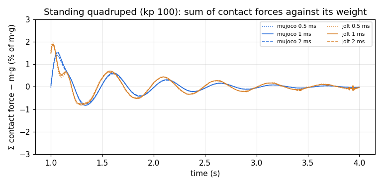
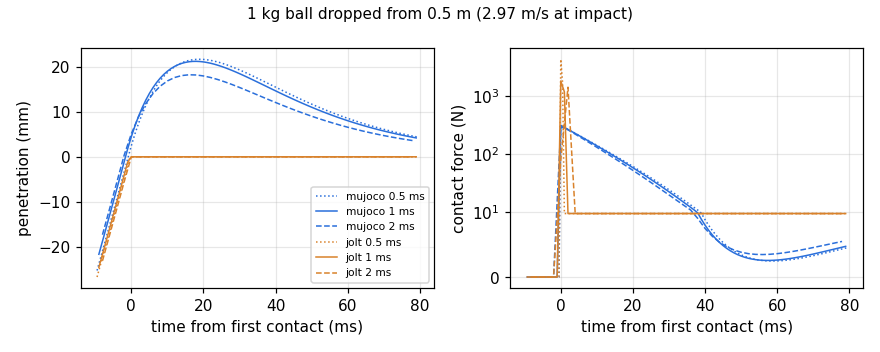
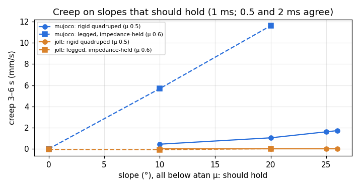
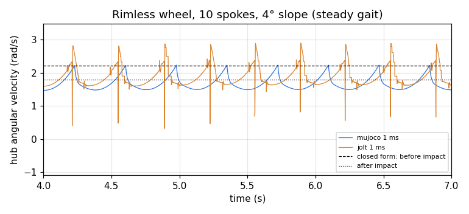
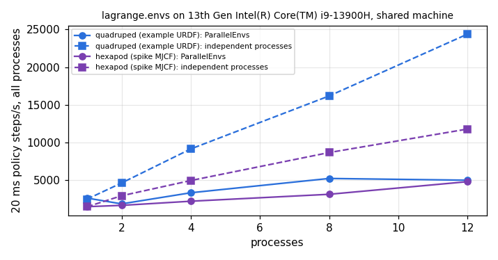

# Spike: legged contact, measured first (RFC 0019 step 1)

Date: 2026-11-15. Question: before RFC 0019 ([legged robots](../../../rfcs/0019-legged-robots.md),
Draft) adds anything, how do Lagrange's two rigid-body backends do on the contacts legs depend on,
at 0.5, 1 and 2 ms, and how fast does `lagrange.envs` run a legged robot? Step 1 of the RFC:
"tests 1–5 and 10 on both engines at 0.5, 1 and 2 ms; the RL speed ... No model changes. Decides
§4's open points." Test 6 (rimless wheel) was feasible and is included.

**Nothing in Lagrange was changed for the measurements.** Everything below runs `dev` (2e06653)
through the Python bindings, with test models and scripts in [`legged/`](legged/). Two findings
were fixed afterwards (`fix/jolt-friction-mjcf-joints`): Jolt's friction per collider (§5) and the
MJCF importer's helper frames' mass (§2); the numbers they change are rerun and marked "since the
fix".

## Answer in short

- **Static force accounting is right on both engines at every step.** A standing 12-joint
  quadruped's contact forces add up to its weight within 0.016 %; the front and rear feet carry
  what the moment balance says within 0.09 %; a two-link leg's joint torques match `Jᵀ F` within
  0.006 % (MuJoCo) and 0.96 % (Jolt). The step size does not change these.
- **MuJoCo's soft contacts creep, and much more on legs than on a box.** A rigid quadruped on a
  slope that should hold creeps 0.44 mm/s at 10° and 1.72 mm/s at 26° (μ 0.5); the same robot
  standing on impedance-held legs creeps **5.7 mm/s at 10° and 11.5 mm/s at 20°** (13× and 11×).
  The creep does not depend on the step (0.5, 1, 2 ms agree to 4 digits). Jolt holds every slope
  below atan μ with no measurable creep, and both engines slide above it at the closed-form
  acceleration (within 0.3 %).
- **Impacts:** MuJoCo's default contact is soft — a foot landing at 1.4 m/s sinks 12–13 mm, a
  ball at 3 m/s 21 mm, spread over ~40 ms. Jolt stops the body in one or two steps (peak force
  ∝ 1/dt, 32–130 m·g for the quadruped) with under 0.7 mm penetration. Neither bounces.
- **Rimless wheel (McGeer):** MuJoCo's impact ratio is within 1 % of `cos 2α` (with the hub's
  inertia) and its steady speed within 3.4–4.9 %; Jolt keeps too much energy at each impact
  (ratio +2.3–3.4 %, speed +10–17 %, chattering impacts), and `substeps: 4` does not change it.
- **Step size:** physics accuracy barely moves between 0.5, 1 and 2 ms on either engine. What
  limits the step is the joint controller: an explicit impedance law (evaluated before the step,
  as RL policies' PD loops are) stands the quadruped at kp up to 250 N·m/rad at 0.5 and 1 ms but
  only 100 at 2 ms on both engines; at 2 ms Jolt also diverged on the light hexapod where MuJoCo
  held.
- **RL speed (MuJoCo, 1 ms, 20 ms policy step):** the 12-joint example quadruped runs **2,660
  policy steps/s** in one process (RTF 53; the sensorless arm's 14,000 is not a legged number);
  the 18-joint hexapod 1,520. Independent processes scale nearly linearly (24,400 quadruped
  steps/s on 12), but `ParallelEnvs` stops at about 5,000 on 8–12 processes: its lock-step
  round trips cost more than the physics.
- **For the RFC:** keep 1 ms as the default and MuJoCo as the reference (it is the one that gets
  the rimless wheel and the sliding right and is the RL community's engine), but treat creep on
  slopes as a known MuJoCo error that legs make ten times worse: standalone MuJoCo shows the same
  creep, it scales with the foot's inverse weight (armature, i.e. rotor inertia, cuts it), and
  `noslip` stops it but changes transients (§6). Implement RFC §5's impedance mode inside the physics
  step (implicitly in MuJoCo), not as a torque computed a step earlier. Details in §11.

## 1. Setup

- Build: this branch's `dev` packages that changed since the shared base (lagrange_core, gpu,
  importers, recording, stage, aerodynamics, rigid_body_mujoco, sensors, ros2, server, python),
  built over `wt7-base` with `--cmake-clean-cache`; the Python module is this overlay's
  (`results/*.json` record its path).
- Machine: 13th Gen Intel Core i9-13900H (6 performance + 8 efficiency cores, 20 threads), 30 GB,
  shared with other agents' builds and tests. Load average (1 min) during the runs: 4.3–16.7,
  recorded in each result file. Speeds are therefore lower bounds for this machine. MuJoCo
  writes `MUJOCO_LOG.TXT` into the working directory when the gain sweep makes it diverge.
- Engines: MuJoCo 3.12.0 (vendor), Jolt 5.6.0 (vendor), as Lagrange configures them (MuJoCo:
  elliptic cone, `implicitfast`, default `solref`/`solimp`, `condim` 3; Jolt: one body per rigid
  group, friction the larger of the two bodies' at measurement time, the larger of the two
  colliders' since the fix; no sleeping).
- Every case is an MJCF with its own floor or slab (so Lagrange adds no ground) and a profile
  that picks the backend and `rigid_body.dt` and turns every other domain to its substitute.
- Legs are held by an **impedance law in Python**: before every physics step, each joint gets
  `τ = kp (q* − q) − kd q̇` as an effort command (kp 100 N·m/rad, kd 1 N·m·s/rad for the
  quadruped; the leg 400/3; the hexapod 30/0.3). Lagrange's joint module passes efforts on at its
  own 1 ms rate, so at 0.5 ms a torque holds for two physics steps. This is what RFC 0019 §5's
  impedance mode would do; Lagrange's built-in position loop (8 Hz bandwidth on the joint's
  effective inertia) cannot hold a 15 kg body (it crouches to 0.16 m, §8).

Models ([`legged/models.py`](legged/models.py) writes them to `legged/models/`):

| Model | What |
|---|---|
| `quad.xml` | The example quadruped (`examples/lagrange_example_quadruped/robot/quadruped.urdf`) in MJCF: same links, masses, inertias, axes, limits, 15.4 kg, sphere feet r 25 mm, μ 0.6; stands at hip-to-foot 0.28 m, feet under the hips |
| `quad_drop.xml` | The same, feet 0.1 m above the floor, legs held straight |
| `quad_slope_<deg>.xml` | The same on a slab tilted 0°, 10°, 20° |
| `rigid_quad_slope_<deg>.xml` | The quadruped as one rigid body in its stance (legs welded), μ 0.5, on 10–32° |
| `leg2.xml` | A 5 kg hip on a vertical rail over a two-link leg (0.3 m + 0.3 m, 0.4 and 0.2 kg) at thigh 0.6 rad, knee −1.2 rad (foot under the hip), foot and floor frictionless |
| `ball.xml` | A 1 kg sphere, r 50 mm, from 0.5 m |
| `box_slope_10.xml` | The comparison's 1 kg, 0.2 m cube on 10°, μ 0.3 (creep reference) |
| `rimless.xml` | A rimless wheel: 10 spokes of 0.5 m (two rims 0.3 m apart), 10 kg hub with 0.01 kg·m², massless spokes, tip spheres r 5 mm, μ 1.5, on 4° |
| `hexapod.xml` | A simple legged model: 4 kg box, six 3-joint legs (18 joints), 5.5 kg |

Rerun (about 20 s for the contact tests and 3 min for the RL speed on this machine):

```bash
cd docs/plan/spikes/legged
python3 models.py models
python3 contact_tests.py models OUT          # all tests; or name some: stance leg2 drop ...
python3 rl_speed.py models OUT/rl_speed.json 1 2 4 8 12
python3 plots.py OUT plots
```

## 2. Weight at rest and the symmetric stance (tests 1, 2)

The quadruped stands up from straight legs over 0.5 s and is measured over 2–4 s. "Closed form"
per foot: left and right mirror each other, so front against rear is statically determinate even
with four feet; the moment balance about y with the measured centre of mass (from the body poses
and the model's inertial offsets) and the measured feet gives each pair's share.

| Engine, step | Σ contact force − m·g | Ripple, std / peak-to-peak (% m·g) | Front, rear foot (N) | Closed form (N) | Worst foot vs closed form | Foot penetration, mean / max |
|---|---|---|---|---|---|---|
| MuJoCo 0.5 ms | +0.014 % | 0.12 / 0.55 | 32.04, 43.51 | 32.06, 43.48 | 0.07 % | 1.31 / 1.54 mm |
| MuJoCo 1 ms | +0.014 % | 0.11 / 0.53 | 32.04, 43.50 | 32.06, 43.47 | 0.07 % | 1.31 / 1.54 mm |
| MuJoCo 2 ms | +0.013 % | 0.10 / 0.50 | 32.04, 43.51 | 32.06, 43.48 | 0.06 % | 1.31 / 1.53 mm |
| Jolt 0.5 ms | +0.015 % | 0.18 / 0.78 | 31.68, 43.87 | 31.71, 43.83 | 0.08 % | 0.004 / 0.013 mm |
| Jolt 1 ms | +0.016 % | 0.18 / 0.77 | 31.71, 43.84 | 31.73, 43.81 | 0.08 % | 0.004 / 0.007 mm |
| Jolt 2 ms | +0.015 % | 0.17 / 0.78 | 31.73, 43.82 | 31.76, 43.78 | 0.08 % | 0.004 / 0.005 mm |



- The "ripple" is mostly the body still bouncing at about 2 Hz on its impedance-held legs after
  standing up, decaying, the same on both engines (plot); the contacts' own step-to-step noise
  is below it (Jolt shows a few single-step spikes).
- Weight 151.07 N. The legs bend backwards, so the centre of mass sits 2–3 cm behind the middle
  and the rear feet carry 58 %: "m·g/4 by symmetry" (RFC test 2) holds left to right only; front
  to rear it is the moment balance above, which both engines meet.
- Left and right agree to 0.01 N on MuJoCo and to 0.01–0.02 N on Jolt (Jolt's rigid contacts
  make the split indeterminate; here it stayed symmetric).
- **Hexapod** (6 feet, kp 30): every foot 9.00–9.01 N on MuJoCo and Jolt at 0.5 and 1 ms. The
  sum read +0.11 % over the 5.5 kg weight: the MJCF importer added a 1 g placeholder body for each
  extra joint of a multi-joint body (`kPlaceholderMassKg`, `io/importers/src/Description.cpp`),
  six here, which is 0.109 %; the rest agreed to 0.003 %. **Since the fix** the helper frames
  take their 1 g from their link (its mass, centre of mass and inertia less theirs, so the link
  and its frames weigh, balance and turn as the MJCF body; exact in every pose when the body's
  joints share its origin, as here), the robot weighs the MJCF's 5.5 kg, and the sum reads
  +0.003 % on MuJoCo and −0.0001 to −0.0008 % on Jolt at 0.5 and 1 ms (feet 8.99–9.00 N;
  `results/hexapod.json`). MuJoCo refuses a massless body with a joint ("mass and inertia of
  moving bodies must be larger than mjMINVAL", checked in standalone MuJoCo 3.12.0) and Jolt
  needs a mass per body, so the frames keep theirs. At 2 ms Jolt diverged with this law (§8),
  before and after; MuJoCo held.

## 3. Static leg torques (test 3)

The hip slides freely on its rail, the foot is frictionless, so the floor pushes the foot with
exactly the weight above it (5.6 kg · g = 54.94 N), straight up. Closed form: each joint's torque
is minus the moment about its axis of every external force on the bodies beyond it (gravity at the
centres of mass, the floor at the contact point), from the measured poses. `joint/<j>/torque`
averaged over 1–2 s:

| Engine, step | Foot force error | Hip, knee torque (N·m) | Closed form (N·m) | Error hip, knee |
|---|---|---|---|---|
| MuJoCo 0.5 ms | 0.000 % | 0.8686, 9.4822 | 0.8686, 9.4822 | +0.004 %, 0.000 % |
| MuJoCo 1 ms | 0.000 % | 0.8686, 9.4822 | 0.8686, 9.4822 | +0.006 %, 0.000 % |
| MuJoCo 2 ms | 0.000 % | 0.8685, 9.4822 | 0.8686, 9.4822 | −0.003 %, 0.000 % |
| Jolt 0.5 ms | +0.002 % | 0.8600, 9.4741 | 0.8677, 9.4816 | −0.89 %, −0.08 % |
| Jolt 1 ms | +0.001 % | 0.8778, 9.4912 | 0.8695, 9.4828 | +0.96 %, +0.09 % |
| Jolt 2 ms | +0.001 % | 0.8636, 9.4774 | 0.8681, 9.4819 | −0.52 %, −0.05 % |

Jolt's error is a few mN·m (its joint solve leaves a small residual the impedance law fills), the
same at every step. Found on the way: a joint on a fixed base is held at its start position by
the joint module until it is commanded (`JointControl`, `hold`), so a rail that should be free
must be sent effort 0 first; otherwise it carries the hip (here 45 N of the 55).

## 4. Drops (test 4)

**Ball**, 1 kg from 0.5 m (closed-form impact speed 2.971 m/s). "Impact" runs from the first
step with a contact force to the highest upward speed within 50 ms after it; the impulse check
`∫F dt = m Δv + m g T` holds to rounding on both engines, but only because both report the contact
force as what moves the body (Jolt by construction), so it checks the signal, not the physics.

| Engine, step | Impact | Peak force | Peak penetration | Rest sink | Upward speed after | Bounce |
|---|---|---|---|---|---|---|
| MuJoCo 0.5 ms | 39.5 ms | 309 N | 21.7 mm | 0.37 mm | 0.40 m/s (still in contact) | 0.01 mm |
| MuJoCo 1 ms | 39.0 ms | 311 N | 21.2 mm | 0.37 mm | 0.39 m/s | 0.01 mm |
| MuJoCo 2 ms | 38.0 ms | 293 N | 18.3 mm | 0.37 mm | 0.34 m/s | 0.00 mm |
| Jolt 0.5 / 1 / 2 ms | 1 / 2 / 4 ms | 4,261 / 1,808 / 1,412 N | 0.00 mm | 0.00 mm | 0 | 0 |
| Jolt `substeps: 4`, 0.5 / 1 / 2 ms | 0.5 / 2 / 2 ms | 5,945 / 2,783 / 1,491 N | 0.00 mm | 0.00 mm | 0 | 0 |

**Quadruped**, legs held straight, feet 0.1 m up (1.40 m/s at touchdown, 15.11 J to lose):

| Engine, step | Peak Σ force / m·g | Peak foot penetration | At rest | Weight carried within 2 % after | Energy lost |
|---|---|---|---|---|---|
| MuJoCo 0.5 ms | 11.7 | 13.1 mm | 1.31 mm | 0.158 s | 15.25 J |
| MuJoCo 1 ms | 12.1 | 12.9 mm | 1.31 mm | 0.156 s | 15.20 J |
| MuJoCo 2 ms | 11.0 | 11.8 mm | 1.31 mm | 0.154 s | 15.09 J |
| Jolt 0.5 ms | 129.7 | 0.17 mm | 0.002 mm | 0.132 s | 15.05 J |
| Jolt 1 ms | 64.3 | 0.32 mm | 0.010 mm | 0.130 s | 15.00 J |
| Jolt 2 ms | 32.1 | 0.67 mm | 0.022 mm | 0.156 s | 14.90 J |



- MuJoCo's default contact (`solref` 0.02 s, critically damped) is a spring–damper of about
  20 ms: a landing foot sinks a centimetre and the force peak is set by that spring, nearly
  independent of the step. A foot-contact sensor thresholded on force sees touchdown spread over
  tens of milliseconds; a gait using penetration or height to detect contact sees 1.3 mm at rest.
- Jolt's contacts are rigid: the impact is one step and the peak force is `m Δv / dt`, so
  "peak foot force" on Jolt is a function of the step, not of the robot. Both lose the drop's
  energy (no restitution is set anywhere; "energy lost" is from the bodies' translations, so
  within ±1 % is as close as it can tell).

## 5. Slopes and creep (test 5)

**Rigid quadruped** (no controller in the way), μ 0.5 (atan μ = 26.57°), creep along the slope:

| Slope | Should | MuJoCo creep 1–3 s, rate 3–6 s (all steps) | Jolt (all steps) | Sliding acceleration, closed form / MuJoCo / Jolt |
|---|---|---|---|---|
| 10° | hold | 0.89 mm, 0.44 mm/s | 0, 0 | — |
| 20° | hold | 2.09 mm, 1.04 mm/s | 0, 0 | — |
| 25° | hold | 3.22 mm, 1.61 mm/s | 0, 0 | — |
| 26° | hold | 3.44 mm, 1.72 mm/s | 0, 0 | — |
| 28° | slide | — | — | 0.2747 / 0.2746–0.2752 / 0.2746–0.2747 m/s² |
| 32° | slide | — | — | 1.0388 / 1.033–1.037 / 1.0388–1.0389 m/s² |

(At 32° the robot runs off the 12 m slab after about 3.5 s; the fit is over 1–3 s.) The creep is
the same to four digits at 0.5, 1 and 2 ms. The comparison's box on 10° (μ 0.3) creeps 1.13 mm in
its first 2 s and 0.89 mm in the next 2 s on MuJoCo here, against 0.916 mm in comparison.md.

**Legged quadruped**, standing on its impedance-held legs, μ 0.6, feet's mean creep:

| Slope | MuJoCo, 1–3 s / rate 3–6 s | Jolt, 1–3 s / rate 3–6 s |
|---|---|---|
| 0° | 0.10 mm / 0.005 mm/s | 0.11–0.16 mm / −0.15 to −0.01 mm/s |
| 10° | 10.4 mm / **5.68 mm/s** | −0.35 to −0.55 mm / −0.16 to −0.07 mm/s |
| 20° | 55–58 mm / **11.5 mm/s** | 26–41 mm (settling) / 0.00–0.07 mm/s |



- MuJoCo's creep rate grows with the slope and is about **13× larger on legs than on the same
  robot made rigid**. The reason (§6): MuJoCo's soft-constraint regularisation is built from the
  inverse weight of the bodies in contact, and a foot on a light leg, held by joint torques that
  MuJoCo does not count as inertia, has a large one (shin 1.73 against the rigid body's 0.065).
- Jolt's feet move 26–41 mm on 20° while the robot settles in its first seconds (it pitches
  forward as it crouches), then stop.
- The articulated runs on 28° and 34° (μ 0.6) are not in the table: the robot, rising from
  straight legs on kp 100, pitched over forwards on both engines. That is the test's controller,
  not contact; the rigid robot above answers the friction question.
- **Jolt read one friction per rigid body**, the largest of its colliders'
  (`JoltBackend.cpp`, compound shape). The first run of the rigid robot left the body box at
  MJCF's default μ 1, and on Jolt the robot then held at 28° and 32° where its μ 0.5 feet should
  slide (MuJoCo slid). **Since the fix** each collider carries its own friction on its Jolt
  sub-shape and a contact takes the larger of the two colliders' (MuJoCo's rule for geoms of
  equal priority); manifold reduction is off for a body whose colliders differ, since it would
  merge the feet's and the body's contacts under one sub-shape. Rerun with the body box at μ 1
  (`rigid_body1_quad_slope_*`, `contact_tests.py ... rigid_body_friction_1`,
  `results/rigid_body_friction_1.json`): on 26° Jolt holds (0 creep) and MuJoCo creeps as in the
  table; on 28° and 32° Jolt slides at 0.2746–0.2747 and 1.0388–1.0389 m/s² (closed form 0.2747
  and 1.0388), its pose bit for bit that of the μ 0.5 body, and MuJoCo is unchanged. Conformance
  test `EachColliderTouchesWithItsOwnFriction` checks it on every backend.

## 6. MuJoCo `noslip` and armature, standalone

RFC §4 asks whether MuJoCo's `noslip` iterations remove the creep. Lagrange does not expose them,
so the same models ran in standalone MuJoCo 3.12.0 (`legged/mj_noslip.py`; the Python package is
a test tool here, not a dependency) with Lagrange's settings and the same impedance law.

Creep rate over 3–6 s (mm/s; 1 ms; the 1–3 s creep in `results/mj_noslip.json`):

| Case | MuJoCo standalone, `noslip_iterations` 0 | 5 | 20 | Lagrange (§5) |
|---|---|---|---|---|
| Rigid quadruped, 10° | 0.4437 | −0.0007 | −0.0007 | 0.4437 |
| Rigid quadruped, 25° | 1.609 | 0.934 | 0.934 | 1.609 |
| Legged, 10° | 5.61 | −0.20 (after −11 mm while standing up) | same as 5 | 5.68 |
| Legged, 20° | 12.0 | 0 — **tipped over** while standing up (0.76 m) | same as 5 | 11.5 |

With an armature on the twelve leg joints (reflected rotor inertia; `mj_setConst` recomputes
MuJoCo's inverse weights after the change), no `noslip`:

| Armature (kg·m²) | Shin's `body_invweight0` | Legged, 10° | Legged, 20° |
|---|---|---|---|
| 0 | 1.734 | 5.61 | 12.0 |
| 0.005 | 1.485 | 4.81 | 10.6 |
| 0.02 | 1.142 | 3.77 | 8.15 |

- **Lagrange adds no error here**: standalone MuJoCo creeps exactly as Lagrange does on the rigid
  robot (0.4437 and 1.609 mm/s, to four digits) and within 2–5 % on the legged one (the impedance
  law's timing differs slightly: Lagrange passes it through its 1 ms joint module).
- **The creep scales with the foot's inverse weight**, the diagonal MuJoCo's soft-constraint
  regularisation is built from: on the legged robot 3.2–3.3 mm/s per unit of the shin's
  `body_invweight0` at every armature. A foot on a light leg (1.73) moves far more easily than
  the rigid robot's body (0.065). Heavier joints (armature, i.e. the motor's rotor inertia
  through its gearbox) cut it in proportion.
- **`noslip` stops steady creep** on 10° (rigid: to 0.7 µm/s; legged: −0.2 mm/s, a slow uphill
  drift), roughly halves it near the friction limit (25°, μ 0.5: 0.93 mm/s, not zero; not
  explained here), and changes transients: the legged robot standing up from straight legs on
  20° tipped over with `noslip`, where without it its feet slid a little while the legs folded.
  5 and 20 iterations give the same numbers. Cost: about 55 → 91 µs per step for the quadruped
  model in standalone MuJoCo (one indicative measurement at load 44).

## 7. Rimless wheel (test 6)

McGeer's rimless wheel with the hub's own inertia `I_c`: at each spoke's impact the angular
velocity drops by `k = (I_c + m l² cos 2α) / (I_c + m l²)` = 0.8098 (cos 2α = 0.8090 for 10 spokes),
and the steady gait on 4° has 2.212 rad/s before each impact, 1.792 after, a step of 0.386 s and
0.801 m/s along the slope. The wheel starts balanced on one upright spoke and settles into the
steady gait within about 10 steps. Measured per stance from the hub's angle, away from the impact
(the middle half of each stance, where the rigid-stance energy equation extrapolates to the
moments just after and before the impacts), so the soft impact window does not blur it:

| Engine, step | Impact ratio (last 10) | ω before impact | Speed 6–10 s |
|---|---|---|---|
| MuJoCo 0.5 ms | 0.8174 (+0.9 %) | 2.253 (+1.8 %) | 0.839 m/s (+4.7 %) |
| MuJoCo 1 ms | 0.8180 (+1.0 %) | 2.255 (+1.9 %) | 0.840 m/s (+4.9 %) |
| MuJoCo 2 ms | 0.8147 (+0.6 %) | 2.238 (+1.2 %) | 0.829 m/s (+3.4 %) |
| Jolt 0.5 ms | 0.8373 (+3.4 %) | 2.379 (+7.5 %) | 0.940 m/s (+17.3 %) |
| Jolt 1 ms | 0.8354 (+3.2 %) | 2.358 (+6.6 %) | 0.906 m/s (+13.1 %) |
| Jolt 2 ms | 0.8282 (+2.3 %) | 2.319 (+4.8 %) | 0.884 m/s (+10.3 %) |
| Jolt `substeps: 4`, 0.5 / 1 / 2 ms | +3.7 / +3.1 / +3.4 % | +7.9 / +7.7 / +7.5 % | +15.4 / +15.9 / +17.3 % |



- MuJoCo's soft impact takes ~40 ms but the momentum it takes is McGeer's within 1 %. Its speed
  is high by 3–5 %, partly the 5 mm tip spheres rolling (about 1 % more distance per step) and the
  contact's sink.
- Jolt keeps more energy at each impact than a no-slip, no-bounce impact does, and its impacts
  chatter (spikes in ω in the plot): the wheel runs 10–17 % fast. Sub-steps do not help. This is
  the impact model a walking robot exercises at every touchdown.

## 8. Step size and the joint controller

The impedance law of §1, kd = kp/100, on the quadruped standing from straight legs; "stands" is
less than 2 mm of height change and under 0.1 rad/s on every joint in its third second:

| kp (N·m/rad) | MuJoCo 0.5 ms | MuJoCo 1 ms | MuJoCo 2 ms | Jolt 0.5 ms | Jolt 1 ms | Jolt 2 ms |
|---|---|---|---|---|---|---|
| 25, 50 | sags (0.25, 0.28 m) | sags | sags | sags | sags | sags |
| 100 | stands 0.295 m | stands | stands | stands 0.296 m | stands | stands |
| 150 | stands | stands | **oscillates** | stands | stands | **collapses** |
| 250 | stands 0.301 m | stands | diverges | stands 0.302 m | stands | diverges |
| 400 | diverges | diverges | diverges | flies off | flies off | diverges |

The law is explicit and one step late (computed before the step from the state after the last
one, held by the 1 ms joint module), as RL locomotion code usually computes its PD (legged_gym:
`sim.dt = 0.005` with `decimation = 4`, kp 80 and kd 2 for ANYmal C,
`legged_gym/envs/base/legged_robot_config.py` and `anymal_c/mixed_terrains/anymal_c_rough_config.py`,
read 2026-11-15). Its limit is `kd/I_eff` and `kp/I_eff` against the step, where `I_eff` is the
joint's own inertia: tiny on this robot's light legs (no rotor inertia is modelled; a real geared
motor adds `I_rotor · N²`). At 0.5 ms nothing is gained over 1 ms because the joint module still
runs at 1 ms. The hexapod's lighter legs (0.1 kg lower links) at kp 30, kd 0.3 stood on
both engines at 0.5 and 1 ms and on MuJoCo at 2 ms; Jolt at 2 ms diverged (forces of 10²¹ N).

Real-time factor (the quadruped standing on Lagrange's own 8 Hz joint loops, one `step_until`
of 10 s, no Python per step; load 7.8):

| Step | MuJoCo | Jolt |
|---|---|---|
| 0.5 ms | RTF 37 (73,700 steps/s) | RTF 22 (44,700 steps/s) |
| 1 ms | RTF 71 (71,300 steps/s) | RTF 46 (46,200 steps/s) |
| 2 ms | RTF 137 (68,600 steps/s) | RTF 89 (44,400 steps/s) |

A step costs about the same at every size, so the RTF follows the step; MuJoCo is 1.5× faster
than Jolt on this robot. (On those default loops the robot crouches to 0.16–0.17 m: they are
critically damped at 8 Hz on the joint's own inertia and cannot hold a body; the RFC's impedance
mode is needed for legs.)

## 9. Determinism (test 10)

The quadruped standing on the impedance law at 1 ms, twice in one process on each engine:
`state_hash()` identical at all 20 checks (every 100 ms over 2 s), MuJoCo and Jolt. Not run: the
`lagrange determinism` CLI on a legged profile (it needs a profile with a URDF stage; step 1's PR
adds that profile).

## 10. RL speed

`lagrange.envs.LagrangeEnv`, default profile (MuJoCo, 1 ms), position actions (uniform random,
scale 0.5 rad, Lagrange's 8 Hz joint loops), 20 ms policy step, 10 s episodes, flat ground.
"Independent" is N processes each stepping its own environment with no pipe between them (what an
asynchronous learner sees); `ParallelEnvs` steps them in lock step through pipes.

| Robot | Processes | ParallelEnvs: policy steps/s | Independent: policy steps/s (slowest–fastest process) | Load |
|---|---|---|---|---|
| Quadruped, 12 joints | 1 | 2,659 (RTF 53; `step_until` alone RTF 77) | 2,510 | 4.3–10.3 |
| | 2 | 1,888 | 4,656 (2,200–2,455) | |
| | 4 | 3,360 | 9,164 (2,180–2,473) | |
| | 8 | 5,255 | 16,184 (1,611–2,504) | |
| | 12 | 5,025 | 24,379 (1,476–2,512) | |
| Hexapod, 18 joints | 1 | 1,518 (RTF 30; `step_until` alone RTF 54) | 1,500 | 9.9–16.7 |
| | 2 | 1,689 | 2,961 (1,308–1,653) | |
| | 4 | 2,239 | 4,979 (852–1,476) | |
| | 8 | 3,157 | 8,688 (828–1,400) | |
| | 12 | 4,830 | 11,803 (810–1,210) | |



- One quadruped step of 20 ms costs 0.38 ms; about 30 % of it is `LagrangeEnv`'s Python (12
  commands and 24 reads per step). The arm's 14,000 steps/s (one process) is 5× this: contacts
  and a free base cost.
- Processes scale well on their own (the slower ones land on efficiency cores and on a loaded
  machine), so the machine gives ~24,000 quadruped steps/s on 12 processes; `ParallelEnvs`
  delivers a fifth of that, because every step waits for the slowest process and two pipe hops.
  Several environments per worker process, or stepping without waiting, would recover most of it.
- Not measured: "with and without the electrical domain" (RFC §8). The example quadruped has no
  motor prims, and `LagrangeEnv` takes no profile or overlay to give it some; step 1's PR needs a
  powered legged sample. The rough course does not exist yet (RFC step 6).

## 11. What the numbers mean for RFC 0019

- **RFC §4 Step size.** Keep 1 ms. Contact accuracy, force sums, creep and impact ratios hardly
  change between 0.5 and 2 ms on either engine, and 2 ms doubles the RTF, but 2 ms halves the
  stiffest impedance a light leg can hold with an explicit law and made Jolt diverge on the
  hexapod. 0.5 ms buys nothing while the joint module runs at 1 ms. The guide can say: 2 ms is
  fine for physics, check the controller's gains against it.
- **RFC §4 and Q2: Reference engine.** MuJoCo as reference and default: it gets impacts (rimless wheel
  within 1 %), sliding (within 0.3 %) and torques (within 0.006 %) right, is 1.5× faster here,
  and is what menagerie's models are tuned for. Its two legged errors are measured: a centimetre of
  soft landing and slope creep that legs multiply by ~13. Jolt: rigid contacts, no creep, no sink,
  but impacts that keep 2–3 % too much velocity (a 10–17 % fast rimless wheel), step-dependent
  peak forces, and less margin for stiff explicit gains (its one friction per rigid body is
  fixed, §5). Supported and reported, not the reference.
- **RFC §4 Creep.** It is real and large on legs (5.7 mm/s standing on 10°, 11.5 mm/s on 20°): a
  robot standing for a minute on a ramp slides 0.3–0.7 m on MuJoCo, and Lagrange reproduces
  standalone MuJoCo's creep exactly. Two levers, both measured (§6): `noslip_iterations` (5 is
  enough) stops the steady creep at a ~65 % step cost but changes transients (a robot that
  needed its feet to slip while standing up fell over); and the motor's reflected inertia as
  MuJoCo armature cuts creep in proportion to the foot's inverse weight and is physically right
  anyway. Proposed: model the armature from `elec:rotorInertia · N²` (RFC §5 already plans the
  motor-side inertia), offer `noslip_iterations` as a profile key off by default, and state the
  remaining creep in the guide. `ContactAPI_1`'s `solref`/`solimp` should reach MuJoCo as
  planned (menagerie tunes them).
- **RFC §5 Impedance mode.** Implement it inside the physics step, not as a torque from the previous
  state: in MuJoCo as a position actuator with `kp` and implicit `kd` (`implicitfast` integrates
  actuator damping implicitly — TODO(verify) for actuator `biasprm` velocity terms in 3.12), in
  Jolt through its motor's spring settings. With RFC §5's motor-side inertia (`elec:rotorInertia ·
  N²`, MuJoCo armature) the explicit limit also rises, since it is set by `kp/I` and `kd/I` of
  the joint, and the creep falls (§6).
- **RFC §4 Statically indeterminate stance.** Both engines split symmetric stances symmetrically and
  meet the determinate front/rear moment balance within 0.09 %. Nothing to fix; report per engine
  as planned.
- **Contact force signal.** `body/<b>/contact_force` sums to the weight within 0.016 % on both
  engines at every step and matches `Jᵀ F` torques; it is a sound base for `foot_contact`. Its
  transients differ by engine by design (MuJoCo: a 40 ms spring; Jolt: one step of `m Δv/dt`).
- **Smaller things found.** (a) Joints on a fixed base are held at their start until commanded,
  which surprises a test that wants a free rail. (b) The MJCF importer's 1 g placeholder bodies
  (one per extra joint) added weight, 0.1 % on the hexapod (fixed: taken from their link, §2).
  (c) Lagrange's default joint loops
  (8 Hz) cannot hold a legged robot up; `LagrangeEnv(mode="position")` inherits that until
  impedance mode exists.

## 12. Files

- [`legged/models.py`](legged/models.py): the test models (MJCF) and their constants.
- [`legged/contact_tests.py`](legged/contact_tests.py): tests 1–6, 10, the gain sweep and the RTF.
- [`legged/rl_speed.py`](legged/rl_speed.py): `LagrangeEnv` and `ParallelEnvs` speed.
- [`legged/mj_noslip.py`](legged/mj_noslip.py): standalone MuJoCo, `noslip` and armature.
- [`legged/plots.py`](legged/plots.py), [`legged/plots/`](legged/plots/): the figures.
- [`legged/results/`](legged/results/): every number above as JSON, with the load and the
  Lagrange module used.
