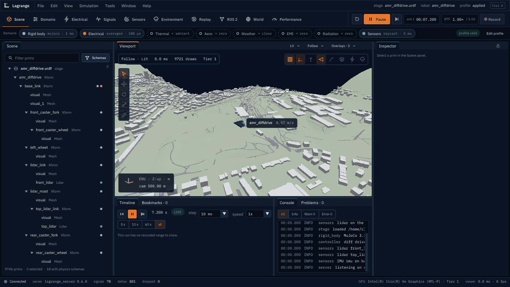

# Lagrange v0.7.0: huge worlds (release notes)

v0.6 put cars on a city block. v0.7 makes the world large: a world streamed in tiles around
the robot, a floating origin that follows the robot as it drives, robots kilometres apart in
regions of their own, and worlds built from open data (an elevation model, OpenStreetMap, 3D
Tiles), with terrain as height fields.

**Status:** released on 2026-10-29 as `v0.7.0`, under the owner's standing request to release
each version when its work is done.

  
   The 40 km sample around Zurich. Terrain produced using Copernicus WorldDEM-30 © DLR e.V.
  2010-2014 and © Airbus Defence and Space GmbH 2014-2018 provided under COPERNICUS by the
  European Union and ESA; all rights reserved. Buildings and roads © OpenStreetMap contributors
  (ODbL).

## Highlights

- **Floating origin during the run** (huge-worlds.md §1.4).
  - Past 1000 m from the region origin, the server moves the origin to the robot's whole-metre
    position between two steps.
  - The world tables are shifted, the run is rebuilt, and its state is carried over through
    `IModule::shiftOrigin` (MuJoCo, Jolt, the multicopter controller, ArduPilot).
  - Fields load into the region frame.
  - The viewer keeps its camera on the same place, ROS `/odom` and TF stay continuous, and
    recordings store each new frame.
- **Tile streaming** (§2.1).
  - `WorldTileAPI_1` (new `world` schema library) marks a prim as a tile whose payload holds
    its content.
  - Tiles are selected by level of detail, with collision tiles near the robot, coarse tiles
    kept until their replacements are loaded, hysteresis, deterministic mode and memory
    budgets.
  - Tiles load on worker threads. The robot never drives where physics has no ground yet.
  - Profile keys: `world.streaming.load_radius`, `unload_radius` and `collision_radius`.
  - Sample: `assets/worlds/tiled_town`.
- **Active regions** (§3.1).
  - `--add-robot NAME=FILE@X,Y` puts more robots in a run.
  - `server::RegionHost` runs robots far apart in separate runs, each with its own origin,
    physics and tiles.
- **Worlds from open data** (§4.1, new package `lagrange_geospatial`).
  - `lagrange_build_world` builds terrain from elevation rasters through GDAL and PROJ. The
    vertical datum must be given, never guessed.
  - Buildings and roads come from OpenStreetMap, and 3D Tiles can be added for show.
  - Each world gets an `ATTRIBUTION.md`.
  - `tools/ci/build_sample_world.sh` builds the 40 km Zurich sample from the Copernicus DEM
    and OpenStreetMap.
- **Height field terrain.**
  - New `ShapeType::HeightField`: MuJoCo `hfield`, Jolt `HeightFieldShape`, exact CPU lidar and
    radar casts, the viewer's collision shading, and USD.
  - The Zurich sample loads in 1.4 s, against 57 s with terrain as prisms.
- **World workspace.**
  - Shows the loaded tiles by level of detail, the floating origin, the georeference and the
    streaming statistics.
  - The viewer's camera is a streaming hint (`SetCameraInterest`).
- **Python:** `spawn=`, `region_origin()`, `colliders()`, `sample_tiled_town()`.
- **Docs:** the huge-worlds tutorial (`docs/guide/tutorial-huge-worlds.md`, run by
  `tools/ci/tutorial_huge_worlds.sh`).

## Acceptance (roadmap §8)

| Epic | Acceptance | Status | Evidence |
|---|---|---|---|
| Tile streaming | `huge-worlds.md` §6 | partly met | The 40 km sample streams (1700 tiles, 1.4 s load); a robot never enters a tile not in physics (`TileSelector.ARobotMayNotEnterATileThatIsNotLoaded`, the server's hold); deterministic tile selection (`Streaming.TheTilesAroundTheRobotAreLoadedAndTheRunIsDeterministic`: equal state hashes). Memory budgets are in the selector (`TheBudgetKeepsTheTilesARobotNeeds`) but no profile key sets them yet; the viewer's frame time while tiles load was not measured |
| Active regions | Multi-robot test with robots 10 km apart | met (static regions) | `Regions.RobotsTenKilometresApartRunInTheirOwnRegions`: the robot 10 km out drives exactly as one alone at the origin. Owed: moving robots between regions while running, agent levels of detail |
| Geospatial pipeline | Sample 40 km world built by CI from open data | met, locally | `tools/ci/build_sample_world.sh` (Copernicus DEM GLO-30 and OpenStreetMap; licences read and recorded in `dependencies.md`); GitHub Actions are disabled, so it ran locally |
| Renderer scale | Frame budget during streaming | not done | The viewer receives each tile change as a full snapshot; per-tile acceleration structures and instancing are owed. The GPU lidar does not see height fields yet |
| Protocol additions | No protocol major change | met | `LocalFrame.region_enu`, `SetCameraInterest`, the recordings' `/lagrange/scene/frame` channel; the protocol stays `v1`. Incremental tile deltas in `SceneDelta` are owed |

## Known issues

- **A tile change rebuilds the run.** That takes about a second for the Zurich sample, and the
  run waits meanwhile. MuJoCo's spec API names meshes in quadratic time, so worlds with many
  hull colliders near the robot load slowly.
- **Not followed or not read:**
  - external 3D Tiles tilesets;
  - OSM multipolygon relations;
  - OSM PBF (libosmium is not used yet).
- **Third-party plugins (C ABI) are not told about a rebase.**
- **Radiation** stays a zero substitute (post-1.0, the owner's decision of 2026-10-29).
- **From earlier releases:** Jolt's drive-wheel slip, Nav2's occasional start-up discovery
  failure, rotor strobing in the viewer.
- **Not run while GitHub Actions are disabled:** the sanitizer builds and the nightly jobs.
  Everything else was verified locally with colcon: 996 tests, 0 failures, and the four
  tutorial scripts and the sample-world script pass.

## Release checklist

- [x] Every v0.7 epic done, partly done or owed, with evidence above
- [x] Release notes
- [x] Gated changes merged under the v0.7 mandate and listed for review (`progress.md`)
- [ ] Owner review of those merges (`world` schemas, `LocalFrame.region_enu`, `SetCameraInterest`)
- [ ] GitHub Actions re-enabled and green on `dev`
- [x] Released: `dev` merged into `main` and tagged `v0.7.0` on 2026-10-29
