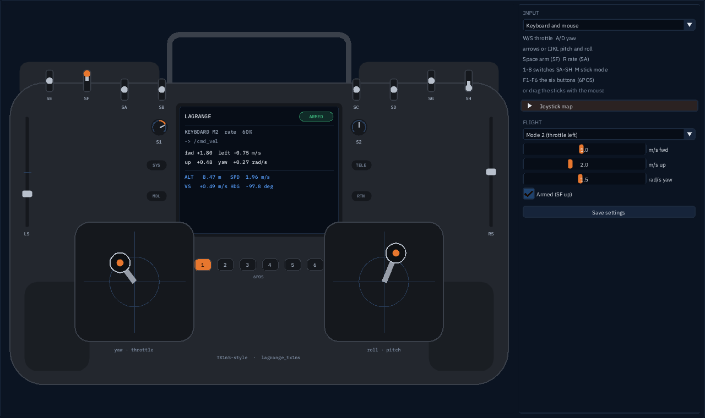

# lagrange_tx16s: a TX16S-style remote

A window that looks and works like a RadioMaster TX16S. Fly any robot that takes `/cmd_vel` with
it: from a real TX16S plugged in by USB, or from the keyboard and mouse. The radio's screen shows
what it sends and the robot's telemetry from `/odom`.



```bash
ros2 run lagrange_tx16s lagrange_tx16s                       # or:
ros2 launch lagrange_tx16s tx16s.launch.py mode:=2 topic:=/cmd_vel
ros2 launch lagrange_example_holybro teleop.launch.py        # the Holybro, with this remote
```

## What it sends

| Topic | Type | When |
|---|---|---|
| `/cmd_vel` (`topic`) | `geometry_msgs/TwistStamped` (`stamped:=false`: `Twist`) | 50 times a second while armed; one zero command when disarmed, then nothing |
| `/tx16s/joy` | `sensor_msgs/Joy` | always, 50 times a second: axes = the 17 controls (roll, pitch, throttle, yaw, SA–SH, S1, S2, LS, RS, 6POS), −1 to +1; buttons = SA–SH each at its top position, then the six buttons, the lit one 1 |

`/cmd_vel` is what Lagrange's built-in controllers take: forward and left (m/s, in the robot's
heading), up (m/s) and yaw rate (rad/s, counter-clockwise). A drone run with `--no-demo` waits
on the ground until it is told to climb.

| Control | Gives |
|---|---|
| right stick up/down (pitch) | `linear.x`, up is forward |
| right stick left/right (roll) | `linear.y`, right is to the right (−y) |
| left stick up/down (throttle) | `linear.z`, up climbs; the centre holds the height |
| left stick left/right (yaw) | `angular.z`, right turns clockwise |
| SF | arm: up is armed |
| SA | rate: down 30 %, middle 60 %, up 100 % of full stick |
| buttons 1–6 (6POS) | nothing in `/cmd_vel`: one position of six in `/tx16s/joy`, for your own flight modes |

At full stick and full rate: 5 m/s, 2 m/s up and 1.5 rad/s, the limits of Lagrange's
multicopter controller (`max_horizontal`, `max_vertical`, `max_yaw_rate`). Mode 2 (throttle on
the left) by default; `mode:=1` or `M` swaps throttle and pitch.

## From the keyboard

Click the window so it has the keyboard.

| Key | Does |
|---|---|
| `Space` | arm and disarm (SF) |
| `W` / `S` | throttle: climb / descend |
| `A` / `D` | yaw: turn left / right |
| `↑` `↓` `←` `→` or `I` `K` `J` `L` | pitch and roll: forward, back, left, right |
| `R` | rate (SA) |
| `1` to `8` | switches SA to SH |
| `F1` to `F6` | the six buttons under the screen (6POS): the one pressed stays lit |
| `M` | stick mode 1 or 2 |
| `Esc` | disarm at once |

A held key pushes its stick to the end in about a third of a second; let go and it springs back
to the centre, the throttle too. The mouse drags the sticks, pots and sliders and clicks the
switches and the six buttons.

## From a real TX16S

1. Plug the radio into the computer by USB-C, with the radio on. EdgeTX asks what the USB
   connection is for: pick **USB Joystick (HID)**. (TODO(verify): the menu's wording on your
   EdgeTX version; on EdgeTX 2.8 and later it is in RADIO SETUP → USB mode as well.)
2. In the model you fly with, give the channels this order (the default map):

   | Channel | 1 | 2 | 3 | 4 | 5 | 6 | 7 | 8 |
   |---|---|---|---|---|---|---|---|---|
   | Source | Ail | Ele | Thr | Rud | SF | SA | SB | SC |

3. Start the remote. Its panel shows the radio's name and a bar per axis. Move each stick and
   switch and check the right bar moves the right way (to use the six buttons from the radio,
   give the 6POS one of channels 1–8 in EdgeTX's mixer, say 8 instead of SC, and pick that axis
   for `six_pos`: in classic mode only channels 1–8 are axes, TODO(verify)); if one is on another
   axis, or backwards,
   open **Joystick map**, pick its axis or tick **inv**, and press **Save settings**.

EdgeTX's "classic" joystick mode puts channels 1 to 8 on the HID axes X, Y, Z, Rx, Ry, Rz,
slider and dial, which SDL numbers 0 to 7. TODO(verify): this axis order with a real TX16S; it
has been checked here only with SDL's virtual joystick (`test_joystick`), not with a radio.

A real throttle stick does not spring back. Its centre means "hold the height", so before you
arm, put it in the middle; below the middle the drone descends (on the ground, it stays down).

## Settings

**Save settings** writes `~/.config/lagrange/tx16s.yaml` (`$XDG_CONFIG_HOME`), a ROS parameter
file the remote reads at start. Parameters on the command line still win over it.

| Parameter | Default | |
|---|---|---|
| `mode` | 2 | stick mode, 1 or 2 |
| `topic` | `/cmd_vel` | where the command goes |
| `stamped` | true | `TwistStamped`; false: `Twist` (`--cmd-vel-unstamped` on the server) |
| `frame_id` | `base_link` | the command's header frame |
| `odom_topic` | `/odom` | the telemetry |
| `max_horizontal`, `max_vertical`, `max_yaw_rate` | 5.0, 2.0, 1.5 | at full stick, full rate |
| `map.<control>.axis`, `map.<control>.invert` | the table above | the joystick map; controls: roll, pitch, throttle, yaw, SA to SH, S1, S2, LS, RS, six_pos |
| `map.deadband` | 0.03 | of full scale, round the sticks' centres |

## Headless

`--headless --frames N --screenshot FILE.bmp` draws N frames with no window and saves the last;
`--demo` arms it and holds the sticks part way. That is how the picture above was made.

## How it is built

- `include/lagrange/tx16s/Radio.hpp`, `src/Radio.cpp`: the radio's model, with no SDL, ImGui or
  ROS (sticks, switches, keyboard springs, the joystick map, the command). `test/test_radio.cpp`.
- `src/RemoteUi.cpp`: the radio and the panel, drawn with Dear ImGui in the viewer's theme
  (`lagrange_viewer`'s `lagrange_theme.hpp` and IBM Plex fonts).
- `src/main.cpp`: SDL3's window, renderer, keyboard and joystick; the ROS node.
- `test/test_joystick.cpp`: a virtual 8-axis joystick through SDL and the default map.
